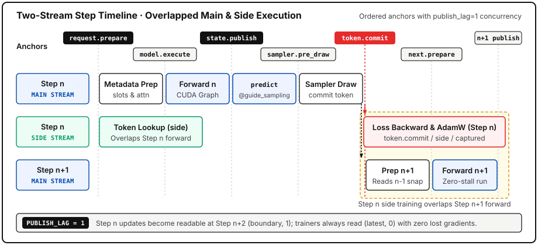
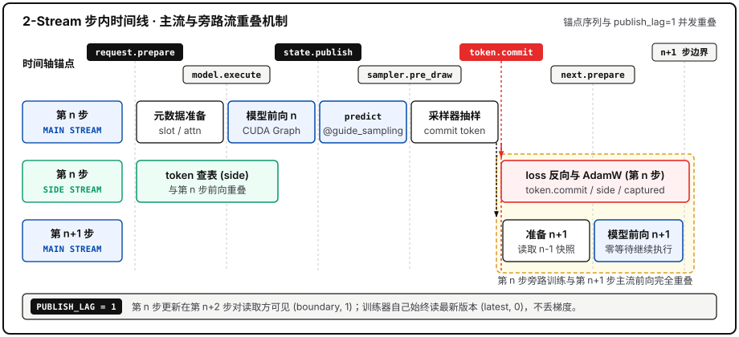

<link rel="stylesheet" href="{{ '/assets/css/pllm-hub.css' | relative_url | bust_file_cache }}">

<div class="zine-dispatch" data-title-zh="核心概念" data-title-en="Core Concepts" data-desc-zh="pLLM 文档 · 架构与机制解析" data-desc-en="pLLM Documentation · Architecture &amp; Design Explanations">
  <div class="zine-dispatch-links">
    <a class="zine-pill-link primary" data-i18n-zh="← 返回 pLLM 文档中心" data-i18n-en="← pLLM Docs Hub" href="/pllm/#docs">← pLLM Docs Hub</a>
    <a class="zine-pill-link" data-i18n-zh="文档导航地图" data-i18n-en="Docs Roadmap" href="/pllm/docs/">Docs Roadmap</a>
    <span class="zine-lang-badge" data-i18n-zh="架构与机制解析" data-i18n-en="Architecture &amp; Design Explanations">Architecture &amp; Design Explanations</span>
  </div>
  <a class="zine-pill-link" data-i18n-zh="GitHub 源码 ↗" data-i18n-en="View on GitHub ↗" href="https://github.com/LinesHogan/pLLM/blob/main/doc/explain/core-concepts.md" target="_blank" rel="noopener">View on GitHub ↗</a>
</div>

<div id="markdown-content">

<div class="zine-lang-panel" data-lang-panel="en" lang="en" markdown="1">

<div id="en-core-concepts"></div>

After running through one or two tutorials (such as [00 Quickstart](/pllm/docs/tutorials/00_quickstart/) or [03 Decode-Time Training](/pllm/docs/tutorials/03_decode_training/)), you may notice that writing algorithms in pLLM feels very different from attaching PyTorch forward hooks to Hugging Face `generate`. Inputs are declared as default parameter values (input markers), methods cannot call `.item()` or branch in Python on tensor values, reductions are restricted to the last dimension (`dim=-1`), and parameters trained on step $$n$$ become readable by default one step later, on step $$n+2$$.

These rules are not arbitrary syntax restrictions. They follow directly from two physical mechanisms at the heart of modern inference engines: **continuous batching** and **asynchronous CUDA Graph execution**. Understanding the five core concepts below—why declarations replace hooks, what a "row" is, the single-step timeline and stream overlap, versioned state publishing, and why invalid combinations are rejected at build time—lets you see the reason behind every rule and predict a workload's behavior and cost before running it.

---

## 1. Why Not Hooks: Continuous Batching & CUDA Graphs {#en-sec-1}

### The Real Problem in a Serving Engine {#en-the-real-problem-in-a-serving-engine}

In a single-request prototype, reading or modifying layer 12 activations takes five lines with `register_forward_hook`. Drop that same logic into a vLLM serving engine, however, and you immediately hit two walls:

1. **No Python code runs during CUDA Graph replay**: During autoregressive decoding, each step generates only 1 token per concurrent request, so individual kernels are very short. To eliminate the CPU overhead of launching kernels one by one from Python, vLLM captures the entire model forward pass into a CUDA Graph and launches the whole graph with a single replay call per step. (Falling back to eager mode by disabling CUDA graphs imposes a penalty proportional to step duration: at concurrency 128 on an RTX 4090, a ~3 ms 0.5B step drops to 49% of graph-mode throughput, whereas a ~21.7 ms 7B step still reaches 98%; see [Performance & Memory](/pllm/docs/explain/performance/).) During graph replay, the Python interpreter is completely out of the loop—Python hooks registered on modules never fire.
2. **Packed tensors have no request identity, and Python branches force host syncs**: Even in eager mode, continuous batching packs tokens from dozens of concurrent requests into a single 2D tensor. A plain module hook receives that packed tensor with no idea which row belongs to which request or which row is the final token of a newly finished prompt. Worse, writing `if h.norm() > 1:` or `print(h.item())` inside a hook forces the CPU to stall until the GPU finishes all queued kernels and copies the value back to host memory (host sync), draining the GPU pipeline and breaking CUDA Graph capture.

### The pLLM Approach: Declare Once, Trace Statically, Capture the Whole Graph {#en-the-pllm-approach-declare-once-trace-statically-capture-the-whole-graph}

pLLM replaces runtime callbacks with **declarations + pure tensor math**. Your `pllm.Workload` subclass declares only three things (see [Workload Anatomy](/pllm/docs/guides/workload-anatomy/)):

- **What to read**: written as parameter defaults (such as `pllm.hidden(0)`, `pllm.residual(12)`, `pllm.parameter("distiller", "w")`);
- **What state to own**: written as class attributes or type-annotated `@property` definitions (such as `pllm.RequestState`, `pllm.InstanceState`);
- **Where results go**: written as method decorators or model-site declarations (such as `@pllm.train`, `@pllm.guide_sampling`, `@pllm.export`, `pllm.model.ActivationPatch`).

When creating the engine (`pllm.make_llm`) or inspecting the execution plan ([`pllm.explain`](/pllm/docs/guides/explain/)), pLLM reads these declarations once at startup, traces each method on CPU using PyTorch `meta` tensors to compute every intermediate shape, memory lifetime, and dependency, and then compiles and captures your tensor math—including autograd backward passes and `AdamW` / `SGD` updates—directly into CUDA Graphs.

```python
from dataclasses import dataclass

import torch
from torch import nn

import pllm
from pllm import testing


@dataclass(frozen=True)
class Distill(pllm.Workload):
    beta: float = 0.5

    distiller = pllm.RequestState(
        init=pllm.FromModule(
            lambda m: nn.Sequential(nn.Linear(m.hidden_size, 4), nn.Linear(4, m.hidden_size))
        ),
        optimizer=pllm.AdamW(1e-3),
    )

    @pllm.train(state="distiller")
    def loss(
        self,
        shallow: torch.Tensor = pllm.hidden(0),
        deep: torch.Tensor = pllm.hidden(-1),
        f: nn.Module = pllm.module("distiller"),
    ) -> torch.Tensor:
        return (f(shallow.float()) - deep.float()).square().mean(-1)

    def strength(self) -> float:
        return self.beta

    @pllm.guide_sampling(beta=strength)
    def predict(
        self,
        shallow: torch.Tensor = pllm.hidden(0),
        f: nn.Module = pllm.module("distiller"),
    ) -> torch.Tensor:
        return f(shallow.float())


CONFIG = pllm.ModelConfig("Qwen/Qwen2.5-0.5B-Instruct", max_num_seqs=8)
print(pllm.explain(Distill(), CONFIG))
```

`pllm.explain` completes tracing and planning on CPU and produces an excerpt like:

```text
forward  CUDA graphs: no effect needs eager
member  effect  anchor / lane / graph  state reads (origin, distance)
loss  train  token.commit / side / captured  distiller (latest, 0)
predict  guide_sampling  state.publish / main / captured  distiller (boundary, 1)
state  scope  bytes/root  reserved bytes [exact; state_page_budget_bytes]
distiller  request  96832  1807536  field 0: float32 x 24 pages, field 1: float32 x 16 pages, ...
host     0 syncs in traced workload math; exports: none
timing   publish_lag=1 (default): updates at step n become readable at n + 2; training may overlap later forwards
```

### What This Means for Your Code {#en-what-this-means-for-your-code}

All four method-body rules (no cross-row math, read-only inputs, no host syncs or value-dependent Python branches, no mutable state stored on `self`) follow directly from this: methods are traced once with `meta` tensors at build time and replayed as CUDA graphs at runtime. See [Workload Anatomy: What to Write in Method Bodies](/pllm/docs/guides/workload-anatomy/) for the exact rules, examples, and fixes.

---

## 2. Rows: Dynamically Packed Requests & the Isolation Contract {#en-sec-2}

### The Real Problem in a Serving Engine {#en-the-real-problem-in-a-serving-engine-1}

In offline batching, row `i` of a batch tensor is always example `i`. In a continuous-batching engine, a single engine step mixes requests at different lifecycle stages:

- **decode** requests generating one token at a time;
- newly arrived **prefill** requests (with chunked prefill enabled, a long prompt is split into chunks across multiple steps);
- requests temporarily **preempted** due to KV cache pressure whose history is later recomputed.

At every step, the scheduler packs the currently active tokens contiguously along dimension 0. **Row ordering is chosen by the scheduler, changes on every step, and is outside your control.**

### What a "Row" Means in pLLM {#en-what-a-row-means-in-pllm}

In every row-aligned tensor passed to a workload method, dimension 0 is always the **row axis (`[rows, ...]`)**. pLLM handles row selection and state alignment underneath: whenever you read a `pllm.RequestState` (via `pllm.parameter` or `pllm.module`), row `r` of the parameter tensor is guaranteed to belong to the exact same request as row `r` of the activation tensor.

Which token each row corresponds to depends on the input marker you declare (see [Reading Model Internals](/pllm/docs/guides/reading/)):

| Input Marker or Method Type | Meaning of Each Row Along Dimension 0 (`rows`) |
| :--- | :--- |
| `pllm.hidden`, `pllm.residual`, `pllm.final_hidden` (default `tokens="decode"`) | **1 row** per request currently in decode (that request's latest generated decode token) |
| Same markers with `tokens="prefill"` | **1 row** per request finishing its full prompt prefill on this step (the final token of that prompt; even for chunked prompts, it appears only once, on the completion step) |
| `pllm.layer_logits`, `@pllm.add_logits`, `@pllm.guide_sampling` | **1 row** per token being sampled on this step (each prompt's final token upon prefill completion, plus every decode token) |
| Activation markers above with `tokens="all"` (`@pllm.export` only) | **1 row** for **every token** newly computed on this step (including intermediate chunks of a prompt), ordered by in-request position; tokens recomputed after preemption are exported only once |

### What This Means for Your Code {#en-what-this-means-for-your-code-1}

A request's result must never depend on which other requests happen to be packed alongside it on a given step. Methods therefore operate along the feature dimension (`dim=-1`), and per-row training returns a `[rows]` loss vector that pLLM reduces per state. See [What to Write in Method Bodies](/pllm/docs/guides/workload-anatomy/) for the rules. On CPU, [`pllm.testing.check`](/pllm/docs/guides/checking/) permutes row order, alters co-batched requests, chunks prompts, and simulates preemption to verify that every request produces identical results.

---

## 3. Timeline: Anchors, Phase Windows & Main/Side Lanes {#en-sec-3}

### The Real Problem in a Serving Engine {#en-the-real-problem-in-a-serving-engine-2}

Within a single decode step, different pieces of data become available at different moments: input token IDs are known before the model forward pass; layer hidden states exist only after the forward pass finishes; and newly sampled tokens exist only after the sampler runs. Meanwhile, serializing external table lookups, backward passes, and optimizer steps onto the same CUDA stream as the model forward pass forces every step's forward to wait on them, dragging down throughput.

### The Step Timeline: Anchors and Phase Windows (`pllm.Phase`) {#en-the-step-timeline-anchors-and-phase-windows-pllmphase}

pLLM divides each engine step into an ordered sequence of timeline **anchors**. When `pllm.explain` prints `token.commit / side / captured` in the `member` column, the first item is the anchor to which the task is attached:

1. `request.prepare`: step begins; active request slots and historical input tokens (`pllm.input_tokens`) are ready.
2. `model.execute`: the base model runs its forward pass (`ActivationPatch`, `Adapter`, `@pllm.custom_residual`, `@pllm.custom_attention`, `@pllm.train_in_forward`, and `@pllm.custom_forward` execute here).
3. `state.publish`: model forward completes; layer activations (`pllm.hidden`, `pllm.residual`, `pllm.final_hidden`) and state versions published at the forward boundary are ready.
4. `sampler.pre_draw`: pre-sampling logit biases (`@pllm.add_logits`) and guidance predictions (`@pllm.guide_sampling`) are ready and fed into the sampler.
5. `sampler.complete`: the sampler finishes drawing tokens.
6. `token.commit`: tokens drawn on this step (`pllm.sampled_tokens`) and unmodified base distributions (`pllm.base_logits`) are committed.
7. `request.finish` → `next.prepare`: finished requests retire and their slots are reclaimed; the engine prepares the next step.

Each interval between two anchors defines a **phase window (`pllm.Phase`)**. Every effect decorator has its own default phase window, and the planner automatically places each method where its inputs are ready and its outputs arrive before consumers need them. You only need `@pllm.on(phase)` when writing helper methods without an effect decorator or when overriding default timing:

| `pllm.Phase` Enum | Anchor Interval | Effects & Computations Running Here by Default |
| :--- | :--- | :--- |
| `Phase.BEFORE_FORWARD` | `request.prepare` → `model.execute` | Lookup computations depending only on `pllm.input_tokens` and read-only state |
| `Phase.IN_FORWARD` | `model.execute` → `state.publish` | `@pllm.train_in_forward` (plus in-model patches, adapters, residual edits, and attention rewrites) |
| `Phase.AFTER_FORWARD` | `state.publish` → `sampler.pre_draw` | `@pllm.export` (exports after forward completes by default) |
| `Phase.BEFORE_SAMPLE` | `model.execute` → `sampler.pre_draw` | `@pllm.add_logits`, `@pllm.guide_sampling` |
| `Phase.AFTER_SAMPLE` | `token.commit` → `next.prepare` | Per-request-row `@pllm.train`, host-batch `@pllm.train` |
| `Phase.AUTOMATIC` | `request.prepare` → `next.prepare` | Default declared window for `@pllm.write` and `@pllm.train` (placed automatically by the planner from dependencies) |

### Overlapping the Main Stream (`main`) and Side Stream (`side`) {#en-overlapping-the-main-stream-main-and-side-stream-side}

Besides choosing the anchor, the planner assigns each task an execution `lane`:

- **`main` (main stream)**: the primary CUDA stream running the model forward (`model.execute`) and sampler, plus any task whose results must finish before this step's sampling (such as `predict` in `Distill` from Section 1).
- **`side` (side stream)**: an auxiliary CUDA stream running concurrently with `main`. Whenever a task does not block the current step's sampling, the planner puts it on `side` to overlap with main-stream execution:
  - Lookup methods that read only `pllm.input_tokens` and read-only tables launch at `request.prepare / side`, overlapping with the **current step's** model forward;
  - Per-request online training (such as `loss` in `Distill`) launches at `token.commit / side`, overlapping with the **next step's** model forward.

Using the `Distill` workload from Section 1 (augmented with a read-only token-lookup helper), two consecutive decode steps execute across the two streams as follows:

{: style="display: block; max-width: 100%; height: auto; margin: 1.5rem auto;" }

### What This Means for Your Code {#en-what-this-means-for-your-code-2}

A value can only be read in the phase that produces it or later: sampling outcomes are available only to `@pllm.train` or `AFTER_SAMPLE` methods; to read logits before sampling, use `pllm.layer_logits((-1,))` (see [When Methods Run](/pllm/docs/guides/workload-anatomy/#en-when-methods-run)). Factoring computations that depend only on tokens and read-only tables into a separate helper method lets the planner schedule them at the start of the step to overlap with the forward pass (see [Performance & Memory](/pllm/docs/explain/performance/)).

---

## 4. State & Versions: Immutable Snapshots & `publish_lag` {#en-sec-4}

### The Real Problem in a Serving Engine {#en-the-real-problem-in-a-serving-engine-3}

When hundreds of requests generate concurrently while online training or external imports continuously mutate parameters, two concurrency issues arise:

1. **Who shares which copy of a parameter?** Some parameters are engine-wide (static steering vectors, global lookup tables), some belong to each request individually (per-request online distillers or LoRAs), and others must be shared across $$n$$ sampled completions of the same prompt or persisted by session route across multiple `generate` calls.
2. **Read/write hazards and mid-stream tearing**: If an optimizer on the side stream mutates a weight tensor in place while the next forward pass on the main stream reads it, the model observes half-written weights. Likewise, if a new request imports a new steering vector via `generate` and overwrites a global buffer in place, older in-flight requests have their parameters swapped out mid-sentence.

### Scopes, Immutable Versions, and In-Flight Isolation {#en-scopes-immutable-versions-and-in-flight-isolation}

In pLLM, **State is the only mutable construct** (see [State](/pllm/docs/guides/state/)).

First, you declare the ownership scope of each state copy via the state type and `key_fields`:

- **`pllm.InstanceState`**: one logical state shared across the entire engine.
- **`pllm.RequestState`**: independent state copies partitioned by `key_fields`:
  - Default `key_fields=("request_id",)`: one private copy per request, initialized on request admission and reclaimed when generation finishes;
  - `key_fields=("prompt_index",)`: shared across all $$n$$ sampled sequences from the same prompt;
  - `key_fields=("route",)`: shared by requests passing the same routing key to `generate(..., routes=(...))`, persisting across multiple `generate` calls until the engine shuts down.

Second, **state updates never overwrite a buffer under a reader's feet—they publish a new Version**. Whether via `@pllm.train` optimizer updates, `@pllm.write` tensor writes, `pllm.io.StateImport`, or cross-process `llm.feed`, every update writes to a fresh copy and atomically publishes it as a new version at a window boundary.

A method reading state locks onto a published version at the start of its window, so:

- **Readers never observe torn, half-written tensors**;
- **In-flight requests keep the version they started with**: recall the `Steering` workload in [00 Quickstart](/pllm/docs/tutorials/00_quickstart/), which declares `steer = pllm.InstanceState(..., init=pllm.Imported())` and `pllm.model.ActivationPatch("steer", layers=(12,), operator="add", decode=True)`. Each `llm.generate(prompts, greedy, batch=pllm.io.StateImport((strength * vector,)))` call publishes a new version of `steer`; requests admitted by that call bind to the new version, while already-running requests continue reading the version captured at their own admission (`ActivationPatch` defaults to `refresh="admission"`; it only switches to the latest version every decode step if you explicitly set `refresh="step"`).

### `publish_lag`: Why Updates Become Visible One Step Later by Default {#en-publish_lag-why-updates-become-visible-one-step-later-by-default}

Understanding versions and the side stream explains these two lines in the `pllm.explain` output from Section 1:

```text
loss     train           token.commit / side / captured   distiller (latest, 0)
predict  guide_sampling  state.publish / main / captured  distiller (boundary, 1)
timing   publish_lag=1 (default): updates at step n become readable at n + 2; training may overlap later forwards
```

In online distillation (ESamp, [03 Decode-Time Training](/pllm/docs/tutorials/03_decode_training/)), the training method `loss` on step $$n$$ starts after `token.commit` and must complete its forward, backward, and `AdamW` update on the `side` stream.

- Requiring `predict` on step $$n+1$$ to immediately read the weights trained on step $$n$$ (`publish_lag=0`) forces the main stream on step $$n+1$$ to stall until step $$n$$'s training finishes, serializing training and inference.
- pLLM defaults to **`publish_lag=1`**: updates computed on step $$n$$ become visible to other readers on step **$$n+2$$**. While step $$n$$'s training runs on `side`, step $$n+1$$'s main stream immediately reads the version already published at step $$n-1$$ (`boundary, 1`, distance 1 from latest) without waiting. Meanwhile, the training task itself always iterates on the latest version (`latest, 0`, distance 0), never dropping a single gradient step (see [Online Training](/pllm/docs/guides/training/)).
- Because both the new version being written on `side` and the older version being read on `main` must reside in VRAM simultaneously, pLLM reserves more pages per state than `max_num_seqs` (shown as `x N pages` on the `state` line of `explain`: at `max_num_seqs=8`, `Distill` reserves 24 pages for the parameter field, while `AdamW` step and moment fields are read only by training itself—no older versions retained—so they reserve 16 pages each). Larger `publish_lag` keeps more concurrent versions alive and increases parameter-field page reservations.

### What This Means for Your Code {#en-what-this-means-for-your-code-3}

`pllm.version(state)` tells a method how many times a state has been updated, so untrained requests can fall back to unmodified sampling. When an algorithm strictly requires seeing updates on the very next step, set `ExecutionOptions(publish_lag=0)`, trading away overlap between training and the next forward pass. See [Online Training](/pllm/docs/guides/training/) for usage.

---

## 5. Why Boundaries Exist: Build-Time Rejection & Explicit Costs {#en-sec-5}

### The Real Problem in a Serving Engine {#en-the-real-problem-in-a-serving-engine-4}

In research scripts, when two modules combine ambiguously or a tensor exceeds available VRAM, tools often "silently fall back to a slow path" (disabling graph capture, silently spilling tensors to CPU RAM, or overwriting in some implicit order). In a serving engine, silent fallbacks are disastrous: the code appears to run, yet either throughput collapses unnoticed or gradients become zero and the algorithm quietly stops working.

### pLLM's Principle: Validate at Build Time, Make Expensive Choices Explicit {#en-pllms-principle-validate-at-build-time-make-expensive-choices-explicit}

pLLM treats workload compilation as static verification (see [Composition Rules](/pllm/docs/reference/composition-rules/) and [Error Catalog](/pllm/docs/reference/errors/)):

1. **Reject illegal or ambiguous combinations before touching a GPU**: `pllm.explain` and `pllm.make_llm` enforce the exact same admission rules. Whenever declarations conflict or have undefined semantics, build time raises an error immediately with the reason and fix rather than silently taking another path. The sole automatic fallback is CUDA graph capture: under the default `cuda_graphs="auto"`, a few constructs that cannot enter the whole-model graph drop the model to eager mode, with the reason recorded on `explain`'s `forward` line and in `llm.diagnostics().eager_reason`; setting `ModelConfig(cuda_graphs=True)` turns that into a hard error.
2. **Defaults only make cheap, local decisions**: For example, the default `dtype="auto"` selects precision by field role—parameters updated by an optimizer or read-modify-write accumulators use `torch.float32` (preventing small-gradient underflow and long-sequence drift), while read-only fields match the model's `bfloat16`/`float16` precision (cutting memory capacity and bandwidth in half).
3. **Expensive tradeoffs must be declared explicitly, and `explain` itemizes the bill**:
   - Placing large read-only lookup tables in host RAM (`pllm.Pretrained(path, placement="host")`) vs. VRAM (default `"device"`, never silently spilled to host);
   - Changing `@pllm.custom_attention` physical KV retention (`keep="window"`, `sink=True`, or cross-layer sharing `keep="none", source=k`);
   - Disabling cross-step overlap (`publish_lag=0`) or requiring exact intra-forward cross-chunk visibility (`@pllm.train_in_forward(visibility="exact")`);
   - Memory budget knobs (`state_page_budget_bytes`, `execution_peak_budget_bytes`, `cuda_graph_pool_budget_bytes` on `ExecutionOptions`): when `execution_peak_budget_bytes` falls between the side-overlap peak and the inline floor, `explain`'s `memory` line states the threshold and gracefully degrades side tasks to inline main-stream execution; dropping below the inline floor or graph-pool budget raises an error with exact required bytes, never silently disabling CUDA graphs.

### Four Canonical Boundaries and Why They Exist {#en-four-canonical-boundaries-and-why-they-exist}

These four examples illustrate why pLLM rejects certain patterns at build time and the math or mechanics behind each boundary (for broader discussion of unsupported algorithm families, see [Design Tradeoffs](/pllm/docs/explain/design-tradeoffs/); for authoring patterns, see [Model Edits](/pllm/docs/guides/model-edits/) and [Customizing Forward Structure](/pllm/docs/guides/forward-structure/)):

| Rejected Pattern | Build-Time Error (Excerpt) | Why the Boundary Exists / How to Fix |
| :--- | :--- | :--- |
| Declaring two `@pllm.guide_sampling` methods in one workload (including subcomponents) | `... and ... both declare @pllm.guide_sampling; keep at most one guidance method` | Multiple `@pllm.add_logits` contributions simply add biases to the vocabulary before filtering; addition is commutative, so any number can coexist. `@pllm.guide_sampling` projects a hidden-state prediction to the vocabulary and reweights the top-k/top-p filtered distribution via `(1 + beta) * logits - beta * pred_logits`, which the sampler performs once per step. Whether two predictions should be averaged, summed, or applied sequentially is an algorithmic choice pLLM refuses to guess: combine them into one returned prediction in a single method, or use `@pllm.add_logits` for additive vocabulary biases. |
| Reading `pllm.hidden` or `pllm.final_hidden` alongside `@pllm.custom_forward` | `... reads block or model outputs, which a @pllm.custom_forward does not produce; use pllm.residual or pllm.layer_logits to read each layer's last visited stream` | In a standard forward pass, every layer runs exactly once, so `pllm.hidden(L)` uniquely identifies layer `L`'s MLP output. Under `@pllm.custom_forward`, a layer may execute multiple times (looped depth) or be skipped (early exit), leaving "the unique output of layer `L`" undefined. Use `pllm.residual(layer)` or `pllm.layer_logits(...)` to read each layer's last-visited residual stream. |
| Passing an early-exit mask `active=` to `layers(...)` inside `@pllm.custom_forward(tokens="all")` | `Use @pllm.custom_forward(tokens="decode") for active=: skipped prompt tokens would leave approximate K/V that every later token reads. ...` | When a row exits early at layer $$L$$ and skips subsequent layers, pLLM backfills approximate K/V entries for the skipped layers. Skipping prompt tokens during prefill would leave approximate K/V across upper layers of the prompt that every subsequent decode token attends to. `active=` is therefore restricted to `tokens="decode"`, while prompts run the full model by default. |
| Leaving a trainable low-rank `pllm.model.Adapter(operator="low_rank")` with the default all-zero initializer | `...: add init=pllm.Computed(...) (e.g. random A, zero B); with both low_rank factors at zero every gradient is zero and the adapter never learns` | A low-rank adapter computes $$\text{scale} \cdot B A x$$. If both $$A$$ and $$B$$ start at zero, then during backprop $$\nabla_A \propto B^\top = 0$$ and $$\nabla_B \propto A^\top = 0$$; every gradient is identically zero and the adapter never updates. Supply `init=pllm.Computed(...)` initializing one factor (e.g., $$A$$) to small random values and the other ($$B$$) to zero. |

---

## Self-Check {#en-self-check}

1. **Why does writing `return h - h.mean(dim=0, keepdim=True)` in an `@pllm.export` method pass `pllm.explain` yet fail `pllm.testing.check`?**
   <details><summary>Answer</summary>
   <code>h.mean(dim=0, keepdim=True)</code> is still pure tensor math with valid shapes and no GPU-to-CPU synchronization, so it passes static shape and memory planning in <code>pllm.explain</code>. However, dimension 0 holds dynamically packed rows from concurrent requests; averaging along <code>dim=0</code> couples one request's output to whoever else happens to be in the same batch. <code>pllm.testing.check</code> catches this when altering co-batched requests and permuting row order, raising <code>ContractError: method ... mixes rows</code>. Reduce along the feature dimension instead: <code>h - h.mean(dim=-1, keepdim=True)</code>.
   </details>

2. **In the `Distill` workload, both `@pllm.train` and `@pllm.guide_sampling` read `"distiller"`, yet `pllm.explain` reports `(latest, 0)` for `loss` and `(boundary, 1)` for `predict`. Why?**
   <details><summary>Answer</summary>
   Under the default <code>publish_lag=1</code>, the side-stream training task launched at <code>token.commit</code> on step $$n$$ executes concurrently with step $$n+1$$'s main-stream forward pass. The guidance method <code>predict</code> on the main stream reads the version already published at the forward boundary (<code>boundary, 1</code>, computed on step $$n-1$$) so it does not stall waiting for step $$n$$'s backward pass and optimizer step. Meanwhile, the training task <code>loss</code> always iterates on the latest parameters (<code>latest, 0</code>) so every gradient update accumulates onto the newest state.
   </details>

3. **If you want to filter or rescale the model's original vocabulary distribution inside an `@pllm.add_logits` method, why can't you declare `logits: torch.Tensor = pllm.base_logits()`? What should you use instead?**
   <details><summary>Answer</summary>
   On the step timeline, <code>@pllm.add_logits</code> runs in <code>Phase.BEFORE_SAMPLE</code> (between <code>model.execute</code> and <code>sampler.pre_draw</code>) before sampling happens, whereas <code>pllm.base_logits()</code> is only committed at <code>token.commit</code> after sampling finishes for post-sample consumers such as <code>@pllm.train</code>. To read the final layer's logits before sampling, declare the parameter default as <code>logits: torch.Tensor = pllm.layer_logits((-1,))</code> (and take <code>logits[:, 0]</code>).
   </details>

---

## Where to Go Next {#en-where-to-go-next}

- Look up patterns by task: [State](/pllm/docs/guides/state/), [Reading Model Internals](/pllm/docs/guides/reading/), [Where Results Go](/pllm/docs/guides/results/), [Online Training](/pllm/docs/guides/training/), [Model Edits](/pllm/docs/guides/model-edits/), [Customizing Forward Structure](/pllm/docs/guides/forward-structure/)
- Read execution plans and memory bills on CPU: [Inspecting Costs: `pllm.explain`](/pllm/docs/guides/explain/)
- Verify correctness contracts on CPU and GPU: [Checking Correctness](/pllm/docs/guides/checking/)
- Review measured throughput and memory figures across mechanisms: [Performance & Memory](/pllm/docs/explain/performance/)
- Understand why certain algorithm families are outside scope: [Design Tradeoffs](/pllm/docs/explain/design-tradeoffs/)
- Further reading: [Standalone Technical Essays](/pllm/#blog) collects ten standalone deep dives on underlying mechanics, scheduling tradeoffs, and verification
- Look up exact definitions of all terms: [Glossary](/pllm/docs/reference/glossary/)

</div>

<div class="zine-lang-panel is-hidden" data-lang-panel="zh" lang="zh-CN" markdown="1">

<div id="zh-sec-1"></div>

跑通一两篇教程（如 [00 快速上手](/pllm/docs/tutorials/00_quickstart/) 或 [03 decode 时训练](/pllm/docs/tutorials/03_decode_training/)）之后，你可能会注意到：在 pLLM 里写算法和在 Hugging Face `generate` 里挂载 PyTorch forward hook 很不相同。输入要写成参数默认值的标记，方法里不能调用 `.item()` 或对张量值写 Python `if`，归约只能沿最后一维（`dim=-1`）进行，而每步训练算出的新参数默认要隔一步（在第 $$n+2$$ 步）才会被读到。

这些规则并不是随意规定的语法限制，而是由现代推理引擎的两项底层物理机制直接决定的：**连续批处理（continuous batching）**与 **CUDA Graph 异步执行**。理解下面五个核心概念——为什么用声明代替 hook、什么是“行”、一步推理的时间线与流重叠、状态如何按版本发布，以及为什么构建期会直接拒绝越界组合——你就能一眼看出每条规则背后的原因，并在写代码前预判负载的行为与开销。

---

## 1. 为什么不是 hook：连续批处理与 CUDA Graph {#zh-sec-2}

### 服务引擎里的真实问题 {#zh-sec-3}

在单请求实验代码里，读取或修改第 12 层的激活只需要五行 `register_forward_hook`。但把同样的逻辑放进 vLLM 服务引擎时，会立刻撞上两堵墙：

1. **CUDA Graph 回放期根本不执行 Python 代码**：在自回归解码（decode）阶段，GPU 每步只为每个并发请求生成 1 个 token，算子本身耗时极短。为了消除逐个从 Python 发射算子的 CPU 开销，vLLM 会把整个模型前向录制成一张 CUDA Graph，后续每步只向 GPU 发射一次图回放指令（关掉 CUDA Graph 退回 eager 模式后，发射开销的代价取决于一步有多长：在 RTX 4090、128 并发下，一步约 3 ms 的 0.5B 掉到图模式的 49%，一步约 21.7 ms 的 7B 仍有 98%，见 [性能与显存](/pllm/docs/explain/performance/)）。图回放期间，Python 解释器完全不参与层的执行，挂在模块上的 Python hook 根本不会被调用。
2. **打包张量没有请求身份，且 Python 分支会触发主机同步**：即便退回 eager 模式，连续批处理也会把几十个并发请求的 token 拼进同一个二维张量。普通模块 hook 只拿到这块拼好的张量，不知道哪一行属于哪个请求、哪一行是刚算完的 prompt 末尾。更糟的是，如果 hook 里写了 `if h.norm() > 1:` 或 `print(h.item())`，CPU 就必须停下来等待 GPU 把前面的算子全部算完並把数值拷回主机内存（host sync），直接打断 GPU 流水线，也让 CUDA Graph 无法录制。

### pLLM 的做法：一次声明、静态追踪、整图捕获 {#zh-sec-4}

pLLM 用**声明 + 纯张量数学**代替运行时回调。你编写的 `pllm.Workload` 子类只声明三件事（详见 [负载的组成](/pllm/docs/guides/workload-anatomy/)）：

- **读什么**：写在方法参数的默认值上（如 `pllm.hidden(0)`、`pllm.residual(12)`、`pllm.parameter("distiller", "w")`）；
- **拥有什么状态**：写成类属性或带类型注解的 `@property`（如 `pllm.RequestState`、`pllm.InstanceState`）；
- **结果去哪**：写成方法装饰器或模型位置声明（如 `@pllm.train`、`@pllm.guide_sampling`、`@pllm.export`、`pllm.model.ActivationPatch`）。

在创建引擎（`pllm.make_llm`）或查看执行计划（[`pllm.explain`](/pllm/docs/guides/explain/)）时，pLLM 只在启动期读取一次这些声明，在 CPU 上用 PyTorch 的 `meta` 张量把每个方法追踪（trace）一遍，算出所有中间张量的形状、显存生命周期与依赖关系，然后把你的张量数学（包括反向传播和 `AdamW` / `SGD` 更新）直接编译并捕获进 CUDA Graph。

```python
from dataclasses import dataclass

import torch
from torch import nn

import pllm
from pllm import testing


@dataclass(frozen=True)
class Distill(pllm.Workload):
    beta: float = 0.5

    distiller = pllm.RequestState(
        init=pllm.FromModule(
            lambda m: nn.Sequential(nn.Linear(m.hidden_size, 4), nn.Linear(4, m.hidden_size))
        ),
        optimizer=pllm.AdamW(1e-3),
    )

    @pllm.train(state="distiller")
    def loss(
        self,
        shallow: torch.Tensor = pllm.hidden(0),
        deep: torch.Tensor = pllm.hidden(-1),
        f: nn.Module = pllm.module("distiller"),
    ) -> torch.Tensor:
        return (f(shallow.float()) - deep.float()).square().mean(-1)

    def strength(self) -> float:
        return self.beta

    @pllm.guide_sampling(beta=strength)
    def predict(
        self,
        shallow: torch.Tensor = pllm.hidden(0),
        f: nn.Module = pllm.module("distiller"),
    ) -> torch.Tensor:
        return f(shallow.float())


CONFIG = pllm.ModelConfig("Qwen/Qwen2.5-0.5B-Instruct", max_num_seqs=8)
print(pllm.explain(Distill(), CONFIG))
```

`pllm.explain` 在 CPU 上完成追踪与规划，输出节选如下：

```text
forward  CUDA graphs: no effect needs eager
member  effect  anchor / lane / graph  state reads (origin, distance)
loss  train  token.commit / side / captured  distiller (latest, 0)
predict  guide_sampling  state.publish / main / captured  distiller (boundary, 1)
state  scope  bytes/root  reserved bytes [exact; state_page_budget_bytes]
distiller  request  96832  1807536  field 0: float32 x 24 pages, field 1: float32 x 16 pages, ...
host     0 syncs in traced workload math; exports: none
timing   publish_lag=1 (default): updates at step n become readable at n + 2; training may overlap later forwards
```

### 对你写代码的直接影响 {#zh-sec-5}

方法体的四条规则（不跨行、输入只读、不同步也不按张量的值分支、不在 `self` 上存状态）都来自这里：方法在构建时用
`meta` 张量追踪一次，运行时作为 CUDA graph 回放。规则本身、例子和改法见
[负载的组成：方法体里写什么](/pllm/docs/guides/workload-anatomy/#zh-sec-3)。

---

## 2. 行（rows）：动态打包的请求与独立性契约 {#zh-sec-6}

### 服务引擎里的真实问题 {#zh-sec-7}

在离线批处理里，batch 张量的第 `i` 行永远是第 `i` 条样本。但在连续批处理引擎里，一步（engine step）中同时混着处于不同阶段的请求：

- 正在逐 token 生成的 **decode** 请求；
- 刚到达的 **prefill** 请求（开启分块预填充时，一条长 prompt 还会被切成多个块跨多步算完）；
- 因 KV 缓存空间不足被临时**抢占（preempt）**、稍后重新计算历史的请求。

调度器在每一步把当前活跃的 token 紧缩打包进张量的第 0 维，**行的排列顺序由调度器决定，每一步都在变，你无法控制**。

### pLLM 中的“一行”代表什么 {#zh-sec-8}

在负载方法收到的所有按行张量中，第 0 维始终是**行轴（`[rows, ...]`）**。pLLM 已经在底层替你完成了行筛选与状态对齐：当你读取 `pllm.RequestState`（通过 `pllm.parameter` 或 `pllm.module`）时，参数张量的第 `r` 行保证属于激活张量第 `r` 行所在的那个请求。

具体“一行对应哪个 token”，取决于你声明的输入来源（详见 [读取模型内部](/pllm/docs/guides/reading/)）：

| 输入来源或方法类型 | 第 0 维（`rows`）里每一行的含义 |
| :--- | :--- |
| `pllm.hidden`、`pllm.residual`、`pllm.final_hidden`（默认 `tokens="decode"`） | 每个处于 decode 阶段的请求各占 **1 行**（该请求最新生成的 decode token） |
| 上述标记设 `tokens="prefill"` | 本步刚完成整个 prompt 预填充的请求各占 **1 行**（该 prompt 的最后一个 token，即使 prompt 被分块也只在完成那一步出现一次） |
| `pllm.layer_logits`、`@pllm.add_logits`、`@pllm.guide_sampling` | 采样器在本步要抽样的每个 token 各占 **1 行**（刚完成预填充的 prompt 末 token，以及每个 decode token） |
| 上述激活标记设 `tokens="all"`（仅限 `@pllm.export`） | 本步新算出的**每一个 token** 各占 **1 行**（含分块 prompt 的中间 token），按请求内位置有序排列；抢占重算的 token 只导出一次 |

### 对你写代码的直接影响 {#zh-sec-9}

一个请求的结果不能取决于这一步恰好和谁拼在一起，所以方法只沿特征维（`dim=-1`）计算，逐行训练返回 `[rows]` 的
loss、由 pLLM 按状态归约。规则见[方法体里写什么](/pllm/docs/guides/workload-anatomy/#zh-sec-3)；
[`pllm.testing.check`](/pllm/docs/guides/checking/) 在 CPU 上打乱行序、改变别的请求、切分 prompt、模拟抢占，检查每个请求的结果不变。

---

## 3. 时间线：锚点、阶段窗口与主/旁路流 {#zh-sec-10}

### 服务引擎里的真实问题 {#zh-sec-11}

在一步解码内部，不同数据在不同时刻才诞生：输入 token ID 在模型前向之前就已知；各层隐藏状态要等模型前向跑完才有；而本步抽出的新 token 要等采样器跑完才存在。同时，如果把外部查表或反向传播、优化器更新统统串行塞进模型前向所在的同一条 GPU 流（CUDA stream），每一步前向都得干等这些计算跑完，吞吐就会大幅下滑。

### 一步的时间线：锚点（anchors）与阶段窗口（`pllm.Phase`） {#zh-sec-12}

pLLM 把引擎的每一步划分为有序的时间轴**锚点（anchors）**。当你在 `pllm.explain` 的 `member` 列看到 `token.commit / side / captured` 时，第一项就是任务挂载的锚点：

1. `request.prepare`：一步开始；活跃请求槽位与历史输入 token（`pllm.input_tokens`）就绪。
2. `model.execute`：基座模型执行前向传播（`ActivationPatch`、`Adapter`、`@pllm.custom_residual`、`@pllm.custom_attention`、`@pllm.train_in_forward`、`@pllm.custom_forward` 在此期间运行）。
3. `state.publish`：模型前向结束；各层激活（`pllm.hidden`、`pllm.residual`、`pllm.final_hidden`）以及在前向边界发布的状态版本就绪。
4. `sampler.pre_draw`：采样前 logits 偏置（`@pllm.add_logits`）与采样引导预测（`@pllm.guide_sampling`）就绪，送入采样器。
5. `sampler.complete`：采样器完成抽样。
6. `token.commit`：本步抽出的 token（`pllm.sampled_tokens`）与未修改的原始分布（`pllm.base_logits`）提交确定。
7. `request.finish` → `next.prepare`：已结束的请求退役回收，引擎准备下一步。

每两个锚点之间的区间构成一个**阶段窗口（`pllm.Phase`）**。每种效果装饰器都有自己的默认窗口，规划器会自动把方法安放在它的输入已经就绪、且输出赶得上消费方的窗口里；只有编写不带效果装饰器的辅助方法，或需要覆盖默认时机时，才需要写 `@pllm.on(phase)`：

| `pllm.Phase` 枚举 | 对应的锚点区间 | 默认在此窗口运行的效果与计算 |
| :--- | :--- | :--- |
| `Phase.BEFORE_FORWARD` | `request.prepare` → `model.execute` | 只依赖 `pllm.input_tokens` 和只读状态的查表计算 |
| `Phase.IN_FORWARD` | `model.execute` → `state.publish` | `@pllm.train_in_forward`（以及作用在模型内部的补丁、Adapter、残差与注意力改写） |
| `Phase.AFTER_FORWARD` | `state.publish` → `sampler.pre_draw` | `@pllm.export`（默认在前向完成后导出） |
| `Phase.BEFORE_SAMPLE` | `model.execute` → `sampler.pre_draw` | `@pllm.add_logits`、`@pllm.guide_sampling` |
| `Phase.AFTER_SAMPLE` | `token.commit` → `next.prepare` | 逐请求行 `@pllm.train`、宿主批次 `@pllm.train` |
| `Phase.AUTOMATIC` | `request.prepare` → `next.prepare` | `@pllm.write` 与 `@pllm.train` 的默认声明窗口（由规划器按依赖自动定位） |

### 主流（`main`）与旁路流（`side`）的重叠 {#zh-sec-13}

除了决定“在哪个锚点触发”，规划器还会为每个任务选择执行车道（`lane`）：

- **`main`（主流）**：运行模型前向（`model.execute`）和采样器的主 CUDA stream，以及必须赶在本步采样前出结果的任务（如第 1 节 `Distill` 中的 `predict`）。
- **`side`（旁路流）**：与主流并发执行的辅助 CUDA stream。只要任务不阻塞当前步的采样，规划器就会把它放进 `side` 流，与主流的计算重叠：
  - 只读 `pllm.input_tokens` 与只读表的查表方法在 `request.prepare / side` 启动，与**当前步**的模型前向重叠；
  - 逐请求行的在线训练（如 `Distill` 中的 `loss`）在 `token.commit / side` 启动，与**下一步**的模型前向重叠。

以第 1 节的 `Distill` 负载（再加一个只读 token 查表辅助方法）为例，连续两个 decode 步在两条流上的时间线如下：

{: style="display: block; max-width: 100%; height: auto; margin: 1.5rem auto;" }

### 对你写代码的直接影响 {#zh-sec-14}

一个值只能在产生它的阶段及之后读：采样结果只给 `@pllm.train` 或 `AFTER_SAMPLE` 的方法，采样前读 logits 用
`pllm.layer_logits((-1,))`（见[方法什么时候运行](/pllm/docs/guides/workload-anatomy/#zh-sec-11)）。只依赖 token
和只读表的计算拆成独立的辅助方法，才能排到步首、与 forward 重叠（见[性能与显存](/pllm/docs/explain/performance/)）。

---

## 4. 状态与版本：不可变快照与 `publish_lag` {#zh-sec-15}

### 服务引擎里的真实问题 {#zh-sec-16}

当上百个请求并发生成，同时在线训练或外部导入在不断修改参数时，会出现两个并发问题：

1. **谁和谁共享哪一份参数？** 有的参数全引擎共享（如静态引导向量、全局查找表），有的参数每个请求独立拥有（如每请求在线蒸馏器或 LoRA），还有的参数需要在同一个 prompt 的 $$n$$ 个采样分支之间共享，或者跨多次 `generate` 调用按会话路由保留。
2. **读写冲突与半途变卦**：如果旁路流上的优化器正在原地改写一块权重张量，而主流上的下一步前向同时在读这块张量，模型就会读到写了一半的脏数据；或者当一个新请求通过 `generate` 导入了新的引导向量时，如果直接覆盖全局缓冲，正在生成途中的老请求就会在一句话说到一半时突然被换掉参数。

### 作用域、不可变版本与在途隔离 {#zh-sec-17}

在 pLLM 中，**状态（State）是唯一可变的东西**（详见 [状态](/pllm/docs/guides/state/)）。

首先，你通过状态类型与 `key_fields` 声明每份状态副本的归属范围：

- **`pllm.InstanceState`**：整个引擎共享一份逻辑状态。
- **`pllm.RequestState`**：按 `key_fields` 切分独立的状态副本：
  - 默认 `key_fields=("request_id",)`：每个请求独占一份副本，请求准入时初始化，生成结束时自动回收；
  - `key_fields=("prompt_index",)`：同一个 prompt 抽出的 $$n$$ 条采样序列共享一份副本；
  - `key_fields=("route",)`：`generate(..., routes=(...))` 传入相同路由键的请求共享一份副本，并跨多次 `generate` 调用持续保留，直到引擎关闭。

其次，**状态更新从不在读者眼皮底下原地覆盖，而是发布新版本（Version）**。无论是 `@pllm.train` 的优化器更新、`@pllm.write` 的张量写入、外部导入 `pllm.io.StateImport`，还是外部进程推送 `llm.feed`，每次更新都先写到一份新的副本里，写完后在窗口边界整体发布为一个新版本。

读取状态的方法在窗口开始时锁定一个已发布的版本，因此：

- **绝不会读到写了一半的张量**；
- **已在途的请求保留它开始时的版本**：回看 [00 快速上手](/pllm/docs/tutorials/00_quickstart/) 中的激活引导负载 `Steering`，它声明了 `steer = pllm.InstanceState(..., init=pllm.Imported())` 与 `pllm.model.ActivationPatch("steer", layers=(12,), operator="add", decode=True)`。每次调用 `llm.generate(prompts, greedy, batch=pllm.io.StateImport((strength * vector,)))` 都会为 `steer` 发布一个新版本；这次调用新准入的请求绑定到这个新版本，而已经在生成中的请求继续读取它准入时的版本（`ActivationPatch` 默认 `refresh="admission"`；只有显式声明 `refresh="step"` 时，才会在每个 decode 步切换读取最新版本）。

### `publish_lag`：为什么默认隔一步可见？ {#zh-sec-18}

理解了版本与旁路流，就能看懂第 1 节 `pllm.explain` 输出里的这两行：

```text
loss     train           token.commit / side / captured   distiller (latest, 0)
predict  guide_sampling  state.publish / main / captured  distiller (boundary, 1)
timing   publish_lag=1 (default): updates at step n become readable at n + 2; training may overlap later forwards
```

在 [03 decode 时训练](/pllm/docs/tutorials/03_decode_training/) 的在线蒸馏（ESamp）中，第 $$n$$ 步的训练方法 `loss` 在采样确定（`token.commit`）后启动，需要在旁路流（`side`）上跑完前向、反向传播和 `AdamW` 更新。

- 如果要求第 $$n+1$$ 步的 `predict` 立刻读到第 $$n$$ 步训练出的新权重（即 `publish_lag=0`），主流上的第 $$n+1$$ 步就必须停下来干等第 $$n$$ 步的训练全部算完，训练和推理被迫串行。
- pLLM 默认设置 **`publish_lag=1`**：第 $$n$$ 步算出的更新在第 **$$n+2$$** 步才对其他读取者可见。这样，当第 $$n$$ 步的训练在 `side` 流上运行时，第 $$n+1$$ 步的主流可以直接读取第 $$n-1$$ 步已发布的版本（`boundary, 1`，距离最新差 1 步），完全不用等待；与此同时，训练任务自己始终基于最新版本迭代（`latest, 0`，距离为 0），不会丢失任何一步梯度（详见 [在线训练](/pllm/docs/guides/training/)）。
- 因为 `side` 流正在写的新版本和 `main` 流正在读的旧版本必须同时留在显存里，pLLM 为每个状态预留的份数比并发请求数多（`explain` 里 `state` 行的 `x N pages`：`max_num_seqs=8` 时 `Distill` 的参数字段预留 24 页；AdamW 的步数和矩只有训练自己读，旧版本不保留，各 16 页）。`publish_lag` 越大，同时存在的版本越多，参数字段预留的页数也越多。

### 对你写代码的直接影响 {#zh-sec-19}

`pllm.version(state)` 告诉方法状态已经更新过几次，可以用来让还没训练过的请求先按原模型采样；算法要求下一步立刻看到
更新时设 `ExecutionOptions(publish_lag=0)`，代价是训练不再与 forward 重叠。写法见[在线训练](/pllm/docs/guides/training/)。

---

## 5. 为什么有边界：构建期拒绝与显式代价 {#zh-sec-20}

### 服务引擎里的真实问题 {#zh-sec-21}

在研究脚本里，如果两个模块组合在一起存在语义歧义，或者某个张量超出了预留显存，很多工具会选择“悄悄退回慢路径”（例如关掉图捕获、悄悄把张量挪到 CPU 内存，或者按某种隐式顺序覆盖）。在服务引擎里，这种静默回退是灾难性的：代码看似跑通了，但要么吞吐掉了一大半却没人察觉，要么梯度永远是零、算法根本没有生效。

### pLLM 的原则：构建期验证，贵的决定由作者显式写出来 {#zh-sec-22}

pLLM 把负载编译当成一次静态校验（详见 [组合规则](/pllm/docs/reference/composition-rules/) 与 [报错目录](/pllm/docs/reference/errors/)）：

1. **在触碰 GPU 之前拒绝非法或歧义组合**：`pllm.explain` 和 `pllm.make_llm` 使用同一套准入规则。只要声明之间存在真实冲突或语义未定义，构建期立即抛出异常并说明原因与改法，不会悄悄换一条路径执行。唯一的自动退让是 CUDA graph：默认 `cuda_graphs="auto"` 下，个别暂时不能进 graph 的写法会让模型以 eager 运行，但原因写在 `explain` 的 `forward` 行和 `llm.diagnostics().eager_reason` 里；设 `ModelConfig(cuda_graphs=True)` 则直接报错。
2. **默认值只替你做廉价的局部决定**：例如状态字段默认 `dtype="auto"` 会根据字段角色自动选择精度——被优化器更新的参数或“读出旧值再写回”的累加器使用 `torch.float32`（防止微小梯度下溢或长序列累加上漂），只读字段则跟随模型精度 `bfloat16`/`float16`（省下一半显存容量与带宽）。
3. **昂贵的取舍必须由你在声明里写明，`explain` 把账单列出来**：
   - 把只读大查找表放在主机内存（`pllm.Pretrained(path, placement="host")`）还是显存（默认 `"device"`，绝不因显存不足自动溢写到主机）；
   - 改变 `@pllm.custom_attention` 的 KV 物理保留策略（`keep="window"`、`sink=True` 或跨层共享 `keep="none", source=k`）；
   - 关闭跨步重叠（`publish_lag=0`）或要求前向内跨块立即读取最新权重（`@pllm.train_in_forward(visibility="exact")`）；
   - 显存预算旋钮（`ExecutionOptions` 的 `state_page_budget_bytes`、`execution_peak_budget_bytes`、`cuda_graph_pool_budget_bytes`）：当 `execution_peak_budget_bytes` 低于旁路重叠峰值但高于内联下限时，`explain` 的 `memory` 行会明确标出阈值并将旁路任务优雅降级到主流内联执行；低于内联下限或图池预算不足时直接报错并给出所需字节数，绝不静默关掉 CUDA Graph。

### 四个典型边界及其背后的原因 {#zh-sec-23}

下面四个例子展示了 pLLM 为什么在构建期拦下某些写法，以及每个限制背后的数学或原因（更多关于“某类算法为什么不支持”的讨论见 [设计取舍](/pllm/docs/explain/design-tradeoffs/)，写法指南见 [改模型](/pllm/docs/guides/model-edits/) 与 [改 forward 结构](/pllm/docs/guides/forward-structure/)）：

| 被拒绝的写法 | 构建期报错信息（节选） | 为什么有这条边界 / 该怎么写 |
| :--- | :--- | :--- |
| 同一个负载（含子组件）声明了两个 `@pllm.guide_sampling` | `... and ... both declare @pllm.guide_sampling; keep at most one guidance method` | 多个 `@pllm.add_logits` 只是在过滤前把词表偏置相加，先加哪个结果都一样，因此可以共存。`@pllm.guide_sampling` 则要把一个 hidden 预测投影到词表，在 top-k / top-p 过滤后的分布上按 `(1 + beta) * logits - beta * pred_logits` 重新加权，采样器每步只做这一次。两个预测该相加、取平均还是先后应用，是算法本身的选择，pLLM 不替你猜：在一个方法里把它们合成一个预测返回，其余词表修正改用 `@pllm.add_logits`。 |
| 使用 `@pllm.custom_forward` 的同时，又有方法读取 `pllm.hidden` 或 `pllm.final_hidden` | `... reads block or model outputs, which a @pllm.custom_forward does not produce; use pllm.residual or pllm.layer_logits to read each layer's last visited stream` | 标准前向里每层恰好跑一次，`pllm.hidden(L)` 唯一对应第 `L` 层的那次 MLP 输出；而在 `@pllm.custom_forward` 中，同一层可能在循环深度里跑多遍，或在早退时被跳过，“第 `L` 层的唯一输出”不再有定义。改用 `pllm.residual(layer)` 或 `pllm.layer_logits(...)` 读取每层最后一次访问后的残差流。 |
| 在 `@pllm.custom_forward(tokens="all")` 中对 `layers(...)` 传入早退掩码 `active=` | `Use @pllm.custom_forward(tokens="decode") for active=: skipped prompt tokens would leave approximate K/V that every later token reads. ...` | 当某一行在第 $$L$$ 层早退跳过后续层时，pLLM 会为被跳过的层补齐近似的 Q/K/V。如果在 prefill 阶段对 prompt token 早退，整段 prompt 在高层都会留下近似的 KV，后续每一个 decode token 做注意力时都会读到这些近似值。因此早退 `active=` 仅用于 `tokens="decode"`，prompt 默认跑完整模型。 |
| 可训练的低秩 `pllm.model.Adapter(operator="low_rank")` 使用默认的全零初始化 | `...: add init=pllm.Computed(...) (e.g. random A, zero B); with both low_rank factors at zero every gradient is zero and the adapter never learns` | 低秩适配器计算的增量是 $$\text{scale} \cdot B A x$$。若 $$A$$ 和 $$B$$ 初值同时为 0，反向传播时 $$A$$ 的梯度正比于 $$B^\top=0$$，$$B$$ 的梯度正比于 $$A^\top=0$$，梯度永远是 0，参数一步也不会更新。使用 `init=pllm.Computed(...)` 将其中一个因子（如 $$A$$）初始化为随机小值、另一个因子（$$B$$）初始化为 0。 |

---

## 自测 {#zh-sec-24}

1. **为什么在 `@pllm.export` 方法里写 `return h - h.mean(dim=0, keepdim=True)` 能通过 `pllm.explain`，却会在 `pllm.testing.check` 时失败？**
   <details><summary>答案</summary>
   <code>h.mean(dim=0, keepdim=True)</code> 仍然是纯张量运算，不包含 GPU 到 CPU 的同步，形状也合法，因此在做静态形状与显存规划的 <code>pllm.explain</code> 中能够通过。但第 0 维（<code>dim=0</code>）存放的是当前步动态打包的不同请求行；沿 <code>dim=0</code> 求均值会让一个请求的输出取决于同批其他请求是谁。<code>pllm.testing.check</code> 在改变同批其他请求输入和打乱行顺序时会捕获这一差异，抛出 <code>ContractError: method ... mixes rows</code>。应改为沿特征维归约：<code>h - h.mean(dim=-1, keepdim=True)</code>。
   </details>

2. **在 `Distill` 负载中，`@pllm.train` 方法和 `@pllm.guide_sampling` 方法都读取了同一个状态 `"distiller"`，为什么 `pllm.explain` 显示前者读的是 `(latest, 0)`，后者读的却是 `(boundary, 1)`？**
   <details><summary>答案</summary>
   默认 <code>publish_lag=1</code> 时，第 $$n$$ 步在 <code>token.commit</code> 启动的旁路训练任务与第 $$n+1$$ 步的主流前向并发执行。主流上的采样引导方法 <code>predict</code> 读取在前向边界已经发布好的版本（<code>boundary, 1</code>，即第 $$n-1$$ 步算出的版本），从而不必停下来等待旁路流完成第 $$n$$ 步的反向传播与优化器更新；而训练任务 <code>loss</code> 自身始终在最新参数（<code>latest, 0</code>）上继续迭代，保证每一步梯度更新都累加在最新状态上。
   </details>

3. **如果你想在 `@pllm.add_logits` 方法里根据模型原本的词表分布做过滤或缩放，为什么不能把参数写成 `logits: torch.Tensor = pllm.base_logits()`？应该用什么代替？**
   <details><summary>答案</summary>
   按一步的时间线，<code>@pllm.add_logits</code> 运行在采样器抽样之前的 <code>Phase.BEFORE_SAMPLE</code>（<code>model.execute</code> 到 <code>sampler.pre_draw</code> 之间），而 <code>pllm.base_logits()</code> 是在采样器完成抽样后的 <code>token.commit</code> 才提交给采样后任务（如 <code>@pllm.train</code>）读取的反馈输入。要在采样前读取模型最后一层的 logits，应将参数默认值写为 <code>logits: torch.Tensor = pllm.layer_logits((-1,))</code>（取 <code>logits[:, 0]</code>）。
   </details>

---

## 下一步去哪 {#zh-sec-25}

- 按具体任务查阅写法：[状态](/pllm/docs/guides/state/)、[读取模型内部](/pllm/docs/guides/reading/)、[结果去哪](/pllm/docs/guides/results/)、[在线训练](/pllm/docs/guides/training/)、[改模型](/pllm/docs/guides/model-edits/)、[改 forward 结构](/pllm/docs/guides/forward-structure/)
- 在 CPU 上读懂执行计划与显存账单：[看成本：`pllm.explain`](/pllm/docs/guides/explain/)
- 在 CPU 与 GPU 上验证正确性契约：[检查正确性](/pllm/docs/guides/checking/)
- 了解各项机制的实测吞吐与显存数字：[性能与显存](/pllm/docs/explain/performance/)
- 了解为什么某些算法结构不在支持范围内：[设计取舍](/pllm/docs/explain/design-tradeoffs/)
- 延伸阅读：[独立技术随笔](/pllm/#blog)收录围绕底层机制、调度取舍与核验方法的十篇独立文章
- 查阅所有术语的精确定义：[术语表](/pllm/docs/reference/glossary/)

</div>

</div>

<div class="zine-doc-footer">
  <a class="zine-pill-link" data-i18n-zh="← 返回 pLLM 项目与文档中心" data-i18n-en="← Back to pLLM Project &amp; Docs" href="/pllm/#docs">← Back to pLLM Project &amp; Docs</a>
  <a class="zine-pill-link" href="https://github.com/LinesHogan/pLLM/blob/main/doc/explain/core-concepts.md" target="_blank" rel="noopener">GitHub &middot; doc/explain/core-concepts.md ↗</a>
</div>

<script defer src="/assets/js/bilingual-post.js"></script>
