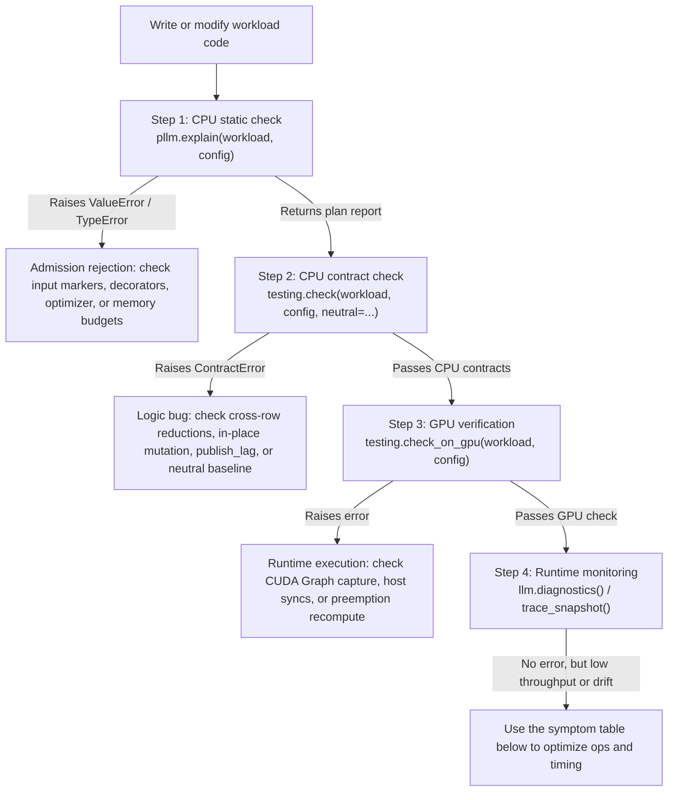
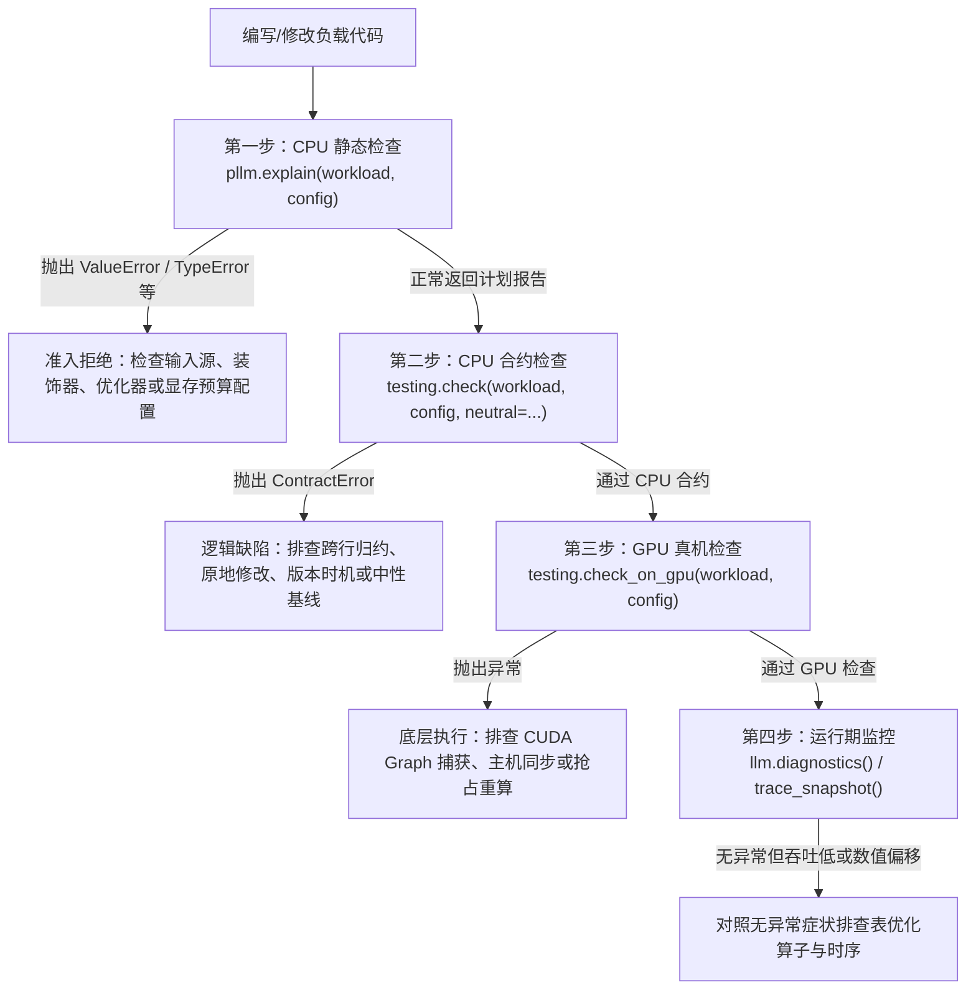

<link rel="stylesheet" href="{{ '/assets/css/pllm-hub.css' | relative_url | bust_file_cache }}">

<div class="zine-dispatch" data-title-zh="排查报错" data-title-en="Troubleshooting" data-desc-zh="pLLM 文档 · 操作与上线指南" data-desc-en="pLLM Documentation · How-To &amp; Serving Guides">
  <div class="zine-dispatch-links">
    <a class="zine-pill-link primary" data-i18n-zh="← 返回 pLLM 文档中心" data-i18n-en="← pLLM Docs Hub" href="/pllm/#docs">← pLLM Docs Hub</a>
    <a class="zine-pill-link" data-i18n-zh="文档导航地图" data-i18n-en="Docs Roadmap" href="/pllm/docs/">Docs Roadmap</a>
    <span class="zine-lang-badge" data-i18n-zh="操作与上线指南" data-i18n-en="How-To &amp; Serving Guides">How-To &amp; Serving Guides</span>
  </div>
  <a class="zine-pill-link" data-i18n-zh="GitHub 源码 ↗" data-i18n-en="View on GitHub ↗" href="https://github.com/LinesHogan/pLLM/blob/main/doc/howto/troubleshooting.md" target="_blank" rel="noopener">View on GitHub ↗</a>
</div>

<div id="markdown-content">

<div class="zine-lang-panel" data-lang-panel="en" lang="en" markdown="1">

<div id="en-troubleshooting"></div>

When authoring or running a `pllm.Workload`, if you hit an exception, unexpected throughput drop, out-of-memory failure, or numerical drift, use this page to pinpoint the root cause and fix it systematically.

---

## 1. Quick Triage Workflow: CPU First, Then GPU {#en-sec-1}

Do not debug directly on a multi-GPU cluster or a huge checkpoint. Follow this four-step triage path: **reproduce and isolate in seconds on CPU with `pllm.explain` and `testing.check`, then verify GPU runtime behavior with `check_on_gpu` and `diagnostics`**.



### Step 1: Run `pllm.explain` on CPU (Admission and Planning) {#en-step-1-run-pllmexplain-on-cpu-admission-and-planning}

`pllm.explain` shares the exact same admission checks and memory planner as `pllm.make_llm`. Using only the model's `config.json` and `meta` tensors on CPU, it traces shapes in seconds without loading weights or initializing CUDA.

If your code violates static rules, `pllm.explain` immediately raises the exact same error as engine startup:
- Missing input marker defaults on method parameters (e.g., missing `= pllm.hidden(0)`);
- An undecorated method with no effect decorator (result goes nowhere);
- Multiple `@pllm.guide_sampling` methods declared;
- A `@pllm.train` method targeting a state that lacks an optimizer;
- An exported tensor exceeding the 32 KiB per-row limit;
- Insufficient memory budget (listed in `report.budget_errors`).

Even when no exception is raised, inspect the returned report: check whether `report.eager_reason` is empty (non-empty means the forward pass falls back to eager mode) and whether each method's `anchor` and `lane` (`side` stream vs. `main` stream) match expectations. See [Reading Costs: pllm.explain](/pllm/docs/guides/explain/).

### Step 2: Run `pllm.testing.check` on CPU (Algorithmic Contracts) {#en-step-2-run-pllmtestingcheck-on-cpu-algorithmic-contracts}

Once `pllm.explain` succeeds, run `pllm.testing.check` on CPU. It drives three fixed synthetic requests through the real planner and executor to verify that your tensor math satisfies pLLM's contracts:
- **Row mixing**: Whether you accidentally reduced or sorted across dimension 0 (e.g., `mean(0)`, `sum(0)`), breaking isolation between concurrent requests;
- **In-place mutation of borrowed views**: Whether you modified an input tensor or state parameter in place via `add_()`, `mul_()`, etc.;
- **Version visibility timing (`publish_lag`)**: Whether training updates and forward reads see the expected state versions;
- **Neutral baseline**: Whether setting intervention strength to 0 (passing `neutral=Workload(beta=0.0)`) yields strictly zero intervention output.

Any violation raises `pllm.testing.ContractError`. See [Checking Correctness](/pllm/docs/guides/checking/).

### Step 3: Run `pllm.testing.check_on_gpu` on GPU (Graph Capture and Device Execution) {#en-step-3-run-pllmtestingcheck_on_gpu-on-gpu-graph-capture-and-device-execution}

CPU checks do not run the real model forward pass. For effects hooked inside model layers (`pllm.model.ActivationPatch`, `@pllm.custom_residual`, `@pllm.custom_attention`, `pllm.model.Adapter`), run `pllm.testing.check_on_gpu` on GPU to verify:
- Steady-state decode is captured into a CUDA Graph;
- Zero unexpected host syncs occur during decode steps (enforcing 0 CPU syncs);
- State recomputes cleanly on memory pressure / preemption.

### Step 4: Runtime Diagnostics with `llm.diagnostics()` and `llm.trace_snapshot()` {#en-step-4-runtime-diagnostics-with-llmdiagnostics-and-llmtrace_snapshot}

During live runs, if throughput lags or numerical behavior looks suspicious, inspect runtime diagnostics:
- `llm.diagnostics().eager_reason`: Empty string means whole-model CUDA Graph mode; otherwise names the exact fallback cause;
- `llm.diagnostics().numeric_health`: Reports NaN or Inf counts across state tensors;
- `llm.diagnostics().state_usage`: Tracks logical live bytes vs. physical allocated bytes;
- `llm.trace_snapshot()`: Shows timing breakdowns across main-stream and side-stream tasks as well as dropped exports (`export_dropped`).

---

## Minimal Diagnostic Example {#en-minimal-diagnostic-example}

Here is a self-contained runnable example using `Qwen/Qwen2.5-0.5B-Instruct` to run `pllm.explain` and `testing.check` on CPU:

```python
from dataclasses import dataclass

import torch
from torch import nn

import pllm
from pllm import testing
from pllm.workloads.esamp import ESampConfig, ESampWorkload

# 1. Declare model config (hidden size 896, 24 layers, vocab 151936)
config = pllm.ModelConfig("Qwen/Qwen2.5-0.5B-Instruct", max_num_seqs=8)

# 2. Construct the workload under test and its zero-strength neutral baseline
workload = ESampWorkload(ESampConfig(rank=4, intervention_beta=0.5))
neutral_workload = ESampWorkload(ESampConfig(rank=4, intervention_beta=0.0))

# 3. Step 1: Inspect execution plan & memory budgets on CPU (catches admission errors and eager fallback)
report = pllm.explain(workload, config)
assert report.eager_reason == "", f"Not in CUDA Graph: {report.eager_reason}"

# 4. Step 2: Verify request isolation, version lag, and neutral baseline on CPU
check_result = testing.check(workload, config, neutral=neutral_workload)
print("CPU checks passed:", check_result.passed)
```

To continue verification on GPU for CUDA Graph capture and runtime state:

```python
# Step 3: Verify in-model ops and zero host syncs on GPU
print(testing.check_on_gpu(workload, config, neutral=neutral_workload))

# Step 4: Inspect runtime engine diagnostics
with pllm.make_llm(config, workload=workload) as llm:
    diag = llm.diagnostics()
    assert diag.eager_reason == "", f"Fell back to eager: {diag.eager_reason}"
    assert all(field.nonfinite_count == 0 for field in diag.numeric_health), "NaN/Inf detected in state"
```

---

## Common Error Lookup (Error → Why → Fix) {#en-sec-2}

Every error message, its cause, and its fix are organized by topic in the [Error Catalog](/pllm/docs/reference/errors/); `...` denotes parts that vary with your code.

---

## No Exception Raised, Wrong Behavior (Symptom Guide) {#en-no-exception-raised-wrong-behavior-symptom-guide}

Often your code runs without throwing, yet throughput collapses, VRAM overflows, or outputs drift slightly. The table below maps common symptoms to their physical causes and fixes. For further tuning techniques, see [Making Workloads Faster](/pllm/docs/howto/faster/).

| Symptom | Physical Mechanism & Cause | Diagnosis & Fix |
| :--- | :--- | :--- |
| **`eager_reason` non-empty<br>(no whole-model CUDA Graph)** | Certain declarations do not support whole-model graph capture (e.g., `@pllm.custom_forward` replaces the whole-model graph with per-slice captured graphs, or a method contains a non-traceable op). The cost depends on step duration: on RTX 4090 at 128 concurrency, 0.5B drops to ~49% of graph mode, while 7B is only ~2% slower. | Check the reason reported by `pllm.explain` or `llm.diagnostics().eager_reason`; set `ModelConfig(cuda_graphs=True)` so anything that breaks whole-model capture fails loudly at startup instead of silently degrading. |
| **Throughput far below native vLLM<br>(e.g., 10–20% of native)** | Common causes:<br>1. Dynamic attention (`kv.attend(q, topk=...)`) reduces KV reads, but unfused PyTorch scoring and gather overhead dwarfs the saved bandwidth (e.g., `QuestRead` in Example 10 runs at 13% of native on 7B);<br>2. Implicit CPU host sync inside a workload method;<br>3. A `placement="host"` lookup method also reads `pllm.hidden`, preventing scheduling at `request.prepare / side` and exposing a ~1.6 ms PCIe transfer (38.9 MB) outside the forward;<br>4. Multi-layer `pllm.layer_logits` triggers multiple full-vocabulary LM Head GEMMs. | 1. Use static layouts (`keep="window"` / `source=k`) to save KV VRAM, or implement scoring as a fused kernel (Examples 09, 10) for speed;<br>2. Remove all host syncs;<br>3. Split host lookups into a dedicated undecorated method reading only `pllm.input_tokens` and immutable state, passed via `pllm.result` to overlap on the `side` stream;<br>4. Replace multi-layer `layer_logits` with `@pllm.guide_sampling` to share the LM Head. See [Making Workloads Faster](/pllm/docs/howto/faster/). |
| **Tiny output difference vs. native vLLM at strength 0** | With `@pllm.custom_residual` or `ActivationPatch`, vLLM captures the model's un-fused original ops inside the CUDA Graph instead of Inductor-fused ops; default native vLLM runs fused ops, causing slight bf16 rounding differences. | Expected rounding variance. Compare against native vLLM in eager mode (should match bitwise), or run `pllm.testing.check_on_gpu`, which builds a matching native engine for bitwise comparison. |
| **Export drops rows or events<br>(`dropped_rows > 0`)** | `@pllm.export` guarantees **zero blocking**: to avoid stalling GPU compute, it uses a bounded pinned ring buffer (256-event queue, $$\le 32\text{ KiB}$$ per event). When consumers lag and the queue fills, it drops events by default (`overflow="drop"`, counted in `export_dropped`); when active rows per step or prompts in a `generate` call exceed `max_rows`, excess rows are truncated (counted in `event.dropped_rows`). | Increase `@pllm.export(max_rows=...)` to cover max concurrency or batch chunks; increase `every=...` (e.g., export every 4 steps); drain the consumer promptly; keep prompts per `generate` call within `max_rows`. |
| **`make_llm` hits OOM or capture-pool budget error** | To keep online training and state publishing inside CUDA Graphs, pLLM pre-allocates fixed pools at init. If default budgets plus vLLM weights and KV Cache exceed physical VRAM, allocation fails. `pllm.explain` lists exceeded bytes in `budget_errors`. | Tune `ExecutionOptions` against `pllm.explain`'s `memory` and `state` lines:<br>- `state_page_budget_bytes`: cap state-page memory (lower it, or move large read-only tables to `placement="host"`);<br>- `execution_peak_budget_bytes`: execution peak budget (workspaces + overlap buffers);<br>- `cuda_graph_pool_budget_bytes`: CUDA Graph pool budget (raise if complex slices or custom methods exhaust capture memory);<br>- `max_host_training_rows`: lower max host batch rows to cut peak memory;<br>Also consider lowering `gpu_memory_utilization` or `max_num_seqs`. |
| **Exception on preemption<br>(Preemption Rejection)** | When VRAM pressure triggers preemption and vLLM tries to evict and recompute a sequence's history, pLLM permits lossless recomputation only when request state is keyed solely by `request_id` (private copies) with no mutable cross-request instance state, `Imported` state, or external host inputs; any other overlay or mutable shared state cannot be reconstructed and raises an exception. | Raise `gpu_memory_utilization` (e.g., from 0.85 to 0.90) to give KV Cache more headroom and avoid preemption; reduce `max_num_seqs`; avoid mutable cross-request `InstanceState`. See [Performance and Memory](/pllm/docs/explain/performance/). |
| **Side-stream training (`side`) not overlapping with forward** | When `execution_peak_budget_bytes` falls between the two thresholds on `explain`'s `memory` line, pLLM downgrades side-stream tasks to inline execution on the main stream (`lane` flips from `side` to `main`); `publish_lag=0` also serializes training with the forward. | Check the `member` and `timing` lines in `explain`; keep the default `publish_lag=1`, or raise `execution_peak_budget_bytes` above the overlap threshold. See [Making Workloads Faster](/pllm/docs/howto/faster/), Section 3. |
| **NaN / divergence in long-sequence recurrences or online training** | When accumulators, carry fields, or `pllm.scan` coefficients run in low precision (BF16), rounding errors accumulate across steps. | Check field `dtype` values on `explain`'s `state` lines; declare `pllm.Field(..., dtype=torch.float32)` explicitly and use FP32 coefficients for `pllm.scan`; inspect `llm.diagnostics().numeric_health` at runtime. |
| **Wrong shape returned by `@pllm.guide_sampling`** | `@pllm.guide_sampling` must return `[rows, hidden_size]` (e.g., 896 on Qwen2.5-0.5B). pLLM checks the trailing dimension both at build/CPU check time and at runtime; returning a tensor of another width raises a shape error. | Verify that `@pllm.guide_sampling` returns `[rows, hidden_size]` matching the model's `hidden_size`. |
| **Certain host batch training rounds are much slower** | The first time a training batch shape (sequence count, length) appears, pLLM compiles the training step for that shape. | Once shapes stabilize, no recompilation occurs; use fixed batch shapes and exclude warmup rounds when benchmarking (see [Measuring Throughput Fairly](/pllm/docs/howto/measure-throughput/)). |
| **Crash or VRAM conflict when creating multiple engines in one process** | Each pLLM engine reserves its own GPU graph pools, state pages, and vLLM KV Cache. If a prior engine has not fully released its resources, VRAM stays pinned and subsequent engines fail to allocate. | Always use `with pllm.make_llm(...) as llm:` to release resources automatically on exit, or call `llm.close()` explicitly before creating a new engine. Engines using `@pllm.train_in_forward(visibility="exact")` currently cannot return all VRAM on close—launch subsequent engines in a new subprocess. |

---

## Self-Check Questions {#en-self-check-questions}

1. **Question**: While implementing per-request online learning, you decorated your method with `@pllm.train(state="adapter")` and wrote `return loss.mean()` at the end. Running `testing.check` on CPU raised `training methods return one loss per row; pLLM reduces the selected rows per state`. Why does the framework forbid calling `.mean()` inside the method?
   <details><summary>Answer</summary>
   Because continuous batching packs multiple concurrent requests into each step, the framework needs one scalar loss per row (<code>[rows]</code>) to attribute gradients to each request's private state, mask padding rows, and run per-state optimizer updates. Reducing to a single scalar with <code>.mean()</code> mixes losses across different requests so individual request losses cannot be recovered. Cross-row reduction must be left to <code>@pllm.train(reduction="mean"|"sum")</code>.
   </details>

2. **Question**: You added a large `placement="host"` lookup table and wrote a single method that gathers from the table via `pllm.input_tokens` and gates the result using `pllm.final_hidden()`. Why did GPU throughput drop noticeably?
   <details><summary>Answer</summary>
   Because that method also reads <code>final_hidden</code>, it cannot start until the entire model forward finishes. As a result, the PCIe host-table transfer (~1.6 ms/step for 128 vocab-wide rows on 7B in [Performance and Memory](/pllm/docs/explain/performance/)) is completely exposed outside the forward pass instead of overlapping with it. The fix is to move the host gather into a dedicated undecorated helper reading only <code>input_tokens</code> and the table (which the planner schedules at <code>request.prepare / side</code> using 1/4 of SMs in the background), and read its output in the gating method via <code>pllm.result(...)</code>.
   </details>

---

## Next Steps {#en-next-steps}

- Browse all error messages and exception types: [Error Catalog](/pllm/docs/reference/errors/)
- Learn how to systematically verify contracts on CPU and GPU: [Checking Correctness](/pllm/docs/guides/checking/)
- Analyze execution plans and memory budgets without a GPU: [Reading Costs: pllm.explain](/pllm/docs/guides/explain/)
- Learn how to avoid eager fallback and maximize overlap: [Making Workloads Faster](/pllm/docs/howto/faster/)

</div>

<div class="zine-lang-panel is-hidden" data-lang-panel="zh" lang="zh-CN" markdown="1">

<div id="zh-sec-1"></div>

编写或运行 pLLM 算法负载（`pllm.Workload`）时，如果遇到程序抛出异常，或者吞吐下降、显存不足、数值产生未预期偏移，本页提供快速定位和修复的具体步骤。

---

## 1. 快速分诊流程：先 CPU 后 GPU {#zh-sec-2}

当负载运行出现问题时，不要直接在多卡集群或大模型上盲目调试。完整的排查路线是：**先在 CPU 上用 `pllm.explain` 和 `testing.check` 几秒钟复现并定位，再到 GPU 上用 `check_on_gpu` 与 `diagnostics` 排查运行时状态**。



### 第一步：在 CPU 上运行 `pllm.explain`（检查准入与计划） {#zh-sec-3}

`pllm.explain` 与 `pllm.make_llm` 共享完全一致的准入校验（admission check）和显存规划逻辑。它只需模型配置文件（`config.json`），在 CPU 上使用 `meta` 张量完成形状追踪，不加载任何模型权重，不初始化 CUDA，几秒内即可完成。

如果代码存在以下问题，`pllm.explain` 会立即抛出与真实启动完全相同的异常：
- 方法参数缺少输入源默认值（如缺少 `= pllm.hidden(0)`）；
- 方法未挂载任何效果装饰器（未指明结果去哪）；
- 声明了多个 `@pllm.guide_sampling`；
- 在线训练方法 `@pllm.train` 对应的状态缺少优化器声明；
- 导出张量尺寸超出单行 32 KiB 限制；
- 显存预算不足（见返回报告中的 `budget_errors`）。

即便没有抛出异常，也可检查返回的计划报告：`report.eager_reason` 是否为空（非空表示模型前向会退回 eager 模式）、各方法的 `anchor` 与 `lane`（`side` 旁路流还是 `main` 主流）是否符合预期。详见 [看成本：pllm.explain](/pllm/docs/guides/explain/)。

### 第二步：在 CPU 上运行 `pllm.testing.check`（检查算法契约） {#zh-sec-4}

当 `pllm.explain` 正常通过后，下一步在 CPU 上运行 `pllm.testing.check`。它使用固定的三个合成请求，经由真实规划器与执行器测试请求调度，检验你的张量数学是否满足框架契约：
- **请求行混淆（Row Mixing）**：是否在第 0 维误用了 `mean(0)`、`sum(0)` 或跨行排序，破坏了并发请求间的隔离性；
- **原地修改借用视图（In-place Mutation）**：是否直接对输入张量或参数执行了 `add_()`、`mul_()` 等原地写入；
- **版本可见性时机（publish_lag）**：训练更新与前向读取的版本是否符合时序预期；
- **中性基线（Neutral）**：当把干预强度设为 0 时（传入 `neutral=Workload(beta=0.0)`），干预输出是否严格为 0。

若违反契约，会抛出 `pllm.testing.ContractError`。详见 [检查正确性](/pllm/docs/guides/checking/)。

### 第三步：在 GPU 上运行 `pllm.testing.check_on_gpu`（验证图捕获与真机执行） {#zh-sec-5}

CPU 检查不执行模型内部的真实前向。对于挂载在模型内部的效果（如 `pllm.model.ActivationPatch`、`@pllm.custom_residual`、`@pllm.custom_attention`、`pllm.model.Adapter`），需要在 GPU 上使用 `pllm.testing.check_on_gpu` 进一步验证：
- 稳态解码是否被完整捕获进 CUDA Graph；
- 解码步骤中是否存在未预期的主机同步（Host sync，要求解码期间 0 次 CPU 同步）；
- 发生显存不足或抢占重算时，状态能否正确重算。

### 第四步：运行时状态诊断 `llm.diagnostics()` 与 `llm.trace_snapshot()` {#zh-sec-6}

在真实服务运行期间，若发现吞吐低于预期或怀疑数值异常，可查询运行时诊断信息：
- `llm.diagnostics().eager_reason`：为空字符串表示运行在整图 CUDA Graph 模式；若非空，会明确点名退回 eager 的原因；
- `llm.diagnostics().numeric_health`：检查状态张量中是否存在 NaN 或 Inf；
- `llm.diagnostics().state_usage`：监控逻辑存活字节与物理分配字节；
- `llm.trace_snapshot()`：查看主干流与旁路流各任务的耗时分布，以及是否有导出丢弃（`export_dropped`）。

---

## 最小诊断示例 {#zh-sec-7}

下面是利用 `Qwen/Qwen2.5-0.5B-Instruct` 在 CPU 上运行 `pllm.explain` 与 `testing.check` 的完整可运行示例：

```python
from dataclasses import dataclass

import torch
from torch import nn

import pllm
from pllm import testing
from pllm.workloads.esamp import ESampConfig, ESampWorkload

# 1. 声明模型配置（隐藏层 896，24 层，词表 151936）
config = pllm.ModelConfig("Qwen/Qwen2.5-0.5B-Instruct", max_num_seqs=8)

# 2. 准备待检查的工作负载及其强度为 0 的中性基线
workload = ESampWorkload(ESampConfig(rank=4, intervention_beta=0.5))
neutral_workload = ESampWorkload(ESampConfig(rank=4, intervention_beta=0.0))

# 3. 第一步：在 CPU 上查看执行计划与显存预算（快速捕获准入错误与 eager 风险）
report = pllm.explain(workload, config)
assert report.eager_reason == "", f"未进入 CUDA Graph: {report.eager_reason}"

# 4. 第二步：在 CPU 上验证请求隔离、版本时滞与中性基线
check_result = testing.check(workload, config, neutral=neutral_workload)
print("CPU 检查通过项:", check_result.passed)
```

若要在 GPU 上进一步检验 CUDA Graph 捕获与运行时状态，可补充以下步骤：

```python
# 第三步：在 GPU 上验证模型内部算子与 0 主机同步
print(testing.check_on_gpu(workload, config, neutral=neutral_workload))

# 第四步：运行时查看引擎诊断信息
with pllm.make_llm(config, workload=workload) as llm:
    diag = llm.diagnostics()
    assert diag.eager_reason == "", f"模型退回 eager: {diag.eager_reason}"
    assert all(field.nonfinite_count == 0 for field in diag.numeric_health), "状态里出现了 NaN/Inf"
```

---

## 常见报错速查（报错 → 原因 → 改法） {#zh-sec-8}

每条报错的原文、原因和改法按主题列在[报错目录](/pllm/docs/reference/errors/)；`...` 代表随你的代码变化的部分。

---

## 运行无异常但行为不合预期（症状排查） {#zh-sec-9}

很多时候代码并未抛出异常，但吞吐大幅下降、显存超标或数值产生微小偏移。下表汇总此类常见症状的物理根因与针对性调优策略。关于进一步的性能调优技巧，详见 [让负载更快](/pllm/docs/howto/faster/)。

| 症状表现 | 物理机制与原因 | 排查与解决办法 |
| :--- | :--- | :--- |
| **`eager_reason` 非空<br>（未使用整模型 CUDA graph）** | 某些声明暂不支持整模型图捕获（例如使用 `@pllm.custom_forward` 时整模型图会被切片捕获图替代，或方法包含不可追踪操作）。退回 eager 的代价取决于步长：RTX 4090、128 并发下，0.5B 降至图模式的约 49%，7B 只慢约 2%。 | 查看 `pllm.explain` 或 `llm.diagnostics().eager_reason` 指明的原因；在配置中设置 `ModelConfig(cuda_graphs=True)`，使任何无法保留整模型 CUDA graph 的写法在启动时直接报错，避免静默降级。 |
| **吞吐远低于原生 vLLM<br>（例如只有一两成）** | 常见于以下原因：<br>1. 动态注意力（如 `kv.attend(q, topk=...)`）虽减少了 KV 读取，但未经融合的打分与 gather 算子开销远超节省的带宽（如示例 10 中 `QuestRead` 在 7B 上吞吐仅为原生的 13%）；<br>2. 方法内含隐式 CPU 同步；<br>3. `placement="host"` 主机大表查表方法混读了 `pllm.hidden`，导致查表无法提前到步首 `request.prepare / side` 与前向重叠（跨 PCIe 搬运 38.9 MB 约需 1.6 ms，暴露在外直接拖慢步时）；<br>4. 声明了多层 `pllm.layer_logits`，触发多次全词表 LM Head 矩阵乘（GEMM）。 | 1. 要省 KV 显存用静态布局（`keep="window"` / `source=k`），要提速就把打分写成融合 kernel（见示例 09、10）；<br>2. 移除所有主机同步代码；<br>3. 将主机大表查表拆成仅依赖 `pllm.input_tokens` 和不可变状态的独立方法，经 `pllm.result` 传递，确保调度在 `side` 旁路流上重叠；<br>4. 用 `@pllm.guide_sampling` 替代多层 `layer_logits`，共用 LM Head。详见 [让负载更快](/pllm/docs/howto/faster/)。 |
| **强度为 0 时输出与原生 vLLM 存在微小差异** | 带 `@pllm.custom_residual` 或 `ActivationPatch` 时，vLLM 在 CUDA graph 里捕获模型原本的算子，不做 inductor 融合；默认的原生 vLLM 用融合后的算子，bf16 舍入略有不同。 | 这是正常的舍入差异。和 eager 模式的原生 vLLM 对比（应逐位相同），或运行 `pllm.testing.check_on_gpu`，它会建一个设置相同的原生引擎做逐位对照。 |
| **导出数据丢失行或不完整<br>（`dropped_rows > 0`）** | `@pllm.export` 具有**零阻塞保证**：为不阻塞 GPU 计算流，采用有界锁页环形缓冲区（队列上限 256 个事件，每个 $$\le 32\text{ KiB}$$）。当消费拉取不及时队列满时，默认直接丢弃（`overflow="drop"`，记入 `export_dropped`）；当单步有效行数超过 `max_rows`，或单次 `generate` 传入的 prompt 数超过 `max_rows` 时，超出部分会被截断（记入 `event.dropped_rows`）。 | 调大 `@pllm.export(max_rows=...)`，确保覆盖最大并发序列数或分块大小；调大导出间隔 `every=...`（如每 4 步导出一次）；确保消费进程及时读取；单次 `generate` 传入的 prompt 数量不要超过 `max_rows`。 |
| **`make_llm` 报 OOM 或图捕获预算报错点名字节数** | pLLM 为确保在线训练与状态发布完全进 CUDA Graph，会在初始化时预留固定显存池。若默认预算叠加 vLLM 权重与 KV cache 超出了物理显存容量，就会导致分配失败。`pllm.explain` 会在 `budget_errors` 中列出超标字节数。 | 对照 `pllm.explain` 的 `memory` 与 `state` 行调整 `ExecutionOptions` 参数：<br>- `state_page_budget_bytes`：状态页显存预算（调小以限制状态显存，或将大只读表设为 `placement="host"`）；<br>- `execution_peak_budget_bytes`：执行峰值预算（包含任务工作区与重叠缓冲区）；<br>- `cuda_graph_pool_budget_bytes`：CUDA Graph 显存池预算（若使用复杂切片或多个自定义方法捕获显存不足，需适当调大）；<br>- `max_host_training_rows`：主机批训练最大并行行数（调小以降低显存峰值）；<br>适当调低 `gpu_memory_utilization` 或 `max_num_seqs`。 |
| **抢占时抛出异常<br>（Preemption Rejection）** | 当显存紧张触发抢占、vLLM 试图逐出并重算序列历史时，仅当请求状态以 `request_id` 为键（私有独立副本）、且无跨请求可变实例状态、无外部导入（`Imported`）或主机外部输入时，框架才能够无害重算历史；任何其他带有覆盖（overlay）或可变共享状态的算法，由于历史无法复原，框架会拒绝重算并抛出异常。 | 提高 `gpu_memory_utilization`（如从 0.85 提至 0.90）为 KV cache 预留更多显存，从根源上避免触发抢占；调低并发序列数 `max_num_seqs`；避免在算法中依赖跨请求的可变 `InstanceState`。详见 [性能与显存](/pllm/docs/explain/performance/)。 |
| **旁路训练（`side`）没有和前向重叠** | `execution_peak_budget_bytes` 介于 `explain` 的 `memory` 行给出的两个阈值之间时，pLLM 把旁路任务改成主 stream 内联执行，lane 从 `side` 变为 `main`；`publish_lag=0` 也会让训练与 forward 串行。 | 看 `explain` 的 `member` 行和 `timing` 行；保持默认 `publish_lag=1`，或把预算调到重叠阈值以上。见[让负载更快](/pllm/docs/howto/faster/)第 3 节。 |
| **长序列递推或在线训练出现 NaN / 发散** | 累加器、carry 或 `pllm.scan` 的系数是低精度（BF16）时，舍入误差随步数累积。 | 看 `explain` 的 `state` 行里各字段的 `dtype`；用 `pllm.Field(..., dtype=torch.float32)` 显式指定，`pllm.scan` 的系数用 FP32；运行时查 `llm.diagnostics().numeric_health`。 |
| **`@pllm.guide_sampling` 返回形状不对** | `@pllm.guide_sampling` 返回的张量形状必须是 `[rows, hidden_size]`（如 Qwen2.5-0.5B 为 896）。pLLM 在构建/CPU 检查与运行时都会校验最后一维宽度；若在设置里误用了别维度的张量会抛出尺寸报错。 | 核对 `@pllm.guide_sampling` 返回值的形状是 `[rows, hidden_size]`，与模型 `hidden_size` 一致。 |
| **宿主批训练某几轮特别慢** | 训练批次的形状（序列数、长度）第一次出现时，pLLM 要为它编译训练步。 | 形状稳定后不再重编；测吞吐时用固定形状的批次并排除预热轮（见[公平地测吞吐](/pllm/docs/howto/measure-throughput/)）。 |
| **单进程内创建多个引擎导致崩溃或显存冲突** | 每个 pLLM 引擎会在 GPU 端独占分配图显存池、状态页和 vLLM KV cache。前一个引擎若未完全释放，显存将被锁死，导致后续引擎无法分配连续显存块。 | 使用上下文管理器 `with pllm.make_llm(...) as llm:`，退出时自动释放资源；或显式调用 `llm.close()` 释放 GPU 显存与后台 Worker 进程后再创建新引擎。用了 `@pllm.train_in_forward(visibility="exact")` 的引擎关闭时暂不能归还全部显存，之后的引擎在新的子进程里启动。 |

---

## 自测小问题 {#zh-sec-10}

1. **问题**：在实现每请求在线学习时，你的方法被 `@pllm.train(state="adapter")` 装饰，并在函数体最后写了 `return loss.mean()`。在 CPU 上运行 `testing.check` 时抛出了 `training methods return one loss per row; pLLM reduces the selected rows per state`。为什么框架禁止用户自己在方法里调用 `.mean()`？
   <details><summary>答案</summary>
   因为连续批处理中每个 step 拼入了多个并发请求，框架需要获得每行独立的标量损失 <code>[rows]</code>，才能知道每个请求的私有状态对应的梯度，进而执行逐请求的掩码过滤与优化器更新。如果用户自己在函数内调用 <code>.mean()</code> 归约成单个标量，不同请求的损失就混合在了一起，框架无法还原各请求独立的损失值。跨行归约应当交由 <code>@pllm.train(reduction="mean"|"sum")</code> 框架自动处理。
   </details>

2. **问题**：你给模型添加了一个 `placement="host"` 的超大查表状态，并在同一个方法里既通过 `pllm.input_tokens` 查表，又通过 `pllm.final_hidden()` 读取模型最后一层激活做门控。为什么在 GPU 上运行后吞吐明显下降？
   <details><summary>答案</summary>
   因为该方法同时读取了 <code>final_hidden</code>，它必须等到整个模型前向全部计算完毕后才能启动执行。这导致跨 PCIe 搬运主机大表数据的耗时（[性能与显存](/pllm/docs/explain/performance/)一页中 128 行、7B 词表宽的查表约 1.6 ms/步）完全暴露在模型前向之外，无法在后台与前向重叠。正确的改法是将主机查表拆写为一个只读 <code>input_tokens</code> 的无效果方法（规划器会将其调度在步首的 <code>request.prepare / side</code> 旁路流上，利用 1/4 SM 在后台等 PCIe 搬运），再由门控方法通过 <code>pllm.result(...)</code> 读取查表结果，从而让大表搬运与主干前向深度异步重叠。
   </details>

---

## 接下来 {#zh-sec-11}

- 查看全部错误消息清单与异常类型：[报错目录](/pllm/docs/reference/errors/)
- 了解如何在 CPU 与 GPU 上系统性验证契约：[检查正确性](/pllm/docs/guides/checking/)
- 在不启动 GPU 的前提下分析执行图与显存预算：[看成本：pllm.explain](/pllm/docs/guides/explain/)
- 了解避免 eager 退化与最大化重叠的优化技巧：[让负载更快](/pllm/docs/howto/faster/)

</div>

</div>

<div class="zine-doc-footer">
  <a class="zine-pill-link" data-i18n-zh="← 返回 pLLM 项目与文档中心" data-i18n-en="← Back to pLLM Project &amp; Docs" href="/pllm/#docs">← Back to pLLM Project &amp; Docs</a>
  <a class="zine-pill-link" href="https://github.com/LinesHogan/pLLM/blob/main/doc/howto/troubleshooting.md" target="_blank" rel="noopener">GitHub &middot; doc/howto/troubleshooting.md ↗</a>
</div>

<script defer src="/assets/js/bilingual-post.js"></script>
