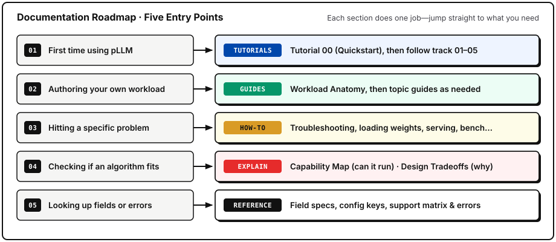
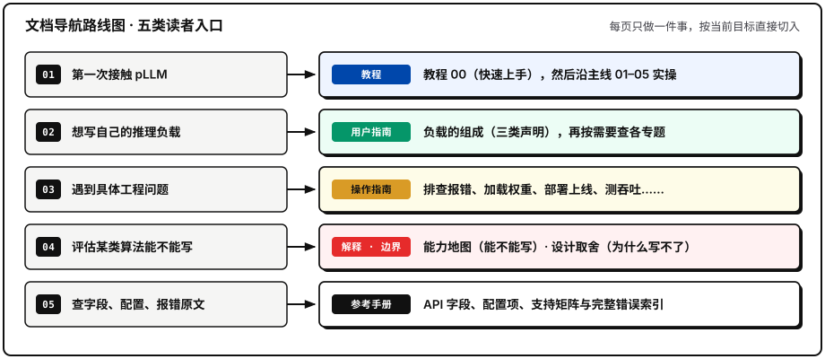

<link rel="stylesheet" href="{{ '/assets/css/pllm-hub.css' | relative_url | bust_file_cache }}">

  

    <a class="zine-pill-link primary" data-i18n-zh="← 返回 pLLM 文档中心" data-i18n-en="← pLLM Docs Hub" href="/pllm/#docs">← pLLM Docs Hub</a>
    <a class="zine-pill-link" data-i18n-zh="文档导航地图" data-i18n-en="Docs Roadmap" href="/pllm/docs/">Docs Roadmap</a>
    Documentation Overview
  

  <a class="zine-pill-link" data-i18n-zh="GitHub 源码 ↗" data-i18n-en="View on GitHub ↗" href="https://github.com/LinesHogan/pLLM/blob/main/doc/README.md" target="_blank" rel="noopener">View on GitHub ↗</a>

pLLM's documentation is organized into five categories by purpose, with each page focused on a single job: **Tutorials** teach you how to write workloads from scratch; **User Guides** explain each declaration by feature along with its costs; **How-To Guides** give step-by-step recipes for specific problems; **Reference** pages provide item-by-item specifications; and **Explanation** pages cover the reasoning behind the rules. There is also an **Examples** gallery, where each entry implements an algorithm family with measured numbers.

{: style="display: block; max-width: 100%; height: auto; margin: 1.5rem auto;" }

To have a coding agent write a workload or migrate an existing project to pLLM, install the skill first (`pllm skill --install claude` / `codex` / `cursor`), or point it directly to the [agent skill](https://github.com/LinesHogan/pLLM/blob/main/doc/agent/SKILL.md), [migration guide](https://github.com/LinesHogan/pLLM/blob/main/doc/agent/migration.md), and [agent reference](https://github.com/LinesHogan/pLLM/blob/main/doc/agent/reference.md).

## Tutorials {#en-tutorials}

Executable notebooks (requiring a GPU) with outputs saved inline. Most run on `Qwen2.5-0.5B-Instruct`; Tutorial 03 benchmarks throughput on `Qwen2.5-7B-Instruct` (~15 GiB BF16 weights, requiring a 24 GiB GPU). Each tutorial starts from a concrete algorithm and ends with common errors and self-check questions.

| Tutorial | Algorithm | What You Will Learn |
| --- | --- | --- |
| [00 Quickstart](/pllm/docs/tutorials/00_quickstart/) | Activation steering (CAA) | The three questions a workload answers—what to read, what to store, where results go—and pre-flight checks with `pllm.explain` and `pllm.testing.check` |
| [01 Observe & Probe](/pllm/docs/tutorials/01_observe_probe/) | Linear probe / SAE monitoring | Reading per-token hidden states and exporting to the host without altering outputs or disabling CUDA graphs |
| [02 Per-Request LoRA](/pllm/docs/tutorials/02_request_adapters/) | Text-to-LoRA hypernetwork | `RequestState`, `Adapter`, `@pllm.write`: giving each request its own prompt-generated LoRA |
| [03 Decode-Time Training](/pllm/docs/tutorials/03_decode_training/) | ESamp | `@pllm.train`, `@pllm.guide_sampling`, `publish_lag`; measuring throughput |
| [04 Custom Forward](/pllm/docs/tutorials/04_custom_forward/) | Looped depth (Ouro / Huginn style) | `@pllm.custom_forward`; how KV caches are handled inside loops |
| [05 Host Feedback Loops](/pllm/docs/tutorials/05_host_feedback/) | TTRL / GRPO | Host-batch training: closing the generate–vote–train loop inside a single engine |

## User Guides {#en-user-guides}

Organized by capability: each page explains what a feature is and when to use it, gives a short runnable example, and explains its cost and constraints.

- [Capability Map](/pllm/docs/guides/capability-map/): which inference-time algorithms pLLM supports today, which primitives to use, and built-in workloads
- [Workload Anatomy](/pllm/docs/guides/workload-anatomy/): the three kinds of declarations, method body rules, when methods run, selectors, and the development loop
- [Reading Model Internals](/pllm/docs/guides/reading/): hidden states, residual streams, per-layer logits, token history, and sampling outcomes
- [State](/pllm/docs/guides/state/): request state vs. instance state, fields, initializers, precision, and carry fields
- [Where Results Go](/pllm/docs/guides/results/): exports, additive logits, sampling guidance, and state writes
- [Online Training](/pllm/docs/guides/training/): `@pllm.train`, reductions, selectors, `publish_lag`, and gradient edges
- [Model Edits](/pllm/docs/guides/model-edits/): activation patches, adapters, and in-forward training
- [Customizing Forward Structure](/pllm/docs/guides/forward-structure/): custom residuals, custom attention & KV layouts, and custom forward
- [Host Loops & Batch Training](/pllm/docs/guides/host-loops/): host batches, causal models, `make_host`, and `generate_feedback`
- [Custom Operators](/pllm/docs/guides/custom-ops/): integrating Triton / CUDA kernels via `torch.library.custom_op`
- [Composing Workloads](/pllm/docs/guides/composition/): running multiple workloads in one engine
- [Inspecting Costs: `pllm.explain`](/pllm/docs/guides/explain/): reading the execution plan on CPU before launch
- [Checking Correctness](/pllm/docs/guides/checking/): `testing.check`, `check_on_gpu`, and `check_distribution`

## How-To Guides {#en-how-to-guides}

- [Troubleshooting Errors](/pllm/docs/howto/troubleshooting/)
- [Online Serving: `AsyncVllmLlm` & `pllm serve`](/pllm/docs/howto/online-serving/)
- [Loading Trained Weights](/pllm/docs/howto/load-trained-weights/)
- [Sharing Training Across Requests](/pllm/docs/howto/share-training-across-requests/)
- [Production Deployment: Multiprocessing, Tensor Parallelism & Quantized Bases](/pllm/docs/howto/production/)
- [Measuring Throughput Fairly](/pllm/docs/howto/measure-throughput/)
- [Making Workloads Faster](/pllm/docs/howto/faster/)
- [Using New Model Families](/pllm/docs/howto/new-model-families/)

## Reference {#en-reference}

- [Support Matrix](/pllm/docs/reference/support-matrix/): model × feature × vLLM version × parallelism
- [Composition Rules](/pllm/docs/reference/composition-rules/): which combinations are valid, which are rejected, and why
- [Configuration Options](/pllm/docs/reference/config/): full fields for `ModelConfig`, `ExecutionOptions`, and related configs
- [`explain` Reports & Runtime Diagnostics](/pllm/docs/reference/diagnostics/)
- [Error Catalog](/pllm/docs/reference/errors/): exact error messages, causes, and fixes
- [Glossary](/pllm/docs/reference/glossary/)
- [Measurement Log](https://github.com/LinesHogan/pLLM/blob/main/doc/reference/measurements.toml): exact configurations and runs behind every throughput and latency number in the docs
- [API Reference](/pllm/docs/reference/api/): signatures and docstrings for every public symbol, grouped by purpose (generated from source)

## Explanation {#en-explanation}

- [Core Concepts](/pllm/docs/explain/core-concepts/): why declarations replace hooks, rows, the single-step timeline, state versions & `publish_lag`, and why boundaries exist
- [Design Tradeoffs](/pllm/docs/explain/design-tradeoffs/): why certain algorithms cannot be expressed today, and available alternatives
- [Performance & Memory](/pllm/docs/explain/performance/): decode bottlenecks, what pLLM saves for you, and measured costs across patterns

## Further Reading {#en-further-reading}

- [Standalone Technical Essays (EN / ZH)](/pllm/#blog): ten standalone articles covering inference-time algorithm trends, scheduler retrospectives, bandwidth quotas, mantissa/bit tricks, compiled fast-weight training, static-graph pointer addressing, GPU memory MVCC/RCU, attention layouts, `attn_metadata` unpacking, and multi-tenant verification

## Examples {#en-examples}

Each example implements an algorithm family following the structure "problem → workload → explain → check → generate → measure → cost & boundaries", with environment details for every benchmark.
Throughput and memory numbers are measured on `Qwen2.5-7B-Instruct` (RTX 4090, vLLM 0.32.0): Examples 07 and 12 use 7B throughout; 06, 09, 10, and 11 inspect behavior on 0.5B before benchmarking throughput on 7B; 08 uses a community 4B In-Place TTT checkpoint; 13 runs its search on 0.5B and requires `bubblewrap` and an authenticated agent CLI.

| Example | Algorithm | Key Focus |
| --- | --- | --- |
| [06 Reading Inside](/pllm/docs/examples/06_reading_inside/) | Logit Lens / DoLa | Keeping residual streams and per-layer logits inside CUDA graphs; compute cost of DoLa |
| [07 Custom Residual](/pllm/docs/examples/07_custom_residual/) | Value residual / hyper-connections / memory sublayers | `@pllm.custom_residual`; bitwise equivalence to native eager when identity; throughput cost |
| [08 In-Place TTT](/pllm/docs/examples/08_inplace_ttt/) | In-Place TTT (community 4B checkpoint) | Chunked fast-weight updates; cross-chunk updates during decode; throughput vs. the official implementation |
| [09 Custom Kernels](/pllm/docs/examples/09_custom_kernels/) | Relative steering (Triton kernel) | `torch.library.custom_op`; operator rows in `explain`; device-equivalence checks in `check_on_gpu` |
| [10 Custom Attention](/pllm/docs/examples/10_custom_attention/) | Attention monitoring / Quest / KV layouts | Swapping read logic only; top-K reads; KV savings from sliding window, prompt+window, and cross-layer sharing |
| [11 Lookup Memory](/pllm/docs/examples/11_lookup_memory/) | N-gram priors / Engram-style residuals | `pllm.input_tokens`; reading tables via `pllm.Pretrained`; placing tables in GPU VRAM vs. host DRAM |
| [12 Adaptive Depth](/pllm/docs/examples/12_adaptive_depth/) | Per-token layer skipping (early exit) | `active=`; KV backfill for skipped layers; when skipping actually saves time |
| [13 Algorithm Search](/pllm/docs/examples/13_algorithm_search/) | Agent-driven search loop | `explain` + `check` + scoring + replay; distinguishing real gains from noise |

pLLM 的文档按用途分成五类，每一页只做一件事：**教程**带你从零学会写负载；**用户指南**按功能讲清每个声明怎么用、代价是什么；
**操作指南**是解决一个具体问题的步骤；**参考**供逐条查证；**解释**讲规则背后的原因。另有一个**示例库**，每篇实现一个算法族、
附带实测。

{: style="display: block; max-width: 100%; height: auto; margin: 1.5rem auto;" }

让编码 agent 写负载或把已有项目迁到 pLLM，先安装 skill（`pllm skill --install claude` / `codex` / `cursor`），或直接交出 [agent skill](https://github.com/LinesHogan/pLLM/blob/main/doc/agent/SKILL.md)、[迁移指南](https://github.com/LinesHogan/pLLM/blob/main/doc/agent/migration.md) 和 [agent 参考](https://github.com/LinesHogan/pLLM/blob/main/doc/agent/reference.md)。

## 教程 {#zh-sec-2}

可执行的 notebook，需要 GPU，输出保留在 notebook 里。大多在 Qwen2.5-0.5B-Instruct 上跑；测吞吐的 03 用 Qwen2.5-7B-Instruct（bf16 权重约 15 GiB，需要一张 24 GiB 的卡）。每篇从一个具体算法出发，结尾有常见错误和自测题。

| 教程 | 算法 | 你会学到 |
| --- | --- | --- |
| [00 快速上手](/pllm/docs/tutorials/00_quickstart/) | 激活引导（CAA） | 负载的三个问题：读什么、存什么、结果去哪；启动前用 `pllm.explain` 和 `pllm.testing.check` 检查 |
| [01 观测](/pllm/docs/tutorials/01_observe_probe/) | 线性探针 / SAE 监控 | 逐 token 读 hidden，导出到宿主机；不改变输出、不关 CUDA graph |
| [02 每请求 LoRA](/pllm/docs/tutorials/02_request_adapters/) | Text-to-LoRA 式超网络 | `RequestState`、`Adapter`、`@pllm.write`：每个请求一份由 prompt 生成的 LoRA |
| [03 decode 时训练](/pllm/docs/tutorials/03_decode_training/) | ESamp | `@pllm.train`、`@pllm.guide_sampling`、`publish_lag`；测吞吐 |
| [04 改写 forward](/pllm/docs/tutorials/04_custom_forward/) | 循环深度（Ouro / Huginn 式） | `@pllm.custom_forward`；循环里 KV 怎么处理 |
| [05 反馈循环](/pllm/docs/tutorials/05_host_feedback/) | TTRL / GRPO | 宿主批训练：生成、投票、训练在同一个引擎里闭环 |

## 用户指南 {#zh-sec-3}

按功能组织，每页先说是什么、何时用，再给可运行的短例子，然后讲代价和限制的原因。

- [能力地图](/pllm/docs/guides/capability-map/)：哪些推理时算法今天能用 pLLM 写、用什么写、现成的负载
- [负载的组成](/pllm/docs/guides/workload-anatomy/)：三类声明、方法体的规则、方法何时运行、选择器、开发循环
- [读取模型内部](/pllm/docs/guides/reading/)：hidden、残差流、逐层 logits、token 历史、采样结果
- [状态](/pllm/docs/guides/state/)：请求状态与实例状态、字段、初值来源、精度、carry 字段
- [结果去哪](/pllm/docs/guides/results/)：导出、logits 加法、采样引导、写状态
- [在线训练](/pllm/docs/guides/training/)：`@pllm.train`、归约、选择器、`publish_lag`、梯度边
- [改模型](/pllm/docs/guides/model-edits/)：激活补丁、Adapter、前向内训练
- [改 forward 结构](/pllm/docs/guides/forward-structure/)：定制残差、定制 attention 与 KV 布局、custom forward
- [宿主循环与批训练](/pllm/docs/guides/host-loops/)：宿主批次、因果模型、`make_host`、`generate_feedback`
- [自写算子](/pllm/docs/guides/custom-ops/)：用 `torch.library.custom_op` 接入 Triton / CUDA kernel
- [组合负载](/pllm/docs/guides/composition/)：把几个负载放进一个引擎
- [看成本：pllm.explain](/pllm/docs/guides/explain/)：启动前在 CPU 上读执行计划
- [检查正确性](/pllm/docs/guides/checking/)：`testing.check`、`check_on_gpu`、`check_distribution`

## 操作指南 {#zh-sec-4}

- [排查报错](/pllm/docs/howto/troubleshooting/)
- [在线服务：AsyncVllmLlm 与 pllm serve](/pllm/docs/howto/online-serving/)
- [加载训练好的权重](/pllm/docs/howto/load-trained-weights/)
- [让一组请求共享训练成果](/pllm/docs/howto/share-training-across-requests/)
- [上生产：多进程、张量并行与量化底座](/pllm/docs/howto/production/)
- [公平地测吞吐](/pllm/docs/howto/measure-throughput/)
- [让负载更快](/pllm/docs/howto/faster/)
- [在新模型家族上使用](/pllm/docs/howto/new-model-families/)

## 参考 {#zh-sec-5}

- [支持矩阵](/pllm/docs/reference/support-matrix/)：模型 × 功能 × vLLM 版本 × 并行方式
- [组合规则](/pllm/docs/reference/composition-rules/)：哪些写法可以并存、哪些被拒绝及原因
- [配置项](/pllm/docs/reference/config/)：`ModelConfig`、`ExecutionOptions` 等的全部字段
- [explain 报告与运行时诊断字段](/pllm/docs/reference/diagnostics/)
- [报错目录](/pllm/docs/reference/errors/)：报错原文、原因与改法
- [术语表](/pllm/docs/reference/glossary/)
- [实测记录](https://github.com/LinesHogan/pLLM/blob/main/doc/reference/measurements.toml)：文档里每个吞吐与耗时数字来自哪次测量、在什么设置下测得
- [API 参考](/pllm/docs/reference/api/)：每个公开名字的签名与文档串，按用途分节（由代码生成）

## 解释 {#zh-sec-6}

- [核心概念](/pllm/docs/explain/core-concepts/)：为什么不是 hook、行、一步的时间线、状态版本与 `publish_lag`、为什么有边界
- [设计取舍](/pllm/docs/explain/design-tradeoffs/)：为什么有些算法今天写不了，以及替代做法
- [性能与显存](/pllm/docs/explain/performance/)：decode 的瓶颈、pLLM 替你省了什么、各写法的实测代价

## 延伸阅读 {#zh-sec-7}

- [独立技术随笔 (中/英)](/pllm/#blog)：围绕推理期算法趋势、调度器复盘、带宽配额、尾声位变换、编译图快权重训练、静态图指针寻址、显存 MVCC/RCU、注意力布局、`attn_metadata` 解包及多租户核验的十篇独立文章

## 示例库 {#zh-sec-8}

每篇实现一个算法族，按"问题 → 负载 → explain → check → 生成 → 测量 → 代价与边界"展开；实测数字都注明了运行环境。
吞吐、显存这类性能数字都在 Qwen2.5-7B-Instruct 上测（RTX 4090，vLLM 0.32.0）：07、12 全程用 7B，06、09、10、11 先在 0.5B 上看行为、再在 7B 上测吞吐；08 用一个 4B 的 In-Place TTT 社区检查点；13 的搜索在 0.5B 上进行，需要 bubblewrap 和已登录的 agent 命令行。

| 示例 | 算法 | 重点 |
| --- | --- | --- |
| [06 读模型内部](/pllm/docs/examples/06_reading_inside/) | logit lens / DoLa | 残差流和逐层 logits 留在 CUDA graph 里；DoLa 的计算代价 |
| [07 改写残差连接](/pllm/docs/examples/07_custom_residual/) | value residual / 超连接 / 记忆子层 | `@pllm.custom_residual`；恒等时与 eager 原生逐位相同；吞吐代价 |
| [08 In-Place TTT](/pllm/docs/examples/08_inplace_ttt/) | In-Place TTT（社区 4B 检查点） | 按块更新的快权重；decode 中跨块更新；与官方实现比吞吐 |
| [09 自写算子](/pllm/docs/examples/09_custom_kernels/) | 相对引导（Triton kernel） | `torch.library.custom_op`；explain 的算子行；`check_on_gpu` 的设备等价检查 |
| [10 自定义 attention](/pllm/docs/examples/10_custom_attention/) | 注意力监控 / Quest / KV 布局 | 只换读法；只读 top-K；滑动窗口、prompt 加窗口、跨层共享各省多少 KV |
| [11 查表记忆](/pllm/docs/examples/11_lookup_memory/) | n-gram 先验 / Engram 式残差 | `pllm.input_tokens`；`pllm.Pretrained` 读表；表放显存还是主机内存 |
| [12 自适应深度](/pllm/docs/examples/12_adaptive_depth/) | 按 token 跳层（early exit） | `active=`；跳过的层怎么补 KV；什么时候真的省 |
| [13 让 agent 搜索算法](/pllm/docs/examples/13_algorithm_search/) | agent 驱动的搜索循环 | explain + check + 打分 + 重放；怎样判断提升是不是噪声 |

  <a class="zine-pill-link" data-i18n-zh="← 返回 pLLM 项目与文档中心" data-i18n-en="← Back to pLLM Project &amp; Docs" href="/pllm/#docs">← Back to pLLM Project &amp; Docs</a>
  <a class="zine-pill-link" href="https://github.com/LinesHogan/pLLM/blob/main/doc/README.md" target="_blank" rel="noopener">GitHub &middot; doc/README.md ↗</a>

