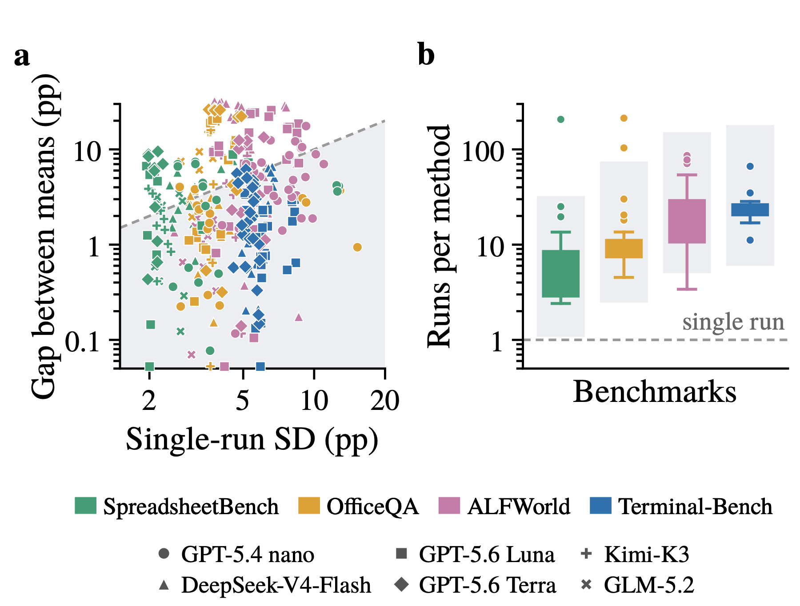

  <a class="zine-pill-link" data-i18n-zh="论文 arXiv:2611.23068 ↗" data-i18n-en="Paper · arXiv:2611.23068 ↗" href="https://arxiv.org/abs/2611.23068" target="_blank" rel="noopener">论文 arXiv:2611.23068 ↗</a>
  

    <button type="button" class="zine-lang-btn" data-lang-target="en" aria-pressed="false">EN</button>
    <button type="button" class="zine-lang-btn is-active" data-lang-target="zh" lang="zh-CN" aria-pressed="true">中文</button>
  

**TL;DR：** 将主流 Agent 进化方法统一为“提议—评估—选择”的零阶优化循环后，我们在 6 个模型、7 种框架与 13 个基准的 1,030 次独立进化中对单次得分做方差分解 $$\text{Var}(\hat{Y}) = \sigma^2 + \tau^2$$。结果显示，单次运行的标准差（1.7–4.1 pp）盖过了超过 60% 同基准方法对的真实差距，也恰好吞没了 9 篇代表论文中 3.4 pp 的中位 SOTA 领先幅度——按常规只跑 1 次实验，在 Terminal-Bench 上从 4 种方法中挑出第一名的概率仅 33%（盲猜为 25%）。这引出了“分辨率假说”：卡住 Agent 自进化的并非提议能力，而是评估系统自身的分辨率下限。

> **《分辨率假说》系列（1/3）** · [论文 arXiv:2611.23068](https://arxiv.org/abs/2611.23068) · [项目主页与 30s 互动小游戏](/resolution-hypothesis/) · [幕后手记](/blog/2026/resolution-hypothesis-behind-the-scenes/)
> **连载导航**：**（一）原地踏步与方差账** · [（二）高通滤波器与捷径审计](/blog/2026/resolution-hypothesis-part-2/) · [（三）好 Skill 与失明的选择器](/blog/2026/resolution-hypothesis-part-3/)

最近半年，我们团队花了大量精力去探索和复现“自进化智能体（Self-Evolving Agents）”。当然，现在这个领域有一个更时髦的名字了，“RSI”。这个方向的设定很吸引人：在基座模型权重 $$W$$ 冻结的前提下，让智能体在与环境的交互中自我反思，不断迭代外挂的持久化状态 $$A$$（可以是 Prompt、Skill 文档、Memory 记忆库，甚至是 Agent 脚手架代码 Harness），从而实现测试时的能力进化。

然而，当我们真正把市面上主流的进化算法拉到一起横向评测时，却频繁遇到一个令人困惑的现象：**不同论文里的结论经常互相打架**。同一个算法，在论文 A 的基准上能稳定涨点，换到论文 B 里做 Baseline 就跑不出效果；到了像 Terminal-Bench 这样贴近真实软件工程的硬核基准上，几乎所有方法都会在几轮之内陷入“原地踏步”。

为了搞清楚这背后的原因，我们在 6 个模型、7 种主流进化方法和 13 个基准上跑了 1,030 次独立进化实验，每一次实验都要做上百次评估（累计超过 210 万条测试轨迹、1000 万次 LLM 调用，这可能是公开领域内规模最大的研究了！）。在这三篇连载博客中，我们想跳出具体方法的工程细节，用一套统一的数学与直觉视角，和大家聊聊我们在实验过程中逐步理清的一个核心问题：**究竟是什么卡住了 Agent 自进化的脖子？**

---

### 进化的统一视角

在动手跑实验之前，我们首先思考的一个问题是：市面上有改 Prompt 的（如 GEPA）、有提炼 Skill 的（如 SkillOpt、Trace2Skill）、有攒 Memory 的（如 ReasoningBank）、还有直接改 Agent 代码的（如 Meta-Harness、AHE），**这些五花八门的方法，底层到底在做什么？**

如果把传统的模型微调看作参数空间上的梯度下降 $$W_t = W_{t-1} - \eta \nabla L(W_{t-1})$$，那么 Agent 进化面对的是一个离散的文本或代码空间。由于外部状态 $$A$$ 必须通过影响智能体在环境中的多步采样轨迹（Trajectory）才能转化为最终得分，我们显然无法对 $$A$$ 求导。

因此，所有现有的 Agent 进化方法，在数学上其实都退化成了同一个“提议-评估-选择（Propose-Evaluate-Select）”的零阶优化循环：

$$
C_t = \text{Propose}(A_{t-1}, \mathcal{T}_{\text{train}}), \quad A_t = \text{Select}\big(A_{t-1}, C_t; \hat{Y}\big) \tag{1}
$$

也就是说，在每一轮 $$t$$，提议器（Proposer）观察训练轨迹 $$\mathcal{T}_{\text{train}}$$ 并写出候选产物 $$C_t$$；随后评估器在验证集上测出观测得分 $$\hat{Y}$$，选择器（Selector）则依据 $$\hat{Y}$$ 决定保留哪些候选进入下一轮。

有了式 (1) 这个视角，社区目前主流的几种代表性方法就可以非常自然地对齐到同一张表里——它们的区别无非在于演化的对象 $$A$$、提议的粒度以及选择的规则不同：

| 进化方法          | 产物 $$A$$          | 提议算子 $$\text{Propose}$$        | 选择算子 $$\text{Select}$$                        |
| ----------------- | ------------------- | ---------------------------------- | ------------------------------------------------- |
| **GEPA**          | Prompt              | 每轮全量重写                       | 3-task 训练集门控 + 验证集 Pareto 前沿采样        |
| **SkillOpt-Lite** | Skill 文档          | 每轮生成 1 条局部编辑              | 验证集得分高出当前产物 $$\ge 2\text{ pp}$$ 则接受 |
| **Trace2Skill**   | Skill 文档          | 每条轨迹提取 1 个 Patch 并层级合并 | 退化选择器（无条件接受全部 Patch）                |
| **ReasoningBank** | Memory 记忆库       | 每任务提取 $$\le 3$$ 条记忆追加    | 退化选择器（无条件接受全部记忆）                  |
| **HarnessLens**   | 指令/Skill/工具描述 | 每轮生成 1 条编辑                  | 训练集配对检验确认 + 验证集取最优                 |
| **Meta-Harness**  | Harness 代码        | 每轮重写完整程序（共 5 轮）        | 5 个候选版本中取训练集最高分                      |
| **AHE**           | 完整代码工作区      | 每轮生成代码编辑（共 5 轮）        | 5 个版本中取验证集最高分                          |

> **Note**：像 Trace2Skill 和 ReasoningBank 这类在常规基准上“只提取经验追加、不根据验证集分数做过滤”的方法，在式 (1) 的视角下并不是没有选择器，而是等价于一个**接受概率恒为 $$1$$ 的选择器（Degenerate Selector）**——它不通过实机重跑实验区分好建议和坏建议，本质上和被高噪声误导的选择器面临着同样的风险。

---

### 浓雾爬山与“分辨率假说”

从式 (1) 我们可以看出，要让这个循环不断往上走，必须同时满足两个条件：第一，$$\text{Propose}$$ 确实能写出真实质量更高的候选（即真实期望得分差 $$\Delta = Y(C_t) - Y(A_{t-1}) > 0$$）；第二，$$\text{Select}$$ 能仅凭单次观测得分 $$\hat{Y}$$ 把这些好候选挑出来。

过去大家发论文，几乎都在卷 $$\text{Propose}$$（设计更精巧的反思提示词、引入树搜索或群体档案），却默认了 $$\hat{Y}$$ 是可靠的。但稍微想一想就会发现不对劲：由于模型权重是冻结的，一段文本 $$A$$ 只能通过微调模型在推理时的行为倾向来发挥作用，而 LLM 每跑一次轨迹本身就有巨大的采样随机性。

{: style="display: block; max-width: 100%; width: auto; height: auto; max-height: 620px; margin: 1.5rem auto; object-fit: contain; border-radius: 8px;" }

我们可以用一个很直观的物理图景来类比（图 1a）：假设你在浓雾笼罩的山区爬山，提议器决定了你每迈出一步的真实高度差 $$\Delta$$（比如 $$+1$$ 米或 $$-1$$ 米），而评估系统则是你手里那块带有测量误差的海拔表（比如随机抖动 $$\pm 5$$ 米）。**当单步的真实改进 $$\Delta$$ 小于海拔表的测量误差时，你看表选路就和抛硬币没两样了。**

如果把一套评估流水线能够从噪声中可靠分辨出来的“最小真实改进量”定义为它的**分辨率（Resolution）**，那么我们在实验中观察到的诸多怪象，都可以归结为一个简单的假说——**分辨率假说（The Resolution Hypothesis）**：

**Agent 自进化的瓶颈，不在于模型无法提议（Propose）出更好的产物，而在于评估系统的分辨率不足以识别（Identify）它们。**

值得先说明的是，这和“评测存在噪声、需要加严统计门控（如 PACE 等 pre-commit gating 思路）”并不是同一回事。我们在这三篇连载中要展示的核心机制，是反馈信号本身的**测量分辨率下限**。它像一台**高通滤波器**：低于分辨率的真实细微提升会被噪声淹没，不管把选择规则改得更贪心（导致误接受漂移）还是更保守（导致原地停滞），都无法凭空恢复信号；只有幅度大到足以刺穿噪声的改动才能活下来，而这恰好解释了为什么社区一边在硬核任务上停滞、榜单反复翻车，一边又在部分基准上频现 +20 至 +40 分的评测捷径。

---

### 两个正交的方差分量

既然怀疑是分辨率不够，我们就需要把评估分数的噪声严格算出来。

考虑一个进化方法在某个基准上的表现。记产物 $$A$$ 的真实能力（无限次重复评估的期望得分）为 $$Y(A) = \mathbb{E}[\hat{Y}\mid A]$$。单次评估观测到的分数可以写为 $$\hat{Y}(A) = Y(A) + \epsilon$$，其中 $$\epsilon$$ 是零均值的评估噪声。与此同时，由于进化过程本身也是随机的，同一个进化方法独立运行多次，每次生成的产物 $$A$$ 其真实质量 $$Y(A)$$ 也会不同。

由全方差公式（Law of Total Variance），单次运行所报告的分数 $$\hat{Y}$$，其总方差严格分解为两个正交分量之和：

$$
\text{Var}(\hat{Y}) = \underbrace{\mathbb{E}_A\left[\text{Var}(\hat{Y} \mid A)\right]}_{\sigma^2\text{（评估噪声方差）}} + \underbrace{\text{Var}_A\left(\mathbb{E}[\hat{Y} \mid A]\right)}_{\tau^2\text{（运行间方差）}} \tag{2}
$$

式 (2) 虽然简单，但它直接告诉了我们**不同场景下的分辨率极限到底受谁制约**：

- 当我们在进化循环内部（候选级）判断**某一个固定候选产物 $$A$$** 是否优于基线时，$$A$$ 是给定的，分辨率只受限于 $$\sigma^2$$；
- 当我们在论文表格里（方法级）横向对比**两个不同的进化方法**时，因为每次运行方法都会重新抽取一个产物 $$A$$，分辨率受限于总方差 $$\tau^2 + \sigma^2$$！这就意味着，哪怕你在测试集上把同一个产物重复测上 100 遍（把测试评估噪声 $$\sigma^2/M$$ 压到接近 $$0$$），只要你只跑了一次进化（$$R=1$$），你的方法得分依然带着 $$\tau^2$$ 的固有方差。

为了给 $$\sigma$$ 和 $$\tau$$ 定量，我们在 ALFWorld、SpreadsheetBench、OfficeQA 和 Terminal-Bench v2.1 上，把上述 7 种方法和 6 个模型组成的 150 个配置全部跑了 $$R=8\sim 16$$ 次独立进化，并对每个生成的产物在测试集上做了 $$M=8\sim 16$$ 次独立评估，用方差分析（ANOVA）的无偏矩估计量分离出了 $$\hat{\sigma}$$ 和 $$\hat{\tau}$$。

{: style="display: block; max-width: 100%; width: auto; height: auto; max-height: 620px; margin: 1.5rem auto; object-fit: contain; border-radius: 8px;" }

把算出来的数字和现有文献放在一起对比，有三个结论非常直观：

1. **绝大多数方法之间的真实差距，小于单次运行的一个标准差**。在四个基准上，评估噪声 $$\sigma$$ 在 $$1.0\sim 4.5\text{ pp}$$（百分点）之间，而运行间标准差 $$\tau$$ 则分布在 $$0\sim 12.3\text{ pp}$$。合起来看，一个方法“进化一次、评估一次”的单次标准差 $$s = \sqrt{\tau^2 + \sigma^2}$$ 各基准中位数为 $$1.7\sim 4.1\text{ pp}$$。而在同模型、同基准的所有 341 对方法对比中，**超过 60% 的方法真实均值差距，落在了单次对比的一个标准差 $$\sqrt{s_1^2 + s_2^2}$$ 以内**（图 2a 阴影区）。
2. **现有论文宣称的 SOTA 领先幅度，恰好掉在这个噪声带里**。我们统计了 9 篇代表性 Agent 进化论文主表里的 171 列有效对比，新方法领先同列最强竞争对手的中位数差距（Margin）恰好是 $$3.4\text{ pp}$$（四分位距 $$1.2\sim 6.6\text{ pp}$$）。而且在这 171 列结果里，**没有一个报告方差或误差棒**，有 152 列甚至没有说明跑了几次进化（更有趣的是，有 4 篇论文在重跑别人家的最强竞争方法时，跑出来的分数甚至低于什么都不加的零样本 Baseline）。
3. **单次实验的排名近乎“开盲盒”**。由式 (2) 不难推导出，要在显著性水平 $$\alpha=0.05$$、统计功效 $$1-\beta=80\%$$ 下识别出 $$\Delta$$ 的真实差距，每个方法所需的独立进化运行次数为：

   $$
   N \ge 2 \cdot \left(\frac{z_{1-\alpha/2} + z_{1-\beta}}{\Delta}\right)^2 \cdot \left(\tau^2 + \frac{\sigma^2}{M}\right) \tag{3}
   $$

   若取文献中位数差距 $$\Delta = 3.4\text{ pp}$$（且单次评估 $$M=1$$），在 SpreadsheetBench、OfficeQA、ALFWorld 和 Terminal-Bench 上分别需要独立跑 **5 次、10 次、19 次和 23 次**进化（如果是下四分位的 $$1.2\text{ pp}$$ 差距，Terminal-Bench 上需要跑 **181 次**）才能识别这种提升。显然，这远远高于大部分工作的汇报标准。如果我们按当前惯例每个方法只跑 1 次，在 Terminal-Bench 上挑出 4 个文本进化方法中真正第一名的概率只有 33%（完全随机盲猜是 25%），排对全部 4 个方法顺序的概率更是只有 8%。

---

### 疑问

算完方法级的这笔方差账，我们明白了为什么那么多方法在对比时总是在两三个点的区间里来回洗牌。

但这立刻引出了一个看似矛盾的现象：**既然单次运行的分辨率连 $$3\sim 4\text{ pp}$$ 的改进都很难识别，为什么在某些基准（比如 SpreadsheetBench、LiveMathematicianBench 或 AIME）上，前人论文和我们自己的实验都能跑出 $$+20\text{ pp}$$ 甚至 $$+40\text{ pp}$$ 的惊人涨幅？**

在[下一篇](/blog/2026/resolution-hypothesis-part-2/)里，我们就顺着“分辨率假说”往下推演，去拆解那些暴涨三四十分的进化产物里，模型到底写出了什么。

---

如果大家对我们的工作感到赞赏或有所启发，欢迎阅读论文全文 [arXiv:2611.23068](https://arxiv.org/abs/2611.23068)、前往[项目主页](/resolution-hypothesis/)查看交互式数据与 30 秒互动小游戏，或在 [HuggingFace Papers](https://huggingface.co/papers/2611.23068) 点赞评论支持！

**TL;DR:** Unifying mainstream agent-evolution frameworks as a zeroth-order Propose–Evaluate–Select loop, we run 1,030 independent evolutions across 6 models, 7 methods, and 13 benchmarks and decompose single-run score variance into $$\text{Var}(\hat{Y}) = \sigma^2 + \tau^2$$. The single-run standard deviation (1.7–4.1 pp) exceeds the true mean gap in over 60% of same-benchmark method pairs and squarely swallows the 3.4 pp median SOTA margin reported across 9 papers—leaving single-run top-1 identification among 4 methods on Terminal-Bench at just 33% (versus 25% random chance). This points to _The Resolution Hypothesis_: the bottleneck in agent self-evolution is not proposing better artifacts, but the evaluation pipeline's own measurement resolution floor.

> **_The Resolution Hypothesis_ Series (1/3)** · [Paper arXiv:2611.23068](https://arxiv.org/abs/2611.23068) · [Project Page & 30s Interactive Game](/resolution-hypothesis/) · [Behind the Scenes](/blog/2026/resolution-hypothesis-behind-the-scenes/)
> **Series Navigation**: **(1) Running in Place & the Variance Ledger** · [(2) The High-Pass Filter & Shortcut Audit](/blog/2026/resolution-hypothesis-part-2/) · [(3) Good Skills & Blind Selectors](/blog/2026/resolution-hypothesis-part-3/)

Over the past six months, our team spent a huge amount of effort exploring and reproducing "Self-Evolving Agents"—a line of work that has lately picked up a trendier name, "RSI." The premise is undeniably appealing: keep the base model's weights $$W$$ frozen, let the agent reflect on its interactions with an environment, and iteratively refine an external persistent artifact $$A$$ (a prompt, a skill document, a memory bank, or even the agent's own harness code) to evolve capabilities at test time.

Yet when we lined up the field's leading evolution algorithms side by side, we kept running into a puzzling pattern: **findings from different papers constantly contradicted one another.** The exact same algorithm would post steady gains on Paper A's benchmark, fail to move the needle when used as a baseline in Paper B, and—once placed on tough, realistic software-engineering benchmarks like Terminal-Bench—almost every method would stall out within a few rounds.

To get to the bottom of it, we ran 1,030 independent evolution experiments across 6 models, 7 mainstream evolution frameworks, and 13 benchmarks, evaluating each run hundreds of times (over 2.1 million trajectories and 10 million LLM calls in total—likely the largest public empirical study of its kind). Across this three-part series, we step back from method-specific engineering tweaks and use one unified mathematical and intuitive lens to answer the central question that crystallized from our runs: **what is actually choking agent self-evolution?**

---

### A Unified View of Agent Evolution

Before launching a single experiment, we asked a foundational question: some methods rewrite prompts (GEPA), some distill skills (SkillOpt, Trace2Skill), some accumulate memories (ReasoningBank), and others rewrite agent source code directly (Meta-Harness, AHE). **Under the hood, what are all these methods actually doing?**

If conventional fine-tuning is gradient descent in continuous parameter space, $$W_t = W_{t-1} - \eta \nabla L(W_{t-1})$$, agent evolution operates over a discrete space of text or code. Because the external artifact $$A$$ only influences the final score through multi-step stochastic rollouts (trajectories) in an environment, we obviously cannot differentiate with respect to $$A$$.

Consequently, every existing agent-evolution framework mathematically reduces to the same zeroth-order "Propose–Evaluate–Select" optimization loop:

$$
C_t = \text{Propose}(A_{t-1}, \mathcal{T}_{\text{train}}), \quad A_t = \text{Select}\big(A_{t-1}, C_t; \hat{Y}\big) \tag{1}
$$

In each round $$t$$, a proposer inspects training trajectories $$\mathcal{T}_{\text{train}}$$ and drafts a candidate artifact $$C_t$$; an evaluator measures its observed validation score $$\hat{Y}$$; and a selector uses $$\hat{Y}$$ to decide which candidates survive into the next round.

Through the lens of Eq. (1), the community's representative methods line up cleanly in a single table—differing only in the evolved object $$A$$, the granularity of proposal, and the selection rule:

| Method            | Artifact $$A$$                | Proposer $$\text{Propose}$$                    | Selector $$\text{Select}$$                                               |
| ----------------- | ----------------------------- | ---------------------------------------------- | ------------------------------------------------------------------------ |
| **GEPA**          | Prompt                        | Full rewrite each round                        | 3-task train gate + validation Pareto-front sampling                     |
| **SkillOpt-Lite** | Skill document                | 1 localized edit per round                     | Accept if validation score beats current artifact by $$\ge 2\text{ pp}$$ |
| **Trace2Skill**   | Skill document                | 1 patch per trajectory, hierarchically merged  | Degenerate selector (unconditionally accepts all patches)                |
| **ReasoningBank** | Memory bank                   | Extract and append $$\le 3$$ memories per task | Degenerate selector (unconditionally accepts all memories)               |
| **HarnessLens**   | Instructions / skills / tools | 1 edit per round                               | Paired test confirmation on train + best-on-validation                   |
| **Meta-Harness**  | Harness code                  | Full program rewrite per round (5 rounds)      | Best training score across 5 candidates                                  |
| **AHE**           | Full code workspace           | Code edit per round (5 rounds)                 | Best validation score across 5 versions                                  |

> **Note**: Methods like Trace2Skill and ReasoningBank—which append extracted lessons without filtering by validation score on standard benchmarks—are not "selector-free" under Eq. (1). They are equivalent to a **degenerate selector with constant acceptance probability $$1$$**: because they never verify good advice against bad advice via live re-execution, they face the exact same failure mode as a selector blinded by high noise.

---

### Climbing in Thick Fog and "The Resolution Hypothesis"

Eq. (1) makes it obvious that climbing steadily requires two conditions at once: first, $$\text{Propose}$$ must genuinely generate better candidates (true expected gain $$\Delta = Y(C_t) - Y(A_{t-1}) > 0$$); second, $$\text{Select}$$ must be able to pick out those winners from the observed score $$\hat{Y}$$.

Historically, nearly every paper in this space poured its energy into $$\text{Propose}$$—fancier reflection prompts, tree search, population archives—while quietly assuming $$\hat{Y}$$ was reliable. Pause for a moment, though, and the crack shows immediately: with weights frozen, a snippet of text $$A$$ only nudges the model's behavioral tendencies at inference time, while every single LLM rollout carries substantial sampling stochasticity on its own.

{: style="display: block; max-width: 100%; width: auto; height: auto; max-height: 620px; margin: 1.5rem auto; object-fit: contain; border-radius: 8px;" }

A simple physical analogy captures it (Fig. 1a): imagine hiking up a mountain shrouded in thick fog. The proposer determines the true elevation change $$\Delta$$ of each step you try (say, $$+1$$ meter or $$-1$$ meter), while the evaluator is the noisy altimeter in your hand (jittering randomly by $$\pm 5$$ meters). **Whenever your true step size $$\Delta$$ is smaller than the altimeter's measurement error, picking your path by reading the dial is no better than flipping a coin.**

If we define an evaluation pipeline's **Resolution** as the smallest true improvement it can reliably distinguish from noise, then the seemingly contradictory behaviors we saw in our experiments collapse into one crisp hypothesis—**The Resolution Hypothesis**:

**The bottleneck in agent self-evolution is not that models fail to propose better artifacts, but that evaluation systems lack the resolution to identify them.**

It is worth clarifying upfront that this is not merely saying "evaluation is noisy, so tighten the statistical gate" (as in pre-commit gating approaches like PACE). What we will demonstrate across these three posts is a deeper constraint: the **measurement resolution floor** of the feedback signal itself. It acts like a **high-pass filter**: real incremental gains below the floor vanish into noise regardless of whether you make the selection rule greedier (causing false-acceptance drift) or stricter (causing stagnation at initialization). Only edits large enough to punch through the noise survive—which neatly explains why the field simultaneously stalls on hard tasks, flips rankings across studies, and posts +20 to +40 pp leaps via evaluation shortcuts on certain benchmarks.

---

### Two Orthogonal Components of Variance

If insufficient resolution is the culprit, we need to measure the noise of evaluation scores rigorously.

Consider an evolution method evaluated on a benchmark. Let $$Y(A) = \mathbb{E}[\hat{Y}\mid A]$$ denote an artifact $$A$$'s true capability (its expected score over infinitely many evaluations). A single observed evaluation can then be written as $$\hat{Y}(A) = Y(A) + \epsilon$$, where $$\epsilon$$ is zero-mean evaluation noise. At the same time, because evolution itself is stochastic, running the same method independently produces artifacts $$A$$ with different true qualities $$Y(A)$$.

By the Law of Total Variance, the total variance of a single reported score $$\hat{Y}$$ decomposes cleanly into two orthogonal terms:

$$
\text{Var}(\hat{Y}) = \underbrace{\mathbb{E}_A\left[\text{Var}(\hat{Y} \mid A)\right]}_{\sigma^2\;\text{(evaluation noise)}} + \underbrace{\text{Var}_A\left(\mathbb{E}[\hat{Y} \mid A]\right)}_{\tau^2\;\text{(between-run variance)}} \tag{2}
$$

Simple as Eq. (2) looks, it immediately tells us **what caps resolution in two distinct regimes**:

- Inside the evolution loop (candidate level), when judging whether **one fixed candidate $$A$$** beats the baseline, $$A$$ is held constant, so resolution is limited solely by $$\sigma^2$$.
- In a paper's main table (method level), when comparing **two evolution methods**, every run draws a fresh artifact $$A$$, so resolution is bounded by the total variance $$\tau^2 + \sigma^2$$! That means even if you re-evaluate one evolved artifact 100 times on the test set (driving test noise $$\sigma^2/M$$ near zero), running evolution only once ($$R=1$$) still leaves your reported score carrying the full irreducible between-run variance $$\tau^2$$.

To pin down exact numbers for $$\sigma$$ and $$\tau$$, we ran all 150 configurations across 7 methods and 6 models on ALFWorld, SpreadsheetBench, OfficeQA, and Terminal-Bench v2.1 for $$R=8\sim 16$$ independent evolution runs each, evaluating every resulting artifact $$M=8\sim 16$$ independent times on the test set, and separated $$\hat{\sigma}$$ and $$\hat{\tau}$$ using unbiased ANOVA moment estimators.

{: style="display: block; max-width: 100%; width: auto; height: auto; max-height: 620px; margin: 1.5rem auto; object-fit: contain; border-radius: 8px;" }

Stacking those numbers next to the published literature yields three stark conclusions:

1. **The true gap between most methods is smaller than one single-run standard deviation.** Across the four benchmarks, evaluation noise $$\sigma$$ spans $$1.0\sim 4.5\text{ pp}$$ (percentage points), while between-run SD $$\tau$$ spans $$0\sim 12.3\text{ pp}$$. Combined, the single-run standard deviation $$s = \sqrt{\tau^2 + \sigma^2}$$ ("evolve once, evaluate once") has a per-benchmark median of $$1.7\sim 4.1\text{ pp}$$. Across all 341 same-model, same-benchmark method pairs, **over 60% of true mean differences fall within one single-run comparison standard deviation $$\sqrt{s_1^2 + s_2^2}$$** (the shaded region in Fig. 2a).
2. **Published SOTA margins land squarely inside this noise band.** Across 171 valid comparison columns in the main tables of 9 representative agent-evolution papers, the median margin of the proposed method over the strongest competing method is exactly $$3.4\text{ pp}$$ (interquartile range $$1.2\sim 6.6\text{ pp}$$). Across all 171 columns, **not a single one reports variance or error bars**, and 152 do not even state how many evolution runs were performed. (Tellingly, in 4 papers, re-running a rival paper's strongest competitor actually scored _below_ the zero-shot baseline.)
3. **Single-run leaderboards are close to drawing from a blind box.** From Eq. (2), identifying a true gap $$\Delta$$ at significance level $$\alpha=0.05$$ and statistical power $$1-\beta=80\%$$ requires the following number of independent evolution runs per method:

   $$
   N \ge 2 \cdot \left(\frac{z_{1-\alpha/2} + z_{1-\beta}}{\Delta}\right)^2 \cdot \left(\tau^2 + \frac{\sigma^2}{M}\right) \tag{3}
   $$

   At the literature's median margin $$\Delta = 3.4\text{ pp}$$ (with single evaluation $$M=1$$), resolving the difference requires **5, 10, 19, and 23 independent evolution runs per method** on SpreadsheetBench, OfficeQA, ALFWorld, and Terminal-Bench respectively (and at the lower quartile of $$1.2\text{ pp}$$, Terminal-Bench demands **181 runs**). That dwarfs current reporting norms. Under the standard 1-run convention, picking the true #1 among 4 text-evolution methods on Terminal-Bench succeeds just 33% of the time (pure guessing is 25%), and getting the full 4-method ranking right happens only 8% of the time.

---

### The Paradox

Once the method-level variance ledger is laid bare, it is easy to see why algorithms constantly trade places within a two-to-three-point band.

Yet that immediately raises an apparent contradiction: **if single-run resolution can barely detect a $$3\sim 4\text{ pp}$$ improvement, how do prior papers—and our own reproduction grid—regularly produce massive $$+20\text{ pp}$$ or even $$+40\text{ pp}$$ jumps on benchmarks like SpreadsheetBench, LiveMathematicianBench, and AIME?**

In [Part 2](/blog/2026/resolution-hypothesis-part-2/), we follow _The Resolution Hypothesis_ straight into those +30-point artifacts to see what the models actually wrote.

---

If you find our work useful or thought-provoking, check out the full paper on [arXiv:2611.23068](https://arxiv.org/abs/2611.23068), explore the interactive figures and 30-second game on the [project page](/resolution-hypothesis/), or upvote and join the discussion on [HuggingFace Papers](https://huggingface.co/papers/2611.23068)!

