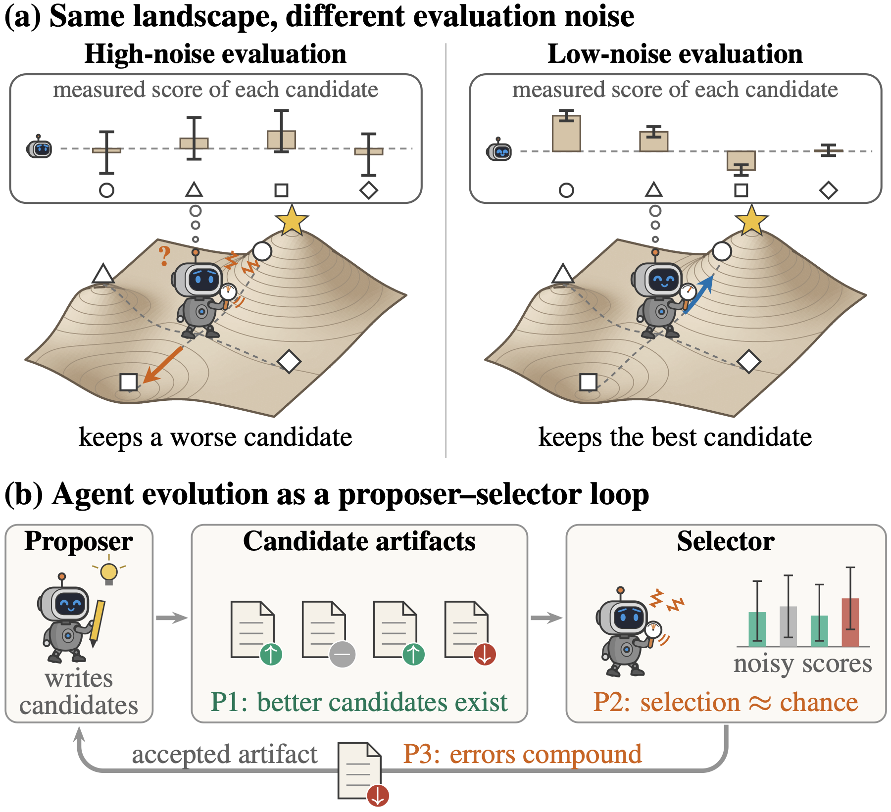

  <a class="zine-pill-link" data-i18n-zh="论文 arXiv:2611.23068 ↗" data-i18n-en="Paper · arXiv:2611.23068 ↗" href="https://arxiv.org/abs/2611.23068" target="_blank" rel="noopener">论文 arXiv:2611.23068 ↗</a>
  

    <button type="button" class="zine-lang-btn" data-lang-target="en" aria-pressed="false">EN</button>
    <button type="button" class="zine-lang-btn is-active" data-lang-target="zh" lang="zh-CN" aria-pressed="true">中文</button>
  

**TL;DR：** 社区普遍把 Agent 自进化停滞归因于模型提议能力不够，但将主流框架放入“提议—评估—选择”的零阶优化循环后，瓶颈往往出在评估信号本身。我们在 6 个模型、7 种框架与 13 个基准上跑了 1,030 次独立进化，按 $$\text{Var}(\hat{Y}) = \sigma^2 + \tau^2$$ 拆解单次得分方差后发现：单次运行的标准差（1.7–4.1 pp）超过了 60% 以上同基准方法对的真实差距，也正好覆盖 9 篇代表论文 3.4 pp 的中位领先幅度——按常规只跑 1 次实验，在 Terminal-Bench 上从 4 种方法里挑出第一名的概率只有 33%（盲猜是 25%）。这就是“分辨率假说”的核心：当真实改进低于评估系统的分辨下限时，选择器难以从噪声中辨认出有效改动；不过，单靠方差拆解还解释不了部分基准上动辄二三十分的涨幅，那是下一篇要拆解的问题。

> **《分辨率假说》系列（1/3）** · [论文 arXiv:2611.23068](https://arxiv.org/abs/2611.23068) · [项目主页与 30s 互动小游戏](/resolution-hypothesis/) · [幕后手记](/blog/2026/resolution-hypothesis-behind-the-scenes/)
> **连载导航**：**（一）原地踏步与方差拆解** · [（二）高通滤波器与捷径审计](/blog/2026/resolution-hypothesis-part-2/) · [（三）好 Skill 与挑不出来的选择器](/blog/2026/resolution-hypothesis-part-3/)

最近半年，我们团队花了不少精力去复现和折腾“自进化智能体（Self-Evolving Agents）”——当然，现在这个方向又换了个更时髦的叫法，叫“RSI”。设想本身自带吸引力：基座模型权重 $$W$$ 保持不动，只让智能体在与环境的交互中总结经验，反复修改外挂的持久化状态 $$A$$（可以是 Prompt、Skill 文档、Memory 记忆库，甚至直接改 Agent 脚手架代码 Harness），就能在测试时越用越强。

然而很遗憾，把市面上主流的进化算法拉到同一张桌子上横向评测后，情况却并不乐观：**不同论文里的结论经常互相打架**。同一个算法，在论文 A 的基准上稳步涨点，换到论文 B 里客串 Baseline 就几乎不动；一旦放到像 Terminal-Bench 这样贴近真实软件工程的任务上，多数方法跑上几轮就开始原地打转。

为了查清原因，我们在 6 个模型、7 种主流进化方法和 13 个基准上跑了 1,030 次独立进化实验，每次实验都要做上百次评估，累计超过 210 万条测试轨迹、1000 万次 LLM 调用。这三篇连载不打算逐个拆解工程技巧，而是想用一套朴素的视角，聊聊我们在这一千多次实验里理清的一个问题：**Agent 自进化为什么总是停在原地。**

---

动手分析数据之前，我们得先给自己找一个统一的坐标系。市面上改 Prompt 的有 GEPA，提炼 Skill 的有 SkillOpt 和 Trace2Skill，攒 Memory 的有 ReasoningBank，直接改 Agent 代码的还有 Meta-Harness 和 AHE。各家术语和工程脚手架五花八门，把它们放进同一个框子里当然会丢掉不少细节；我无意宣称下面这套抽象就是 Agent 进化的“终极本质”，但用来回答“它们为什么会一起失灵”这个问题，它足够顺手。

如果把传统的模型微调看作连续参数空间上的梯度下降 $$W_t = W_{t-1} - \eta \nabla L(W_{t-1})$$，Agent 进化面对的则是离散的文本或代码空间。外挂状态 $$A$$ 只能先影响智能体在环境里的多步采样轨迹（Trajectory），再换算成最终得分，中间隔着一层不可微的交互过程，自然没法对 $$A$$ 直接求导。

在这一约束下，现有的各类方法都可以放进同一个“提议—评估—选择（Propose–Evaluate–Select）”的零阶优化循环：

$$
C_t = \text{Propose}(A_{t-1}, \mathcal{T}_{\text{train}}), \quad A_t = \text{Select}\big(A_{t-1}, C_t; \hat{Y}\big) \tag{1}
$$

每一轮 $$t$$，提议器（Proposer）翻看训练轨迹 $$\mathcal{T}_{\text{train}}$$，写出一份候选产物 $$C_t$$；评估器在验证集上测出观测得分 $$\hat{Y}$$；选择器（Selector）再根据 $$\hat{Y}$$ 决定把哪些候选留到下一轮。

按式 (1) 归类，社区里七种代表性方法可以平铺在同一张表里——差异主要落在演化对象 $$A$$、提议粒度和选择规则这三列上：

| 进化方法          | 产物 $$A$$          | 提议算子 $$\text{Propose}$$        | 选择算子 $$\text{Select}$$                        |
| ----------------- | ------------------- | ---------------------------------- | ------------------------------------------------- |
| **GEPA**          | Prompt              | 每轮全量重写                       | 3-task 训练集门控 + 验证集 Pareto 前沿采样        |
| **SkillOpt-Lite** | Skill 文档          | 每轮生成 1 条局部编辑              | 验证集得分高出当前产物 $$\ge 2\text{ pp}$$ 则接受 |
| **Trace2Skill**   | Skill 文档          | 每条轨迹提取 1 个 Patch 并层级合并 | 退化选择器（无条件接受全部 Patch）                |
| **ReasoningBank** | Memory 记忆库       | 每任务提取 $$\le 3$$ 条记忆追加    | 退化选择器（无条件接受全部记忆）                  |
| **HarnessLens**   | 指令/Skill/工具描述 | 每轮生成 1 条编辑                  | 训练集配对检验确认 + 验证集取最优                 |
| **Meta-Harness**  | Harness 代码        | 每轮重写完整程序（共 5 轮）        | 5 个候选版本中取训练集最高分                      |
| **AHE**           | 完整代码工作区      | 每轮生成代码编辑（共 5 轮）        | 5 个版本中取验证集最高分                          |

> **说明**：像 Trace2Skill 和 ReasoningBank 这类在常规基准上“只提取经验追加、不按验证集分数过滤”的做法，放到式 (1) 里并不是没有选择器，而是相当于一个**接受概率恒为 $$1$$ 的退化选择器（Degenerate Selector）**。它跳过了用实机重跑来区分好坏建议这一步，面临的风险与被高噪声带偏的选择器差不多。

---

式 (1) 摆在眼前，这个循环想持续往上走，得同时指望两件事：第一，$$\text{Propose}$$ 真能写出更好的候选，也就是真实期望得分差 $$\Delta = Y(C_t) - Y(A_{t-1}) > 0$$；第二，$$\text{Select}$$ 得能仅凭观测得分 $$\hat{Y}$$ 把好候选认出来。

过去大家写论文，精力几乎全花在 $$\text{Propose}$$ 上——更细致的反思模板、树搜索、群体档案，设计越来越精巧——至于 $$\hat{Y}$$ 靠不靠谱，往往默认它是准的。这符合直觉，我们一开始复现时也没多想。然而回到具体机制上，这个前提并不成立：模型权重被冻结，一段外挂文本 $$A$$ 顶多微调模型推理时的行为倾向，单步改动带来的真实收益本就有限；偏偏 LLM 每跑一次多步轨迹，本身又带着不小的采样随机性。

{: style="display: block; max-width: 100%; width: auto; height: auto; max-height: 620px; margin: 1.5rem auto; object-fit: contain; border-radius: 8px;" }

打个比方（图 1a）：想象你在大雾天里爬山。提议器决定你试探着迈出一步后的真实海拔变化 $$\Delta$$（比如 $$+1$$ 米或 $$-1$$ 米），评估系统则是手里那块自带抖动的海拔表（随机误差 $$\pm 5$$ 米）。**当每一步的真实变化 $$\Delta$$ 小于仪表的测量误差时，盯着表盘选路，和抛硬币差不了多少。**

如果把一套评估流水线能在噪声中稳定辨认出的“最小真实改进量”叫作它的**分辨率（Resolution）**，我们在复现中遇到的种种怪象，便可以收拢为一个工作假说——**分辨率假说（The Resolution Hypothesis）**：

**限制 Agent 自进化的关键瓶颈，往往不是模型提议（Propose）不出更好的产物，而是评估系统的分辨率不足以把它们辨认（Identify）出来。**

这里顺手区分一个容易混淆的点。我们想说的并不是“评测有噪声，所以把统计门控卡严一点就行”（比如 PACE 那类 pre-commit gating 的思路）。这三篇连载要展开的机制更接近反馈信号本身的**测量分辨率下限**，它起的作用像一台**高通滤波器**：低于分辨率的细微真实改进会被噪声淹没，不管把选择规则调松（误接受噪声，越改越偏）还是调严（干脆拒绝一切改动，原地停滞），都没法凭空把信号变出来。只有幅度高于噪声水平的改动才能留下来——这既解释了硬任务上为什么容易停滞、榜单排名为什么总在打架，也埋下了另一个伏笔：为什么在某些基准上，模型又能动不动跑出 +20 到 +40 分的大幅跃升。

---

打比方只能给出直观理解；要验证是不是分辨率卡住了进化，还得把评估分数的方差拆解清楚。

考虑一个进化方法在某个基准上的表现。把产物 $$A$$ 的真实能力（无限次重复评估的期望得分）记作 $$Y(A) = \mathbb{E}[\hat{Y}\mid A]$$，单次评估拿到的观测分数就是 $$\hat{Y}(A) = Y(A) + \epsilon$$，其中 $$\epsilon$$ 是零均值的评估噪声。与此同时，进化过程本身也是随机的：同一个方法独立跑上几遍，每次产出的 $$A$$，真实质量 $$Y(A)$$ 也不尽相同。

按全方差公式（Law of Total Variance），单次运行报告出来的分数 $$\hat{Y}$$，总方差正好拆成两个正交的部分：

$$
\text{Var}(\hat{Y}) = \underbrace{\mathbb{E}_A\left[\text{Var}(\hat{Y} \mid A)\right]}_{\sigma^2\text{（评估噪声方差）}} + \underbrace{\text{Var}_A\left(\mathbb{E}[\hat{Y} \mid A]\right)}_{\tau^2\text{（运行间方差）}} \tag{2}
$$

这条式子并不复杂，却把两种常见场景的分辨率上限区分开来：

- 在进化循环内部（候选级），我们要判断**某一个固定候选产物 $$A$$** 有没有超过基线。此时 $$A$$ 已经定下来了，分辨率只受评估噪声 $$\sigma^2$$ 制约。
- 在论文主表里（方法级），我们要横向对比**两种进化方法**。因为每跑一次方法都会重新抽出一份新的产物 $$A$$，分辨率受总方差 $$\tau^2 + \sigma^2$$ 制约。换句话说，哪怕你把某次进化产出的单个产物在测试集上反复测上 100 遍，把测试评估噪声 $$\sigma^2/M$$ 压到接近 $$0$$，只要进化本身只跑了 1 次（$$R=1$$），你的方法得分依然甩不掉 $$\tau^2$$ 这块固有方差。

为了测出 $$\sigma$$ 和 $$\tau$$ 的具体数值，我们在 ALFWorld、SpreadsheetBench、OfficeQA 和 Terminal-Bench v2.1 四个基准上，把前面那 7 种方法和 6 个模型组成的 150 个配置，都独立跑了 $$R=8\sim 16$$ 次进化，每个产出的结果又在测试集上独立测了 $$M=8\sim 16$$ 遍，再用方差分析（ANOVA）的无偏矩估计量把 $$\hat{\sigma}$$ 和 $$\hat{\tau}$$ 拆了出来。

{: style="display: block; max-width: 100%; width: auto; height: auto; max-height: 620px; margin: 1.5rem auto; object-fit: contain; border-radius: 8px;" }

将这组测量结果与已发表文献对照，三个事实一目了然：

1. **绝大多数方法之间的真实差距，落在一个单次运行标准差以内。** 在这四个基准上，评估噪声 $$\sigma$$ 分布在 $$1.0\sim 4.5\text{ pp}$$（百分点），运行间标准差 $$\tau$$ 分布在 $$0\sim 12.3\text{ pp}$$。合在一起，一个方法“进化一次、评估一次”的单次标准差 $$s = \sqrt{\tau^2 + \sigma^2}$$，各基准中位数在 $$1.7\sim 4.1\text{ pp}$$。把同模型、同基准的全部 341 对方法两两比较，**超过 60% 的真实均值差距小于单次对比的一个标准差 $$\sqrt{s_1^2 + s_2^2}$$**（图 2a 的阴影区）。
2. **现有论文报告的 SOTA 领先幅度，正好落在同一条噪声带里。** 我们翻了 9 篇代表性 Agent 进化论文的主表，一共 171 列有效对比，新方法领先同列最强对手的中位差距是 $$3.4\text{ pp}$$（四分位距 $$1.2\sim 6.6\text{ pp}$$）。这 171 列里，**没有一列附带方差或误差棒**，其中 152 列连跑了几次进化都没写明。倒也不必苛责作者——多跑几遍的算力成本不低，单次报告早成了大家心照不宣的默认习惯；只是习惯久了，难免出现一些耐人寻味的副产品，比如有 4 篇论文在重跑别人家最强竞争方法时，跑出来的分数甚至低于什么都不加的零样本 Baseline。
3. **按单次运行排座次，和随机抽签差不了多少。** 从式 (2) 可以直接推导出，想在显著性水平 $$\alpha=0.05$$、统计功效 $$1-\beta=80\%$$ 下分辨出 $$\Delta$$ 的真实差距，每个方法至少需要独立跑多少次进化：

   $$
   N \ge 2 \cdot \left(\frac{z_{1-\alpha/2} + z_{1-\beta}}{\Delta}\right)^2 \cdot \left(\tau^2 + \frac{\sigma^2}{M}\right) \tag{3}
   $$

   代进文献中位差距 $$\Delta = 3.4\text{ pp}$$（单次评估 $$M=1$$），在 SpreadsheetBench、OfficeQA、ALFWorld 和 Terminal-Bench 上，每个方法分别需要独立跑 **5 次、10 次、19 次和 23 次**进化；如果差距缩小到下四分位的 $$1.2\text{ pp}$$，Terminal-Bench 上得跑 **181 次**。这与眼下普遍只跑 1 次的惯例相比，缺口悬殊。真按每个方法跑 1 次来比，在 Terminal-Bench 上从 4 种文本进化方法里挑出真正第一名的概率只有 33%（纯盲猜是 25%），把 4 个方法的完整顺序全排对的概率只有 8%。

---

拆解完方法级方差，不同论文里那两三个点的榜单洗牌，也就有了合理解释。

然而，单靠方差拆解还解释不了全貌，甚至立刻会撞上一个绕不开的反例：**既然单次运行的分辨率连 $$3\sim 4\text{ pp}$$ 的改进都难以分辨，那为什么在 SpreadsheetBench、LiveMathematicianBench 或 AIME 这类基准上，前人论文和我们自己的实验依然能跑出 $$+20\text{ pp}$$ 甚至 $$+40\text{ pp}$$ 的涨幅？**

换句话说，噪声只是故事的一半。在[下一篇](/blog/2026/resolution-hypothesis-part-2/)里，我们拆开那些涨了三四十分的进化产物，看看模型究竟往里面写了什么。

---

如果这篇笔记对你有所启发，欢迎翻翻论文全文 [arXiv:2611.23068](https://arxiv.org/abs/2611.23068)，去[项目主页](/resolution-hypothesis/)逛逛交互式数据和 30 秒小游戏，或者在 [HuggingFace Papers](https://huggingface.co/papers/2611.23068) 留条评论接着聊。

**TL;DR:** Most work on agent self-evolution assumes progress stalls because models cannot propose better edits, yet viewing mainstream frameworks through a zeroth-order Propose–Evaluate–Select loop points to a quieter bottleneck in the evaluation signal itself. Across 1,030 independent evolution runs spanning 6 models, 7 methods, and 13 benchmarks, decomposing single-run variance into $$\text{Var}(\hat{Y}) = \sigma^2 + \tau^2$$ shows that a single run's standard deviation (1.7–4.1 pp) exceeds the true mean gap in over 60% of same-benchmark method pairs and covers the 3.4 pp median margin reported across 9 papers—leaving single-run top-1 identification among 4 methods on Terminal-Bench at 33% (versus 25% random chance). That observation motivates _The Resolution Hypothesis_ as a practical working lens: below an evaluator's resolution floor, selectors cannot reliably tell good edits from noise—though variance decomposition alone does not explain the +20 to +40 pp jumps seen on certain benchmarks, which Part 2 takes up next.

> **_The Resolution Hypothesis_ Series (1/3)** · [Paper arXiv:2611.23068](https://arxiv.org/abs/2611.23068) · [Project Page & 30s Interactive Game](/resolution-hypothesis/) · [Behind the Scenes](/blog/2026/resolution-hypothesis-behind-the-scenes/)
> **Series Navigation**: **(1) Running in Place & Variance Decomposition** · [(2) The High-Pass Filter & Shortcut Audit](/blog/2026/resolution-hypothesis-part-2/) · [(3) Good Skills & Selectors That Miss Them](/blog/2026/resolution-hypothesis-part-3/)

Over the past six months, our team spent a good stretch of time reproducing and stress-testing "Self-Evolving Agents"—a line of work that has lately acquired a sleeker label, "RSI." The premise is attractive: leave the base model's weights $$W$$ untouched, let the agent reflect on its own environment interactions, and iteratively edit an external persistent artifact $$A$$—a prompt, a skill document, a memory bank, or the agent's harness code—so its performance improves at test time.

Unfortunately, lining the field's mainstream algorithms up on the same benchmarks told a different story: **published conclusions routinely contradicted one another.** The same algorithm would post tidy gains on Paper A's benchmark, sit flat when borrowed as a baseline in Paper B, and stall within a handful of rounds on realistic software-engineering tasks like Terminal-Bench.

To trace the cause, we ran 1,030 independent evolution experiments across 6 models, 7 mainstream frameworks, and 13 benchmarks, with hundreds of evaluations per experiment—over 2.1 million trajectories and 10 million LLM calls in total. Rather than dissecting method-specific engineering tricks, these three posts take a plainer view of one question: **why does agent self-evolution keep running in place?**

---

Before digging into numbers, it helps to put these methods on a common coordinate system. Some rewrite prompts (GEPA), some distill skills (SkillOpt, Trace2Skill), some accumulate memories (ReasoningBank), and others rewrite agent source code directly (Meta-Harness, AHE). Compressing that variety into a single template inevitably throws away engineering nuances; I make no claim that the abstraction below is the "true essence" of agent evolution, only that it turned out to be a practical lens for seeing why so many different methods hit the same wall.

If conventional fine-tuning is gradient descent in continuous parameter space, $$W_t = W_{t-1} - \eta \nabla L(W_{t-1})$$, agent evolution operates in a discrete space of text or code. Because the external artifact $$A$$ only translates into a score through multi-step stochastic rollouts (trajectories) in an environment, there is no gradient with respect to $$A$$ to follow.

Under that constraint, existing approaches fit into the same zeroth-order "Propose–Evaluate–Select" loop:

$$
C_t = \text{Propose}(A_{t-1}, \mathcal{T}_{\text{train}}), \quad A_t = \text{Select}\big(A_{t-1}, C_t; \hat{Y}\big) \tag{1}
$$

In each round $$t$$, a proposer inspects training trajectories $$\mathcal{T}_{\text{train}}$$ and drafts a candidate artifact $$C_t$$; an evaluator measures its observed validation score $$\hat{Y}$$; and a selector uses $$\hat{Y}$$ to decide which candidates carry over to the next round.

Grouping the community's seven representative methods under Eq. (1) lays them out in one table—their differences come down to the evolved artifact $$A$$, the proposal granularity, and the selection rule:

| Method            | Artifact $$A$$                | Proposer $$\text{Propose}$$                    | Selector $$\text{Select}$$                                               |
| ----------------- | ----------------------------- | ---------------------------------------------- | ------------------------------------------------------------------------ |
| **GEPA**          | Prompt                        | Full rewrite each round                        | 3-task train gate + validation Pareto-front sampling                     |
| **SkillOpt-Lite** | Skill document                | 1 localized edit per round                     | Accept if validation score beats current artifact by $$\ge 2\text{ pp}$$ |
| **Trace2Skill**   | Skill document                | 1 patch per trajectory, hierarchically merged  | Degenerate selector (unconditionally accepts all patches)                |
| **ReasoningBank** | Memory bank                   | Extract and append $$\le 3$$ memories per task | Degenerate selector (unconditionally accepts all memories)               |
| **HarnessLens**   | Instructions / skills / tools | 1 edit per round                               | Paired test confirmation on train + best-on-validation                   |
| **Meta-Harness**  | Harness code                  | Full program rewrite per round (5 rounds)      | Best training score across 5 candidates                                  |
| **AHE**           | Full code workspace           | Code edit per round (5 rounds)                 | Best validation score across 5 versions                                  |

> **Note**: Methods like Trace2Skill and ReasoningBank—which append extracted lessons without filtering on validation scores on standard benchmarks—are not "selector-free" in Eq. (1). They act as a **degenerate selector with constant acceptance probability $$1$$**: skipping live re-execution to separate helpful advice from unhelpful advice leaves them exposed to much the same drift as a selector misled by noisy scores.

---

Looking at Eq. (1), climbing steadily requires two things to hold at once: $$\text{Propose}$$ has to produce better candidates (true expected gain $$\Delta = Y(C_t) - Y(A_{t-1}) > 0$$), and $$\text{Select}$$ has to recognize them from the observed score $$\hat{Y}$$.

Most papers in this literature focused almost entirely on $$\text{Propose}$$—more elaborate reflection prompts, tree search, population archives—while treating $$\hat{Y}$$ as reliable by default. That assumption is natural; we did not question it at first either. Yet the underlying mechanics push the other way: with weights frozen, a block of text $$A$$ only nudges inference-time behavior, so real single-step gains are modest, whereas every multi-step LLM rollout carries substantial sampling variance of its own.

{: style="display: block; max-width: 100%; width: auto; height: auto; max-height: 620px; margin: 1.5rem auto; object-fit: contain; border-radius: 8px;" }

A physical analogy makes this concrete (Fig. 1a): imagine hiking up a mountain in thick fog. The proposer sets the true elevation change $$\Delta$$ of each candidate step (say, $$+1$$ meter or $$-1$$ meter), while the evaluator is the altimeter in your hand, jittering randomly by $$\pm 5$$ meters. **When your true step size $$\Delta$$ is smaller than the instrument's measurement error, choosing your next step off the dial is barely different from flipping a coin.**

If we call the smallest true improvement an evaluation pipeline can reliably separate from noise its **Resolution**, the conflicting patterns from our reproductions converge on a working hypothesis—what we call **The Resolution Hypothesis**:

**The limiting bottleneck in agent self-evolution is often not that models fail to propose better artifacts, but that evaluation systems lack the resolution to identify them.**

One distinction is worth drawing upfront. This is not just saying "evaluation is noisy, so tighten the statistical gate" (as in pre-commit gating methods like PACE). The constraint we trace across these three posts sits in the feedback signal's own **measurement resolution floor**, which behaves like a **high-pass filter**: real incremental gains below the floor disappear into noise whether you loosen the selection rule (accepting false positives and drifting) or tighten it (rejecting everything and stalling at initialization). Neither knob can manufacture signal that is not there. Only edits large enough to rise above the noise level make it through—which accounts for both the stalling and ranking reversals on hard tasks, while hinting at why certain benchmarks still exhibit +20 to +40 pp leaps.

---

A foggy mountain only supplies intuition; to test whether resolution is the bottleneck, we need to decompose the score variance directly.

Consider an evolution method evaluated on a benchmark. Let $$Y(A) = \mathbb{E}[\hat{Y}\mid A]$$ be an artifact $$A$$'s true capability (its expected score over infinitely many evaluations), so a single observed evaluation is $$\hat{Y}(A) = Y(A) + \epsilon$$ with zero-mean evaluation noise $$\epsilon$$. At the same time, evolution itself is stochastic: running the same method independently draws artifacts $$A$$ whose true qualities $$Y(A)$$ vary from run to run.

By the Law of Total Variance, the total variance of a single reported score $$\hat{Y}$$ splits into two orthogonal terms:

$$
\text{Var}(\hat{Y}) = \underbrace{\mathbb{E}_A\left[\text{Var}(\hat{Y} \mid A)\right]}_{\sigma^2\;\text{(evaluation noise)}} + \underbrace{\text{Var}_A\left(\mathbb{E}[\hat{Y} \mid A]\right)}_{\tau^2\;\text{(between-run variance)}} \tag{2}
$$

Elementary as Eq. (2) is, it separates two regimes that are easy to conflate in practice:

- Inside the evolution loop (candidate level), when judging whether **one fixed candidate $$A$$** beats the baseline, $$A$$ is held fixed, so resolution is bounded only by evaluation noise $$\sigma^2$$.
- In a paper's main table (method level), when comparing **two evolution methods**, every run draws a fresh artifact $$A$$, so resolution is bounded by the total variance $$\tau^2 + \sigma^2$$. Even if you re-evaluate a single evolved artifact 100 times on the test set (pushing test noise $$\sigma^2/M$$ close to $$0$$), running evolution only once ($$R=1$$) still leaves your method score carrying the full irreducible between-run variance $$\tau^2$$.

To put concrete numbers on $$\sigma$$ and $$\tau$$, we ran all 150 configurations across the 7 methods and 6 models on ALFWorld, SpreadsheetBench, OfficeQA, and Terminal-Bench v2.1 for $$R=8\sim 16$$ independent evolution runs each, evaluated every resulting artifact $$M=8\sim 16$$ independent times on the test set, and separated $$\hat{\sigma}$$ and $$\hat{\tau}$$ with unbiased ANOVA moment estimators.

{: style="display: block; max-width: 100%; width: auto; height: auto; max-height: 620px; margin: 1.5rem auto; object-fit: contain; border-radius: 8px;" }

Setting those measurements beside the published literature makes three things hard to miss:

1. **The true gap between most methods sits inside a single run's standard deviation.** Across the four benchmarks, evaluation noise $$\sigma$$ runs from $$1.0\sim 4.5\text{ pp}$$ (percentage points), and between-run standard deviation $$\tau$$ spans $$0\sim 12.3\text{ pp}$$. Putting both together, the single-run standard deviation $$s = \sqrt{\tau^2 + \sigma^2}$$ ("evolve once, evaluate once") has a per-benchmark median of $$1.7\sim 4.1\text{ pp}$$. Across all 341 same-model, same-benchmark method pairs, **over 60% of true mean differences fall within one single-run comparison standard deviation $$\sqrt{s_1^2 + s_2^2}$$** (the shaded region in Fig. 2a).
2. **Published SOTA margins land right inside that noise band.** Across 171 valid comparison columns in the main tables of 9 representative agent-evolution papers, the median margin of the proposed method over the strongest competing method is $$3.4\text{ pp}$$ (interquartile range $$1.2\sim 6.6\text{ pp}$$). Across all 171 columns, **not one reports variance or error bars**, and 152 do not state how many evolution runs were performed. It is easy to see how that norm took hold—repeated evolution runs are expensive, and single-run tables became everyone's default habit. Left unchecked, the habit produces telling side effects: in 4 papers, re-running a rival paper's strongest competitor scored _below_ the zero-shot baseline.
3. **Single-run rankings sit close to a coin toss.** From Eq. (2), resolving a true gap $$\Delta$$ at significance level $$\alpha=0.05$$ and statistical power $$1-\beta=80\%$$ requires the following number of independent evolution runs per method:

   $$
   N \ge 2 \cdot \left(\frac{z_{1-\alpha/2} + z_{1-\beta}}{\Delta}\right)^2 \cdot \left(\tau^2 + \frac{\sigma^2}{M}\right) \tag{3}
   $$

   At the literature's median margin $$\Delta = 3.4\text{ pp}$$ (with a single evaluation $$M=1$$), resolving the gap takes **5, 10, 19, and 23 independent evolution runs per method** on SpreadsheetBench, OfficeQA, ALFWorld, and Terminal-Bench respectively—and at the lower quartile of $$1.2\text{ pp}$$, Terminal-Bench takes **181 runs**. That is a long way from current reporting budgets. Under the usual 1-run convention, picking the true #1 among 4 text-evolution methods on Terminal-Bench succeeds 33% of the time (pure guessing is 25%), and getting the full 4-method ordering right happens only 8% of the time.

---

With that method-level variance decomposition in hand, it is straightforward to see why algorithms keep trading places inside a two-to-four-point band across papers.

Yet variance decomposition does not explain everything, and it leaves a conspicuous counterexample: **if single-run evaluation can barely resolve a $$3\sim 4\text{ pp}$$ gain, how do prior papers and our own experiments still produce $$+20\text{ pp}$$ or even $$+40\text{ pp}$$ jumps on benchmarks like SpreadsheetBench, LiveMathematicianBench, and AIME?**

Measurement noise is only half the story. In [Part 2](/blog/2026/resolution-hypothesis-part-2/), we open up those +30-point artifacts to see what the models wrote into them.

---

If you find these notes useful, you are welcome to read the full paper on [arXiv:2611.23068](https://arxiv.org/abs/2611.23068), explore the interactive data and 30-second game on the [project page](/resolution-hypothesis/), or drop a comment on [HuggingFace Papers](https://huggingface.co/papers/2611.23068).

