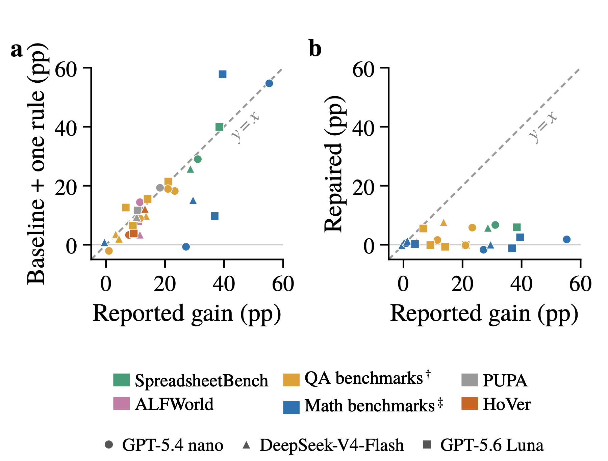

  <a class="zine-pill-link" data-i18n-zh="论文 arXiv:2611.23068 ↗" data-i18n-en="Paper · arXiv:2611.23068 ↗" href="https://arxiv.org/abs/2611.23068" target="_blank" rel="noopener">论文 arXiv:2611.23068 ↗</a>
  

    <button type="button" class="zine-lang-btn" data-lang-target="en" aria-pressed="false">EN</button>
    <button type="button" class="zine-lang-btn is-active" data-lang-target="zh" lang="zh-CN" aria-pressed="true">中文</button>
  

**TL;DR：** 高噪声评估在进化循环里起着高通滤波器的作用：只帮一两道题提分 2.5–5 pp 的技巧容易被方差盖住，在噪声中可辨识的，往往是跨全题库生效的评测捷径。逐行核对 12 个基准的评测器源码与进化产物后，在全部 27 组原涨幅超 3 pp 的配置上，仅往未进化基线后补一句话，就能复现中位数 90% 的收益；修好评测问题后，中位涨幅从 17.6 pp 降到了 0.8 pp。优化器本身并没有出错，它只是在追逐最可靠的信号——SpreadsheetBench 上同一条规则“30 分时 8/8 留下、6 分时 12 里只剩 2”，以及 LiveMathematicianBench 上进化花多轮打磨话术说服模型走捷径，都直观说明了这一点。清理掉这些表面增益后，高难度基准仍留有大块提升空间，也把问题推向下一篇：没有捷径可走时，好 Skill 究竟写不写得出来，又是在哪一步弄丢的。

> **《分辨率假说》系列（2/3）** · [论文 arXiv:2611.23068](https://arxiv.org/abs/2611.23068) · [项目主页与 30s 互动小游戏](/resolution-hypothesis/) · [幕后手记](/blog/2026/resolution-hypothesis-behind-the-scenes/)
> **连载导航**：[（一）原地踏步与方差拆解](/blog/2026/resolution-hypothesis-part-1/) · **（二）高通滤波器与捷径审计** · [（三）好 Skill 与挑不出来的选择器](/blog/2026/resolution-hypothesis-part-3/)

在[上一篇](/blog/2026/resolution-hypothesis-part-1/)里，我们通过方差分解 $$\text{Var}(\hat{Y}) = \sigma^2 + \tau^2$$ 把噪声边界拆解清楚了：常规 Agent 评估的单次标准差在 $$1.7\sim 4.1\text{ pp}$$ 之间，两三个百分点的方法差距，大多会被单次采样的噪声盖过去。

不过上一篇末尾留了个悬念。无论是在文献里，还是在我们自己跑出的复现网格里，确实存在不少看似可靠的数字：在 SpreadsheetBench、LiveMathematicianBench、AIME 2025 这些基准上，进化后的产物比 Baseline 高出 $$10\sim 40\text{ pp}$$，超出了单次运行的噪声区间。

看到这种涨幅，第一反应自然是：至少在这些任务上，进化算法学到了真本事。

然而很遗憾，对照评测器源码逐行核对这些高涨幅产物后，事实并非如此。**在进化循环里，高噪声的评估系统起着高通滤波器（High-Pass Filter）的作用。**

---

道理可以直观理解。假设验证集有 40 道各不相同的任务，单次评估的噪声标准差为 $$3\sim 4\text{ pp}$$。

如果提议器（Proposer）总结出一条**扎实、但只适用于某类具体问题**的工程习惯——比如“处理 CSV 缺失值前先检查文件编码”——它也许能帮智能体多做对 1 到 2 道题，带来的真实提升约为 $$\Delta \approx 2.5\sim 5\text{ pp}$$。放在单次评估的噪声里，这点收益容易被一次偶然的采样波动抹平，选择器（Selector）难以辨识出来。

反过来，什么样的改动能在单步拉出 $$+20\sim 40\text{ pp}$$ 的差距，在噪声中清晰可辨并被选择器留下来？

它多半是一条**跨过具体题目内容、能同时撬动测试集里大多数题目的全局规则**。而在现有基准测试里，能做到这一点的，往往不是领域能力的跃迁，而是刚好踩中评测器习惯或漏洞的**评估捷径（Evaluation Shortcuts）**。

公道地说，进化算法找到这种捷径，既不是“作弊”，也不是优化器坏了。恰恰相反，这说明优化器正在按既定目标工作——循环里哪种信号高于噪声水平、最为可靠，选择压力就会顺着它往下推。噪声越高，局部改进能被辨识的空间越窄，最后留存下来的，自然只剩幅度最大的全局捷径。

为了验证这个判断，我们对 12 个基准上报告的最大涨幅做了两项对照审计：

1. **一句话测试（The One-Rule Test）**：进化出来的 Skill 或 Prompt 动辄写满几十条指令。我们先用 LLM 辅助筛选，再对照评测器源码逐条人工核对，从中只抽出**一句话**，原封不动地拼在未进化的 Baseline 后面，其余一字不改；
2. **修复评估测试（Repaired Evaluation）**：把评测脚本里偏离基准原意的问题修好——比如恢复官方公式重算、把严格字符串匹配换成语义等价判分、核查题目里的泄露或残缺项——然后拿同一批进化产物重新测分。

{: style="display: block; max-width: 100%; width: auto; height: auto; max-height: 620px; margin: 1.5rem auto; object-fit: contain; border-radius: 8px;" }

跑出来的数字整齐得有点不好意思：在全部 27 个原涨幅超过 $$3\text{ pp}$$ 的“模型-基准”对里，**只往 Baseline 后面补这一句话，就复现了完整进化算法中位数 90% 的涨幅**（图 3a）；而修好评测器问题后，**中位涨幅从 17.6 pp 降到了 0.8 pp**（图 3b）。哪怕在修复后的评测器上从头重跑进化，原本二三十分的涨幅再也没有出现。

---

比起汇总柱状图，审计中翻出的几个具体案例更能把“进化如何受分辨率支配”讲透。完整细节记在论文 [arXiv:2611.23068](https://arxiv.org/abs/2611.23068) 的附录 E 里，这里看三个代表性案例。

**先看 SpreadsheetBench 上那道“30 分 vs 6 分”的门槛。** 在 SpreadsheetBench 上，无论是原论文还是我们的复现，进化方法都能拿到 $$+30\sim 40\text{ pp}$$ 的提升，乍看之下像是学会了某种高阶电子表格建模能力。然而打开进化产物就会发现，真正起作用的核心只有一句话：_“严禁向单元格写入 Excel 公式字符串，必须在 Python 中算出结果数值后直接填入纯数字或文本。”_

写好的 Excel 公式怎么会被判错？原因出在评测脚本上：随某个方法开源的评测脚本读取生成的 `.xlsx` 文件时，没有调用电子表格引擎重算公式（Recalculate）。所有未带缓存结果的公式单元格读出来全是空的，直接记 0 分。工程上漏掉重算步骤并不少见，但放进进化循环里，就成了最清晰的优化信号。

修好评测器后的变化更有意思。我们按官方评测标准接入 LibreOffice，在判分前重算工作簿公式，同一批进化产物（以 GPT-5.4 nano 为例）的涨幅从 $$+31.1\text{ pp}$$ 降到了 $$+6.7\text{ pp}$$。为什么还剩约 $$6\text{ pp}$$ 的正收益？因为有几道题用到了较新的 Excel 函数，连 LibreOffice 也算不出来，所以“用 Python 算好再填数值”在修好的评测器下，依然是一条能带来 $$6\text{ pp}$$ 真实收益的策略。

按直觉，既然修好评测器后这条规则仍有 $$+6\text{ pp}$$ 的收益，从头重跑进化应该还能学会它。

然而事实并非如此。把验证集规模拆解清楚就能直观理解：验证集共 39 道题，$$+6\text{ pp}$$ 折算下来只有 **2 到 3 道题**的差距，刚好落进单次评估的随机噪声里。于是同一条规则出现了截然不同的命运：在旧评测器下（收益 $$30\text{ pp}$$），8 次独立运行全部学会并留住了这一行为（8/8）；换到修复后的评测器下（收益 $$6\text{ pp}$$），12 次重跑里有一半曾在中间轮次提议过这句话，但走到最后留下来并照着执行的，只剩 **2 次**（2/12）。一模一样的一条规则，值 $$30\text{ pp}$$ 时次次都能被接住，降到 $$6\text{ pp}$$ 就被噪声淹没——分辨率决定进化能留住什么，这是最直接的对照。

**再看 LiveMathematicianBench：模型不肯走捷径，进化就学着去做思想工作。** LiveMathematicianBench 把最新 arXiv 数学论文的定理改写成了五选一选择题。核对数据时我们发现一个构建巧合：全部 177 道题里，有 85 道包含一个选项——“其余选项中有一个是正确的，但可以证明一个更强的结果（stronger result）”。只要这个选项出现，它 100% 是标准答案（测试集 106 道题里占 46 道）。

按理说，“一句话测试”在这里应该直接通关。然而结果出乎意料：把大白话规则——_“如果某个选项说其余某项正确但能证明更强结果，就选它”_——拼到 Baseline 后面时，三个模型在含该选项的题目上照做的比例分别只有 **4%、54% 和 27%**；完整进化出来的 Skill，照做比例却达到 **67%、86% 和 92%**。

把答案喂到嘴边，模型为什么不吃？原因在于训练成熟的基座模型自带一点“数学自尊心”：面前摆着一道正经的图论或代数定理题，直白地命令它跳过推导、选一个含糊的兜底选项，模型在推理时会犯嘀咕，干脆不听指令。

把完整进化出来的 Skill 文本逐段拆开才发现，进化循环在多轮迭代里，对着基座模型的心理防线做了一整套“修辞优化”：

1. 先给出一个听起来像模像样的学术理由：提醒模型，出题人写的具体数学选项 _“几乎总是被故意弱化表述的（almost always deliberately understated）”_；
2. 接着把举证责任倒置：规定除非能严格证明某个具体选项的界已经是紧致的（sharp），否则默认选“更强结果”；
3. 最后列出这类选项常见的措辞变体，并在输出最终答案前再叮嘱一遍。

这事说明了一个机制：只要捷径的收益高于噪声水平，选择压力不仅能找出它，还会花上多轮迭代专门打磨话术，把基座模型哄顺。而拿掉这 46 道题、只看测试集剩下的 60 道正常数学题，所有模型的进化收益都回到了零附近（$$-1.7\sim 0.0\text{ pp}$$）。

**最后看审计中碰到的两个基准插曲：SearchQA 和 ALFWorld**（细节见论文附录 E.3 与 E.4）。

SearchQA 的设计初衷，是考察模型从给定搜索引擎片段（Snippets）里抽取答案的能力。原版评测用了严格字面匹配——比如 `"George Calvert (the 1st Lord Baltimore)"` 会被判错，只认更短的写法——进化算法靠约束模型输出最短跨度，就拿到了十几个点的涨幅。换用语义判分后，本以为检索片段终于能发挥作用；然而把题目里提供的**所有搜索片段全部删掉、让模型闭卷裸考**时，DeepSeek-V4-Flash 的得分反而从 89.4% 升到了 90.2%，GPT-5.6 Luna 从 89.8% 升到了 90.7%。撤掉检索证据，分数不仅没跌，还略微上升：模型凭预训练记忆就能答出这些题，剩下的错题里，有 36% 是因为原数据集中 Jeopardy 题目丢掉了分类上下文，成了谁看都猜不准的死题。

ALFWorld 则是另一种情况。在 ALFWorld 上，代码进化方法 Meta-Harness 和 AHE 在 DeepSeek-V4-Flash 和 GPT-5.6 Luna 上都涨了 $$16\sim 32\text{ pp}$$，乍看像是学会了复杂的具身规划。然而翻出代码 diff 一看，原因简单得多：初始 Baseline Agent 的代码里写死了一个过窄的超参，**只保留最近 2 步的交互历史（History）**。智能体刚走两步，就忘了前脚刚搜过哪个抽屉。其中一次进化运行别的逻辑都没改，只放开这行历史窗口限制，单步就多拿了 $$+29\text{ pp}$$。起步脚手架顺手写个保守默认值在工程上常见，但放进进化循环里，最先被优化出来的自然是这行配置，而不是空间规划策略。

---

聊完这些案例，没必要把板子打在具体哪篇论文或评测脚本上。写基准、搭脚手架本就是繁琐的工程活，漏掉公式重算、写窄历史窗口，或在几百道题里留下出题模板痕迹，都是研究工程里的常见疏忽。更值得留意的，是背后的筛选机制：进化循环本身不区分“真本事”和“评测捷径”，它只认信噪比。哪条改动的收益高于噪声水平、信号清晰可靠，优化就会往哪边用力。

把这些捷径和配置插曲清理掉后，现状反而清晰了：

- 在 DocVQA、AIME 2025、PUPA 这些基准上，修好评测后的 Baseline 本身已考到 $$88\sim 97$$ 分，天花板（Headroom）本来就没剩多少；
- 而在 **Terminal-Bench**、**OfficeQA** 这类硬骨头基准上，Baseline 离满分还有 $$30\sim 45\text{ pp}$$ 的空间，同时没有表面捷径可钻。到了这里，现有进化算法集体减速，增益只剩 $$1.0\sim 3.6\text{ pp}$$，又掉回了单次运行的标准差里。

到这一步，真正的核心问题才浮出水面：撤掉评测捷径之后，面对 Terminal-Bench 这样的难题，大模型究竟写不写得出有用的好 Skill？如果写得出来，那些好 Skill 又是在进化循环的哪一步弄丢的？

在[最后一篇](/blog/2026/resolution-hypothesis-part-3/)里，我们把提议器（Proposer）和选择器（Selector）拆开，进候选池里面找答案。

**TL;DR:** Inside an evolution loop, noisy evaluation acts as a high-pass filter: task-specific habits worth 2.5–5 pp vanish into rollout variance, while benchmark-wide shortcuts stay legible above the noise. Auditing graders and evolved artifacts line by line across 12 benchmarks, appending a single sentence to the unevolved baseline recovers a median 90% of gains above 3 pp across 27 model–benchmark pairs, and repairing the graders drops the median gain from 17.6 pp to 0.8 pp. The optimizer is not broken—it optimizes whatever signal rises clearly above the noise, retaining the same SpreadsheetBench rule 8/8 times at 30 pp versus 2/12 times at 6 pp, and spending rounds refining persuasive copy on LiveMathematicianBench to talk models into a shortcut. Once those artifacts are cleared, hard benchmarks still leave wide headroom, raising the question for Part 3: without shortcuts, can models propose useful skills at all, and where do they get lost?

> **_The Resolution Hypothesis_ Series (2/3)** · [Paper arXiv:2611.23068](https://arxiv.org/abs/2611.23068) · [Project Page & 30s Interactive Game](/resolution-hypothesis/) · [Behind the Scenes](/blog/2026/resolution-hypothesis-behind-the-scenes/)
> **Series Navigation**: [(1) Running in Place & Variance Decomposition](/blog/2026/resolution-hypothesis-part-1/) · **(2) The High-Pass Filter & Shortcut Audit** · [(3) Good Skills & Selectors That Miss Them](/blog/2026/resolution-hypothesis-part-3/)

In [Part 1](/blog/2026/resolution-hypothesis-part-1/), the variance decomposition $$\text{Var}(\hat{Y}) = \sigma^2 + \tau^2$$ established a plain baseline: a single run on an agent benchmark carries a standard deviation of $$1.7\sim 4.1\text{ pp}$$. Two or three percentage points of separation between methods disappear into rollout noise.

Part 1 left one loose thread. Both prior papers and our own reproduction grid contain numbers that look solid on the surface: on SpreadsheetBench, LiveMathematicianBench, and AIME 2025, evolved artifacts finish $$10\sim 40\text{ pp}$$ ahead of the baseline, past any single-run variance band.

Seeing jumps that large, the natural first conclusion is that evolution must have learned something real on those benchmarks.

Unfortunately, checking those high-gain artifacts line by line against the grader source code tells a different story. **Inside an evolution loop, a noisy evaluator acts as a high-pass filter.**

---

The mechanism is straightforward. Suppose a validation split has 40 distinct tasks and an evaluation noise standard deviation of $$3\sim 4\text{ pp}$$.

If the proposer distills a **solid, task-specific engineering habit**—say, checking file encoding before handling missing CSV values—it might flip 1 or 2 failing tasks to passes, a gain of $$\Delta \approx 2.5\sim 5\text{ pp}$$. Under single-run variance, one unlucky rollout erases that margin, so the selector rarely recognizes it.

Now consider the opposite case: what edit produces a $$+20\sim 40\text{ pp}$$ jump in one step, standing out above the noise so the selector locks it in?

Almost by necessity, it has to be **a global rule that bypasses task specifics and moves most of the test set at once.** On current benchmarks, what delivers that blanket lift is rarely a leap in domain capability—it is usually an **Evaluation Shortcut** matched to a quirk in the grader.

To be fair to the algorithms, finding a shortcut is neither "cheating" nor a broken optimizer. On the contrary, the optimizer is doing its job: selection pressure pushes on whichever signal rises clearly above the noise. The noisier the evaluation, the narrower the odds for incremental local fixes, until only the largest global shortcuts survive.

To test that reading, we ran two controlled checks across the largest reported gains on 12 benchmarks:

1. **The One-Rule Test**: Evolved skills and prompts often span dozens of instructions. Using LLM-assisted screening and manual verification against the grader code, we extracted **a single sentence** and appended it verbatim to the unevolved baseline, changing nothing else.
2. **Repaired Evaluation**: We patched places where the evaluation script departed from the benchmark's intent—restoring official spreadsheet recalculation, replacing strict string matching with semantic equivalence, and auditing leaked or broken items—then re-scored the same evolved artifacts.

{: style="display: block; max-width: 100%; width: auto; height: auto; max-height: 620px; margin: 1.5rem auto; object-fit: contain; border-radius: 8px;" }

The numbers lined up almost too neatly. Across all 27 model–benchmark pairs with an original gain above $$3\text{ pp}$$, **appending that one sentence to the baseline recovered a median 90% of the full evolutionary gain** (Fig. 3a). Once the graders were repaired, **the median gain dropped from 17.6 pp to 0.8 pp** (Fig. 3b). Re-running evolution from scratch under the repaired graders did not bring those jumps back.

---

Summary bars give the macro picture, while individual cases show how resolution governs what optimization keeps. The full audit appears in Appendix E of [arXiv:2611.23068](https://arxiv.org/abs/2611.23068); three cases stand out.

**Start with the 30 pp vs. 6 pp threshold on SpreadsheetBench.** Both prior papers and our reproductions saw evolution add $$+30\sim 40\text{ pp}$$ here, making it look like the agent had acquired stronger spreadsheet modeling. Unfortunately, opening the evolved artifacts shows that nearly the entire lift came from one instruction: _"Never write Excel formula strings into cells; compute the results in Python and write raw numbers or text directly."_

Why would valid Excel formulas lose points? The evaluation script released with one method opened generated `.xlsx` files without invoking a spreadsheet engine to recalculate formulas. Any formula cell lacking a cached value read as empty and scored 0. Omitting a recalculation pass is an ordinary plumbing oversight; inside an evolution loop, it becomes the clearest optimization signal on the board.

The more telling result came after the repair. Restoring the official protocol—running LibreOffice to recalculate workbooks before grading—cut the same artifact's gain on GPT-5.4 nano from $$+31.1\text{ pp}$$ to $$+6.7\text{ pp}$$. Why did roughly $$6\text{ pp}$$ remain? A handful of tasks use newer Excel functions that LibreOffice cannot evaluate, so computing answers in Python and writing raw values remained a legitimate $$+6\text{ pp}$$ habit under the repaired grader.

You might expect fresh evolution runs on the repaired grader to keep rediscovering a rule still worth $$+6\text{ pp}$$.

They did not. The validation split explains why: across 39 tasks, $$+6\text{ pp}$$ amounts to **2 to 3 tasks**, sitting inside single-run sampling variance. Under the broken grader (worth $$30\text{ pp}$$), **8 out of 8** independent runs discovered and retained the rule (100%). Under the repaired grader (worth $$6\text{ pp}$$), half of 12 fresh runs proposed it at some intermediate step, yet only **2** retained and executed it at the end. The same behavioral rule—retained every time at $$30\text{ pp}$$, mostly lost to noise at $$6\text{ pp}$$—shows how evaluation resolution sets what evolution can keep.

**Next, LiveMathematicianBench—where the model resisted a shortcut, so evolution learned persuasion.** LiveMathematicianBench turns theorems from recent arXiv math papers into 5-choice questions. Auditing the dataset uncovered a structural quirk: 85 of 177 problems include an option stating _"one of the other options is correct, but a stronger result can be proved,"_ and whenever that option appears, it is 100% the ground-truth answer (46 of 106 test problems).

We expected the One-Rule Test to settle this in one line. Instead, appending the plain instruction—_"if an option says another option is correct but a stronger result can be proved, select it"_—to the baseline yielded compliance of only **4%, 54%, and 27%** across three models on those problems. Full evolved skills, by contrast, achieved **67%, 86%, and 92%** compliance.

Why ignore an answer handed over on a plate? Well-trained base models carry a streak of mathematical pride: place a serious graph-theory or algebra theorem in front of them and bluntly tell them to skip the derivation for a vague meta-option, and they push back during reasoning.

Reading the evolved skill text revealed what the loop had done across iterations—a miniature **rhetorical optimization** aimed at the base model's hesitation:

1. It supplied an academic-sounding premise, telling the model that concrete mathematical options are _"almost always deliberately understated"_ by the problem authors.
2. It inverted the burden of proof, instructing the model to default to the "stronger result" option unless it could prove a concrete bound was sharp.
3. It listed phrasing variants of that option and repeated the instruction right before the final answer.

The pattern is instructive: once a shortcut's payoff sits clearly above the noise, selection pressure not only locates the loophole, it spends iterations refining persuasive copy to talk the base model into taking it. On the remaining 60 normal test problems without that option, evolutionary gains across every model hovered near zero ($$-1.7\sim 0.0\text{ pp}$$).

**Finally, two benchmark quirks turned up by the audit: SearchQA and ALFWorld** (details in Appendix E.3 and E.4).

SearchQA is designed to measure whether a model can extract answers from search snippets. Its original grader used strict string matching—marking `"George Calvert (the 1st Lord Baltimore)"` wrong in favor of a shorter span—allowing evolution to score double-digit gains by instructing the model to output minimal spans. Switching to semantic grading should have isolated retrieval performance. Yet when we **deleted all retrieved snippets (forcing closed-book inference)**, DeepSeek-V4-Flash rose from 89.4% to 90.2%, and GPT-5.6 Luna rose from 89.8% to 90.7%. Removing the evidence nudged scores _up_: models already recall these answers from pretraining, and 36% of remaining errors stem from Jeopardy clues in the dataset missing their category context.

ALFWorld presented a different picture. Code-evolution methods Meta-Harness and AHE gained $$16\sim 32\text{ pp}$$ on DeepSeek-V4-Flash and GPT-5.6 Luna, looking at first glance like better embodied planning. The code diffs showed a simpler cause: the starter baseline agent hardcoded a narrow hyperparameter that **kept only the last 2 turns of interaction history**, so after two steps the agent forgot where it had looked. One run touched nothing else—lifting that history window alone produced a $$+29\text{ pp}$$ gain in one step. Conservative starter defaults are common in engineering, and when an optimizer sees a 29-point lever in plain sight, it pulls it first.

---

None of this is a reason to fault specific papers or benchmark authors. Building evaluation harnesses is messy work; omitting spreadsheet recalculation, shipping a narrow history window, or leaving a template artifact across a dataset are ordinary hazards of research engineering. The relevant lesson is the selection dynamic underneath: an evolution loop does not distinguish domain mastery from grader plumbing. It sees only signal-to-noise ratio, and it optimizes whichever signal stands out above the noise.

Once those shortcuts and harness quirks are removed, the landscape is clearer:

- On DocVQA, AIME 2025, and PUPA, repaired baselines already score $$88\sim 97\%$$, leaving little headroom to begin with.
- On hard benchmarks like **Terminal-Bench** and **OfficeQA**, baselines still leave $$30\sim 45\text{ pp}$$ of headroom with no surface shortcuts available. There, existing evolution methods stall, with gains of $$1.0\sim 3.6\text{ pp}$$—back inside a single run's standard deviation.

That leaves the central question: with shortcuts off the table, on hard benchmarks like Terminal-Bench, can LLMs write useful skills at all? And if they can, where in the evolution loop do those skills get lost?

In [Part 3](/blog/2026/resolution-hypothesis-part-3/), we separate the proposer from the selector and inspect the candidate pool.

