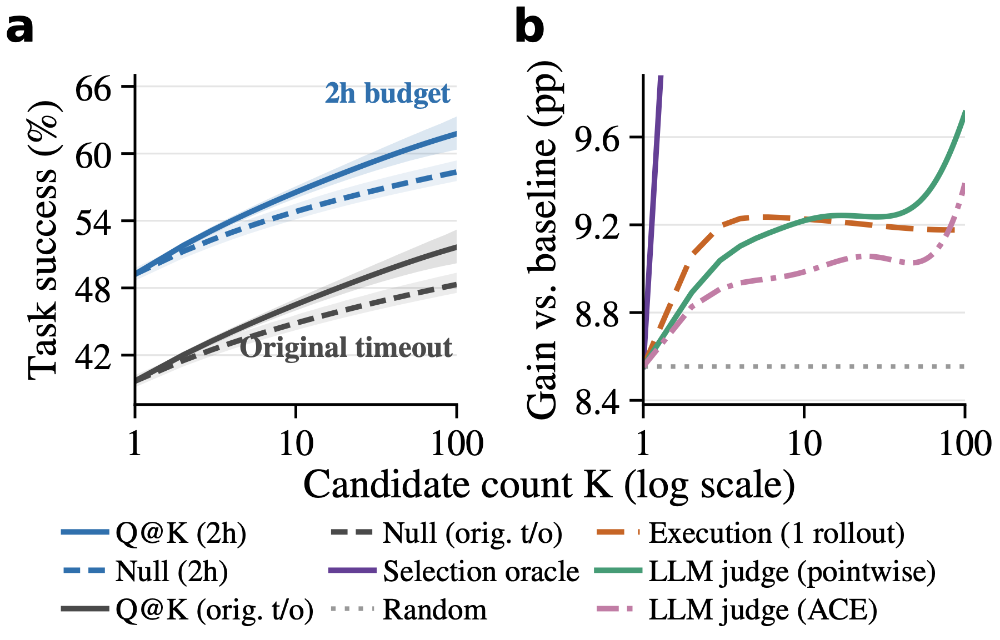

  <a class="zine-pill-link" data-i18n-zh="论文 arXiv:2611.23068 ↗" data-i18n-en="Paper · arXiv:2611.23068 ↗" href="https://arxiv.org/abs/2611.23068" target="_blank" rel="noopener">论文 arXiv:2611.23068 ↗</a>
  

    <button type="button" class="zine-lang-btn" data-lang-target="en" aria-pressed="false">EN</button>
    <button type="button" class="zine-lang-btn is-active" data-lang-target="zh" lang="zh-CN" aria-pressed="true">中文</button>
  

**TL;DR：** 进化算法在严格基准上停滞，并非大模型写不出有用的 Skill。将提议与选择拆开后，极简提议器生成的 100 个候选中，`Quality@100` 超出等质量零假设 +3.4 pp，通用 Skill 如 `seed-027` 跨任务平均高出基线 +11.4 pp。卡住进化的是选择器分辨率不足：1–2 次执行门控（49.7% / 48.6%）与三类轨迹 LLM 裁判（45.4%–49.0%）都接近抛硬币，多轮迭代后累积为循环内噪声套利（虚涨 6.9–9.0 pp）和跨运行随机游走；收紧门控会让系统停在原地（HarnessLens 47/71 次退回起点），而 16 倍采样验证虽能将最优运行从 64.8% 提到 72.7%，却带来 16 倍算力开销与保守倾向。更现实的做法是用降噪 13–57 倍的确定性过程指标做诊断、用静态候选池做组件级解耦评估——两者都不是银弹（过程指标直接优化会触发捷径，静态池覆盖不了全部多步交互），只是校准尺子的第一步。

> **《分辨率假说》系列（3/3）** · [论文 arXiv:2611.23068](https://arxiv.org/abs/2611.23068) · [项目主页与 30s 互动小游戏](/resolution-hypothesis/) · [幕后手记](/blog/2026/resolution-hypothesis-behind-the-scenes/)
> **连载导航**：[（一）原地踏步与方差拆解](/blog/2026/resolution-hypothesis-part-1/) · [（二）高通滤波器与捷径审计](/blog/2026/resolution-hypothesis-part-2/) · **（三）好 Skill 与挑不出来的选择器**

前两篇交代了两个事实：第一，常规单次评估的方差（$$1.7\sim 4.1\text{ pp}$$）比多数方法之间的真实均值差更宽；第二，那些高于噪声带、拿到 $$+30\text{ pp}$$ 涨幅的案例，拆开后多半对应一次性拉高全局分数的评测捷径。

修补这些捷径，或者换到 Terminal-Bench v2.1 这样每个任务运行在独立 Docker 容器中、由单元测试判分的基准上，进化算法的收益便重新落回噪声带内。

这就引出一个绕不开的问题：在钻不了空子的任务上进化停滞，究竟是因为模型写不出有用的 Skill（Proposal 瓶颈），还是好产物已经写出来了，只是选择器认不出来（Selection 瓶颈）？

在端到端进化循环 $$A_t = \text{Select}(A_{t-1}, \text{Propose}(A_{t-1}))$$ 里，提议和选择绑在同一条链上。只看最终分数停滞，无法分辨是 $$\text{Propose}$$ 没产出有效修改，还是 $$\text{Select}$$ 把有效修改扔掉了。把这两步拆开单测谈不上理论创新，只是排查故障的常规办法：先单独测一遍每个环节的实际表现。

---

为了排除选择器的干扰，单独测清提议器的上限，我们从 Terminal-Bench v2.1 和 DeepSWE 的执行轨迹出发，用极简提议器离线生成了 **$$n=100$$ 个候选 Skill**，构成固定的静态候选池。随后，我们在 10 个不相交的 Terminal-Bench 测试任务上，对每个候选执行 $$16$$ 次独立采样（Rollouts），同时在包含 11 个任务的 Selection Pool 上执行 $$8\sim 15$$ 次独立采样。

即使跑满十几次，有限次二元成功率的观测值仍有波动。因此我们用经验贝叶斯层级模型（Empirical-Bayes Hierarchical Model）跨候选共享先验信息，估计每个候选 $$i$$ 在任务上的潜在成功率 $$\theta_i \sim \text{Beta}(a,b)$$，再计算从池中随机抽取 $$K$$ 个候选时最优者的期望质量（`Quality@K`）。这里有个统计陷阱：哪怕所有候选的真实水平相同，只要抽取数量 $$K$$ 越大，抽到一次高分极值的期望也会跟着上浮。为了扣掉这部分极值偏差，我们用等质量零假设（Equal-Quality Null，假设 100 个候选真实成功率相等）对曲线做了校准。

{: style="display: block; max-width: 100%; width: auto; height: auto; max-height: 620px; margin: 1.5rem auto; object-fit: contain; border-radius: 8px;" }

数据直接支持了第一个候选级推论（**P1：候选池中确实存在有效改进**）：

1. **单任务维度存在真实上升空间**：如图 4a 所示，随着候选数 $$K$$ 从 $$1$$ 增至 $$100$$，观测到的 `Quality@K` 曲线超出等质量零假设的 95% 置信带——在 2 小时预算下从 49.2% 升至 61.8%，高出零假设 $$+3.4\text{ pp}$$，与第二篇修补捷径后保留下来的真实涨幅量级一致。
2. **池中不仅有局部特化解，也有跨任务泛化的通用 Skill**：`Quality@K` 允许每个任务各选最优解，例如 `seed-058` 在 `mteb-retrieve` 上几乎次次满分，换到其他任务却收效甚微。为排除“一题一策”的巧合，我们将 100 个候选按全部 11 个测试任务的平均收益排序。排在头部的 `seed-027` 和 `seed-099`（详见论文附录 I.1），**跨任务平均高出 Baseline $$+11.4\text{ pp}$$**。

翻开 `seed-027` 的原文，看不到什么抽象的元认知口诀，写的全是工程师排查线上故障后会记下来的工程契约：

- **克制随手改名的冲动**：模型从失败轨迹里总结出，当任务提示词明确约定了类名、函数签名或空值返回格式时——例如要求导出 `Mean(xs []int) (float64, error)` 且空切片返回 `(0, nil)`——Agent 经常会按自己的编码习惯顺手改成 `computeMean` 或 `Servicer`，或者返回 `(-1, err)`，结果隐藏评测脚本一 `import` 就报错。所以动笔前必须先抽出所有字面量符号，用一字不差的薄封装（Shim）对齐公共接口。
- **别替第三方分词器和编码器做主张**：遇到依赖特定 Tokenizer 或 Embedding 模型的任务，不要手写分隔符硬拼文本——BPE 分词器对 `"a b"` 和 `"a\nb"` 的子词合并方式不一样，精确计数会直接偏移；调用指令感知的编码器时，也必须显式区分 Query 和 Passage 的 `prompt_type` 参数，不要图省事混用默认值。

哪怕只用极简提议器，大模型也能从失败日志里提炼出 $$+10\text{ pp}$$ 级别的工程经验。好候选已经在池中，问题随之转向选择端：进化循环为什么挑不出来？

---

拿到了这 100 个已知后验质量的候选 Skill，就可以把常见选择器（Selectors）放到贴近日常预算的条件（每候选 1–2 次 Rollouts）下单独测试，检验推论 **P2**。

为避免数据泄露，测试采用独立参考集协议（Independent-Reference Protocol）：选择器只能看到每个候选的前 1~2 次 Rollouts，而它挑出的产物质量，由剩余未见 Rollouts 拟合出的后验值裁定。

结果见下表，可对照图 4b 右侧子图查看：

| 选择机制 (Selection Mechanism)              | 成对比较准确率 (Pairwise Acc. %) | 错误接受率 (False Accept. %) |
| ------------------------------------------- | -------------------------------- | ---------------------------- |
| **Random（纯随机盲选）**                    | $$50.0 \pm 0.0$$                 | $$30.5 \pm 14.0$$            |
| **Execution (1 rollout，单次执行得分)**     | $$49.7 \pm 1.9$$                 | $$62.1 \pm 42.9$$            |
| **SkillOpt-Lite 原生选择算子** (2 rollouts) | $$48.6 \pm 2.6$$                 | $$59.4 \pm 46.2$$            |
| **GEPA 原生选择算子** (2 rollouts)          | $$48.6 \pm 2.6$$                 | $$31.6 \pm 14.5$$            |
| **LLM Judge (Pointwise 单点轨迹打分)**      | $$45.4 \pm 4.5$$                 | $$39.9 \pm 17.5$$            |
| **LLM Judge (Pairwise 成对轨迹比较)**       | $$49.0 \pm 2.2$$                 | $$57.6 \pm 23.3$$            |
| **LLM Judge (ACE 无真值反思模板)**          | $$46.9 \pm 3.5$$                 | $$39.0 \pm 15.6$$            |

数据指向两个结论：

1. **常规执行门控与抛硬币无异**。成对比较中，单次执行得分挑出更优 Skill 的概率为 49.7%，SkillOpt-Lite 和 GEPA 使用的 2 次 Rollouts 门控也只有 48.6%。更棘手的是错误接受率（False Acceptance）：被单次执行分判为“优于基线”而放行的候选中，**62.1% 实际比基线更差**。这也解释了图 4b 曲线为何近乎水平——即便让选择器筛完整个 100 候选池，挑出的产物质量仍不及理想 Oracle 在不到 5 个候选里选出的结果。
2. **引入 LLM 裁判通读完整轨迹，同样救不回分辨率**。一个常见直觉是：终端 Pass/Fail 只有 1 比特，信息损失太大，把整段交互轨迹交给大模型裁判读一遍，总能分辨出 Skill 到底帮了忙还是帮了倒忙。然而很遗憾，无论采用单点打分、双向成对比较，还是套用 ACE 的无真值反思模板，三类 LLM 裁判的成对准确率全部落在 45.4%~49.0% 之间，甚至略低于随机盲选。

信息给得更全，判断为何反而不如抛硬币？拆开方差项就能看清机制：单次运行留下的轨迹本身就带着环境采样噪声 $$\epsilon_{\text{env}}$$；让裁判模型从冗杂日志里推断因果，又叠加了一层与之独立的评判噪声 $$\epsilon_{\text{judge}}$$。两层独立噪声的方差只会相加而非抵消（$$\sigma^2_{\text{total}} = \sigma^2_{\text{env}} + \sigma^2_{\text{judge}}$$），总噪声更大，分辨率反而更低。

---

把接近抛硬币的选择器放进多轮进化循环，第一篇观察到的两个现象便会依次出现（对应推论 **P3**）。

{: style="display: block; max-width: 100%; width: auto; height: auto; max-height: 620px; margin: 1.5rem auto; object-fit: contain; border-radius: 8px;" }

{: style="display: block; max-width: 100%; width: auto; height: auto; max-height: 620px; margin: 1.5rem auto; object-fit: contain; border-radius: 8px;" }

_（上图：循环内记录的验证分数持续走高，独立 8 倍重评估几乎走平；下图：运行间方差随迭代轮次单调扩散）_

第一重效应是**循环内噪声套利（Noise Exploitation）**。贪心规则每轮只接受验证分更高的候选，本质上是在不断截取噪声分布右尾的极值（顺序统计量偏差 $$\max_{t} \epsilon_t$$）。图 5 中，循环内记录的验证分数（蓝线）一路抬升 $$+6.9\sim 9.0\text{ pp}$$，但同一批产物经过独立 8 倍重测，真实表现（橙线）始终停在 $$+0.35\sim -3.21\text{ pp}$$ 区间。

第二重效应是**跨运行随机游走（Random Walk）**。图 6 中，所有独立运行从同一初始产物起步（$$\tau_0^2 = 0$$），多轮近乎随机的筛选将不同运行推向产物空间里互不相干的区域。消噪后的运行间方差 $$\hat{\tau}_t^2$$ 随轮次单调扩至 $$4.2\sim 24.5\text{ pp}^2$$，直接导致了第一篇里方法排名的反复洗牌。

顺着这个逻辑，人们往往会想到另一个办法：既然贪心门控容易误接受，那把接受门槛调严——加上配对检验或更苛刻的预提交条件——不就稳住了吗？然而事实并非如此。在修复评测后的网格实验中，采用训练集配对检验的 **HarnessLens 在 71 次独立运行里有 47 次退回了初始版本**。收紧门槛并不会提高底层评估器的分辨率，它只是把“因误接受而随机漂移”，换成了“为避免犯错而停在原地”。

那如果不动门控逻辑，直接投入算力拉高分辨率呢？比如每轮验证不再只跑 1 次，而是跑 16 次独立 Rollouts 取平均，把 $$\sigma$$ 压缩到原来的 $$1/4$$，进化能否恢复积累？我们在论文附录 F.3 中对 SkillOpt-Lite 做了因果对照（16 次独立运行，最多 8 轮，最终产物做 32 次独立测试采样）。答案是肯定的，但代价同样明确：

- **提高分辨率恢复了有效积累**：在 32 次独立测试采样下，最优进化产物从常规验证的 **64.8% 升至 72.7%**，跨运行均值也从 61.4% 提至 64.4%。日志揭示了原因：常规单次验证常在前 4 轮偶发一次 80% 的高分，将接受门槛锁在高位，后续更优的候选反而跨不过去；16 倍采样消除了这种极值锁死。
- **但低方差同时引入了保守倾向（Conservatism）**：除了 16 倍的算力成本难以在日常研发中承受，一旦评估方差压低且当前产物处于较高平台，任何需要过渡步骤的探索性修改，只要无法在当轮交出净提升，都会被选择器直接拒掉。系统更稳定了，却也更难跳出局部最优。

---

日常研发承担不起 16 倍验证算力。不靠堆采样次数，高分辨率还能从哪里来？

邻近领域已有跑通的对照——**确定性程序进化（Program Evolution）**，例如用大模型进化 GPU CUDA Kernel（KernelAgent）、搜索 ARC-AGI-2 解题代码或合成 Atari 策略。同样是让模型修改产物再评估，这些方向能够逐轮积累进展，通用 Agent 的 Prompt 或 Skill 进化却频频停滞。

放进方差框架来看，原因并不复杂：确定性代码重评估成本低，编译器报错与硬件耗时剖析（Profiling）给出的反馈几乎不含采样噪声（$$\sigma^2 \approx 0$$），评估刻度本身足够精细。

沿着这一思路，与其继续堆叠更复杂的 Proposer，不如先朝两个“分辨率感知（Resolution-Aware）”的方向做务实调整。

**在候选级，可用低方差的过程行为指标做诊断。** 终端 Pass/Fail 把几十步推理和工具调用压成 1 比特，信噪比过低。如果改用确定性脚本统计轨迹中的中间过程行为（Process Metrics）——例如“智能体修改代码文件后，紧接着运行测试命令且未掩盖错误诊断输出的比例”——在 DeepSeek-V4-Flash 轨迹上实测的结果是：**跨全部 7 种进化方法与基线，该指标的评估噪声方差 $$\sigma^2_{\text{behavior}}$$ 比终端奖励方差 $$\sigma^2_{\text{reward}}$$ 低 13~57 倍**。借助这一分辨率优势，终端通过率里辨认不出的行为偏移变得一目了然：Trace2Skill 使编辑后验证率上升 $$+8.73\text{ pp}$$（$$z=2.17$$），AHE 则将同一习惯拉低 $$17.98\text{ pp}$$（$$z=-4.19$$）。

**在方法级，将端到端黑盒对比拆为组件级解耦评估。** 评测新进化算法时，与其围绕落在单次分辨率之下的 $$2\text{ pp}$$ 测试集差距争论，不如拆成两项在噪声中可辨识的独立检验：测提议器（Proposer）时，绘制后验 `Quality@K` 曲线并对照等质量零假设，直接观察反思机制是否抬高了候选池上限；测选择器（Selector）时，放到同一已知后验质量的静态基准池（如我们将开源的 100-Skill 候选池）上画质量恢复曲线。这既剥离了运行间方差 $$\tau^2$$，也省去了反复起容器的开销，几分钟即可测出选择器的鉴别力。

---

但换个角度看，把分析框架立起来之后，也得把同样的标准用回我们自己提出的这两条建议上。

过程指标只是诊断工具，不是优化目标。有人可能会顺势想：既然它噪声低几十倍，直接拿它当选择器奖励不就好了？然而很遗憾，改完代码多跑两遍测试不等于修好了 Bug；一旦把过程指标直接塞进选择器作为唯一目标，古德哈特定律（Goodhart's Law）很快会生效，模型会学会跑一堆空测试来刷分——等于把第二篇的评测捷径换个形式请回来。过程指标适合做离线诊断、预过滤门控（Pre-commit Gating），或与终端奖励配合做多保真度（Multi-fidelity）选择，不能替代任务结果本身。

组件级解耦评估同样不是全部真相。将 Proposer 和 Selector 拆到静态池里单测，能剥离 $$\tau^2$$ 并降低测量成本，但也有盲区：在多轮进化里，偶尔会出现跨轮次的多步耦合——某一轮看似平庸的改动，可能恰好为两轮后的突破铺路。静态池测不出这类跨轮交互，它只能检验各个组件在单步上是否具备基本能力。

回顾这 1,030 次进化运行与 210 万条轨迹，结论本身并不复杂：**自进化智能体的上限由提议器（Proposer）决定，但系统最终能留住并累积多少改进，取决于评估系统的分辨率（Resolution）。**

当尺子的刻度比改进本身更粗，细微的真实进步会在噪声里得而复失，反倒是钻评测空子的捷径最容易显露。先把评估这把尺子校准——如实汇报多次运行的方差（$$\tau$$ 与 $$\sigma$$），用低方差过程指标辅助诊断，把提议与选择拆开验证——算不上解决智能体自进化的银弹，只是在继续设计更复杂的进化算法之前，绕不过去的第一步。

---

- **论文全文（arXiv）**：[https://arxiv.org/abs/2611.23068](https://arxiv.org/abs/2611.23068)
- **项目主页、交互式数据浏览器与 30 秒互动小游戏**：[/resolution-hypothesis/](/resolution-hypothesis/)
- **作者幕后手记**：[我们本来想做一个 Agent 进化算法，最后却给这个领域做了一次全面体检](/blog/2026/resolution-hypothesis-behind-the-scenes/)

**TL;DR:** Evolution stalling on strict coding benchmarks is not because LLMs fail to write useful skills. Decoupling proposal from selection over a static 100-skill pool shows `Quality@100` clearing the equal-quality null by +3.4 pp, with shared skills like `seed-027` beating the baseline by +11.4 pp across tasks. The bottleneck is selection resolution: 1–2 rollout execution gates (49.7% / 48.6%) and three trajectory-level LLM judges (45.4%–49.0%) all behave like coin flips, turning multi-round iteration into in-loop noise exploitation (+6.9–9.0 pp illusion) and cross-run random walks; stricter gates stall at initialization (47/71 HarnessLens runs), and 16× validation lifts the best run from 64.8% to 72.7% at 16× compute cost and added conservatism. Deterministic process metrics (13×–57× lower variance) and decoupled component evaluation offer a cheaper diagnostic ruler—neither is a silver bullet (direct optimization invites Goodharting and static pools miss some multi-step interactions), just a necessary first step.

> **_The Resolution Hypothesis_ Series (3/3)** · [Paper arXiv:2611.23068](https://arxiv.org/abs/2611.23068) · [Project Page & 30s Interactive Game](/resolution-hypothesis/) · [Behind the Scenes](/blog/2026/resolution-hypothesis-behind-the-scenes/)
> **Series Navigation**: [(1) Running in Place & Variance Decomposition](/blog/2026/resolution-hypothesis-part-1/) · [(2) The High-Pass Filter & Shortcut Audit](/blog/2026/resolution-hypothesis-part-2/) · **(3) Good Skills & Selectors That Miss Them**

Parts 1 and 2 established two plain facts. First, single-run evaluation variance ($$1.7\sim 4.1\text{ pp}$$) is wider than the true mean gap between most competing methods. Second, the $$+30\text{ pp}$$ jumps that clear the noise floor mostly trace back to global evaluation shortcuts.

Once those shortcuts are patched—or once we move to a benchmark like Terminal-Bench v2.1, where every task runs inside an isolated Docker container graded by unit tests—evolutionary gains drop back inside the noise band.

That leaves a direct question: when evolution stalls on hard tasks, is it because LLMs cannot produce useful engineering artifacts (a Proposal bottleneck), or because useful artifacts are already written and the selector cannot separate them from noise (a Selection bottleneck)?

In a standard end-to-end loop, $$A_t = \text{Select}(A_{t-1}, \text{Propose}(A_{t-1}))$$, the two steps are coupled. Watching the final score sit flat tells you nothing about whether $$\text{Propose}$$ came up empty or $$\text{Select}$$ discarded valid edits. Separating the two is not a new paradigm; it is standard debugging—measuring each component on its own to see where the signal is lost.

---

To measure what a proposer can produce without selector bias, we used a minimal proposer to generate **$$n=100$$ candidate skills** offline from Terminal-Bench v2.1 and DeepSWE trajectories, forming a fixed static pool. We then ran $$16$$ independent rollouts per candidate across 10 disjoint Terminal-Bench test tasks (the Proposal Pool), and $$8\sim 15$$ rollouts across an 11-task Selection Pool.

Even with a dozen rollouts, finite binary outcomes fluctuate. We fit an Empirical-Bayes hierarchical model that borrows strength across candidates, estimating each candidate $$i$$'s posterior latent success rate $$\theta_i \sim \text{Beta}(a,b)$$ on each task and tracking the expected quality of the best candidate in a random draw of $$K$$ items (`Quality@K`). Because taking the maximum over more noisy draws drifts upward even when every candidate has the same quality, we calibrated each curve against an Equal-Quality Null assuming all 100 skills are equally strong.

{: style="display: block; max-width: 100%; width: auto; height: auto; max-height: 620px; margin: 1.5rem auto; object-fit: contain; border-radius: 8px;" }

The results back our first candidate-level prediction (**P1: genuine improvements already sit inside the pool**):

1. **Per-task headroom exists.** In Fig. 4a, as $$K$$ grows from $$1$$ to $$100$$, the observed `Quality@K` curve separates above the 95% band of the equal-quality null—rising from 49.2% to 61.8% under the 2-hour budget, $$+3.4\text{ pp}$$ above the null, matching the post-repair gains from Part 2.
2. **The pool holds generalizable skills, not just single-task flukes.** Because `Quality@K` can pick a different winner for each task (for instance, `seed-058` scores 100% on every rollout of `mteb-retrieve` yet helps little elsewhere), we also tested **single shared skills** across all 11 tasks. Ranking all 100 candidates by cross-task average gain puts `seed-027` and `seed-099` at the top (Appendix I.1), where they **beat the baseline by an average of $$+11.4\text{ pp}$$ across tasks**.

Open `seed-027` and there is no abstract metacognitive philosophy in it—just concrete software-engineering habits that read like a post-mortem checklist:

- **Stop renaming public symbols.** From failed logs, the model noticed that when a prompt specifies exact class names, function signatures, or empty-input conventions—such as exporting `Mean(xs []int) (float64, error)` and returning `(0, nil)` on an empty slice—agents routinely drift toward names like `computeMean` or `Servicer`, or return `(-1, err)`, breaking hidden test `import`s. The skill instructs the agent to extract every literal public symbol before coding and expose a verbatim thin shim.
- **Respect tokenizer and embedding contracts.** On tasks tied to specific tokenizers or embedding models, don't stitch text together with ad-hoc separators—BPE merges behave differently across `"a b"` vs. `"a\nb"`, shifting exact token counts—and on instruction-aware encoders, pass query and passage `prompt_type` arguments explicitly rather than falling back to defaults.

Even a minimal proposer extracts $$+10\text{ pp}$$-grade engineering discipline from failure traces. With good candidates already in the pool, the question moves downstream: why can't the loop pick them out?

---

With posterior ground-truth quality estimated for all 100 skills, we benchmarked common selectors under realistic validation budgets (1 to 2 rollouts per candidate) to test prediction **P2**.

To prevent data leakage, we use an Independent-Reference Protocol: each selector sees only the first 1–2 rollouts of every candidate, while the artifact it chooses is scored using posterior estimates fit on the remaining unseen rollouts.

The table below summarizes the result (also shown in the right panel of Fig. 4b):

| Selection Mechanism                              | Pairwise Accuracy (%) | False Acceptance Rate (%) |
| ------------------------------------------------ | --------------------- | ------------------------- |
| **Random**                                       | $$50.0 \pm 0.0$$      | $$30.5 \pm 14.0$$         |
| **Execution (1 rollout)**                        | $$49.7 \pm 1.9$$      | $$62.1 \pm 42.9$$         |
| **SkillOpt-Lite native selector** (2 rollouts)   | $$48.6 \pm 2.6$$      | $$59.4 \pm 46.2$$         |
| **GEPA native selector** (2 rollouts)            | $$48.6 \pm 2.6$$      | $$31.6 \pm 14.5$$         |
| **LLM Judge (Pointwise trajectory scoring)**     | $$45.4 \pm 4.5$$      | $$39.9 \pm 17.5$$         |
| **LLM Judge (Pairwise trajectory comparison)**   | $$49.0 \pm 2.2$$      | $$57.6 \pm 23.3$$         |
| **LLM Judge (ACE ground-truth-free reflection)** | $$46.9 \pm 3.5$$      | $$39.0 \pm 15.6$$         |

Two findings stand out:

1. **Execution-based selectors perform no better than a coin flip.** In pairwise comparisons, a 1-rollout execution score picks the stronger skill 49.7% of the time; 2 rollouts (as in SkillOpt-Lite and GEPA) sit at 48.6%. Among candidates accepted by a 1-rollout gate as better than baseline, **62.1% are regressions (False Acceptance)**. That explains Fig. 4b: even after scanning all 100 candidates, these selectors recover less quality than an oracle given fewer than 5 candidates.
2. **Reading full trajectories with an LLM judge does not rescue resolution.** The intuition is tempting: terminal Pass/Fail collapses everything into a single bit, so handing a judge model the full execution trace ought to show whether a skill helped. Unfortunately, pointwise scoring, bidirectional pairwise comparison, and ACE's ground-truth-free reflection template all land between 45.4% and 49.0% pairwise accuracy—slightly below random guessing.

Why does giving the judge more information perform worse than flipping a coin? Variance decomposition makes the mechanism clear. The trace already carries environment rollout noise $$\epsilon_{\text{env}}$$. Asking a judge model to infer causality from long logs adds an independent judgment noise term $$\epsilon_{\text{judge}}$$. Independent variances add rather than cancel ($$\sigma^2_{\text{total}} = \sigma^2_{\text{env}} + \sigma^2_{\text{judge}}$$), pushing effective resolution down.

---

Drop a coin-flip selector into a multi-round loop, and the two compounding behaviors from Part 1 follow mechanically (confirming prediction **P3**).

{: style="display: block; max-width: 100%; width: auto; height: auto; max-height: 620px; margin: 1.5rem auto; object-fit: contain; border-radius: 8px;" }

{: style="display: block; max-width: 100%; width: auto; height: auto; max-height: 620px; margin: 1.5rem auto; object-fit: contain; border-radius: 8px;" }

_(Top: in-loop validation score climbs while independent 8× re-evaluation stays flat. Bottom: between-run variance diffuses monotonically across rounds.)_

First is **in-loop noise exploitation**. Greedy acceptance replaces the incumbent whenever a candidate posts a higher noisy score, harvesting the right tail of the noise distribution—order-statistic bias, $$\max_{t} \epsilon_t$$. In Fig. 5, the algorithm's validation log (blue) climbs by $$+6.9\sim 9.0\text{ pp}$$, while independent 8× re-evaluation of the same artifacts (orange) stays between $$+0.35$$ and $$-3.21\text{ pp}$$.

Second is **cross-run random walk**. In Fig. 6, every run starts from the same initial artifact ($$\tau_0^2 = 0$$), yet repeated near-random decisions push independent runs into unrelated regions of artifact space. Noise-corrected between-run variance $$\hat{\tau}_t^2$$ grows monotonically to $$4.2\sim 24.5\text{ pp}^2$$, driving the unstable method rankings from Part 1.

An obvious response follows: if greedy acceptance drifts on false positives, tighten the gate with paired significance tests or stricter pre-commit rules. Unfortunately, our post-repair grid shows the other side of that trade-off. Under the same noisy evaluator, **HarnessLens—which uses a paired training-set test—reverted to the initial artifact in 47 out of 71 independent runs.** Tightening the gate does not raise measurement resolution; it trades noisy drift for sitting still.

What if we raise resolution directly instead—averaging 16 independent validation rollouts per step so $$\sigma$$ shrinks to $$1/4$$? In Appendix F.3, we ran a causal check on SkillOpt-Lite (16 independent runs, up to 8 rounds, 32 independent test rollouts on final artifacts). Evolution does resume, though with a catch:

- **Higher resolution restores accumulation.** Under 32× test evaluation, the best evolved artifact rose from **64.8%** under standard validation to **72.7%**, and the cross-run mean moved from 61.4% to 64.4%. The logs pinpoint the mechanism: standard 1-rollout validation often hit a lucky 80% within the first 4 rounds, locking the acceptance threshold on a noisy peak that stronger candidates could not clear. Averaging 16 rollouts broke that lock-in.
- **Lower variance also introduces cost and conservatism.** Beyond paying 16× validation compute, once variance drops and the incumbent reaches a strong plateau, any exploratory edit that fails to lift the mean immediately gets rejected. The loop stabilizes, but becomes reluctant to take multi-step detours off local optima.

---

Paying 16× validation compute on every step is not viable in routine development. Where else can higher resolution come from without spending an order of magnitude more rollouts?

An adjacent area gives a clear contrast: **deterministic program evolution**—evolving GPU CUDA kernels (KernelAgent), searching ARC-AGI-2 solver code, or synthesizing Atari policies. Evolution compounds there while general agent prompt and skill evolution stalls for a simple operational reason: re-evaluating deterministic code is cheap, and compiler diagnostics plus hardware profiling carry near-zero feedback noise ($$\sigma^2 \approx 0$$). The ruler is precise from the start.

Guided by that contrast, agent self-evolution gets more leverage from two **resolution-aware** shifts than from another round of complex proposers.

**At the candidate level, low-variance process metrics serve as diagnostic tools.** Terminal Pass/Fail compresses dozens of reasoning and tool-use steps into a single bit. Measuring **intermediate process behaviors** with deterministic scripts—such as the share of code edits immediately followed by a test command whose diagnostic output is not suppressed—yields much tighter signals. Across DeepSeek-V4-Flash trajectories on all 7 evolution methods and baselines, this behavior metric's evaluation noise variance $$\sigma^2_{\text{behavior}}$$ is **13× to 57× lower than terminal reward variance $$\sigma^2_{\text{reward}}$$**. That resolution exposes behavioral shifts invisible in pass rates: Trace2Skill lifts post-edit verification by $$+8.73\text{ pp}$$ ($$z=2.17$$), whereas AHE pushes the same habit down by $$17.98\text{ pp}$$ ($$z=-4.19$$).

**At the method level, decoupled component evaluation beats debating noisy end-to-end tables.** Rather than arguing over a $$2\text{ pp}$$ end-to-end test-set gap buried below single-run resolution, split the audit into two measurements above the noise floor. Evaluate the **proposer** with posterior `Quality@K` curves calibrated against the equal-quality null to check whether a reflection scheme raises the candidate ceiling. Evaluate the **selector** with quality-recovery curves on a fixed pool with known posterior quality (such as the 100-skill benchmark pool we are open-sourcing), removing between-run variance $$\tau^2$$ and repeated container runs so selector discrimination can be measured in minutes.

---

Still, we should apply the same skepticism to our own recommendations.

A process metric is a diagnostic tool, not an objective. It is tempting to think that a metric 13×–57× quieter can simply replace terminal reward inside the selector. Unfortunately, running tests after an edit does not mean the bug is fixed. Optimize a process metric directly, and Goodhart's law takes over: agents learn to run empty checks to game the counter—bringing Part 2's shortcut problem back under a new label. Process signals fit offline diagnostics, pre-commit filtering, or multi-fidelity pairing with terminal outcomes, not standalone selection targets.

Decoupled static pools have their own blind spot. Benchmarking proposers and selectors separately removes $$\tau^2$$ and measures single-step competence, yet cannot capture every multi-step interaction where an imperfect intermediate edit enables a stronger revision rounds later.

Looking back across 1,030 evolution runs and 2.1 million trajectories, the conclusion is simple: **the proposer sets the ceiling on what a self-evolving agent can gain, while evaluation resolution governs how much of that gain can be kept.**

When the ruler is coarser than the improvements you are measuring, real gains get lost in noise and benchmark loopholes stand out first. Calibrating the ruler—reporting multi-run variance ($$\tau$$ and $$\sigma$$), tracking low-variance process diagnostics, and decoupling proposal from selection—is no silver bullet for open-ended self-evolution. It is simply the first step before debating which evolution loop is smarter: making sure the instrument can tell two candidates apart.

---

- **Full Paper (arXiv)**: [https://arxiv.org/abs/2611.23068](https://arxiv.org/abs/2611.23068)
- **Project Page, Interactive Explorer & 30s Game**: [/resolution-hypothesis/](/resolution-hypothesis/)
- **Behind the Scenes**: [We Set Out to Build an Agent Evolution Algorithm—and Ended Up Running a Full-Body Diagnostic on the Field](/blog/2026/resolution-hypothesis-behind-the-scenes/)

