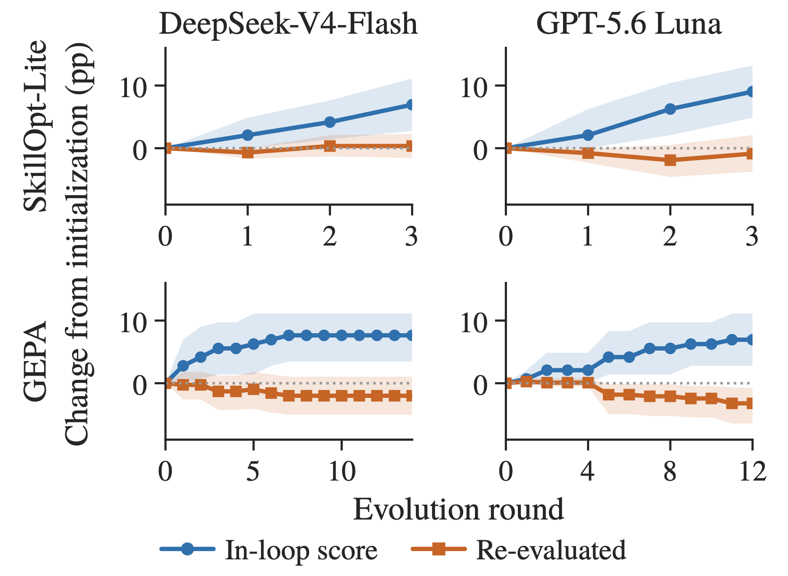
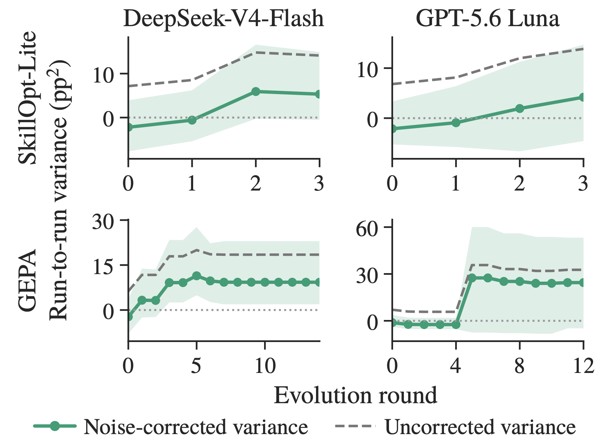

  <a class="zine-pill-link" data-i18n-zh="论文 arXiv:2611.23068 ↗" data-i18n-en="Paper · arXiv:2611.23068 ↗" href="https://arxiv.org/abs/2611.23068" target="_blank" rel="noopener">论文 arXiv:2611.23068 ↗</a>
  

    <button type="button" class="zine-lang-btn" data-lang-target="en" aria-pressed="false">EN</button>
    <button type="button" class="zine-lang-btn is-active" data-lang-target="zh" lang="zh-CN" aria-pressed="true">中文</button>
  

**TL;DR：** 在硬核基准上进化停滞，并不是因为大模型写不出有用的 Skill——把提议与选择拆开后，极简提议器生成的 100 个候选 Skill 中，`Quality@100` 超出等质量零假设 +3.4 pp，`seed-027` 这类通用 Skill 在跨任务测试上甚至平均高出基线 +11.4 pp。真正卡住系统的机制在于选择器分辨率不足：单次/两次执行门控（49.7% / 48.6%）与三类轨迹 LLM 裁判（45.4%–49.0%）在统计上都接近抛硬币，多轮迭代下必然累积为循环内噪声套利（虚涨 6.9–9.0 pp）与跨运行随机游走；收紧门控只会让系统停在原地（HarnessLens 47/71 次退回起点），而把验证加码到 16 倍采样虽能把最优运行从 64.8% 拉到 72.7%，却伴随着高昂算力成本与低方差下的保守倾向。更务实的切入口，是用降噪 13–57 倍的确定性过程指标做诊断、用静态候选池做组件级解耦评估。当然，过程指标一旦被直接优化也会招来新的捷径，解耦评估也覆盖不了所有的多步交互——把尺子磨清不是银弹，只是走出原地打转前最起码的一步。

> **《分辨率假说》系列（3/3）** · [论文 arXiv:2611.23068](https://arxiv.org/abs/2611.23068) · [项目主页与 30s 互动小游戏](/resolution-hypothesis/) · [幕后手记](/blog/2026/resolution-hypothesis-behind-the-scenes/)
> **连载导航**：[（一）原地踏步与方差账](/blog/2026/resolution-hypothesis-part-1/) · [（二）高通滤波器与捷径审计](/blog/2026/resolution-hypothesis-part-2/) · **（三）好 Skill 与挑不出来的选择器**

前两篇其实只把两件相对朴素的事实交代清楚了：第一，常规单次评估自带的方差（$$1.7\sim 4.1\text{ pp}$$）比大多数方法之间的真实均值差还要宽；第二，那些能稳稳越过噪声带、实现 $$+30\text{ pp}$$ 上涨的案例，拆开之后多半指向一次性拉高全局分数的评测捷径。

把这些捷径修补干净，或者干脆换到 Terminal-Bench v2.1 这样每个任务都跑在独立 Docker 容器里、由严格单元测试判分的基准上，进化算法的收益便重新落回了噪声带里面。

到这里，一个绕不开的问题自然就浮上来了：在不容易钻空子的任务上进化停滞，究竟是因为模型本身能力不够、写不出能帮上忙的 Skill（Proposal 瓶颈），还是好产物其实已经被写出来了，只是评估选择器没本事把它们认出来（Selection 瓶颈）？

在标准的端到端进化循环 $$A_t = \text{Select}(A_{t-1}, \text{Propose}(A_{t-1}))$$ 里，提议和选择是绑在同一条链上的。你只看最终分数没动，根本没法分辨是 $$\text{Propose}$$ 压根没拿出好东西，还是 $$\text{Select}$$ 在半路上把好东西扔了。把这两步拆开单看，算不上什么玄妙的理论创新，只是排查系统故障时最直接的一种做法：先分别量一下每个零件到底在干什么。

---

为了在不掺杂选择器偏见的前提下摸清提议器的底细，我们从 Terminal-Bench v2.1 和 DeepSWE 的执行轨迹里，用一个非常朴素的提议器离线生成了 **$$n=100$$ 个候选 Skill**，组成一个固定的静态候选池。接着，我们在 10 个不相交的 Terminal-Bench 测试任务上，对池中每个候选跑了 $$16$$ 次独立采样（Rollouts），同时在一个包含 11 个任务的 Selection Pool 上跑了 $$8\sim 15$$ 次独立采样。

哪怕跑到十来次，有限次二元成功率的观测值依然会有波动。于是我们用经验贝叶斯层级模型（Empirical-Bayes Hierarchical Model）跨候选借用信息，估计每个候选 $$i$$ 在任务上的真实潜在成功率 $$\theta_i \sim \text{Beta}(a,b)$$，再看从池中随机抽取 $$K$$ 个候选时，最优候选的期望质量（`Quality@K`）。这里有一个很容易踩的统计陷阱：哪怕所有候选的真实水平一模一样，只要你抽的数量 $$K$$ 越大，靠运气抽到一次高分极值的期望也会跟着往上飘。为了把这部分假象扣掉，我们用等质量零假设（Equal-Quality Null，假设 100 个候选的真实成功率完全相等）对整条曲线做了校准。

{: style="display: block; max-width: 100%; width: auto; height: auto; max-height: 620px; margin: 1.5rem auto; object-fit: contain; border-radius: 8px;" }

数据出来之后，结果倒是很直白，直接支撑了我们的第一个候选级推论（**P1：候选池中确实存在有效的改进产物**）：

1. **单任务维度上有实打实的上升空间**：如图 4a 所示，随着候选数 $$K$$ 从 $$1$$ 增加到 $$100$$，观测到的 `Quality@K` 曲线稳稳走出了等质量零假设的 95% 置信带——在 2 小时预算下从 49.2% 升至 61.8%，超出零假设 $$+3.4\text{ pp}$$。这个幅度和第二篇里修掉评测捷径后留存下来的真实改进量级基本吻合。
2. **池子里不止有局部偏科解，还有能跨任务泛化的通用 Skill**：`Quality@K` 允许每个任务各挑各的最优解，比如 `seed-058` 在 `mteb-retrieve` 上几乎次次满分，但换到别的任务上就没什么用。为了排除这种“一题一策”的巧合，我们又把 100 个候选按全部 11 个测试任务的平均收益排了个序。排在最前面的 `seed-027` 和 `seed-099`（详见论文附录 I.1），在严格测试下**跨任务平均高出 Baseline $$+11.4\text{ pp}$$**。

翻开 `seed-027` 的原文，其实看不到什么高深的元认知口诀，写的全是程序员排查线上故障后才会记在本子上的具体契约：

- **克制随手改名的冲动**：模型从失败轨迹里总结出，当任务提示词明确约定了类名、函数签名或空值返回格式时——例如要求导出 `Mean(xs []int) (float64, error)` 且空切片返回 `(0, nil)`——Agent 经常会按自己的编码习惯顺手改成 `computeMean` 或 `Servicer`，或者返回 `(-1, err)`，结果隐藏评测脚本一 `import` 就报错。所以动笔前必须先抽出所有字面量符号，用一字不差的薄封装（Shim）对齐公共接口。
- **别替第三方分词器和编码器做主张**：遇到依赖特定 Tokenizer 或 Embedding 模型的任务，不要手写分隔符硬拼文本——BPE 分词器对 `"a b"` 和 `"a\nb"` 的子词合并方式不一样，精确计数直接就偏了；调用指令感知的编码器时，也必须显式区分 Query 和 Passage 的 `prompt_type` 参数，不要图省事混用默认值。

说白了，哪怕只用一个最简单的提议器，大模型也能从失败日志里总结出价值 $$+10\text{ pp}$$ 以上的具体工程经验。好候选已经在池子里躺着了，那问题自然转到了下半场：为什么进化循环就是拿不到手？

---

手头有了这批已知后验真实质量的 100 个候选 Skill，我们就可以把常见的选择器（Selectors）逐个拉出来，放在贴近日常预算的设定下（每个候选看 1 到 2 次 Rollouts）单独考试，检验推论 **P2**。

为了避免数据泄露，考试采用独立参考集协议（Independent-Reference Protocol）：选择器只能看到每个候选的前 1~2 次 Rollouts，而它挑出来的产物到底好不好，则完全由剩余未见过的所有 Rollouts 拟合出的后验质量来裁定。

结果整理在下表里，也可以对照上面的图 4b 右侧子图来看：

| 选择机制 (Selection Mechanism)              | 成对比较准确率 (Pairwise Acc. %) | 错误接受率 (False Accept. %) |
| ------------------------------------------- | -------------------------------- | ---------------------------- |
| **Random（纯随机盲选）**                    | $$50.0 \pm 0.0$$                 | $$30.5 \pm 14.0$$            |
| **Execution (1 rollout，单次执行得分)**     | $$49.7 \pm 1.9$$                 | $$62.1 \pm 42.9$$            |
| **SkillOpt-Lite 原生选择算子** (2 rollouts) | $$48.6 \pm 2.6$$                 | $$59.4 \pm 46.2$$            |
| **GEPA 原生选择算子** (2 rollouts)          | $$48.6 \pm 2.6$$                 | $$31.6 \pm 14.5$$            |
| **LLM Judge (Pointwise 单点轨迹打分)**      | $$45.4 \pm 4.5$$                 | $$39.9 \pm 17.5$$            |
| **LLM Judge (Pairwise 成对轨迹比较)**       | $$49.0 \pm 2.2$$                 | $$57.6 \pm 23.3$$            |
| **LLM Judge (ACE 无真值反思模板)**          | $$46.9 \pm 3.5$$                 | $$39.0 \pm 15.6$$            |

这张表其实挺说明问题的，两件事摆在明面上：

1. **常规执行门控在统计上和抛硬币没有差别**。成对比较里，单次执行得分挑出更优 Skill 的概率是 49.7%，像 SkillOpt-Lite 和 GEPA 那样看 2 次 Rollouts 也只有 48.6%。更麻烦的是错误接受率（False Acceptance）：在被单次执行分数判定为“优于基线”而放行的候选中，有 **62.1% 实际上比基线更差**。回头看图 4b 就能理解为什么曲线那么平——哪怕让选择器把全部 100 个候选都过一遍，它捞出来的产物质量，还不如理想 Oracle 从不到 5 个候选里挑出来的水平。
2. **请 LLM 当裁判读完整轨迹，并没有把分辨率救回来**。做研究时大家很容易有这个直觉：终端的 Pass/Fail 只有 1 个比特，信息丢得太厉害，如果把整段交互轨迹交给大模型裁判去通读，总能看出这个 Skill 到底有没有帮上忙吧？结果无论用单点打分、双向成对比较，还是套用 ACE 的无真值反思模板，LLM 裁判的成对准确率全都落在 45.4%~49.0% 之间。

为什么把全套日志都摊开给裁判看，反而还不如盲猜？用方差分解拆一下其实不难明白：单次运行留下的轨迹本身已经裹着一层环境采样噪声 $$\epsilon_{\text{env}}$$；让裁判模型去读又长又杂的交互日志，它不仅对复杂因果的判断力有限，还会再叠上一层与之独立的阅读评判噪声 $$\epsilon_{\text{judge}}$$。两层独立噪声碰到一起是相加而不是抵消（$$\sigma^2_{\text{total}} = \sigma^2_{\text{env}} + \sigma^2_{\text{judge}}$$），总方差更大，分辨率自然更低。

---

把一个接近抛硬币的选择器塞进多轮进化循环里，第一篇里观察到的两个现象就会按部就班地冒出来（对应推论 **P3**）。

{: style="display: block; max-width: 100%; width: auto; height: auto; max-height: 620px; margin: 1.5rem auto; object-fit: contain; border-radius: 8px;" }

{: style="display: block; max-width: 100%; width: auto; height: auto; max-height: 620px; margin: 1.5rem auto; object-fit: contain; border-radius: 8px;" }

_（上图：循环内记录的验证分数持续走高，独立 8 倍重评估几乎走平；下图：运行间方差随迭代轮次单调扩散）_

第一重效应是**循环内的噪声套利（Noise Exploitation）**。贪心接受规则每次只认验证分更高的候选，相当于每一轮都在收割噪声分布右尾的幸运极值（顺序统计量偏差 $$\max_{t} \epsilon_t$$）。反映在图 5 里，就是算法自己账本上的验证分数（蓝线）一路抬高了 $$+6.9\sim 9.0\text{ pp}$$，而把同样这批产物拿出去做独立 8 倍重测，真实表现（橙线）却一直在 $$+0.35\sim -3.21\text{ pp}$$ 之间徘徊。

第二重效应是**跨运行的随机游走（Random Walk）**。图 6 中，所有独立运行从完全相同的初始产物起步（$$\tau_0^2 = 0$$），但一轮又一轮接近随机的选择，会把不同运行推向产物空间里互不相干的角落。消噪后的运行间方差 $$\hat{\tau}_t^2$$ 随着轮次单调膨胀到 $$4.2\sim 24.5\text{ pp}^2$$，这正是第一篇里方法排名动不动大洗牌的直接来由。

看到这里，很容易想到一个反问：既然贪心门控会因为误接受而漂移，那把门槛调严一点——比如加上配对检验或者更严格的预提交条件——不就稳住了吗？我们在修复评测后的网格实验里刚好看到了硬币的另一面：在同样粗糙的评估信号下，采用训练集配对检验的 **HarnessLens 在 71 次独立运行里有 47 次干脆退回了初始版本**。收紧门槛并不会提高底层测量器的分辨率，它只是把“误接受导致的乱飘”，换成了“为了不犯错干脆留在原地”。

那如果不动门控逻辑，而是直接花算力把分辨率拉高呢？比如循环内每次验证不再只跑 1 次，而是老老实实跑 16 次独立 Rollouts 取平均，把 $$\sigma$$ 压到原来的 $$1/4$$，进化能不能重新转起来？我们在论文附录 F.3 里拿 SkillOpt-Lite 做了一组因果对照（16 次独立运行，最多 8 轮，最终产物做 32 次独立测试采样），结果把好坏两面都摊得很清楚：

- **提高分辨率确实让进化恢复了积累**：在 32 次独立测试集采样下，进化出的最优产物从常规验证的 **64.8% 升到了 72.7%**，跨运行均值也从 61.4% 提到 64.4%。翻看日志能看出具体发生了什么：常规单次验证经常在前 4 轮里碰巧跑出一个 80% 的幸运高分，接受门槛就此锁在高位，后面真正更好的候选反而跨不过去；16 倍采样把这种幸运极值锁死打掉了。
- **但低方差也顺手带出了新权衡（过度保守，Conservatism）**：除了 16 倍的测量开销本身很难承受，一旦评估方差压得很低、当前产物又已经站到了一个还算体面的位置，任何需要绕一步的探索性修改，只要没法当场在均值上交出净提升，就会被选择器干脆利落地拦下来。系统变稳了，但也更不愿意离开局部平台。

---

日常研发里肯定烧不起 16 倍验证算力。那么在不靠暴力加采样的前提下，高分辨率能从哪里来？

其实旁边已经有一个跑通的对照样本——**确定性程序进化（Program Evolution）**，比如拿大模型进化 GPU CUDA Kernel（KernelAgent）、搜索 ARC-AGI-2 的解题代码，或者合成 Atari 策略。同样是让模型改产物再评估，为什么那边能一轮轮攒出实在进展，通用 Agent 的 Prompt 或 Skill 进化却老在原地晃？

放在我们的方差框架里看，原因并不神秘：确定性代码的重评估成本极低，而且编译器报错和硬件耗时剖析（Profiling）给出的反馈几乎没有采样噪声（$$\sigma^2 \approx 0$$），评估尺子天然就是清楚的。

沿着这个思路，与其继续把全部精力花在发明更复杂的 Proposer 上，不如先朝两个“分辨率感知（Resolution-Aware）”的方向试着做点务实调整。

**在候选级，可以先拿低方差的过程行为指标当诊断听诊器。** 终端的 Pass/Fail 把几十步推理和工具调用压成了一个 0 或 1，信噪比太差。如果改用确定性脚本去统计轨迹里的中间过程行为（Process Metrics）——比如“智能体改完代码文件后，紧接着运行测试命令验证且没有掩盖错误诊断输出的比例”——测量噪声会缩水多少？我们在 DeepSeek-V4-Flash 的轨迹上测了一遍：**在全部 7 种进化方法与基线上，这一过程指标的评估噪声方差 $$\sigma^2_{\text{behavior}}$$ 比终端奖励方差 $$\sigma^2_{\text{reward}}$$ 低了 13~57 倍**。靠着这几十倍的分辨率差，终端通过率完全看不出来的行为偏移立刻显了形：Trace2Skill 让编辑后验证率提升了 $$+8.73\text{ pp}$$（$$z=2.17$$），而 AHE 反而把这项习惯拉低了 $$17.98\text{ pp}$$（$$z=-4.19$$）。

**在方法级，可以把端到端黑盒打擂台拆成组件级解耦评估。** 评审一个新进化算法时，与其对着落在单次分辨率之下的 $$2\text{ pp}$$ 测试集差距争来争去，不如把它拆成两项高于噪声底的独立诊断：测提议器（Proposer）时，画后验 `Quality@K` 曲线并对照等质量零假设，直接看你的反思机制有没有抬高候选池上限；测选择器（Selector）时，放到同一个已知后验真实质量的静态基准池上（比如我们将开源的 100-Skill 候选池）画质量恢复曲线。这样做不仅避开了运行间方差 $$\tau^2$$，还省去了反复起容器重跑环境的开销，几分钟就能摸清选择器的真实鉴别力。

---

不过，按照咱们一贯的习惯，把这套分析框架立起来之后，也得顺手把手术刀调转回来，照照我们自己这两个建议的边界。

过程指标说到底只是听诊器，不是最终目标。改完代码多跑两遍测试，并不等于 Bug 就一定修好了；一旦有人把这类过程指标直接塞进选择器当唯一优化目标，古德哈特定律（Goodhart's Law）很快就会找上门，模型照样会学会跑一堆毫无意义的空测试来刷分——那不过是把第二篇里的评测捷径换件衣服请回来。它更适合用来做离线诊断、预过滤门控（Pre-commit Gating），或者和终端奖励搭在一起做多保真度（Multi-fidelity）选择，而不能替代真正的任务结果。

组件级解耦评估同样不是全部真相。把 Proposer 和 Selector 拆到静态池里单独考，固然能把 $$\tau^2$$ 摘干净、把测量成本降下来，但它也有自己的盲区：真实的长期进化里，偶尔会存在跨轮次的多步耦合——某一轮看似平庸的改动，可能恰好为两轮之后的突破铺了路。静态池测不出这种跨轮交互，它只能告诉你，你的零件在单步上究竟有没有基本功。

回过头看这 1,030 次进化运行与 210 万条轨迹，我们得出的结论其实非常克制：**自进化智能体能触碰的上限由提议器（Proposer）决定，但系统最终能留住并累积多少改进，受制于评估系统的分辨率（Resolution）。**

当尺子的刻度比进步本身还要粗，细微的真实改进就会在噪声里得而复失，反倒是钻评测空子的捷径最容易出头。把评估这把尺子先磨清一点——如实汇报多次运行的方差（$$\tau$$ 与 $$\sigma$$），用低方差的过程指标辅助诊断，把提议和选择拆开验一验——远不是解决智能体自进化的银弹，它只是在继续追逐更聪明的进化算法之前，一个老老实实、总得先迈出去的第一步。

---

- **论文全文（arXiv）**：[https://arxiv.org/abs/2611.23068](https://arxiv.org/abs/2611.23068)
- **项目主页、交互式数据浏览器与 30 秒互动小游戏**：[/resolution-hypothesis/](/resolution-hypothesis/)
- **作者幕后手记**：[我们本来想做一个 Agent 进化算法，最后却给这个领域做了一次全面体检](/blog/2026/resolution-hypothesis-behind-the-scenes/)

**TL;DR:** Evolution stalling on hard coding benchmarks is not because LLMs fail to write useful skills—decoupling proposal from selection over a static 100-skill pool shows `Quality@100` clearing the equal-quality null by +3.4 pp, with shared skills like `seed-027` beating the baseline by +11.4 pp across tasks. The bottleneck is selection resolution: 1–2 rollout execution gates (49.7% / 48.6%) and three trajectory-level LLM judges (45.4%–49.0%) all behave like coin flips, turning multi-round iteration into in-loop noise exploitation (+6.9–9.0 pp illusion) and cross-run random walks, while stricter gates stall at initialization (47/71 HarnessLens runs) and 16× validation lifts the best run from 64.8% to 72.7% at steep cost and added conservatism. Low-variance deterministic process metrics (13×–57× quieter) and decoupled component evaluation offer a cheaper diagnostic ruler. Neither is a silver bullet—process metrics invite Goodharting if optimized directly and static pools miss some multi-step interactions—but calibrating the ruler is the sensible place to start.

> **_The Resolution Hypothesis_ Series (3/3)** · [Paper arXiv:2611.23068](https://arxiv.org/abs/2611.23068) · [Project Page & 30s Interactive Game](/resolution-hypothesis/) · [Behind the Scenes](/blog/2026/resolution-hypothesis-behind-the-scenes/)
> **Series Navigation**: [(1) Running in Place & the Variance Ledger](/blog/2026/resolution-hypothesis-part-1/) · [(2) The High-Pass Filter & Shortcut Audit](/blog/2026/resolution-hypothesis-part-2/) · **(3) Good Skills & Selectors That Miss Them**

Parts 1 and 2 settled two fairly plain facts. First, single-run evaluation variance ($$1.7\sim 4.1\text{ pp}$$) is wider than the true mean gap between most competing methods. Second, the $$+30\text{ pp}$$ jumps that actually clear the noise floor mostly trace back to global evaluation shortcuts.

Once those shortcuts are patched—or once we move onto a benchmark like Terminal-Bench v2.1, where every task runs inside an isolated Docker container graded by strict unit tests—evolutionary gains drop right back inside the noise band.

That leaves a straightforward question: when evolution stalls on hard tasks, is it because LLMs cannot produce useful engineering artifacts (a Proposal bottleneck), or because useful artifacts are already being written and the selector cannot tell them apart from noise (a Selection bottleneck)?

In a standard end-to-end loop, $$A_t = \text{Select}(A_{t-1}, \text{Propose}(A_{t-1}))$$, the two steps are coupled together. Watching the final score sit flat tells you nothing about whether $$\text{Propose}$$ came up empty or $$\text{Select}$$ discarded the right edits. Separating the two isn't an ambitious new paradigm; it is just basic debugging—measuring each piece on its own to see where the signal actually gets lost.

---

To observe what a proposer can produce without selector bias getting in the way, we used a bare-bones proposer to generate **$$n=100$$ candidate skills** offline from Terminal-Bench v2.1 and DeepSWE trajectories, forming a fixed static pool. We then ran $$16$$ independent rollouts per candidate across 10 disjoint Terminal-Bench test tasks (the Proposal Pool), and $$8\sim 15$$ rollouts across an 11-task Selection Pool.

Even with a dozen or more rollouts, finite binary outcomes still fluctuate. So we fit an Empirical-Bayes hierarchical model that borrows strength across candidates, estimating each candidate $$i$$'s posterior latent success rate $$\theta_i \sim \text{Beta}(a,b)$$ on each task and tracking the expected quality of the best candidate in a random draw of $$K$$ items (`Quality@K`). Because taking the maximum over more noisy draws drifts upward automatically even when every candidate has the exact same quality, we calibrated each curve against an Equal-Quality Null assuming all 100 skills are equally good.

{: style="display: block; max-width: 100%; width: auto; height: auto; max-height: 620px; margin: 1.5rem auto; object-fit: contain; border-radius: 8px;" }

The numbers come out clean and directly back our first candidate-level prediction (**P1: genuine improvements already sit inside the pool**):

1. **Real per-task headroom is there.** In Fig. 4a, as $$K$$ grows from $$1$$ to $$100$$, the observed `Quality@K` curve separates cleanly above the 95% band of the equal-quality null—rising from 49.2% to 61.8% under the 2-hour budget, $$+3.4\text{ pp}$$ above the null, right in line with the real post-repair gains from Part 2.
2. **The pool contains generalizable skills, not just single-task flukes.** Because `Quality@K` can pick a different winner for every task (for instance, `seed-058` scores 100% on every rollout of `mteb-retrieve` yet barely moves the needle elsewhere), we also tested **single shared skills** across all 11 tasks. Ranking all 100 candidates by cross-task average gain puts `seed-027` and `seed-099` at the top (Appendix I.1), where they **beat the baseline by an average of $$+11.4\text{ pp}$$ across tasks**.

Open `seed-027` and there is no grand metacognitive philosophy in it—just concrete software-engineering habits that look like a post-mortem checklist:

- **Stop renaming public symbols.** From failed logs, the model noticed that when a prompt specifies exact class names, function signatures, or empty-input conventions—such as exporting `Mean(xs []int) (float64, error)` and returning `(0, nil)` on an empty slice—agents routinely drift toward prettier names like `computeMean` or `Servicer`, or return `(-1, err)`, breaking hidden test `import`s. The skill instructs the agent to extract every literal public symbol before coding and expose a verbatim thin shim.
- **Respect tokenizer and embedding contracts.** On tasks tied to specific tokenizers or embedding models, don't stitch text together with ad-hoc separators—BPE merges behave differently across `"a b"` vs. `"a\nb"`, shifting exact token counts—and on instruction-aware encoders, pass query and passage `prompt_type` arguments explicitly rather than falling back to defaults.

Even a minimal proposer can pull $$+10\text{ pp}$$-grade engineering discipline out of failure traces. If the good candidates are already in the pool, the problem clearly moves downstream: why can't the loop pick them out?

---

With posterior ground-truth quality estimated for all 100 skills, we can benchmark common selectors under realistic validation budgets (1 to 2 rollouts per candidate) to test prediction **P2**.

To keep the check clean of data leakage, we use an Independent-Reference Protocol: each selector sees only the first 1–2 rollouts of every candidate, while the artifact it chooses is scored using posterior estimates fit strictly on the remaining unseen rollouts.

The table below lays out the result (also shown in the right panel of Fig. 4b):

| Selection Mechanism                              | Pairwise Accuracy (%) | False Acceptance Rate (%) |
| ------------------------------------------------ | --------------------- | ------------------------- |
| **Random**                                       | $$50.0 \pm 0.0$$      | $$30.5 \pm 14.0$$         |
| **Execution (1 rollout)**                        | $$49.7 \pm 1.9$$      | $$62.1 \pm 42.9$$         |
| **SkillOpt-Lite native selector** (2 rollouts)   | $$48.6 \pm 2.6$$      | $$59.4 \pm 46.2$$         |
| **GEPA native selector** (2 rollouts)            | $$48.6 \pm 2.6$$      | $$31.6 \pm 14.5$$         |
| **LLM Judge (Pointwise trajectory scoring)**     | $$45.4 \pm 4.5$$      | $$39.9 \pm 17.5$$         |
| **LLM Judge (Pairwise trajectory comparison)**   | $$49.0 \pm 2.2$$      | $$57.6 \pm 23.3$$         |
| **LLM Judge (ACE ground-truth-free reflection)** | $$46.9 \pm 3.5$$      | $$39.0 \pm 15.6$$         |

Two operational facts stand out immediately:

1. **Execution-based selectors perform no better than a coin flip.** In pairwise comparisons, a 1-rollout execution score picks the stronger skill 49.7% of the time; even 2 rollouts (as in SkillOpt-Lite and GEPA) sit at 48.6%. Meanwhile, among candidates accepted by a 1-rollout execution gate as better than baseline, **62.1% are actually regressions (False Acceptance)**. That accounts for Fig. 4b: even after scanning all 100 candidates, these selectors recover less quality than an oracle given fewer than 5 candidates.
2. **Reading full trajectories with an LLM judge does not recover resolution.** It is a tempting intuition: terminal Pass/Fail throws away everything except a single bit, so handing a judge model the entire execution trace ought to show whether a skill helped. Yet pointwise scoring, bidirectional pairwise comparison, and ACE's ground-truth-free reflection template all land between 45.4% and 49.0% pairwise accuracy.

Variance decomposition explains why reading more text didn't rescue the signal. The trace itself already carries environment rollout noise $$\epsilon_{\text{env}}$$. Asking a judge model to parse sprawling logs adds a second, independent reading-and-judgment noise term $$\epsilon_{\text{judge}}$$. Independent noise variances add rather than cancel ($$\sigma^2_{\text{total}} = \sigma^2_{\text{env}} + \sigma^2_{\text{judge}}$$), pushing effective resolution down rather than up.

---

Drop a coin-flip selector into a multi-round loop, and the two compounding behaviors from Part 1 follow mechanically (confirming prediction **P3**).

{: style="display: block; max-width: 100%; width: auto; height: auto; max-height: 620px; margin: 1.5rem auto; object-fit: contain; border-radius: 8px;" }

{: style="display: block; max-width: 100%; width: auto; height: auto; max-height: 620px; margin: 1.5rem auto; object-fit: contain; border-radius: 8px;" }

_(Top: in-loop validation score climbs while independent 8× re-evaluation stays flat. Bottom: between-run variance diffuses monotonically across rounds.)_

First is **in-loop noise exploitation**. Greedy acceptance replaces the incumbent whenever a candidate posts a high noisy score, which systematically harvests the right tail of the noise distribution—order-statistic bias, $$\max_{t} \epsilon_t$$. In Fig. 5, the algorithm's own validation log (blue) climbs by $$+6.9\sim 9.0\text{ pp}$$, while independent 8× re-evaluation of the exact same artifacts (orange) stays flat between $$+0.35$$ and $$-3.21\text{ pp}$$.

Second is **cross-run random walk**. In Fig. 6, every run starts from the identical initial artifact ($$\tau_0^2 = 0$$), yet repeated near-random acceptance decisions push independent runs into unrelated regions of artifact space. Noise-corrected between-run variance $$\hat{\tau}_t^2$$ grows monotonically to $$4.2\sim 24.5\text{ pp}^2$$, producing the unstable method rankings we saw in Part 1.

That raises an obvious pushback: if greedy acceptance drifts on false positives, why not tighten the acceptance rule with paired significance tests or stricter pre-commit gates? Our post-repair grid shows the cost directly. Under the same noisy evaluator, **HarnessLens—which uses a paired training-set test—reverted to the initial artifact in 47 out of 71 independent runs.** Making the gate stricter doesn't improve measurement resolution; it just trades noisy drift for sitting still.

What if we raise resolution directly instead—averaging 16 independent validation rollouts per step so $$\sigma$$ shrinks to $$1/4$$? In Appendix F.3, we ran a direct causal check on SkillOpt-Lite (16 independent runs, up to 8 rounds, 32 independent test rollouts on final artifacts):

- **Higher resolution does restore real accumulation.** Under 32× test evaluation, the best evolved artifact rose from **64.8%** under standard validation to **72.7%**, and the cross-run mean moved from 61.4% to 64.4%. The logs show the exact mechanism: standard 1-rollout validation frequently hit a lucky 80% score within the first 4 rounds, locking the acceptance threshold on a noisy peak that genuinely better candidates could no longer clear. Averaging 16 rollouts broke that lock-in.
- **Lower variance also introduces cost and conservatism.** Aside from paying 16× the validation compute, once measurement variance drops and the incumbent reaches a decent level, any exploratory edit that doesn't immediately lift the mean gets rejected cleanly—making the loop reluctant to step off local plateaus during multi-step exploration.

---

Paying 16× validation compute on every step isn't viable in routine development. So where can higher resolution come from without spending an order of magnitude more rollouts?

An adjacent area already gives a useful clue: **deterministic program evolution**—evolving GPU CUDA kernels (KernelAgent), searching ARC-AGI-2 solver code, or synthesizing Atari policies. Why does evolution compound steadily there while general agent prompt and skill evolution stalls? In operational terms, re-evaluating deterministic code is inexpensive, and compiler diagnostics plus hardware profiling carry feedback noise $$\sigma^2 \approx 0$$. The measurement instrument is clean from the start.

Guided by that contrast, we think agent self-evolution work gets more mileage out of two modest, **resolution-aware** shifts than from another round of ornate proposers.

**At the candidate level, low-variance process metrics can serve as diagnostic stethoscopes.** Terminal Pass/Fail compresses dozens of reasoning and tool-use steps into a single bit, giving poor signal-to-noise. Measuring **intermediate process behaviors** with deterministic scripts—for example, the share of code edits immediately followed by a test command whose diagnostic output is not suppressed—behaves very differently. Across DeepSeek-V4-Flash trajectories on all 7 evolution methods and baselines, this behavior metric's evaluation noise variance $$\sigma^2_{\text{behavior}}$$ is **13× to 57× lower than terminal reward variance $$\sigma^2_{\text{reward}}$$**. That extra resolution picks up behavioral shifts completely hidden in pass rates: Trace2Skill lifts post-edit verification by $$+8.73\text{ pp}$$ ($$z=2.17$$), whereas AHE pushes that same habit down by $$17.98\text{ pp}$$ ($$z=-4.19$$).

**At the method level, decoupled component evaluation beats arguing over noisy end-to-end tables.** Rather than debating a $$2\text{ pp}$$ end-to-end test-set gap buried below single-run resolution, it is more informative to split the audit into two measurements above the noise floor. Evaluate the **proposer** with posterior `Quality@K` curves calibrated against the equal-quality null to check whether a reflection scheme actually raises the candidate ceiling. Evaluate the **selector** with quality-recovery curves on a fixed pool with known posterior quality (such as the 100-skill benchmark pool we are open-sourcing), stripping out between-run variance $$\tau^2$$ and skipping repeated container execution so a selector's discrimination can be checked in minutes.

---

Still, it is worth turning the same skepticism back on our own recommendations.

A process metric is a stethoscope, not an objective. Running tests after an edit does not guarantee the bug is fixed. The moment you optimize a process metric directly as the selection reward, Goodhart's law takes over and agents will happily learn to run superficial checks to game the counter—bringing Part 2's shortcut problem back under a new name. Process signals make sense for offline diagnostics, pre-commit filtering, or multi-fidelity pairing with terminal outcomes, not as standalone targets.

Decoupled static pools have a blind spot of their own. Benchmarking proposers and selectors separately removes $$\tau^2$$ and tells you cleanly whether each component works on a single step, yet it cannot capture every multi-step interaction where an imperfect intermediate edit opens the door for a stronger revision a few rounds later.

Looking back across 1,030 evolution runs and 2.1 million trajectories, the takeaway is fairly understated: **the proposer sets the ceiling on what a self-evolving agent can gain, while evaluation resolution governs how much of that gain can actually be kept.**

When the ruler is coarser than the improvements you are looking for, real gains get found and lost again in the noise, and benchmark loopholes are the easiest signal to see. Polishing the ruler—reporting multi-run variance ($$\tau$$ and $$\sigma$$), tracking low-variance process diagnostics, and decoupling proposal from selection—is hardly a silver bullet for open-ended self-evolution. It is just a practical, unglamorous first step: before arguing over which evolution loop is smarter, make sure the instrument can tell two candidates apart.

---

- **Full Paper (arXiv)**: [https://arxiv.org/abs/2611.23068](https://arxiv.org/abs/2611.23068)
- **Project Page, Interactive Explorer & 30s Game**: [/resolution-hypothesis/](/resolution-hypothesis/)
- **Behind the Scenes**: [We Set Out to Build an Agent Evolution Algorithm—and Ended Up Running a Full-Body Diagnostic on the Field](/blog/2026/resolution-hypothesis-behind-the-scenes/)

