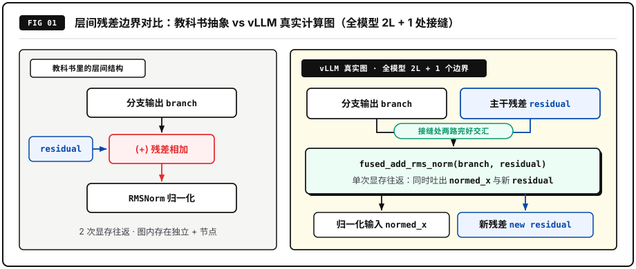
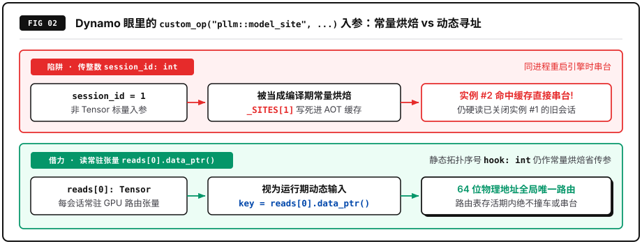
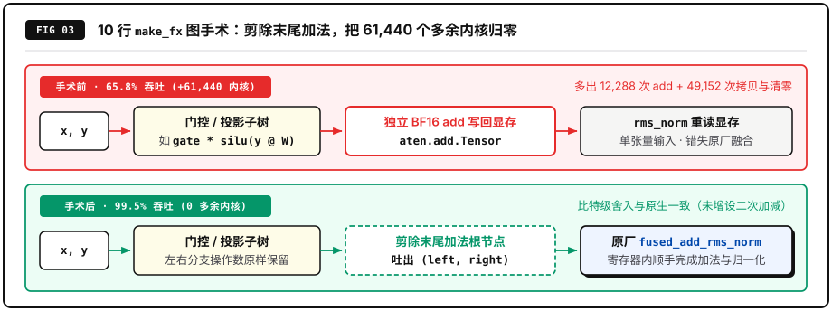
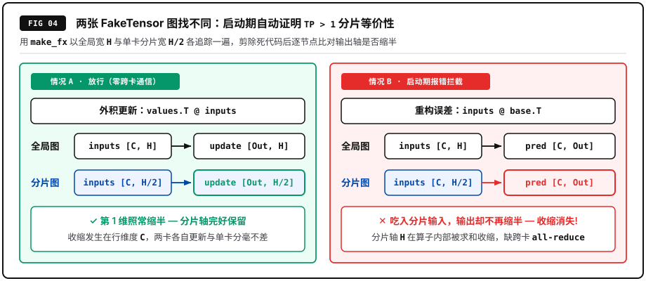
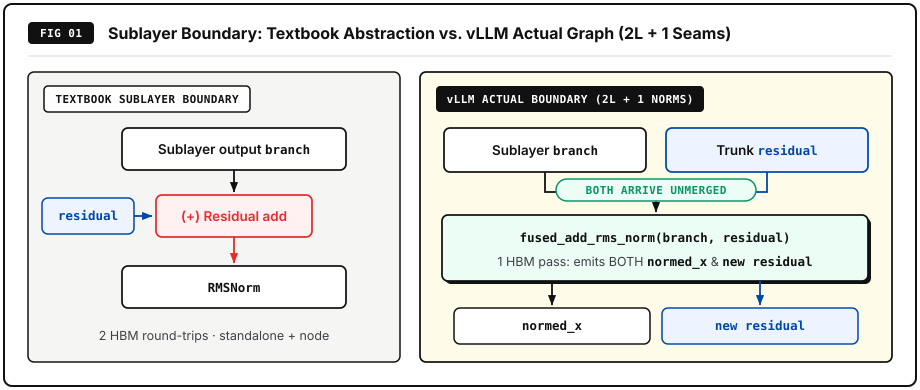
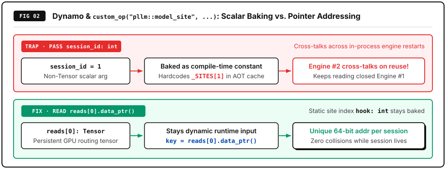
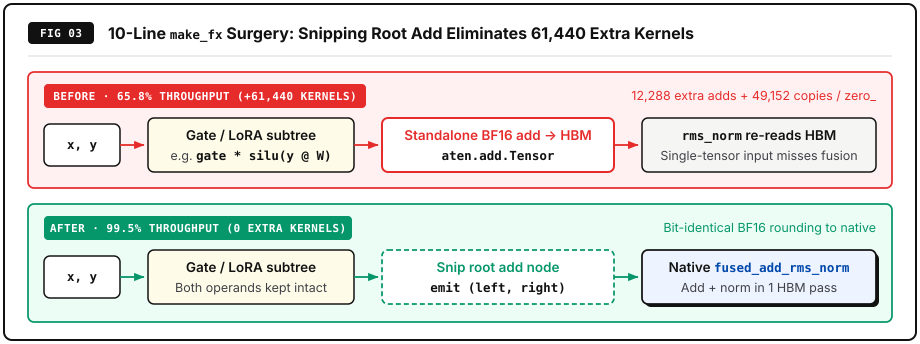
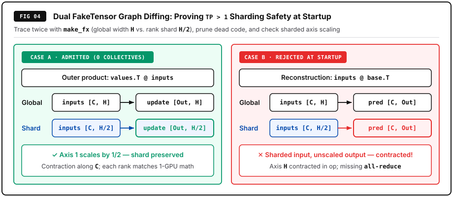

<div class="zine-dispatch" data-title-zh="从 `assert bs == 1` 到编译态多卡并发：在 `torch.compile` 图里改残差与训快权重" data-title-en="From `assert bs == 1` to Multi-GPU Compiled Serving: Editing Residuals and Training Fast Weights Inside `torch.compile`">
  <a class="zine-pill-link" data-i18n-zh="pLLM 项目主页与文档 →" data-i18n-en="pLLM Project &amp; Docs →" href="/pllm/">pLLM 项目主页与文档 →</a>
  <div class="zine-lang-switch" role="group" aria-label="Language">
    <button type="button" class="zine-lang-btn" data-lang-target="en" aria-pressed="false">EN</button>
    <button type="button" class="zine-lang-btn is-active" data-lang-target="zh" lang="zh-CN" aria-pressed="true">中文</button>
  </div>
</div>

<div class="zine-lang-panel" data-lang-panel="zh" lang="zh-CN" markdown="1">

<div class="zine-tldr" markdown="1">

**TL;DR：** 许多测试时训练（如 In-Place TTT）与激活干预的开源仓库在入口处写着 `assert len(input_ids) == 1`——因为一旦放进开启了 `torch.compile`、CUDA Graph 与多卡张量并行（TP）的生产引擎，原厂算子融合、Dynamo 常量烘焙、跨请求批处理与 `bfloat16` 精度吞没会连环报错或掉速。本文顺着把这类算法推进生产引擎的完整链路，拆解四步一脉相承的图内借力方案：借 `fused_add_rms_norm` 接缝与常驻张量 `data_ptr()` 进图、用 10 行 `make_fx` 剪除 61,440 个多余内核、用 `grad → vmap(chunk_size=1) → compile` 与 `float32` 增量破解并发求导与精度吞没，最后用两张假张量计算图对比自动证明多卡 `TP > 1` 零通信更新。

</div>

> **pLLM 技术随笔与机制拆解（5/10 · 极客拆解 · 编译图与快权重）** · [pLLM 项目主页与文档](/pllm/) · [专栏总览与系统解剖图](/pllm/#blog) · [GitHub 原文 ↗](https://github.com/LinesHogan/pLLM/blob/main/blog/zh/05-compiler-and-host-jujitsu.md)

翻开不少前沿推理期算法——比如把选定层 MLP 的下投影矩阵 `down_proj` 当成在线“快权重（Fast Weights）”、每攒够一段上下文就做一次外积更新的 In-Place TTT，或是逐请求动态加减方向向量的激活引导——它们的官方开源代码在推理入口处往往写着同一行断言：

```python
assert len(input_ids) == 1, "only support bs=1 for inference"
```

作者不是不想支持并发，而是只要试着把单请求脚本搬进开启了 `torch.compile` 与 CUDA Graph 的生产级 vLLM 引擎，就会迎头撞上四道连环关卡：教科书里独立的残差 `+` 号在图里消失了；传进编译图的会话编号被固化成常量导致多实例串台；哪怕只挂一行恒等加法也会凭空多出几万个碎内核；等到真正按批次并发更新线性层快权重时，还会同时撞上 `bfloat16` 把 99.99% 的更新量舍入归零、以及多卡切分（`TP > 1`）悄悄算错梯度的暗坑。

不拉取引擎源码分支、也不手写定制 C++/CUDA 算子，怎么一关一关把这条链路打通？核心思路只有一条：**先读懂编译器和宿主算子现有的融合边界与代数不变量，把自定义代码变成它们原本就擅长处理的形状。**

---

第一关：**在编译图里找回消失的 `+` 号，并带着外部会话穿过 `custom_op` 边界。**

在教科书里，Transformer 子层结尾是 `x = x + sublayer(norm(x))`；但打印出 vLLM 的真实计算图，从头找到尾也找不到那个独立的 `+` 号。为了省掉一次全隐藏层宽度的显存读写往返，vLLM 把“上一子层的残差相加”直接融进了**下一子层开头**的 `fused_add_rms_norm` C++ 内核里：

{: style="display: block; max-width: 100%; height: auto; margin: 1.5rem auto;" }

起初这像是一扇锁死的门，换个角度看却替我们标出了全模型最规整的挂载接缝：正因为上一子层没自己做加法，走到下一个 Norm 门口时，**分支输出 `branch` 与主干残差 `residual` 恰好完好无损地同时交到了这里**。只要没有被声明改写的层，原厂 Norm 连碰都不碰，零额外开销。

找准了位置，怎么把自定义 Python 会话逻辑塞进 `torch.compile` 而不触发断图（graph break）？在 `0.5B` 模型 32 并发测试上，图外逐请求回调只能跑 `4,258 tok/s`，进图后能跑到 `12,174 tok/s`，断图会直接丢掉三分之二的吞吐。标准通行证是注册 `@torch.library.custom_op` 不透明算子，但它的签名严禁传自定义 Python 对象，只收 `Tensor` 与基础标量（`int`、`float`）。

如果建一个全局字典 `_SITES[session_id]`、传整数 `session_id: int` 进去查表，单实例跑着好好的，一旦同一进程关掉旧引擎再起第二个同结构引擎，激活值就会串台——因为 Dynamo 会把一切非 `Tensor` 的 `int` 参数当成**编译期常量烘焙进 AOT 代码缓存**，第二个引擎命中缓存后依然在硬读 `_SITES[1]`！

{: style="display: block; max-width: 100%; height: auto; margin: 1.5rem auto;" }

顺着编译器的规矩借力：每个引擎会话启动时本来就持有一张常驻显存的路由索引张量 `reads[0]`，会话存活期间显存分配器绝不会把这块物理地址分给别人。直接拿 `reads[0].data_ptr()` 当 `_SITES` 字典的键，动态会话身份就合法穿过了静态编译图；反倒是标记“模型里第几个钩子”的拓扑序号 `hook: int` 真是静态常量，正好让 Dynamo 烘焙进去省掉传参开销。（顺带一提，单进程反复启停引擎时，vLLM 注册进 `torch._dynamo.convert_frame._bytecode_hooks` 的闭包从不清理，会把整座编译模型死死钉在显存里；在会话关闭时对钩子集合与 `CleanupManager` 做一次快照差集清理，几十 GB 显存才能干净退回。）

---

第二关：**先测零数学底噪——为什么一行恒等 `return x + y` 凭空多出了 61,440 个内核？**

进了图之后别急着写复杂算法，养成一个好习惯：**先挂一个什么都不改的恒等函数 `def identity(x, y): return x + y`，测一测纯框架过路费。**

在 `Qwen2.5-0.5B` 生成 8,192 个词的基准上，这行空转代码竟然让总吞吐掉到了原生的 **65.8%**！打开剖析器数了一遍 GPU 发射的内核总数：原生跑完发射 `104,837` 个内核，挂上 `return x + y` 后暴涨到了 `166,277` 个——凭空多出 **61,440 个小内核**：

- `37,119` 个 `memcpy` 与 `12,240` 个 `direct_copy`（进出算子端口时多余的临时缓冲搬运）；
- `12,288` 个端口预清零（几微秒后就会被覆盖的礼貌性 `zero_`）；
- `12,288` 个独立的 `bfloat16` 加法内核——原本 `fused_add_rms_norm` 在寄存器里顺手做完的加法，因为用户写成了返回单个张量 `x + y`，被迫单独发射一次加法写回显存、再读出来做归一化。

砍掉多余拷贝和清零并不复杂，怎么把那 `12,288` 次独立加法还给原厂融合算子？千万别耍小聪明把任意返回值 `out` 强拆成 `(out - x, x)` 塞回去——我们在对账测试里试过无条件拆分，多出来的一次 `bfloat16` 加减法改变了中间舍入位置，相对 `float32` 黄金参考的最差对数概率误差从原生的 `0.243` 恶化到了 `0.394`。

既要零额外内核，又要比特级舍入一致，只需在加载期用 `make_fx` 在零显存的假张量（FakeTensor）上追踪一次用户函数，看一眼表达式树的**最外层根节点**是不是加法：

```python
body = make_fx(trace, tracing_mode="fake", _allow_non_fake_inputs=True)(samples, arguments)
output = next(node for node in body.graph.nodes if node.op == "output")
(tail,) = output.args[0]
if isinstance(tail, fx.Node) and tail.target == torch.ops.aten.add.Tensor and not tail.kwargs:
    left, right = tail.args  # 确认形状精度匹配后，剪除末尾加法，把两路操作数直接交还原厂融合算子!
    set_tuple_output(body, output, (left, right))
    body.graph.erase_node(tail)
    body.recompile()
```

{: style="display: block; max-width: 100%; height: auto; margin: 1.5rem auto;" }

这套十行图手术的边界由原厂 C++ 算子物理写死的入口决定：只要表达式树的**根节点**是加法——不管左右子树里包着多复杂的门控乘法、低秩投影或激活函数（如 `x + gate * silu(y @ W)`，覆盖了绝大多数残差干预写法）——末尾那次全隐藏层加法就会被剪掉，`(left, right)` 原样对接 `fused_add_rms_norm`，`61,440` 个多余内核归零，吞吐回到 **99.5%**（若整张图只剩纯 `x + y`，则直接卸载该层钩子）。只有当根节点本身是非线性变换（如 `tanh(x + y)`）时，才交由独立的 `torch.compile` 把用户数学与端口写出融成单个内核，只多付一趟显存读写。

---

第三关：**从层间残差走进线性层内部，拆掉快权重训练的 `assert bs == 1` 与精度吞没陷阱。**

打通了残差边界，再往深走一步就是像 In-Place TTT 那样，在前向传播途中按块（如每 `chunk = 1024` 个词）在线求导或算外积，实时更新每个请求自己那份 `down_proj` 快权重增量 $$\Delta W$$，并让后续词立刻读到新权重。

当批次里同时挤着多个请求时，要把单请求求导函数扩成多请求并发编译图，PyTorch 函数式变换的组合顺序和参数藏着两个易错细节：

```python
eager = torch.func.grad(loss)
# 1. constants (底座大权重) 传 None 零拷贝广播；2. 显式设 chunk_size=1 锁死 GEMM 形状!
eager = torch.vmap(eager, in_dims=(0, 0, None, 0), chunk_size=1)
compiled = torch.compile(eager, fullgraph=True, dynamic=False, options={"triton.cudagraphs": False})
```

第一，顺序必须是 **`grad` → `vmap` → `compile`**：先在单请求内求标量损失的导数，再用 `vmap` 沿请求维铺开（冻结底座大权重对应的第 3 维设 `None` 零拷贝广播），最后由 `torch.compile` 把整批前反向融成一张图。  
第二，既然用了 `vmap` 批处理，为什么非要加看似多此一举的 **`chunk_size=1`**？因为一旦用户函数里写了 `x @ base.T`（乘共享冻结底座），不限制 `chunk_size` 就会把 $$B$$ 个请求折进同一次矩阵乘，左矩阵形状从 `[C, H]` 变成 `[B * C, H]`。矩阵行数一变，cuBLAS 的启发式选择器就会换用另一套分块（tile）内核，改变内部 `bfloat16` 累加顺序——导致同一个请求单独跑和跟别人拼批跑时，算出来的梯度在末位比特上发生漂移！加上 `chunk_size=1` 后，每次底座矩阵乘保持 `[C, H]` 原形状，同时仍被外层 `torch.compile` 编在同一张图里，兼顾了融合与跨批次确定性。

跑通了多请求并发，紧接着就会抓到一个更震撼的数值现象。我们在 `Qwen3-4B` 的真实 In-Place TTT 检查点上实测发现：**官方代码直接复制一份 `bfloat16` 底座权重并在上面原地累加更新（$$W \leftarrow \text{BF16}(W + \Delta W)$$），竟然把 99% 以上的梯度更新直接弄丢了！**

这不是代码写错了，而是迎头撞上了经典的浮点数**大数吃小数（Swamping）**。`bfloat16` 只有 **7 位尾数**（精度台阶约 $$2^{-7} \approx 0.78\%$$）。按原论文设定，每个块的更新矩阵按 Frobenius 范数裁剪到 `1e-5` 量级；我们拿该检查点第 0 层真实的 `down_proj` 权重（共 **24,903,680** 个参数）做了一次精确算术统计：把范数 `1e-5` 的更新直接加在 `bfloat16` 底座权重上，**2,490 万个元素里只有区区 472 个元素的数值发生了改变**——其余 **99.998%** 的更新全因跨不过最小精度台阶被硬件舍入抹平，实际留存下来的更新范数只剩预期值的 **0.97%**！

把只读的 `bfloat16` 底座权重 $$W$$ 与每请求从零起步的 **`float32` 独立增量缓冲 `delta`** 拆开（前向读取时只做一次 `inputs @ delta.to(inputs.dtype).T` 叠到底座输出上），微小的在线梯度就能在 23 位尾数里颗粒归仓。在单卡 4k 上下文实测中，拆成 `float32` 增量不仅在单请求下比官方仅支持 `bs=1` 的实现更快（`59.6 tok/s` 对 `54.8 tok/s`，16k 下快约 21%），并发开到 4 请求时还能跑到 **`111.4 tok/s`**。

---

第四关：**当模型切到多卡张量并行（`TP > 1`）时，怎么实现零新增通信，并在启动期自动揪出破坏分片等价性的更新公式？**

在 `TP = 2` 下，`down_proj`（`RowParallelLinear`）的输入特征与权重都按列切成了左右两半，每张卡算完本地半截矩阵乘后由宿主调一次 `all-reduce` 求和。前向读取可以顺手借力：我们不拦外层的 `forward`，而是往里钻一层拦住 `quant_method.apply`——赶在原厂发起 `all-reduce` **之前**，把本卡分片上的增量结果以 `float32` 并入局部和，直接复用原厂那次 `all-reduce`，零新增集合通信，且只在归约完成后做唯一一次 `bfloat16` 舍入。

真正危险的是前向内权重更新（`@pllm.train_in_forward`）：当每张卡手里只有半截特征 `[C, H/2]` 时，各卡闷头跑一遍用户的更新函数，结果还等价于单卡吗？

这取决于更新算式里有没有跨特征维收缩：

- **外积更新（如 TTT 的 `values.T @ inputs`）**：收缩的是块内行维度 `C`，特征维 `H/2` 彼此独立，两张卡各更新各的半边权重，拼起来与单卡分毫不差；
- **内积重构或特征范数（如先算 `pred = inputs @ base.T` 再求导，或 `inputs.square().sum(-1)`）**：被切开的 `H` 维在乘法或求和里收缩消失了——如果不做跨卡 `all-reduce`，每张卡只拿半边特征算误差，权重就会在不报一行错的情况下静默算歪！

怎么在不写几万行分布式分片推导器的前提下，自动拦截所有需要跨卡通信的更新函数？依然用两张假张量 `make_fx` 图做“找不同”：

{: style="display: block; max-width: 100%; height: auto; margin: 1.5rem auto;" }

剪除无关死代码后，把两张图的节点逐一对齐：只要发现任何一个算子吃进了带分片轴（两图形状成比例）的输入，吐出来的输出在两张图里形状却变得一模一样，就证明那个被切开的维度在算子内部被求和收缩了！不到百行代码，不需要为上千个算子手写分片规则表，两张假图自己就把分片守恒律证得明明白白。

---

这四步环环相扣的图内改造，构成了开源扩展层 **[pLLM](https://github.com/LinesHogan/pLLM)**（`pllm`）里 `@pllm.custom_residual` 与 `@pllm.train_in_forward` 的运行底座，不改上游源码即可横跨 vLLM `0.27` 至 `0.32` 运行。

把工程取舍摊在桌面上，这套打法有两笔明确的代价：一是启用残差改写时，为了避开嵌套 FX 追踪冲突并保证中性参数下与基准逐比特一致，模型图采用源算子捕获而非整图 Inductor 融合（在 7B 模型上挂满全部 28 层恒等钩子保持在原生 **97%** 吞吐，约 3% 为这张确定性门票的固定成本）；二是全秩快权重本身的物理体积不小（4B TTT 每份 `float32` 状态根占 `714 MiB`，且改写内部层必须关闭前缀缓存 Prefix Caching）。先看清算子接缝与浮点精度台阶，再去动手写代码，就能省掉大半重造轮子的冤枉活。

</div>

<div class="zine-lang-panel is-hidden" data-lang-panel="en" lang="en" markdown="1">

<div class="zine-tldr" markdown="1">

**TL;DR:** Open-source repositories for test-time training (such as In-Place TTT) and activation steering routinely open with `assert len(input_ids) == 1`—because dropping single-request research hooks into a `torch.compile` + CUDA Graph + Tensor Parallel (`TP > 1`) serving engine triggers a chain reaction of fused-op mismatches, Dynamo constant baking, cross-batch rounding drift, and `bfloat16` precision swamping. Following that single journey end to end without forking vLLM or writing C++ kernels takes four connected moves: riding `fused_add_rms_norm` boundaries with `reads[0].data_ptr()` session addressing, snipping 61,440 ghost kernels via 10 lines of `make_fx`, nesting `grad → vmap(chunk_size=1) → compile` over `float32` deltas to rescue 99.998% of swallowed updates, and diffing two fake-tensor graphs to prove zero-collective `TP > 1` updates at startup.

</div>

> **pLLM Engineering Essays & Deep Dives (5/10 · Deep Dive · Compiled Fast Weights)** · [pLLM Project & Docs](/pllm/) · [Series Index & Anatomy Map](/pllm/#blog) · [GitHub Source ↗](https://github.com/LinesHogan/pLLM/blob/main/blog/en/05-compiler-and-host-jujitsu.md)

Open almost any research release for inference-time adaptation—whether In-Place Test-Time Training (TTT), which treats selected MLP `down_proj` matrices as online fast weights updated every token chunk, or per-request activation steering—and you will likely find this line near the top of `generate`:

```python
assert len(input_ids) == 1, "only support bs=1 for inference"
```

Authors don't write that assertion out of laziness. Moving single-stream research code into a production vLLM engine with `torch.compile` and CUDA Graphs enabled hits four obstacles in sequence: the textbook residual `+` node has vanished from the graph; integer session IDs get baked into AOT caches and cross-talk across instances; even a no-op `return x + y` hook spawns tens of thousands of extra kernels; and batching fast-weight updates runs headfirst into `bfloat16` swamping (>99.99% of gradient updates rounded to zero) and silent multi-GPU (`TP > 1`) sharding bugs.

Walking one algorithm through all four stages without forking the engine or writing custom C++ kernels comes down to a single principle: **map out the exact fusion seams and algebraic invariants of the compiler and host modules first, then reshape your code to match them.**

---

Stage 1: **Find the missing `+` node, and cross `@torch.library.custom_op` without Dynamo constant baking.**

Textbooks write Transformer sublayers as `x = x + sublayer(norm(x))`. Print vLLM's actual execution graph, however, and no standalone residual `+` exists anywhere. To save a full-hidden-width HBM round-trip at every sublayer, vLLM fuses the end-of-sublayer addition into the _next_ sublayer's `fused_add_rms_norm` C++ kernel across all `2L + 1` norms:

{: style="display: block; max-width: 100%; height: auto; margin: 1.5rem auto;" }

What looks like a locked door is actually the cleanest seam in the model: precisely because the preceding sublayer deferred its addition, **both `branch` and `residual` arrive unmerged right at the norm's front door**. Unhooked layers keep their untouched native norms at zero overhead.

How do you invoke session-owned logic at that boundary without breaking `torch.compile`? On a 32-way `0.5B` benchmark, breaking the graph to run per-request Python callbacks outside CUDA Graphs manages only `4,258 tok/s` versus `12,174 tok/s` in-graph—losing two-thirds of throughput. The standard bridge into Dynamo is an opaque `@torch.library.custom_op`, whose schema accepts only `Tensor`s and primitive scalars (`int`, `float`), never Python session objects.

Passing `session_id: int` into a global `_SESSIONS[session_id]` dict works on Engine #1—and silently corrupts activations as soon as the same process closes Engine #1 and starts Engine #2 on the same architecture. Why? Dynamo bakes every non-`Tensor` scalar argument as a **compile-time constant** inside AOT-cached code, so Engine #2 hits the cache and keeps reading `_SESSIONS[1]`!

{: style="display: block; max-width: 100%; height: auto; margin: 1.5rem auto;" }

Aligning with Dynamo's rule solves it cleanly: every engine session already owns a persistent GPU routing tensor `reads[0]` whose 64-bit physical address `reads[0].data_ptr()` cannot be reused while the session is alive. Keying `_SITES` by `reads[0].data_ptr()` routes sessions dynamically, while the static topological site index `hook: int` _should_ be baked in as a constant. _(Checking repeated in-process lifecycles caught a companion VRAM leak: vLLM appends closures to `torch._dynamo.convert_frame._bytecode_hooks` and never cleans them up, pinning compiled models in HBM across teardown; snapshot-diffing `_bytecode_hooks` and `CleanupManager` on `close()` reclaims tens of gigabytes cleanly.)_

---

Stage 2: **Measure zero-math baseline noise first—why did `return x + y` spawn 61,440 extra kernels?**

Before writing fancy interventions inside a compiled hook, establish a baseline: **attach a mathematical no-op `def identity(x, y): return x + y` and count every launched GPU kernel.**

Across an 8,192-token `Qwen2.5-0.5B` run, that one-line identity dropped throughput to **65.8%** of native vLLM, inflating total kernel launches from `104,837` to `166,277`—**61,440 extra kernels**:

- `37,119` `memcpy` and `12,240` `direct_copy` launches staging tensors into and out of port buffers;
- `12,288` polite `zero_` fills on output ports overwritten microseconds later;
- `12,288` standalone `bfloat16` `add` kernels—because returning a single summed tensor forced a separate HBM add before `rms_norm` could read it back.

Eliminating staging copies and zero-fills is straightforward, but how do you hand that addition back to `fused_add_rms_norm`? Do _not_ blindly rewrite arbitrary hook outputs `out` as `(out - x, x)`: testing unconditional splitting shifted intermediate `bfloat16` rounding and degraded worst-case sequence logprob error (against an `float32` reference) from `0.243` to `0.394`.

Getting zero extra kernels _and_ bit-identical rounding takes ten lines of `make_fx` surgery on zero-memory FakeTensors at bind time—inspecting whether the **root node** of the expression tree is `aten.add.Tensor`:

```python
body = make_fx(trace, tracing_mode="fake", _allow_non_fake_inputs=True)(samples, arguments)
output = next(node for node in body.graph.nodes if node.op == "output")
(tail,) = output.args[0]
if isinstance(tail, fx.Node) and tail.target == torch.ops.aten.add.Tensor and not tail.kwargs:
    left, right = tail.args  # Once shapes/dtypes match, snip the terminal add and emit (left, right)!
    set_tuple_output(body, output, (left, right))
    body.graph.erase_node(tail)
    body.recompile()
```

{: style="display: block; max-width: 100%; height: auto; margin: 1.5rem auto;" }

The boundary of this trick follows directly from the hardcoded C++ kernel entry: whenever the **outermost root node** is `+`—no matter how much gating, low-rank projection, or nonlinearity lives inside its left and right subtrees (such as `x + gate * silu(y @ W)`, covering the vast majority of residual edits)—the terminal add vanishes, extra kernels drop to **0**, and throughput returns to **99.5%** (pure `x + y` identities even uninstall the hook outright). Only when the root itself is non-additive (e.g., `tanh(x + y)`) does an isolated `torch.compile` pass fuse the user's math and output-port write into one Inductor kernel, paying a single HBM pass instead of 61,440 eager launches.

---

Stage 3: **Step inside linear projections—breaking `assert bs == 1` and the 99.998% `bfloat16` swamping trap.**

Moving from residual boundaries into linear weights—like In-Place TTT updating per-request `[2560, 9728]` `down_proj` fast weights every `chunk = 1024` tokens mid-forward—requires vectorizing per-request differentiation across concurrent requests without numerical drift:

```python
eager = torch.func.grad(loss)
# 1. Broadcast frozen trunk weights via None; 2. Lock GEMM shape with chunk_size=1!
eager = torch.vmap(eager, in_dims=(0, 0, None, 0), chunk_size=1)
compiled = torch.compile(eager, fullgraph=True, dynamic=False, options={"triton.cudagraphs": False})
```

Two details do the heavy lifting here:

1. **Exact composition order (`grad` → `vmap` → `compile`)**: differentiate scalar masked loss per request first, map across requests while broadcasting the giant frozen base matrix zero-copy (`None`), then compile the joint forward/backward graph once.
2. **Why pass a seemingly self-defeating `chunk_size=1` to `vmap`?** Whenever user loss math evaluates `x @ base.T` against the shared frozen weight, unchunked `vmap` folds $$B$$ requests into a `[B * C, H]` GEMM. Changing the matrix $$M$$ dimension causes cuBLAS heuristics to pick a different tile kernel, altering internal `bfloat16` reduction order so a request's gradient drifts depending on batch size! Setting `chunk_size=1` keeps every frozen-base GEMM at `[C, H]` while still compiling all chunks inside one `torch.compile` graph.

Once batched TTT ran end to end on `Qwen3-4B`, parity checks uncovered an eye-opening numerical trap in the reference approach: **cloning `bfloat16` base weights and adding updates in place ($$W \leftarrow \text{BF16}(W + \Delta W)$$) threw away over 99% of every update!**

That is classic floating-point **swamping**. `bfloat16` carries only **7 mantissa bits** (~`0.78%` relative step size). Under the paper's `1e-5` Frobenius-norm update clip, we measured Layer 0's actual `down_proj` matrix (**24,903,680** parameters): adding a `1e-5`-norm update in `bfloat16` changed **only 472 elements out of 24.9 million**—wiping out **99.998%** of the entries to zero and leaving just **0.97%** of the intended update norm!

Decoupling the read-only `bfloat16` base weight $$W$$ from a zero-initialized **`float32` per-request `delta`** (`inputs @ delta.to(inputs.dtype).T`) preserves every gradient bit in 23-bit mantissas while outrunning the `bs=1`-only HF baseline (`59.6` vs `54.8 tok/s` at 4k solo, +21% at 16k, and **`111.4 tok/s`** at 4-way concurrency).

---

Stage 4: **Scale fast weights to multi-GPU Tensor Parallelism (`TP > 1`) with zero extra collectives—and prove sharding safety via two fake graphs.**

Under `TP = 2`, `down_proj` (`RowParallelLinear`) shards both input features and weights column-wise `[Out, H/2]` before calling an upstream `all-reduce`. Forward reads ride that collective for free: hooking `quant_method.apply` _before_ vLLM's `all-reduce` accumulates each rank's local shard correction in `float32`, adding zero extra communication and rounding to `bfloat16` only once at the exit.

In-forward updates (`@pllm.train_in_forward`) are where silent corruption lurks. When each GPU sees only `[C, H/2]`, can each rank run the author's update function independently?

- **Outer-product updates (`values.T @ inputs` in TTT)**: contract along the chunk-token axis `C`, leaving the sharded `H/2` axis untouched—local shard updates match single-GPU math bit for bit;
- **Inner-product reconstructions (`pred = inputs @ base.T` or `inputs.square().sum(-1)`)**: contract across the sharded `H` axis—without an unspoken cross-GPU `all-reduce`, each GPU computes half the sum and silently corrupts weights!

Rather than building a massive distributed sharding analyzer across a thousand ATen ops, trace the update function twice on FakeTensors and play "spot the difference":

{: style="display: block; max-width: 100%; height: auto; margin: 1.5rem auto;" }

After dead-code elimination, aligning live nodes between the two graphs proves sharding conservation in under a hundred lines: if any operator consumes a sharded operand (`axis is not None`) yet produces identically shaped outputs in both graphs (`axis is None`), the sharded dimension vanished inside a contraction—so startup fails fast with a clear diagnostic.

---

This four-stage pipeline powers `@pllm.custom_residual` and `@pllm.train_in_forward` in **[pLLM](https://github.com/LinesHogan/pLLM)** (`pllm`), running unmodified across upstream vLLM `0.27`–`0.32`.

Two explicit trade-offs come with the design: first, enabling residual rewrites captures model CUDA Graphs over source operators rather than whole-model Inductor fusion to avoid nested-FX conflicts and guarantee bitwise neutral parity (sustaining **97%** of native throughput on 7B even with all 28 layers hooked—a fixed ~3% ticket); second, full-rank fast weights carry real HBM weight (`714 MiB` per `float32` state root on 4B TTT, with Prefix Caching disabled whenever internal layers vary per request). Mapping compiler seams and floating-point step sizes up front turns a multi-week engine fork into surgical hooks.

</div>

<script defer src="/assets/js/bilingual-post.js"></script>
