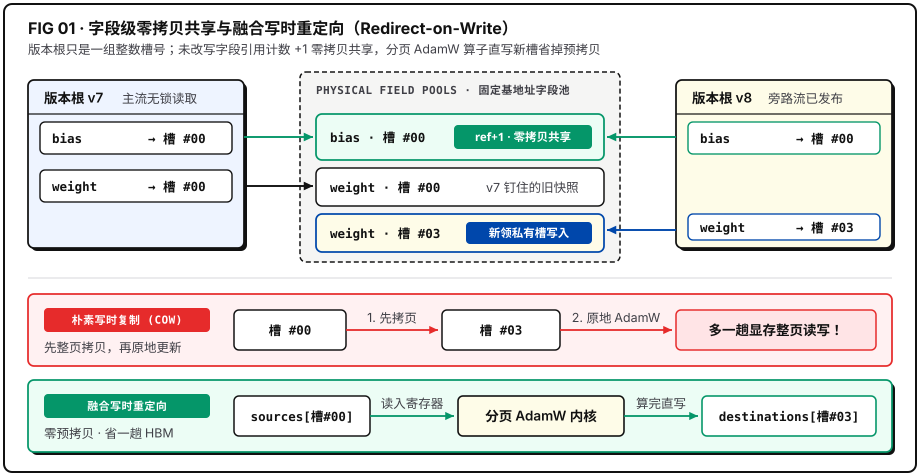
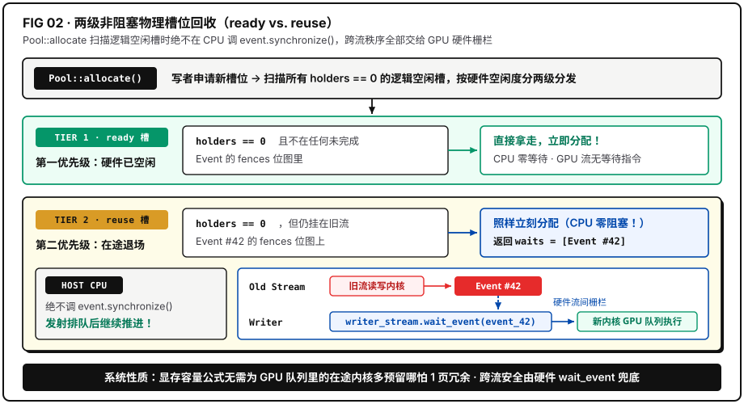
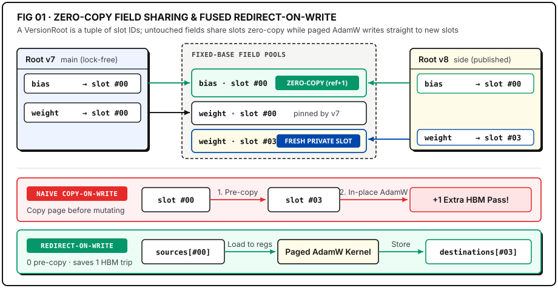
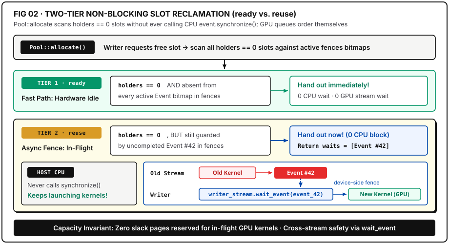

<div class="zine-dispatch" data-title-zh="当上百个在线请求各自边跑边改权重：在 GPU 显存里手搓无锁 MVCC 与异步 RCU" data-title-en="When a Hundred Live Requests Mutate Weights Concurrently: Building Lock-Free MVCC and Async RCU in GPU Memory" data-desc-zh="深入落地显存多版本状态的五道硬关卡：融合“写时重定向”省掉 AdamW 预拷贝并砍掉 30% 动量显存、用无锁代次账本抓出 ABA 悬空槽、靠两级非阻塞 wait_event 与 abort() 栅栏实现零冗余页回收、跨进程 CUDA IPC 远端凭证隔离、以及五行集合交集划定抢占回滚边界（pLLM 技术专栏 · 支持 EN / 中文 一键切换）" data-desc-en="Carrying param.add_() in-place weight updates from a single-stream script into a concurrent serving engine triggers four simultaneous failures: frozen CUDA Graph pointers, two-stream torn... (pLLM Engineering Series · Bilingual EN / 中文)">
  <a class="zine-pill-link" data-i18n-zh="pLLM 项目主页与文档 →" data-i18n-en="pLLM Project &amp; Docs →" href="/pllm/">pLLM 项目主页与文档 →</a>
</div>

<div class="zine-lang-panel" data-lang-panel="zh" lang="zh-CN" markdown="1">

<div class="zine-tldr" markdown="1">

**TL;DR：** 把“边推理边更新权重”塞进并发推理引擎，如果还沿用单机脚本的 `param.add_()` 原地覆盖，会同时撞上静态图地址锁死、主旁双流读写撕裂、在途请求半句变调与 KV 抢占历史篡改四场事故。根治手段是把数据库的**多版本并发控制（MVCC）**与内核 **RCU** 搬上显卡：用固定基地址字段池上的不可变版本号请回“时间维度”。本文深入拆解落地这套系统时真正棘手的五道硬核关卡：如何靠“写时重定向”省掉 `AdamW` 拷贝并砍掉 30% 动量显存、如何用无锁代次账本抓出 ABA 悬空槽、如何靠两级非阻塞 `stream.wait_event` 与 `abort()` 事件栅栏实现零冗余页物理复用、跨进程 `CUDA IPC` 借用为何不能信本地事件、以及 `applied & rewritten` 五行集合交集如何划定抢占回滚边界。

</div>

> **pLLM 技术随笔与机制拆解（7/10 · 极客拆解 · 显存并发状态）** · [pLLM 项目主页与文档](/pllm/) · [专栏总览与系统解剖图](/pllm/#blog) · [GitHub 原文 ↗](https://github.com/LinesHogan/pLLM/blob/main/blog/zh/07-gpu-mvcc-and-rcu.md)

在单请求研究脚本里，在线更新参数根本算不上一个系统问题：建一个字典 `states[req_id]`，每步算完梯度调一句 `param.add_(delta)` 原地覆盖，请求结束 `del` 掉就完事了。

可一旦把这套逻辑搬进满载运转的生产级推理引擎，四起看似毫无关联的故障会接连找上门来：

1. **静态图寻址撞墙**：CUDA Graph 在预热时就把算子读写的裸地址锁死了，字典里动态分配的请求张量根本进不了图；
2. **主旁双流读写撕裂**：为了不让反向求导和 `AdamW` 堵住主干前向（`main` stream），自然要把训练放到旁路流（`side` stream）上与下一步前向并行跑——可两边指着同一个槽位原地改写，主流读出来的是一半新梯度、一半旧权重的半成品；加锁又会让双流退回串行；
3. **在途流式响应半句变调**：老请求 A 刚通过 SSE 吐出半句话，外部调 `import_state` 更新了共享引导向量，原地覆盖会让请求 A 从下半句开始突然换一副腔调；
4. **KV 抢占重算篡改历史**：显存吃紧时调度器踢掉了某个跑到第 50 步的请求的 KV 缓存，稍后从第 0 个词重新预填充恢复——原地覆盖早就把第 0 步的初始权重抹没了，拿第 50 步的权重去重算第 0 步的 K 和 V，算出来的上下文跟被踢走前对不上号。

如果把这四件事当成四个孤立的工程 bug 去打补丁——给录图做静态池、给双流做乒乓双缓冲、给热更新排阻塞队列、给抢占写备份快照——补丁会越叠越厚，且彼此打架。

退后一步剥掉表象，这四起故障在底层其实在争抢同一个东西：**在时间线上的任意一刻，某一个读者究竟应该看见状态的哪一份快照？** 原地修改之所以无解，是因为它抹杀了“时间维度”——把过去、现在和尚未写完的未来拍扁在了同一个物理地址里。

一旦认清病根是“丢了时间”，解法在数据库（PostgreSQL 的 **MVCC**）与操作系统内核（Linux 的 **RCU**）里早有定论：**状态永远不可变；写者绝不覆盖旧槽位，而是从池子里领新槽写入、原子切换版本根指针；旧槽位等所有读者退出“宽限期（Grace Period）”后再回收。**

然而，把这套教材原理真搬到**静态图锁死基地址、CPU 与多条 GPU 硬件流全异步交错、甚至跨进程共享显存**的显卡上，真正的硬骨头才刚开始。下面我们把这套分页张量状态系统（PTTS）拆开，逐一解开落地时最难啃的五道工程关卡。

---

第一关：**分页粒度怎么选？怎么消除写时复制（COW）的拷贝开销与 `AdamW` 动量膨胀？**

听到“分页”，大家第一反应往往是模仿 PagedAttention 把张量切成 16 行一页的小碎块，或者像多 LoRA 系统（S-LoRA / Punica）那样把不同秩的静态只读适配器塞进统一内存池。但在线可变状态面对的物理规律截然不同：KV 缓存是一个词接一个词往后追加的，不切小页会有严重的内部碎片；而在线训练的权重与动量每次都是**整张参数矩阵一起读写**——把一个 `[4, 3584]` 的轻量矩阵再切成碎块，除了徒增页表间接寻址开销，省不下半分拷贝带宽。

因此，我们在启动期按字段（Field）建池：每个字段是一块基地址永不改变的连续大张量 `pool[capacity, *field_shape]`，“一页”就是第 0 维上的一个完整字段槽位 `slot_id`，而一个“状态版本根（Version Root）”物理上只是一组整数槽号。

按字段切槽立刻带来两项实打实的收益。第一是**字段级零拷贝共享与“写时重定向（Redirect-on-Write）”**：

{: style="display: block; max-width: 100%; height: auto; margin: 1.5rem auto;" }

看上面最后两行的区别：常规 COW 在修改前要先调一次拷贝把旧页复制到新页（`fill_versions`）；但对于 `AdamW` 这样全量覆写参数与动量的操作，我们的分页 `AdamW` 内核直接拿着路由表里的源槽号 `0` 读入旧参数和动量，在寄存器里算完一步更新后，直接落盘到目标新槽号 `3`——**连写时复制事先拷旧页的那趟显存往返都省掉了**（只有局部修改部分行的任务才需要声明 `copy_fields` 预拷贝）。

第二项收益来自追问一句“**到底谁会去读历史版本？**”：一份带 `AdamW` 的状态有 4 个字段（参数 `weight`、步数 `step`、一阶动量 `exp_avg`、二阶动量 `exp_avg_sq`）。主干前向推理流只读 `weight`，抢占回滚也只退回初始 `v0` 的 `weight`——没有任何外部读者会去翻看“上一步的历史动量”，动量永远只有旁路训练流自己紧接着读最新版（`lag = 0`）！于是账本在表结构上挂了一组布尔掩码 `pinned: Vec<bool>`：历史快照持有凭证（Pin）只保留参数字段，放行三个优化器字段。无论跨步滞后窗口开多大，`AdamW` 三个动量字段在每条请求谱系上永远封顶 **2 页**（1 读 + 1 写），直接砍掉约 **30%** 的状态池显存。

---

第二关：**在每步几毫秒的解码热路径上，怎么做到零锁记账，并抓出致命的 ABA 悬空槽引用？**

如果用 Python 对象和线程锁来管几百个槽位的引用计数，CPU 开销本身就会拖垮小模型吞吐。我们的切法是严格实行**控制面与数据面分离**：Python 只保管笨重的 GPU 实体（各字段池大张量与 `torch.cuda.Event` 对象池），而所有数字事实全部收归单线程无锁的 Rust 数组账本（`slot_ledger.rs` 与 `page_ledger.rs`，标为 `#[pyclass(unsendable)]`，严禁跨线程共享，连一把互斥锁都没有；扫描数组时通过 `py.allow_threads` 释放 GIL）。

翻开 `slot_ledger.rs` 里物理池的核心结构，只有三个平坦数组：

```rust
pub(crate) struct Pool {
    pub width: usize,
    pub capacities: Vec<usize>,
    offsets: Vec<usize>,
    holders: Vec<i64>,            // 每个物理槽当前的逻辑持有计数 (Pin + 最新根 + 在途写)
    generations: Vec<i64>,        // 分配代次保险丝：每次 holders 归零回收时自增 1
    fences: Vec<(i64, Vec<bool>)> // 硬件宽限期栅栏：(未完成的 Event ID, 该事件护住的槽位位图)
}
```

为什么要专门维护一个 `generations`（分配代次）数组？做内存池最怕隐蔽的 **ABA（悬空槽错位别名）问题**：假设某处上层代码因逻辑漏洞攥着一张旧凭证 `PageSlot(slot=3, gen=12)` 忘了丢弃；期间 3 号槽引用计数归零被回收，转手分给了刚进场的另一个租户请求 B。如果没有代次校验，旧凭证回头拿 `slot=3` 切片时不会报任何错，而是悄无声息地读出或改坏请求 B 的权重！每次 `holders` 归零时执行一句 `generations[index] += 1`，所有张量视图入口强制校验 `holders >= 1 && generations == gen`，一旦撞上过期凭证立刻断言停机，绝不让脏数据溜进计算图。

配合“惰性清理”策略（只要空闲槽够用，已完成的释放收据就留在队列里不轮询，只在槽位报满时集中清扫一次），在 128 并发实测下，单步 `prepare_transition` 仅耗时约 **`181 µs`**，`publish` 约 **`82 µs`**，`release` 约 **`58 µs`**。

---

第三关：**异步 GPU 上“引用计数归零 ≠ 硬件停手”——怎么实现不卡 CPU 的两级物理回收与 `abort()` 栅栏？**

这是把 CPU 数据库的 MVCC 搬上 GPU 最容易栽跟头的地方。在纯 CPU 内存里，`holders == 0` 的那一刻内存就能立刻重用；但在异步显卡上，CPU 释放完引用计数，只代表宿主线程“发完了读/写指令”，刚才那条 CUDA Stream 队列里的内核可能还在硬件上跑着！

更棘手的是：如果分配器每次重用一个刚释放的槽位时，都在 CPU 上调 `event.synchronize()` 等旧内核跑完，CPU 发射流水线就会被卡得一顿一顿的。

看看 `Pool::allocate` 是怎么用**两级非阻塞分配（`ready` + `reuse`）**化解这个死结的：

{: style="display: block; max-width: 100%; height: auto; margin: 1.5rem auto;" }

这套两级机制带来了一个极漂亮的系统性质：**我们的显存容量公式不需要为“GPU 队列里还没跑完的在途内核”多预留哪怕一页冗余显存！** 逻辑一释放，槽位立即可再分配，跨流物理安全全由硬件流上的 `wait_event` 兜底。

顺着同一条硬件铁律往下推，就能看懂两处初学者常漏掉的防御细节：

- **为什么取消写入 `abort(token)` 代码长得跟成功发布 `publish(token)` 几乎一模一样？** 在 `page_bundle.py` 里，哪怕某次状态更新中途报错或因条件未命中决定作废（`abort`），也**必须**像正常发布一样在 `token.stream` 上录下一枚 `cuda.Event` 送进账本 `fences`（仅把最后一个布尔标志设为 `aborted = True` 阻止版本号对外可见）。因为 CPU 决定撤单的前一微秒，旁路流上可能已经发射了三四个写显存内核；不打下这道硬件宽限期栅栏就把废槽放回池子，下一个请求领走该槽位就会跟尚未跑完的废内核迎头相撞！（同理，每个绑定进来的新 CUDA Stream 都必须对池底大张量调一次 `tensor.record_stream(stream)`，防止引擎异步销毁时 PyTorch 缓存分配器提前收走底层显存。）
- **当跨进程通过 `CUDA IPC` 零拷贝借用状态页时，为什么本地 `cuda.Event` 也不够用了？** 在我们的多进程视频/特征流场景里，摄取进程导出只读页给推理子进程消费。此时本地流跑完绝不代表远端进程读完了！因此带远程读者的 `release_pin` 会把收据挂进 `pending_releases`，必须等“本地完成 Event **加上** 所有远端进程在原接收流同步后发回的管道 `ACK` 凭证”全部收齐才放行槽位；一旦远端进程崩溃断连没发回凭证，账本宁可永久隔离扣留那几页并停机报错，也绝不强行回收已被外部映射的物理显存。

---

第四关：**双流滞后流水线（`publish_lag`）的精确页容量算术。**

搞定了底层的安全回收，回到流水线吞吐：在线训练的损失计算必须等第 $$n$$ 步末尾抽样出新词（`token.commit`）后才能在旁路流上启动；而几乎同一微秒，主流已经跨入第 $$n+1$$ 步的模型前向。如果死守 `publish_lag = 0`（强迫第 $$n+1$$ 步前向等第 $$n$$ 步训练跑完），双流立刻退回串行。

放开一步可见性滞后（默认 `publish_lag = 1`），两条流完全解耦：第 $$n+1$$ 步主流无锁读取步边界上早已就绪的 `v_{n-1}`，第 $$n+2$$ 步读 `v_n`；而旁路训练流自己读的是 `(latest, 0)`，第 $$n+1$$ 步训练紧咬在第 $$n$$ 步训练产出的 `v_n` 后面继续迭代，一步梯度都不丢。

满负荷运转下，到底要预留多少物理页才能从数学上保证绝不死锁或槽位耗尽？答案是一行没有任何经验系数的公式：

$$\text{每请求参数字段容量} = (1 + H + W) \times N_{\text{max\_seqs}}$$

其中每一项各司其职：**`1`** 是当前步前向正在钉住读取的版本；**`H`** 是滞后窗口保留的旧版本数（等于 `publish_lag`——注意一个精巧细节：这 `H` 份保留版里最新的一份**恰好就是当前最新发布版**，所以最新发布根根本不用再多占 `+1` 页！且退场老请求留下的滞后页可与刚入场尚无历史的新请求共用配额）；**`W`**（`0` 或 `1`）是旁路流正在后台填充的私有写槽。而对于既允许请求准入锁快照、又允许后台随时 `import_state` 热更新的共享 `InstanceState`，考虑到最坏情况下场上每个在途请求恰好各攥着一版不同的历史导入快照，容量精确封顶于 `1 + H + 1 + N_{\text{max\_seqs}}`。

---

第五关：**KV 抢占重算时，到底该保住进度（`keep`）还是推倒重来（`reset`）？**

当请求跑到第 50 步因 KV 显存不足被临时驱逐、稍后从第 0 个词重新预填充时，状态该怎么处理？在 `preemption.py` 里，判定逻辑被浓缩成了五行集合运算：

```python
applied = {b.resource for b in (*spec.overlay_bindings, *spec.activation_bindings)}
custom = any(not rewrite.patch for rewrite in sites)
return "reset" if (applied & _rewritten(graph)) or custom or probe.custom_attention or adaptive else "keep"
```

分界线沿着**对模型 KV 的因果污染**一刀切开：

- **不改模型内部 K/V（如只读隐藏层并在末尾引导采样的在线蒸馏）→ `keep`**：前 50 个词重算出来的 K 和 V 与被踢走前一模一样，辛辛苦苦训了 50 步的小网络权重原样保留，只需靠行标签水位线滤掉重算行别训第二遍；
- **运行期被改写、且作用在模型层上（`applied & _rewritten(graph)` 非空）→ `reset`**：第 10 步的 KV 是用 `v10` 算的，拿 `v50` 去重算前 50 步会篡改历史，因此准入时预先钉死初始版本 `v0`，抢占时一键拨回 `v0` 跟着词序列重新演进；
- **最妙的边界落在交集之外**：如果挂了模型内的 `Adapter`（属于 `applied`），但它在请求运行期间从未被改写过（比如是准入前通过 `StateImport` 导入的静态引导向量，不在 `_rewritten` 里），交集为空，策略依然是 **`keep`**——省掉了无谓的回滚开销！

---

这套由 Rust 无锁代次账本与 CUDA 事件栅栏驱动的显存 MVCC 引擎，目前支撑着 **[pLLM](https://github.com/LinesHogan/pLLM)**（`pllm`）的全部有状态负载。（附注一条自动精度规则：所有跨块递推累加器与被优化器更新的参数默认强制升为 `float32`——在 32k 词长、64 词分块的递推实测中，`float32` 相对误差仅 $$3.7 \times 10^{-4}$$，而 `bfloat16` 高达 $$1.4 \times 10^{-1}$$，相差近三个数量级。）

最后摊开这本多版本账单的物理边界：在 `Qwen2.5-7B`、128 并发下跑秩为 4 的每请求在线训练（`publish_lag=1`，参数 384 页、动量 256 页），整座状态池仅占 **`110 MiB`** 显存，吞吐维持在原生的 **97.4%**；但因为“整字段成页”加上启动期锁死容量上限，如果你塞入每请求 `[2560, 9728]` 的 6 层全秩快权重，4 并发预留 8 份根就会吃掉 **`5.6 GiB`** KV 缓存预算，稀疏改两行也会触发整字段写放大，且外部导入速率快过慢请求排空速率时会主动抛出非阻塞 `WindowBackpressure` 背压异常。把不可变版本请回显存需要付预留池的钱，换来的是两条异步硬件流在微秒级交错下绝不算错一个比特。

</div>

<div class="zine-lang-panel is-hidden" data-lang-panel="en" lang="en" markdown="1">

<div class="zine-tldr" markdown="1">

**TL;DR:** Carrying `param.add_()` in-place weight updates from a single-stream script into a concurrent serving engine triggers four simultaneous failures: frozen CUDA Graph pointers, two-stream torn reads, mid-sentence SSE hot-reload drift, and corrupted KV preemption replays. Bringing database **MVCC** and kernel **RCU** onto the GPU restores time as immutable versions over fixed-base field pools. We unpack the five hardest systems problems underneath: turning Copy-on-Write into zero-copy **Redirect-on-Write** for `AdamW` while cutting 30% of momentum VRAM, catching ABA stale-slot bugs in a lock-free Rust generation ledger, non-blocking two-tier `stream.wait_event` reclamation and `abort()` fences, why cross-process `CUDA IPC` borrowing cannot trust local events, and the 5-line `applied & rewritten` set intersection governing preemption rollback.

</div>

> **pLLM Engineering Essays & Deep Dives (7/10 · Deep Dive · GPU MVCC & RCU)** · [pLLM Project & Docs](/pllm/) · [Series Index & Anatomy Map](/pllm/#blog) · [GitHub Source ↗](https://github.com/LinesHogan/pLLM/blob/main/blog/en/07-gpu-mvcc-and-rcu.md)

In a single-request research script, mutating online state barely registers as a design problem: keep a Python dict `states[req_id]`, call `param.add_(delta)` in place after each step, and `del` it when generation finishes.

Drop that exact pattern into a loaded production serving engine, and four seemingly unrelated failures detonate one after another:

1. **Frozen graph pointers**: CUDA Graphs lock raw tensor addresses at warmup, so dynamically allocated per-request dict tensors cannot enter captured decode loops;
2. **Two-stream torn reads**: Hiding backward + `AdamW` latency behind the next token's forward pass requires running training on a side CUDA Stream concurrently with the main forward Stream—mutating one slot in place makes the main stream read half-written weights mid-kernel, while adding a mutex serializes both streams;
3. **Mid-sentence SSE hot-reload drift**: Client A is halfway through a streamed sentence when an operator calls `import_state` to update a shared steering vector in place, abruptly changing Client A's persona on token 15;
4. **Corrupted KV preemption replays**: Under KV memory pressure, the scheduler evicts a request at step 50 and later replays its prompt + emitted tokens from position 0—in-place updates destroyed step 0's initial weights long ago, so replaying token 0 under step-50 weights computes contradictory K/V history.

Patching those four symptoms one by one—static slots for graphs, ping-pong buffers for two streams, blocking queues for imports, backup clones for preemption—produces a brittle tangle of conflicting state machines.

Strip away the surface details, and all four failures are fighting over one question: **at any instant on the timeline, which exact snapshot of state should a given reader see?** In-place mutation makes that question unsolvable because it erases time—flattening past, present, and half-written future onto one physical address.

Databases (PostgreSQL **MVCC**) and OS kernels (Linux **RCU**) solved this decades ago: **make state immutable; writers claim fresh slots from a pool and atomically swing a version root, while old slots wait out a Grace Period before reuse.**

Translating textbook MVCC/RCU onto **frozen-base CUDA Graphs, asynchronous multi-stream GPU queues, and cross-process shared HBM**, however, is where the real engineering begins. Here are the five hardest problems inside our Paged Tensor Transition System (PTTS).

---

Problem 1: **What is the right page granularity—and how do you eliminate both the "Copy" in Copy-on-Write and `AdamW` momentum bloat?**

Hearing "paging," engineers instinctively think of PagedAttention's 16-token blocks, or multi-LoRA servers (S-LoRA / Punica) packing heterogeneous-rank _read-only_ adapters. Live mutable state obeys different physics: KV caches append one token at a time (needing small blocks against internal fragmentation), whereas online updates read and write **entire parameter tensors at once**. Slicing a `[4, 3584]` matrix into sub-pages adds page-table indirection while saving zero bytes of copy bandwidth.

So each field owns one contiguous fixed-base tensor `pool[capacity, *field_shape]` allocated once at startup. One "page" is one whole-field `slot_id` along axis 0, and a `VersionRoot` is just a small tuple of integer slot IDs.

Whole-field slots unlock two immediate wins. First is **zero-copy untouched sharing plus Redirect-on-Write**:

{: style="display: block; max-width: 100%; height: auto; margin: 1.5rem auto;" }

Standard COW copies the old page before mutating (`fill_versions`). For full-tensor writers like `AdamW`, our paged optimizer kernel reads `sources[0]` into registers, computes the step, and writes straight out to `destinations[3]`—**skipping the pre-copy HBM round-trip altogether** (only partial-row writers opt into `copy_fields`).

Second, ask **who actually reads historical versions?** An `AdamW`-backed parameter has four fields (`weight`, `step`, `exp_avg`, `exp_avg_sq`). Forward inference only ever reads `weight`, and preemption rollback only resets to `v0`'s `weight`—no external reader ever inspects _historical_ `AdamW` momentum, which is chained strictly at `lag = 0` by the writer itself! Attaching a per-field `pinned: Vec<bool>` mask in the ledger restricts historical pins to model parameters, capping all three optimizer fields at a flat **2 pages** per lineage (1 read + 1 write) regardless of lag window and cutting state-pool VRAM by **~30%**.

---

Problem 2: **How do you run sub-200 µs lock-free bookkeeping while catching silent ABA stale-slot bugs?**

Tracking hundreds of page refcounts through Python objects and locks would bottleneck small-model decode steps on the CPU. Instead, we split **control plane from data plane**: Python holds only heavyweight GPU handles (pool `Tensor`s and `torch.cuda.Event`s), while all numeric ownership lives inside a single-threaded, lock-free Rust ledger (`slot_ledger.rs` and `page_ledger.rs`, marked `#[pyclass(unsendable)]` and releasing Python's GIL via `py.allow_threads`).

Inside `slot_ledger.rs`, each physical pool is just three flat integer/bit vectors:

```rust
pub(crate) struct Pool {
    pub width: usize,
    pub capacities: Vec<usize>,
    offsets: Vec<usize>,
    holders: Vec<i64>,            // Logical refcount per slot (pins + latest root + active write)
    generations: Vec<i64>,        // ABA fuse: increments every time `holders` drops to 0
    fences: Vec<(i64, Vec<bool>)> // Hardware grace periods: (uncompleted Event ID, guarded slot bitmap)
}
```

Why keep `generations`? Custom memory pools are notorious for silent **ABA / use-after-free aliasing**: suppose buggy caller code retains a stale handle `PageSlot(slot=3, gen=12)` after release; slot 3 hits `holders == 0`, gets reallocated to Tenant B, and receives Tenant B's private weights. Without generation tags, dereferencing `slot=3` succeeds silently and leaks Tenant B's state! Incrementing `generations[index] += 1` whenever `holders` hits zero and asserting `holders >= 1 && generations == gen` on every view turns silent corruption into an immediate crash.

Paired with lazy receipt collection (skipping event polling until `PageCapacity` actually runs low), 128-way bookkeeping takes **`~181 µs`** for `prepare_transition`, **`~82 µs`** for `publish`, and **`~58 µs`** for `release`.

---

Problem 3: **On an asynchronous GPU, `holders == 0` never means hardware is idle—how do you recycle slots without stalling the CPU?**

In a CPU database, `holders == 0` means memory is immediately reusable. On an asynchronous GPU, dropping the last logical reference on the host only means the CPU _finished queuing commands_—kernels reading or writing that slot may still be executing in a CUDA Stream!

Calling `event.synchronize()` on the CPU before reusing a slot would stall the host launch pipeline. Look at how `Pool::allocate` avoids CPU stalls completely via **two-tier non-blocking allocation (`ready` vs. `reuse`)**:

{: style="display: block; max-width: 100%; height: auto; margin: 1.5rem auto;" }

This two-tier handoff yields a remarkable capacity property: **our memory budget reserves zero extra slack pages for in-flight GPU kernels!** Once logical ownership ends, slots are immediately reallocatable behind GPU-side `wait_event` ordering.

Following that same async hardware law explains two subtleties that bite almost every first-time implementation:

- **Why `abort(token)` looks nearly identical to `publish(token)`**: Even when a write transaction aborts mid-step (due to an error or false runtime predicate), `abort(token)` _must_ record a `cuda.Event` on `token.stream` and register it in `fences`, differing from `publish` only in setting `aborted = True` so the root stays unpublished. Microseconds before the host decided to abort, kernels may already have launched onto `token.stream`; returning the aborted slot unfenced lets the next tenant collide with still-running aborted writes! (Likewise, every newly bound stream calls `tensor.record_stream(stream)` on backing pools so async engine teardown never lets PyTorch's caching allocator premature-free HBM.)
- **Why cross-process `CUDA IPC` readers cannot rely on local `cuda.Event`s**: When an external ingestion process exports pinned pages zero-copy over `CudaIpcStorage` to an inference worker, local stream completion tells you nothing about when the remote OS process finishes reading! `release_pin` therefore parks a `PageRelease` in `pending_releases` until _both_ the local Event and every remote stream-synchronized pipe `ACK` arrive—and if a peer crashes or disconnects without ACKing, the arena permanently quarantines those pages and fail-stops rather than risking overwriting live IPC-mapped HBM.

---

Problem 4: **Exact deadlock-free page arithmetic under `publish_lag = 1`.**

Online loss computation cannot start on the side stream until step $$n$$ commits its sampled token (`token.commit`), right as the main stream crosses into step $$n+1$$'s forward pass. Demanding `publish_lag = 0` stalls step $$n+1$$ behind step $$n$$'s backward pass.

Allowing a one-step lag (`publish_lag = 1`) decouples both streams lock-free: step $$n+1$$ forward reads `v_{n-1}` (`(boundary, 1)`), step $$n+2$$ reads `v_n`, while the side-stream trainer chains `(latest, 0)` (`v_{n-1} -> v_n`) without dropping a single gradient step.

How many pages guarantee zero deadlocks at peak concurrency? One exact formula with zero fudge factors:

$$\text{Per-request parameter pages} = (1 + H + W) \times N_{\text{max\_seqs}}$$

Every term maps to one physical role: **`1`** for the current step's pinned forward read; **`H`** for lagged retention (`publish_lag`—noting neatly that the newest slot inside `H` _is_ the latest published root, needing no extra `+1`, and retiring requests share lag quota seamlessly with newly admitted ones); and **`W`** (`0` or `1`) for the private write slot in flight. For live-updatable shared `InstanceState` pinned at admission, accounting for the worst case where every active SSE request holds a distinct historical `import_state` snapshot yields `1 + H + 1 + N_{\text{max\_seqs}}`.

---

Problem 5: **When KV preemption evicts a request, when is `keep` safe and when is `reset` mandatory?**

In `preemption.py`, five lines of set algebra draw the exact causal boundary:

```python
applied = {b.resource for b in (*spec.overlay_bindings, *spec.activation_bindings)}
custom = any(not rewrite.patch for rewrite in sites)
return "reset" if (applied & _rewritten(graph)) or custom or probe.custom_attention or adaptive else "keep"
```

- **Never alters trunk K/V (e.g., side-stream distillation steering only the sampler) → `keep`**: replaying the first 50 tokens produces identical trunk K/V, so 50 steps of learned weights stay intact (with `frontier` filtering replayed tokens out of training);
- **Mutated during inference AND applied inside trunk layers (`applied & _rewritten(graph)` non-empty) → `reset`**: token 10's K/V depended on `v10`, so eviction rewinds to admission-pinned `v0`;
- **The sharp edge outside the intersection**: an in-model `Adapter` (`in applied`) imported before admission and never rewritten mid-request (`not in _rewritten`) still gets **`keep`**—avoiding pointless rollbacks!

---

This Rust-ledger + CUDA-event MVCC engine backs every stateful workload in **[pLLM](https://github.com/LinesHogan/pLLM)** (`pllm`), paired with automatic `float32` promotion on optimizer-updated fields and recurrences (across a 32k-token, chunk-64 recurrence test, `float32` relative error stays at $$3.7 \times 10^{-4}$$ versus $$1.4 \times 10^{-1}$$ in `bfloat16`—nearly three orders of magnitude cleaner).

On `Qwen2.5-7B` at 128-way concurrency, rank-4 per-request online training (`publish_lag=1`: 384 parameter pages, 256 optimizer pages) takes **`110 MiB`** total and sustains **97.4%** of stateless throughput. Whole-field fixed-ceiling pools carry clear trade-offs on giant states, however: 6-layer full-rank `[2560, 9728]` fast weights on 4B consume **`5.6 GiB`** across 4 requests, mutating two rows copies the whole field, and outrunning slow-client snapshot drain raises non-blocking `WindowBackpressure`. Paying upfront for versioned slots buys a guarantee no lock can match: asynchronous streams interleaving at microsecond granularity without corrupting a single bit.

</div>

<script defer src="/assets/js/bilingual-post.js"></script>
