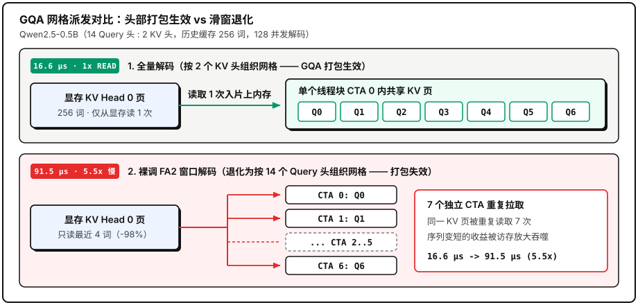
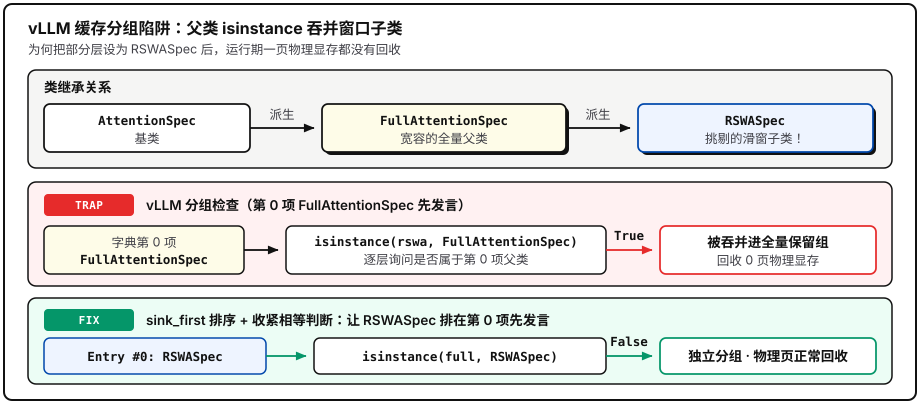
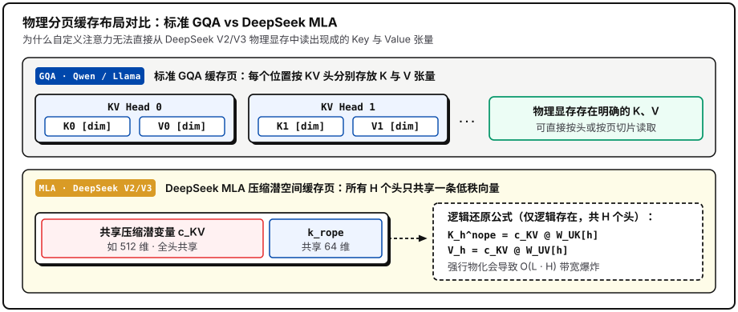
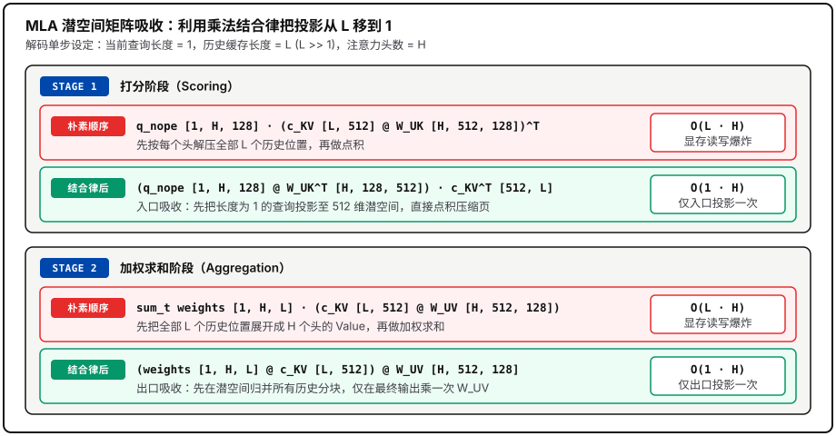
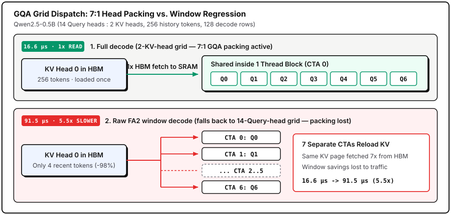
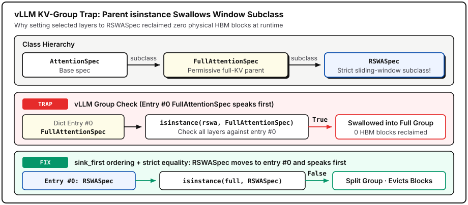
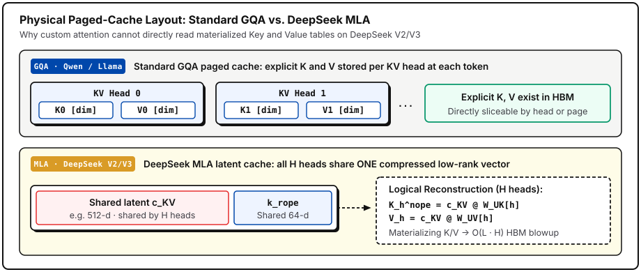
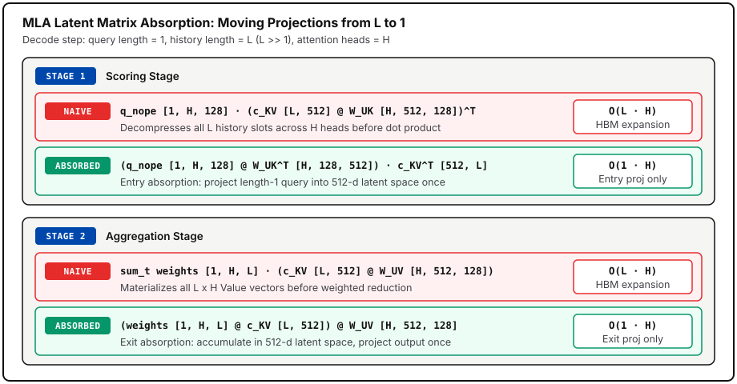

<div class="zine-dispatch" data-title-zh="少读 98% 的历史反而慢 5 倍，换上 DeepSeek 又罢工：从显存布局重看自定义注意力" data-title-en="Why Reading 98% Less History Ran 5x Slower—and Broke on DeepSeek: Rethinking Custom Attention from Memory Layouts" data-desc-zh="示范如何用一页纸 Roofline 除法锁定 7:1 GQA 头部打包失效（附 FullAttentionSpec 吞并 RSWASpec 子类的继承排查），再顺着维度复杂度用矩阵乘法结合律推导出零解压的 DeepSeek MLA 潜空间流式注意力（系统与架构专栏 · 支持 EN / 中文 一键切换）" data-desc-en="Custom attention code written around unfolded [batch, heads, seq, dim] Key and Value tensors hits two walls inside a production serving engine: passing window_size to FlashAttention-2 on... (Systems &amp; Architecture · Bilingual EN / 中文)">
  <a class="zine-pill-link" data-i18n-zh="pLLM 项目主页与文档 →" data-i18n-en="pLLM Project &amp; Docs →" href="/pllm/">pLLM 项目主页与文档 →</a>
  <a class="zine-pill-link" data-i18n-zh="全部博客分类索引 →" data-i18n-en="Blog Categories →" href="/blog/">Blog Categories →</a>
</div>

<div class="zine-lang-panel" data-lang-panel="zh" lang="zh-CN" markdown="1">

<div class="zine-tldr" markdown="1">

**TL;DR：** 照着单机脚本里 `[batch, heads, seq, dim]` 展开张量设计的自定义注意力，放进生产引擎会连续撞上两堵墙：在分组查询注意力（GQA）模型上裸调标准 `window_size`，会因拆散 7:1 头部共享读取反而比读全量历史慢出 5.5 倍；切到采用多头潜在注意力（MLA）的 DeepSeek V2/V3 上，物理缓存里压根不存在独立的 `Key` 和 `Value`。本文复盘如何用一页纸的带宽极限算术定位 GQA 网格退化，又如何从矩阵乘法的维度复杂度出发推导出潜空间矩阵吸收，最终把两套截然不同的物理存储收进同一个读取抽象。

</div>

> **系统与架构专栏（8/12 · 极客拆解 · 跨代际注意力）** · [pLLM 项目主页与文档](/pllm/) · [全站博客分类目录](/blog/) · [GitHub 原文 ↗](https://github.com/LinesHogan/pLLM/blob/main/blog/zh/08-attention-from-gqa-to-mla.md)

做长上下文探测、局部/全局交替注意力或者块级稀疏筛选时，研究员在单机脚本里习惯直接伸手去拿 `Key` 和 `Value` 张量，或者给注意力函数传一个 `window_size` 参数。

但只要把这套习惯带进生产级 vLLM 引擎，没走两步就会遇上两件让人摸不着头脑的事：第一件发生在常规的 Qwen 或 Llama 模型上，传进官方滑动窗口参数让算子只读最近 4 个词，单层耗时非但没降，反而比老老实实读完 256 个词**慢了 5.5 倍**；第二件发生在模型切换到 DeepSeek V2 或 V3 时，自定义注意力直接没法跑了——因为物理分页缓存里根本没有 `Key` 和 `Value` 这两张表。

如果孤立地看，一件像是算子库的性能怪癖，另一件像是新模型的兼容缺口；可要是顺着底层显存布局把账排开，会发现它们讲的是同一个系统建模教训：**上层注意力接口一旦绑死了“物理展开的多头键值张量”，只要碰上真实的硬件打包优化或压缩缓存就会失灵。**

---

先复盘第一件事是怎么排查水落石出的：**为什么少读 98% 的数据，耗时反而从 16.6 微秒涨到了 91.5 微秒？**

排查单层算子性能有一个实用的前置技巧：**选对显微镜尺寸**。如果在 7B 或 70B 大模型上测单层注意力，每步二十多毫秒的稠密线性层会把几十微秒的算子退化遮得严严实实；换到单步总耗时只有约 3 毫秒的 `Qwen2.5-0.5B`（每层 14 个 Query 头配 2 个 KV 头，头维 64，128 行并发解码，历史缓存长 256），微小的退化也会立刻在端到端吞吐上显形。

我们把这个形状下的单层解码注意力单独拎出来回放 1,000 次计时：

- 调上游 FlashAttention-2（FA2）读满全部 256 个历史词，单次耗时 **16.6 微秒**；
- 给同一个函数传进 `window_size=(3, 0)` 只读最近 4 个词，单次耗时涨到了 **91.5 微秒**。

先别急着一头扎进几千行 C++ 模板源码里大海捞针。碰到反常耗时，第一步永远是拿信封背面算一下**硬件物理极限（Roofline）**，看看基准那 `16.6 微秒` 到底处在什么水平。

逐字解码每步只进 1 个新词，算力大幅过剩，耗时纯粹由显存搬运量决定。注意 `Qwen2.5-0.5B`（以及 `7B`）采用的是 **7 比 1 的分组查询注意力（GQA）**：14 个 Query 头每 7 个一组，共享完全相同的 1 个 KV 头。在理想情况下，每组历史 K 和 V 只需要从显存读进芯片 **1 次**：

$$\text{有效搬运量} = 128\text{ 行} \times 256\text{ 词} \times 2\text{ 个 KV 头} \times 2\text{ (K与V)} \times 64\text{ 维} \times 2\text{ Bytes} = 16\text{ MiB}$$

除以测试卡约 `1,000 GB/s` 的显存带宽，理论物理极限正好是 **`16 微秒`**！

这道简单的除法立刻给出了破案方向：全量读取测出 `16.6 微秒`，说明它几乎贴在了硬件极限上——而要想贴住极限，内核就**必然**把共享同一组 KV 的 7 个 Query 头打包进了同一个线程块（CTA）里共用片上内存。反过来，只读 4 个词却慢到了 `91.5 微秒`，5.5 倍的倒退幅度正好跟 **7:1 的头共享比例**撞在同一个量级上！

带着这个猜想打开剖析器看一眼两个内核的启动网格（Grid）参数，病因一抓一个准：

{: style="display: block; max-width: 100%; height: auto; margin: 1.5rem auto;" }

在这个解码形状下，一旦开启滑动窗口，FA2 的解码路径丢掉了 GQA 头部打包，网格从按 **2 个 KV 头**派发退化成了按 **14 个 Query 头**各自派发，省下的序列长度全赔进了重复访存和窗口边界判定里。

确认了根因是“窗口模式下丢了 KV 头打包”，修法就是换用开启窗口依然按 KV 头组织网格的 FlashInfer 解码内核。但动手集成时如果直接 `import flashinfer` 去调底层裸函数，又会撞上静态图约束：FlashInfer 是两阶段有状态管线，每步执行前得先在 CPU 上跑一步 `plan` 算好分块并写进固定地址的工作区，直接调裸函数就得自己重写半套图缓冲区管理。

更省心的做法是顺着宿主的架构借力：vLLM 内部本来就有现成的 `FlashInferMetadataBuilder` 在管这套固定工作区，只需写十来行代码继承它、把同一份原生页映射喂进去，单次窗口读取当即落回 **18.0 微秒**，整机吞吐恢复到原生的 97% 以上。

顺着宿主借力做滑窗物理显存回收时，还能学到一招排查大型框架配置失效的思路。vLLM 内置了实用的 `RSWASpec`（保留完整提示词前缀 + 最近滑动窗口，滑出中间段的物理页在页表里填上 `null_block` 退回空闲池）。可当初我们只把模型里部分层设成 `RSWASpec`、第 0 层仍保留全量注意力 `FullAttentionSpec` 时，运行期这几层居然一页显存都没回收。

碰到“局部配置被静默忽略”，直接去查宿主合并配置组的入口函数，十行代码就暴露了一个面向对象继承陷阱：

{: style="display: block; max-width: 100%; height: auto; margin: 1.5rem auto;" }

看清继承树之后，不用改上游一行源码：派生一个收紧相等条件的子类，再在把配置字典交给引擎前排个序（`sink_first`），把挑剔的 `RSWASpec` 子类挪到字典最前头让它先发言，原生的物理块回收器就正常接管了。

---

理顺了常规 GQA 模型的页表与头部打包，再看切换到 DeepSeek V2 / V3 时撞上的第二堵墙：**当物理缓存里根本不存在 `Key` 和 `Value` 时，怎么建模自定义注意力？**

先把两种架构的物理分页缓存并排画出来对比：

{: style="display: block; max-width: 100%; height: auto; margin: 1.5rem auto;" }

MLA 之所以能把长上下文显存占用砍掉一大截，正是因为它只存那一条所有头共享的 $$c_{KV}$$。这时候如果上层自定义注意力接口非要向底层索取展开后的 `[位置数, 头数 H, 头维]` 键值张量，底层就只能在每次读取时把历史 $$L$$ 个位置的 $$c_{KV}$$ 全部乘上 $$W_{UK}, W_{UV}$$ 物化出来——历史长度 $$L$$ 动辄几千上万，头数 $$H$$ 在大模型上有上百个，这一乘就把 MLA 省下来的显存带宽全数倒贴了回去。

怎么在不物化 K 和 V 的前提下，算出任意窗口或稀疏 `topk` 位置的精确注意力？

不用发明新算子，直接拿**矩阵维度的计算复杂度**来引导代数变形——这其实跟写 LoRA 时先算 `x @ A` 降维再乘 `B`、以及 DeepSeek-V2 论文里推导推理加速是同一个思路：**利用矩阵乘法结合律交换括号顺序，把昂贵的按头投影从长度为 $$L$$ 的历史序列挪到长度为 $$1$$ 的当前查询与输出上。**

对照下面的维度流向图看两次括号移动：

{: style="display: block; max-width: 100%; height: auto; margin: 1.5rem auto;" }

看清维度之后，代码几乎是照着图抄出来的。配合分块在线 `logaddexp` 归并（每扫过一个 128 词的压缩缓存块就动态更新局部最大值与配分函数，保证任意长序列数值稳定），完整的流式潜空间注意力用普通 PyTorch 写出来只有十来行：

```python
def paged_latent_attention(q_nope, q_pe, latent_pages, rope_pages, w_uk_t, w_uv, scale, tile=128):
    # 1. 入口吸收：只在长度为 1 的当前查询上乘一次 W_UK^T，变到 512 维潜空间
    q_abs = torch.einsum("rhp,hpl->rhl", q_nope.float(), w_uk_t.float())
    acc = torch.zeros_like(q_abs)
    lse = q_abs.new_full(q_abs.shape[:2], -float("inf"))

    # 2. 直接在压缩潜变量页上分块流式打分与累加（或按 topk 索引抽取），零 K/V 物化
    for c_tile, r_tile, valid_mask in iter_compressed_tiles(latent_pages, rope_pages, tile):
        scores = (torch.einsum("rhl,rkl->rhk", q_abs, c_tile)
                  + torch.einsum("rhd,rkd->rhk", q_pe.float(), r_tile)) * scale
        scores = scores.masked_fill(~valid_mask, -float("inf"))
        tile_lse = torch.logsumexp(scores, dim=-1)
        merged = torch.logaddexp(lse, tile_lse)
        finite = torch.where(merged.isneginf(), 0.0, merged)
        weights = (scores - tile_lse[..., None]).exp().masked_fill(~valid_mask, 0.0)
        acc = (acc * (lse - finite).exp()[..., None]
               + torch.einsum("rhk,rkl->rhl", weights, c_tile) * (tile_lse - finite).exp()[..., None])
        lse = merged

    # 3. 出口吸收：历史全部归并完后，只在最终结果上每头乘一次 W_UV 还原输出维度
    return torch.einsum("rhl,hlv->rhv", acc, w_uv.float()).to(q_nope.dtype), lse
```

---

把这两段排障与推导合在一起，就能看明白一个耐用的自定义注意力抽象该怎么划界：**不要把底层的物理缓存数组直接暴露给算法作者，而要抽象出与存储格式无关的“注意力动作（Capability）”。**

在我们架在 vLLM 上的开源可编程层 **[pLLM](https://github.com/LinesHogan/pLLM)**（`pllm`）里，`@pllm.custom_attention` 传给用户方法的是一个屏蔽了物理布局的 `PagedKV` 对象：

```python
@dataclass(frozen=True)
class WindowProbe(pllm.Workload):
    @pllm.custom_attention(layers=(0,))
    def monitor(self, q: torch.Tensor, kv: pllm.PagedKV):
        out, full_lse = kv.attend(q)
        _, recent_lse = kv.attend(q, window=64)
        return out, recent_lse - full_lse  # 同一份代码，跨 Qwen/Llama (GQA) 与 DeepSeek (MLA) 通用
```

同一段八行探针代码，挂在 Qwen 或 Llama 上自动走预规划好的 FlashInfer GQA 打包内核，换到 DeepSeek V2/V3 上自动切入潜空间矩阵吸收，两边都能直接录进 CUDA Graph。

当然，前面那张维度流向图也顺便把这套抽象的代价边界标在了明面上：一方面，启用 vLLM 的 FlashInfer 规划管线需要预先留出约 `394 MiB` 的共享工作区显存；另一方面，仔细看 MLA 结合律前后的复杂度对比——矩阵吸收之所以划算，靠的是历史长度 $$L \gg 1$$。如果你的稀疏挑选算法极端激进，每步 `topk` 只挑两三个历史位置（$$L \approx 2$$），那么在入口和出口固定支付的那两次全头矩阵投影（$$W_{UK}^\top$$ 与 $$W_{UV}$$），算力开销反而会超过直接解压那两三个位置。先画清数据维度流向图，什么时候省钱、什么时候亏本，不用上机跑心里就有一本明白账了。

</div>

<div class="zine-lang-panel is-hidden" data-lang-panel="en" lang="en" markdown="1">

<div class="zine-tldr" markdown="1">

**TL;DR:** Custom attention code written around unfolded `[batch, heads, seq, dim]` `Key` and `Value` tensors hits two walls inside a production serving engine: passing `window_size` to FlashAttention-2 on Grouped-Query Attention (GQA) models breaks 7:1 head packing and runs **5.5x slower** than reading full history; switching to DeepSeek V2/V3's Multi-head Latent Attention (MLA) fails outright because separate `Key` and `Value` tensors do not physically exist in paged HBM. We walk through how a back-of-the-envelope Roofline calculation pinpoints the GQA grid regression, how dimension-guided matrix associativity derives zero-materialization latent attention, and how both physical layouts unify behind a single capability interface.

</div>

> **Systems & Architecture (8/12 · Deep Dive · Attention Layouts)** · [pLLM Project & Docs](/pllm/) · [All Blog Categories](/blog/) · [GitHub Source ↗](https://github.com/LinesHogan/pLLM/blob/main/blog/en/08-attention-from-gqa-to-mla.md)

Researchers prototyping long-context probes, alternating local/global windows, or sparse top-$$k$$ attention in standalone scripts are used to reaching directly for `Key` and `Value` tensors—or passing a `window_size` argument to an attention kernel.

Carry that habit into a production vLLM engine, and two surprises show up almost immediately. On standard Qwen or Llama models, telling the attention kernel to read only the 4 most recent tokens instead of 256 makes the layer run **5.5x slower**; switch the model to DeepSeek V2 or V3, and custom attention stops working altogether because the paged cache contains neither `Key` nor `Value` tables.

Viewed separately, one looks like a quirky kernel regression and the other like a missing model integration. Viewed from HBM layout upward, both teach the exact same modeling lesson: **any attention abstraction coupled to unfolded multi-head `K`/`V` tensors breaks the moment it meets real hardware head-packing or compressed latent caches.**

---

Start with the first mystery: **how can reading 98% less history push single-layer decode latency from 16.6 µs up to 91.5 µs?**

Debugging single-layer kernel regressions benefits from **picking the right microscope**. On a 7B or 70B model, twenty-millisecond dense projections drown out a seventy-microsecond attention regression; on `Qwen2.5-0.5B` (14 Query heads sharing 2 KV heads, head dim 64, 128 concurrent decode rows at history length 256), where an entire step takes ~3 ms, kernel regressions jump right out of end-to-end throughput.

Replaying that exact single-layer decode shape 1,000 times in isolation gave:

- Upstream FlashAttention-2 (FA2) reading all 256 history tokens: **16.6 µs**;
- The exact same FA2 call with `window_size=(3, 0)` reading only 4 tokens: **91.5 µs**.

Resist the urge to dive straight into thousands of lines of C++ CUDA templates. Whenever a timing looks upside down, spend thirty seconds doing a **back-of-the-envelope Roofline check** on the `16.6 µs` baseline first.

Autoregressive decode processes 1 query token per request, leaving Tensor Cores largely idle and making runtime pure HBM byte traffic. Crucially, `Qwen2.5-0.5B` (like `7B`) uses **7:1 Grouped-Query Attention (GQA)**: every 7 Query heads share 1 identical KV head. In an optimal kernel, each historical `K` and `V` page streams out of HBM **once**:

$$\text{Minimum HBM traffic} = 128\text{ rows} \times 256\text{ tokens} \times 2\text{ KV heads} \times 2\text{ (K,V)} \times 64\text{ dim} \times 2\text{ Bytes} = 16\text{ MiB}$$

Divide `16 MiB` by the test GPU's `~1,000 GB/s` memory bandwidth, and the physical floor is **`16 µs`**!

That one division solves half the mystery before opening a single source file: hitting `16.6 µs` on full attention proves the baseline kernel **must** be packing all 7 Query heads sharing a KV head into the same thread block (CTA) so they share SRAM. Conversely, regressing to `91.5 µs` (~5.5x slower) sits in the exact same ballpark as the **7:1 GQA sharing ratio**!

Checking the launched grid dimensions in the profiler confirmed the diagnosis on the spot:

{: style="display: block; max-width: 100%; height: auto; margin: 1.5rem auto;" }

Enabling `window_size` on this decode shape dropped FA2 out of its KV-head-packed path into a 14-query-head grid, trading away sequence-length savings for redundant page fetches and window-bound overhead.

Switching windowed GQA reads to FlashInfer—whose decode kernel keeps packing Query groups per KV head even with `window_left` enabled—fixes the grid, provided you respect CUDA Graph constraints: FlashInfer is a two-phase stateful pipeline whose CPU `plan` step precomputes split schedules into fixed workspace buffers before graph replay. Rather than rebuilding workspace management around raw `import flashinfer` calls, subclassing vLLM's existing `FlashInferMetadataBuilder` in a dozen lines reused its persistent graph buffers directly, snapping windowed decode back to **18.0 µs** (>97% of full-engine throughput).

Reclaiming physical HBM blocks on sliding-window layers (`RSWASpec`: retain prompt prefix + recent window, recycling evicted middle blocks to `null_block`) surfaced a reusable lesson for debugging silently ignored config overrides in large frameworks. Setting only a subset of layers to `RSWASpec` while leaving Layer 0 on `FullAttentionSpec` reclaimed zero blocks at runtime. Inspecting vLLM's ten-line KV-cache group merger exposed classic OOP inheritance swallowing:

{: style="display: block; max-width: 100%; height: auto; margin: 1.5rem auto;" }

Tightening equality on a thin subclass and sorting `RSWASpec` entries ahead of `FullAttentionSpec` (`sink_first`) before handing the dict to vLLM let the stricter subclass speak first—activating native physical block eviction without touching upstream code.

---

Now look at the second wall on DeepSeek V2 and V3: **how do you formulate custom windowed or sparse attention when `Key` and `Value` tensors do not exist in physical memory?**

Compare the two physical paged-cache layouts side by side:

{: style="display: block; max-width: 100%; height: auto; margin: 1.5rem auto;" }

MLA slashes KV-cache memory precisely because all $$H$$ heads share that single 512-dim $$c_{KV}$$ vector. If a custom attention API demands unfolded `[seq_len L, heads H, head_dim]` `K` and `V` tensors, the backend has to multiply all $$L$$ historical $$c_{KV}$$ vectors by $$W_{UK}$$ and $$W_{UV}$$ on every step—exploding $$O(L)$$ compressed reads into $$O(L \cdot H)$$ HBM traffic and wiping out MLA's entire advantage.

How do you compute exact arbitrary-window or sparse `topk` attention without ever materializing `K` or `V`?

Let **tensor dimension complexity** guide the algebra—the exact same associative trick behind evaluating LoRA as `B @ (A @ x)` and DeepSeek-V2's own inference formulation: **reassociate matrix multiplications so per-head projections move off the length-$$L$$ history onto the length-$$1$$ decode query and output.**

Follow the parentheses across both stages:

{: style="display: block; max-width: 100%; height: auto; margin: 1.5rem auto;" }

Once the dimensions line up, the implementation writes itself. Paired with tiled online `logaddexp` rescaling over 128-token compressed page tiles for numerical stability at any context length, streaming latent attention fits in fifteen lines of plain PyTorch:

```python
def paged_latent_attention(q_nope, q_pe, latent_pages, rope_pages, w_uk_t, w_uv, scale, tile=128):
    # 1. Entry absorption: project the length-1 query once into the 512-d latent space
    q_abs = torch.einsum("rhp,hpl->rhl", q_nope.float(), w_uk_t.float())
    acc = torch.zeros_like(q_abs)
    lse = q_abs.new_full(q_abs.shape[:2], -float("inf"))

    # 2. Stream directly over compressed latent tiles (or gather sparse topk indices), zero K/V materialization
    for c_tile, r_tile, valid_mask in iter_compressed_tiles(latent_pages, rope_pages, tile):
        scores = (torch.einsum("rhl,rkl->rhk", q_abs, c_tile)
                  + torch.einsum("rhd,rkd->rhk", q_pe.float(), r_tile)) * scale
        scores = scores.masked_fill(~valid_mask, -float("inf"))
        tile_lse = torch.logsumexp(scores, dim=-1)
        merged = torch.logaddexp(lse, tile_lse)
        finite = torch.where(merged.isneginf(), 0.0, merged)
        weights = (scores - tile_lse[..., None]).exp().masked_fill(~valid_mask, 0.0)
        acc = (acc * (lse - finite).exp()[..., None]
               + torch.einsum("rhk,rkl->rhl", weights, c_tile) * (tile_lse - finite).exp()[..., None])
        lse = merged

    # 3. Exit absorption: project the merged latent accumulator once per head back to output dim
    return torch.einsum("rhl,hlv->rhv", acc, w_uv.float()).to(q_nope.dtype), lse
```

---

Put both halves together, and the right abstraction boundary becomes clear: **hide physical cache arrays behind a storage-agnostic attention capability.**

In **[pLLM](https://github.com/LinesHogan/pLLM)** (`pllm`), `@pllm.custom_attention` hands user methods an opaque `PagedKV` handle:

```python
@dataclass(frozen=True)
class WindowProbe(pllm.Workload):
    @pllm.custom_attention(layers=(0,))
    def monitor(self, q: torch.Tensor, kv: pllm.PagedKV):
        out, full_lse = kv.attend(q)
        _, recent_lse = kv.attend(q, window=64)
        return out, recent_lse - full_lse  # Runs unchanged across Qwen/Llama (GQA) and DeepSeek (MLA)
```

Those eight lines dispatch to pre-planned FlashInfer GQA-packed kernels on Qwen/Llama and switch automatically to latent matrix absorption on DeepSeek V2/V3—capturing cleanly inside CUDA Graphs on both.

The dimension diagram above also tells you the exact cost envelope up front: enabling vLLM's FlashInfer planning pipeline reserves a `~394 MiB` shared workspace buffer; and MLA matrix absorption wins specifically when attended history $$L \gg 1$$. If an ultra-sparse `topk` selector attends to only two or three tokens per step ($$L \approx 2$$), paying the fixed $$O(H)$$ entry and exit projections ($$W_{UK}^\top$$ and $$W_{UV}$$) costs more FLOPs than decompressing those two slots directly. Sketching the dimension flow first makes the crossover point visible before running a single benchmark.

</div>

<script defer src="/assets/js/bilingual-post.js"></script>
