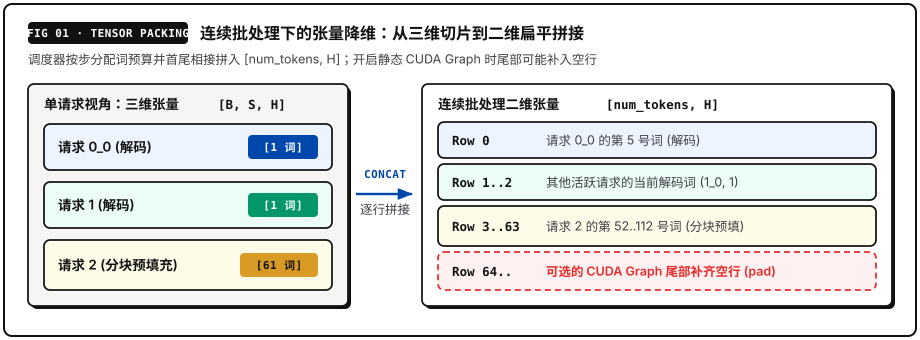
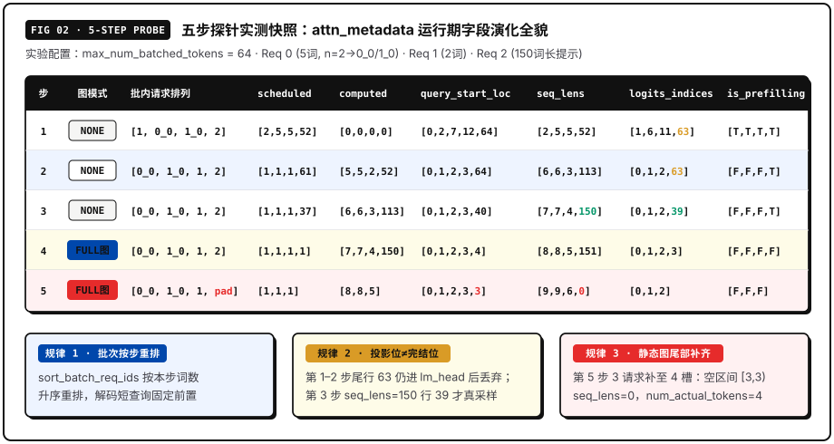
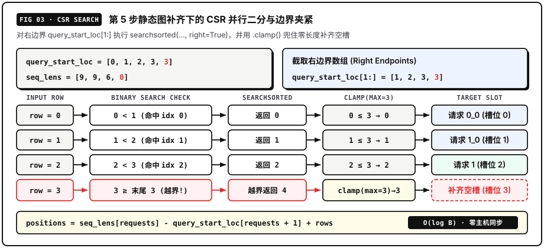
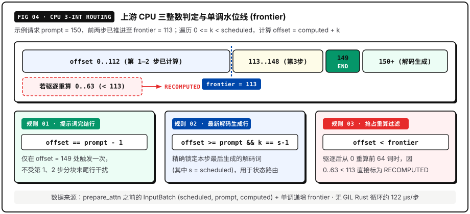
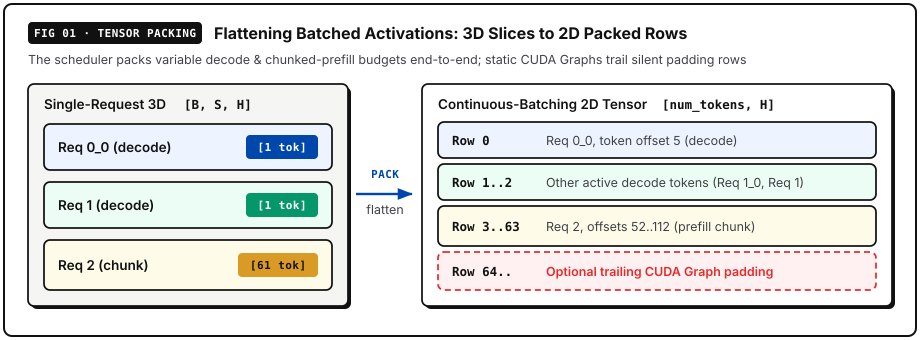
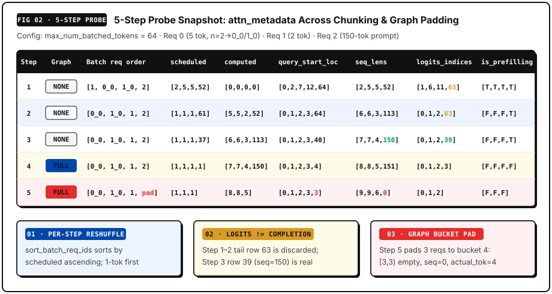
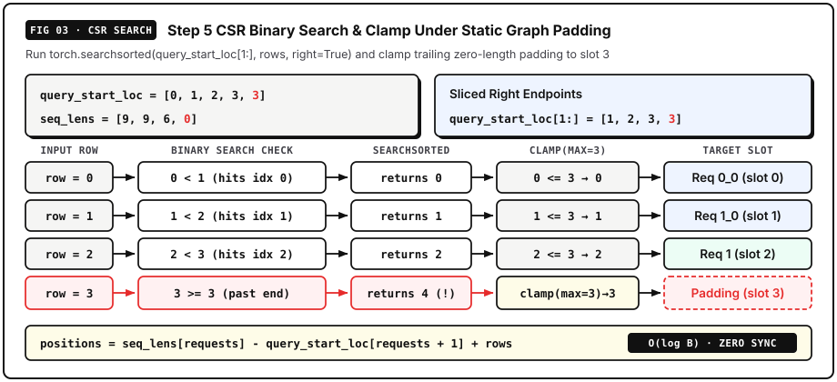
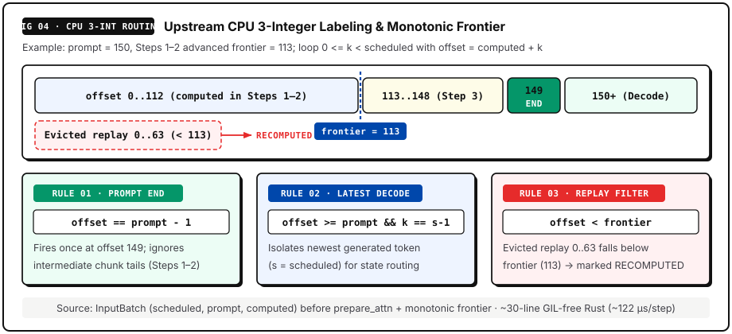

<div class="zine-dispatch" data-title-zh="连续批处理的行坐标还原：探针实测 vLLM `attn_metadata` 与图内无同步反解" data-title-en="Reconstructing Token Coordinates in Flattened Batches: Probing vLLM's `attn_metadata` and Sync-Free On-GPU Parsing" data-desc-zh="示范如何用 5 步最小混批探针与单请求 MSE 对账测清 attn_metadata 的真实语义；从 CSR 行偏移出发推导图内零同步 searchsorted 坐标还原、边界夹紧抽页与 slot_mapping = -1 读写控制，并划分与上游三整数路由的职责边界（系统与架构专栏 · 支持 EN / 中文 一键切换）" data-desc-en="Continuous batching and chunked prefill pack variable-length request slices end to end into a 2D [num_tokens, hidden] tensor—trailed by silent padding rows under static CUDA Graphs (Systems &amp; Architecture · Bilingual EN / 中文)">
  <a class="zine-pill-link" data-i18n-zh="pLLM 项目主页与文档 →" data-i18n-en="pLLM Project &amp; Docs →" href="/pllm/">pLLM 项目主页与文档 →</a>
  <a class="zine-pill-link" data-i18n-zh="全部博客分类索引 →" data-i18n-en="Blog Categories →" href="/blog/">Blog Categories →</a>
</div>

<div class="zine-lang-panel" data-lang-panel="zh" lang="zh-CN" markdown="1">

<div class="zine-tldr" markdown="1">

**TL;DR：** 现代连续批处理与分块预填充把多个变长请求拼成一张二维扁平张量 `[num_tokens, hidden]`，在开启静态图时还会在尾部补入空行。想在模型内部还原每一行对应的请求下标与序列位置，单靠阅读静态源码容易踩进跨后端字段语义分叉的误区。本文先展示如何用 15 行运行时探针与单请求均方误差（MSE）对账，在 5 个推理步内测清 `attn_metadata` 的真实布局；再从稀疏矩阵行偏移（CSR）与算子边界条件出发，推导在 CUDA Graph 内零同步原地反解坐标、安全抽取物理页与控制缓存写入的方法；最后对比说明何时应在 GPU 图内原地解析，何时应退回上游 CPU 用三个标量整数解决跨层状态路由。

</div>

> **系统与架构专栏（9/11 · 极客拆解 · 批次解包与元数据）** · [pLLM 项目主页与文档](/pllm/) · [全站博客分类目录](/blog/) · [GitHub 原文 ↗](https://github.com/LinesHogan/pLLM/blob/main/blog/zh/09-anatomy-of-attn-metadata.md)

在单请求脚本里编写模型层逻辑时，激活张量的形状是规整的三维 `[batch_size, seq_len, hidden_size]`，请求下标与序列位置直接对应前两个维度。

进入开启了连续批处理（Continuous Batching）与分块预填充（Chunked Prefill）的生产级 vLLM 引擎后，为了不让短请求等待长提示词，调度器在每一步为各活跃请求分配不同数量的待算词，首尾相接拼成二维张量 `[num_tokens, hidden_size]` 送入模型；为了对齐预先录制的静态图尺寸，张量末尾还可能补上若干空行：

{: style="display: block; max-width: 100%; height: auto; margin: 1.5rem auto;" }

只要编写与上下文结构相关的定制算子——无论是稀疏注意力、自适应层跳过，还是按请求维护在线状态——在执行张量运算前都必须建立从**扁平行号 `r`** 到 **`(请求序号, 序列逻辑位置 offset, 生命周期阶段)`** 的精确映射。

在模型前向传播内部，线性层与归一化层均按行独立计算，唯一持有批次切分信息的结构体是传给注意力层的 **`attn_metadata`**。然而该结构体跨多个版本与后端演化，公开文档稀少，直接翻阅上万行源码常会误判字段含义。

---

面对缺乏文档的复杂系统内部结构，高效率的排查方法不是静态通读源码，而是**构造一组覆盖全部状态转移的最小输入，挂载轻量探针把运行期字段逐拍打印出来，再用单请求真值做数值对账**。

怎么在最短步数内触发所有边界情况？我们将单步预算设为 `max_num_batched_tokens = 64` 以强制切分长提示词，开启 CUDA Graph，同时提交三条特征互补的请求：

- **请求 0**：5 个提示词，设并行采样 `n = 2`（观察引擎如何将其拆分为两个独立子序列 `0_0` 与 `1_0`）；
- **请求 1**：2 个提示词的短请求；
- **请求 2**：150 个提示词的长请求（在 64 词预算下必须分三步才能完成预填充）。

在模型执行器的 `prepare_attn` 与元数据构建器外包一层十余行的记录函数（见仓库脚本 `tools/probe_attention_metadata.py`），仅需 **5 个推理步**，就能完整捕获预填充、多样本拆分、解码切换与整图尾部补齐（`FULL` CUDA Graph padding）的真实快照：

{: style="display: block; max-width: 100%; height: auto; margin: 1.5rem auto;" }

为了理解为什么表里的字段会出现看似反直觉的数值，需要抓住一个核心建模认知：**`attn_metadata` 并不是给上层业务看的“请求生命周期账本”，而是专门为底层 CUDA 注意力内核准备的“硬件启动参数包”**。从这个视角审视上表，三组关键规律便清晰串了起来：

- **为了方便内核切分网格，批次顺序每步重排且不同后端的阶段计数口径不同**：观察第 1 步到第 2 步，请求并非按到达顺序排列，而是被 `sort_batch_req_ids` 按本步词数 `scheduled` 升序重排——单步长为 1 的解码请求固定排在最前，长分块预填充排在末尾。在此基础上，FlashInfer 后端直接按“本步查询长度 $$\le 1$$”切分 `num_decodes`（若长提示词最后一块恰好剩 1 个词，也会被归入解码子批），而 FlashAttention 后端的 `num_decode_reqs` 与 `num_prefill_tokens` 字段则常年置为 `0`；至于 `seq_lens`，统一表示算完本步后的有效缓存长度 `computed + scheduled`。
- **为了对齐静态图固定形状，名叫“实际词数”的 `num_actual_tokens` 包含了补齐空行**：看第 5 步，请求 `2` 结束后只剩 3 个真实请求（共 3 个词）。为了匹配容量为 4 的 `FULL` 静态图档位，张量被补齐到 4 行：`query_start_loc` 在末尾重复了一次 `3`（`[0, 1, 2, 3, 3]`，用长度为 0 的区间表示第 4 个占位数），`seq_lens` 补 `0`，物理缓存写槽 `slot_mapping` 填 `-1`；而 `attn_metadata.num_actual_tokens` 记的是补齐后的图档位行数 **`4`**（源码此处亦留有待重命名注释）。
- **`logits_indices` 仅代表词表投影采样位，不代表提示词完结**：看第 1、2 步的请求 `2`，150 个提示词尚未读完，其当前分块的末行 `63` 依然出现在 `logits_indices` 中参与 `lm_head` 计算，随后在采样后被丢弃；只有第 3 步 `seq_lens` 抵达 `150` 时的末行 `39` 才是首次有效生成点。（此外，在双卡 `TP = 2` 下重跑探针可确认，各张量并行卡收到的 `InputBatch` 与 `attn_metadata` 数值逐字节一致，仅每卡持有的 KV 头数减半。）

写完任何基于行号的拆包逻辑后，都可以用一项通用的 **单请求 MSE 对账法** 验证正确性：先以 `batch_size = 1` 贪心模式逐条单跑测试请求，记录第 0 层毫无混排歧义的解码隐藏状态作为基准；再将同一批请求并发混跑，核对提取出的各请求对应行与基准的均方误差（MSE）。哪怕下标在分块或补齐边界偏了一行，误差也会立即暴露。

---

理清了数据结构，接下来解决第一个工程问题：**当自定义算子位于模型层内部（如 `@pllm.custom_attention` 或图内子层切片），夹在 `torch.compile` 与静态 CUDA Graph 中间，严禁调用 `.cpu()` 或 `.tolist()` 触发主机同步时，如何在纯 GPU 上原地反解并利用这些元数据？**

**第一步：把 `query_start_loc` 建模为 CSR 行偏移，用并行二分反解请求号与序列位置。**

观察 `query_start_loc`（如第 2 步的 `[0, 1, 2, 3, 64]`），它与稀疏矩阵压缩行存储（CSR，广泛用于 `cuSPARSE` 与图计算框架）的 `row_ptr` 数组完全同构：第 $$i$$ 个请求拥有扁平张量里 `[query_start_loc[i], query_start_loc[i+1])` 的半开行区间。

要在 GPU 上无循环地把每个行号 `row` 映射回所属请求 `i`，直接对右边界数组 `query_start_loc[1:]` 执行并行二分查找 `torch.searchsorted(..., right=True)`（寻找第一个严格大于 `row` 的右边界下标）即可。更关键的是，需要验证它在第 5 步尾部存在零长度补齐段 `[0, 1, 2, 3, 3]` 时的边界行为：

{: style="display: block; max-width: 100%; height: auto; margin: 1.5rem auto;" }

拿到每行对应的请求下标 `requests` 后，利用前面测出的恒等式“步末 `seq_lens` 等于该请求本步最后一个词的绝对位置加 1”，只做一次向量加减法就能还原每行的精确序列坐标 `positions`（见 `pllm/execution/attention.py`）：

```python
rows = torch.arange(query_count, device=pages.device)
# 1. O(log B) 并行反解每行所属请求；clamp 安全兜住静态图尾部的零长度补齐行
requests = torch.searchsorted(query_start_loc[1:], rows, right=True).clamp(max=len(seq_lens) - 1)
# 2. 由请求步末总长与批次区间右端点，一步推出当前行的逻辑序列位置 offset
positions = seq_lens[requests] - query_start_loc[requests + 1] + rows
```

用第 2 步请求 `2`（占据 `Row 3..63`，`seq_lens=113`，`query_start_loc[4]=64`）代入验算：`Row 3` 得 `113 - 64 + 3 = 52`，`Row 63` 得 `113 - 64 + 63 = 112`，与真实偏移完全吻合。（若运行在 DeepSeek V2/V3 的 MLA 后端上，`MLACommonMetadata` 将 `decode` 与 `prefill` 拆成了两个子结构；在 GPU 上拼接完整 `seq_lens` 时，预填充段需用 `prefill.query_start_loc.diff()` 加上分块历史 `prefill.chunked_context.context_lens`，避免遗漏前序分块长度。）

**第二步：在静态图内按页表 `block_table` 抽取稀疏位置时，先做边界夹紧再做数值掩码。**

算出 `requests` 与 `positions` 后，自定义稀疏注意力常需根据选中的历史位置 `chosen` 去二维页表 `block_table[requests, chosen // 16]` 查物理块号。在静态图固定形状下，未命中的掩码位或尾部补齐行里往往填着 `-1`，或在开启滑窗回收的层上越过有效页界。直接作下标索引会触发设备端越界异常；无分支的安全写法是**先将下标夹紧到合法物理范围内完成读取，再把无效通道乘零屏蔽**：

```python
valid = (chosen >= 0) & (chosen <= positions[:, None])
safe = torch.where(valid, chosen.clamp(0, block_table.shape[1] * 16 - 1), 0).long()
blocks = torch.where(valid, block_table[requests[:, None], safe // 16], 0).long()
keys = key_cache[blocks, safe % 16].masked_fill(~valid[..., None, None], 0.0)
```

**第三步：利用上游算子的元数据边界约定，实现零新增内核的读写控制。**

看清底层 C++ 算子如何处理特殊元数据值后，许多看似需要重写 CUDA 内核的需求可以直接通过修改元数据张量完成：

- **利用 `slot_mapping = -1` 选择性屏蔽缓存写入**：vLLM 的缓存写入算子遇到负数物理槽位会自动跳过存储。例如在自适应深度（CALM 早退）中，某行跳过第 16 层计算时仍需补写该层 KV 缓存供后续词读取，而同批次未跳层的活跃行刚刚已经写过缓存——此时只需把活跃行的 `slot_mapping` 掩码置为 `-1`，临时将 `self_attn.attn.forward` 替换为仅调用 `do_kv_cache_update` 的五行函数，即可直接复用十余种模型家族现成的 `QKV + QK-norm + RoPE` 代码完成补写。（注意：在将活跃行紧缩进 2 的幂次静态图分桶时，未填满的空道除将 `slot_mapping` 置 `-1` 外，还需将 `seq_lens` 置为 `1` 而非 `0`，防止注意力算子内部出现 `0 / 0` 产生 `NaN`。）
- **利用 `seqused_k = seq_lens - 1` 实现无副作用的只读注意力探测**：若想在层间试算一次注意力又不想改动当前缓存内容，可将可见长度设为 `(metadata.seq_lens - 1).clamp_min(0)` 先读取严格早于当前词的历史缓存，再调用上游 `merge_attn_states` 将当前词的对角线注意力在线归并，全程不触碰一字节物理缓存。

---

掌握了 GPU 原地解析技巧后，最后回到系统架构层面回答一个分界问题：**是不是所有需要行身份的功能，都应该去解析 `attn_metadata`？**

答案是否定的。正如前面五步探针所示，`attn_metadata` 只描述当前这一拍的缓存切片：它既无法区分 `logits_indices` 里的分块中间行与真正的提示词终点，也无法识别当前预填充行究竟是首次计算，还是因显存不足被驱逐后从头重算的回放历史。

因此，对于**第 0 层激活捕获、旁路流状态预取、每请求状态路由以及抢占重算过滤**这类跨层机制，正确的切入点是从注意力层往上游退一步，在 CPU 端的 `GPUModelRunner.prepare_attn` 构造 `attn_metadata` 之前读取 `InputBatch`。那里保存着决定调度的三个基础整数——本步词数 `scheduled`、提示词总长 `prompt`、已算词数 `computed`。配合为每个请求维护的单调递增进度上界 `frontier`，不到 30 行无 GIL 的 Rust 整数循环（单步约 `122 µs`）就能算完所有生命周期标签：

{: style="display: block; max-width: 100%; height: auto; margin: 1.5rem auto;" }

在 **[pLLM](https://github.com/LinesHogan/pLLM)**（`pllm`）中，这两套机制各司其职：**跨层状态路由与生命周期判定留在上游 CPU，用三个标量整数隔离后端差异；层内自定义注意力留在下游 GPU，用 `searchsorted` 与元数据掩码保持静态图零同步**（唯一前提是不开启单步塞入多个草稿词的投机解码 `num_draft_tokens == 0`，入口处对此有显式断言检查）。先辨清问题属于“跨层调度语义”还是“层内缓存寻址”，就不会在错误的抽象层上绕弯路。

</div>

<div class="zine-lang-panel is-hidden" data-lang-panel="en" lang="en" markdown="1">

<div class="zine-tldr" markdown="1">

**TL;DR:** Continuous batching and chunked prefill pack variable-length request slices end to end into a 2D `[num_tokens, hidden]` tensor—trailed by silent padding rows under static CUDA Graphs. Recovering which request owns row `r` and at what logical sequence position by reading static source code easily runs afoul of undocumented cross-backend differences. We show how a 15-line runtime probe and a `bs=1` MSE parity check map out `attn_metadata` in 5 steps; derive sync-free **on-GPU** coordinate reconstruction from Compressed Sparse Row (CSR) offsets, safe paged gathers, and metadata write switches; and draw the architectural boundary between in-layer GPU metadata parsing and upstream three-integer CPU routing.

</div>

> **Systems & Architecture (9/11 · Deep Dive · Unpacking Jagged Batches)** · [pLLM Project & Docs](/pllm/) · [All Blog Categories](/blog/) · [GitHub Source ↗](https://github.com/LinesHogan/pLLM/blob/main/blog/en/09-anatomy-of-attn-metadata.md)

In a single-request research script, activations arrive as a 3D `[batch_size, seq_len, hidden_size]` tensor where request index and token position correspond directly to the first two axes.

Inside a production vLLM engine running continuous batching and chunked prefill, the scheduler assigns each active request a variable token budget per step and concatenates them end to end into a 2D `[num_tokens, hidden_size]` tensor; under static CUDA Graphs, extra padding rows may also trail at the end to match a captured bucket width:

{: style="display: block; max-width: 100%; height: auto; margin: 1.5rem auto;" }

Any custom operator that depends on sequence structure—sparse or windowed attention, adaptive layer skipping, or per-request stateful adaptation—must first establish an exact mapping from **flat row index `r`** to **`(request_index, logical_offset, lifecycle_phase)`**.

Inside `forward`, linear projections and normalizations operate row-independently; the sole struct carrying batch layout into the model is **`attn_metadata`**. Because `attn_metadata` evolves across engine releases and attention backends with minimal documentation, guessing field invariants from static source code is error-prone.

---

Rather than reading twenty thousand lines of backend code and guessing, a reliable diagnostic workflow is **designing a minimal input schedule that forces every state transition in a handful of steps, logging runtime fields with a tiny wrapper, and verifying row extraction against a `bs=1` MSE reference**.

Setting `max_num_batched_tokens = 64` to force chunked prefill with CUDA Graphs enabled and submitting three small requests—a 5-token prompt with parallel sampling `n = 2` (splitting into `0_0` and `1_0`), a 2-token prompt (`1`), and a 150-token prompt (`2`)—exercises prefill chunking, multi-sample fan-out, decode transitions, and `FULL` CUDA Graph padding within **5 steps** (`tools/probe_attention_metadata.py`):

{: style="display: block; max-width: 100%; height: auto; margin: 1.5rem auto;" }

Every quirk in that table makes immediate sense once you model what `attn_metadata` actually is: **it is not a high-level request-lifecycle ledger—it is a low-level kernel launch packet shaped around GPU grid partitioning and static graph buckets.** Three structural consequences follow directly:

- **Batch order reshuffles every step, and phase counters follow kernel dispatch rules rather than prompt lifecycle**: Between Steps 1 and 2, `sort_batch_req_ids` sorts requests ascending by `scheduled` length so 1-token queries sit contiguously at the front ahead of multi-token chunks. Downstream, `FlashInferMetadata` counts _any_ 1-token query as `num_decodes` (including a 1-token final prefill chunk, even while `is_prefilling` remains `True`), whereas `FlashAttentionMetadata` leaves `num_decode_reqs` and `num_prefill_tokens` at `0`; `seq_lens` always equals post-step valid cache length `computed + scheduled`.
- **Under `FULL` CUDA Graphs, `num_actual_tokens` reports the padded bucket width**: On Step 5, only 3 real requests (3 tokens) remain, padded to a 4-row graph bucket. `query_start_loc` appends a zero-length interval (`[0, 1, 2, 3, 3]`), `seq_lens` appends `0`, and `slot_mapping` writes `-1`—while `attn_metadata.num_actual_tokens` equals **`4`**, the padded tensor height.
- **`logits_indices` marks `lm_head` projection slots, not prompt completion**: On Steps 1 and 2, Request `2`'s unfinished chunk tail (row `63`) still appears in `logits_indices`, runs through `lm_head`, and is discarded afterward; only row `39` on Step 3 (`seq_lens == 150`) produces a real initial sample. (Re-running the probe under `TP = 2` also confirms that every tensor-parallel rank receives byte-identical `InputBatch` and `attn_metadata` fields, halving only local KV head counts.)

To verify any row-extraction logic end to end, run prompts one by one at `batch_size = 1` (greedy) to record unambiguous Layer-0 decode states, then run the mixed batch concurrently and check per-step MSE against those single-request references—any off-by-one shift at a chunk or padding boundary surfaces immediately.

---

With the layout clear, consider the in-graph problem: **when custom code runs inside a model layer (`@pllm.custom_attention` or compiled layer slices) where `.cpu()` and `.tolist()` are forbidden by `torch.compile` and CUDA Graphs, how do you reconstruct coordinates and steer cache behavior purely on the GPU?**

**1. Model `query_start_loc` as a CSR row-pointer array and invert it via parallel binary search.**

`query_start_loc` (`[0, 1, 2, 3, 64]`) is identical to the `row_ptr` array in **Compressed Sparse Row (CSR)** matrices (`cuSPARSE` / graph frameworks): Request $$i$$ owns the half-open row interval `[query_start_loc[i], query_start_loc[i+1])`.

Evaluating `torch.searchsorted(query_start_loc[1:], rows, right=True)` finds the first right endpoint strictly greater than `row` in $$O(\log B)$$ parallel work per thread—and clamping to `len(seq_lens) - 1` handles Step 5's trailing zero-length graph-padding interval `[0, 1, 2, 3, 3]` cleanly:

{: style="display: block; max-width: 100%; height: auto; margin: 1.5rem auto;" }

Once `requests` is known, subtracting the request's batch end offset from its post-step `seq_lens` recovers every row's exact logical sequence position `positions` (`pllm/execution/attention.py`):

```python
rows = torch.arange(query_count, device=pages.device)
# 1. Invert CSR offsets in O(log B) parallel registers; clamp absorbs trailing 0-length graph padding
requests = torch.searchsorted(query_start_loc[1:], rows, right=True).clamp(max=len(seq_lens) - 1)
# 2. Recover exact logical sequence offset from post-step seq_lens without host synchronization
positions = seq_lens[requests] - query_start_loc[requests + 1] + rows
```

Checking Request `2` on Step 2 (`Rows 3..63`, `seq_lens=113`, `query_start_loc[4]=64`) gives `113 - 64 + 3 = 52` at Row 3 and `113 - 64 + 63 = 112` at Row 63. (On DeepSeek V2/V3 MLA, `MLACommonMetadata` splits `decode` and `prefill` sub-structs; rebuilding unified `seq_lens` on GPU adds `prefill.chunked_context.context_lens` onto `prefill.query_start_loc.diff()` whenever prior chunks exist.)

**2. Clamp before gathering from `block_table`, then mask loaded values.**

Indexing `block_table[requests, chosen // 16]` for custom sparse `topk` reads inside a static graph encounters `-1` entries on unselected lanes and padding rows. Clamping coordinates into `[0, max_slots - 1]` prior to indexing and zero-masking afterward prevents out-of-bounds device faults without branching:

```python
valid = (chosen >= 0) & (chosen <= positions[:, None])
safe = torch.where(valid, chosen.clamp(0, block_table.shape[1] * 16 - 1), 0).long()
blocks = torch.where(valid, block_table[requests[:, None], safe // 16], 0).long()
keys = key_cache[blocks, safe % 16].masked_fill(~valid[..., None, None], 0.0)
```

**3. Steer upstream C++ cache and attention kernels via metadata boundary values.**

Respecting the exact sentinel conventions of upstream kernels avoids writing custom CUDA for control flow:

- **Selective cache-write suppression (`slot_mapping = -1`)**: vLLM's cache-write kernel ignores negative slot IDs. When an adaptive-depth policy (CALM) skips Layer 16 on a subset of rows, those skipped rows still need fresh K/V written for later tokens while already-computed active rows must not be overwritten—masking active rows' `slot_mapping` to `-1` and temporarily binding a 5-line `do_kv_cache_update` wrapper onto `self_attn.attn.forward` reuses native `QKV + QK-norm + RoPE` across 15 model families. (When compacting active rows into power-of-two graph buckets, also set inactive lanes' `seq_lens` to `1` rather than `0` so FlashAttention never divides `0 / 0` into `NaN`.)
- **Write-free attention "peek" (`seqused_k = seq_lens - 1`)**: Passing `(metadata.seq_lens - 1).clamp_min(0)` reads strictly prior cached KV, while `merge_attn_states` folds in the uncached current token's diagonal score—evaluating exploratory attention without modifying a byte of physical cache.

---

Finally, step back to the system boundary: **should cross-layer features parse `attn_metadata` on the GPU too?**

No. Because `attn_metadata` carries neither original prompt lengths nor eviction history, it structurally cannot distinguish an unfinished prefill chunk in `logits_indices` from true prompt completion, nor fresh prefill from a KV-preemption replay.

Whenever a workload needs **Layer-0 hidden capture, side-stream state prefetching, per-request state routing, or preemption replay filtering**, stepping one call upstream on the CPU to `GPUModelRunner.prepare_attn`—before `InputBatch` is lowered into `attn_metadata`—exposes three plain CPU integers (`scheduled`, `prompt`, `computed`). Paired with one monotonic per-request high-water mark `frontier`, a 30-line GIL-free Rust loop (`~122 µs`) resolves every lifecycle label deterministically:

{: style="display: block; max-width: 100%; height: auto; margin: 1.5rem auto;" }

In **[pLLM](https://github.com/LinesHogan/pLLM)** (`pllm`), both layers work in tandem: **cross-layer state routing and lifecycle checks stay upstream on three CPU integers, while in-layer custom attention stays on-GPU with `searchsorted` and metadata masks** (guarded at entry by `num_draft_tokens == 0`, since multi-token speculative decoding breaks the one-sample-slot-per-request invariant). Matching each problem to the layer that actually owns its invariant keeps both paths simple.

</div>

<script defer src="/assets/js/bilingual-post.js"></script>
