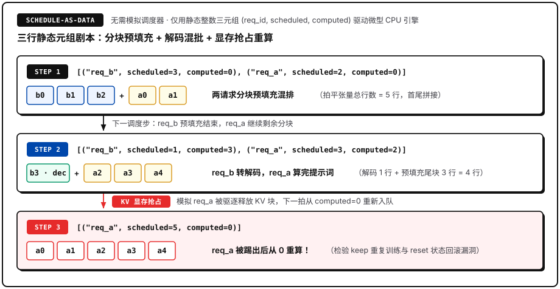
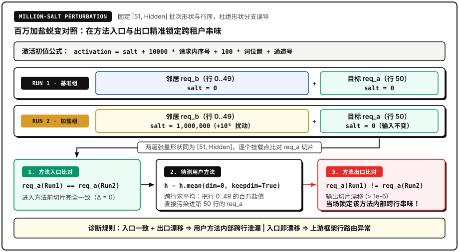
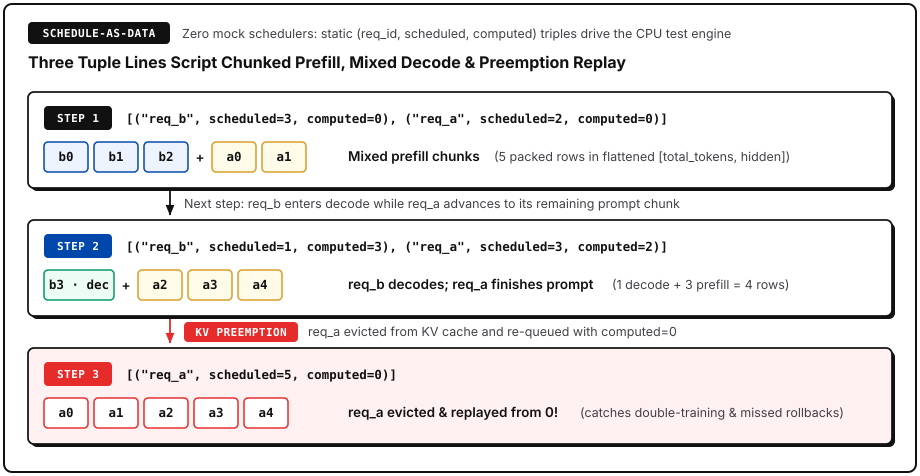
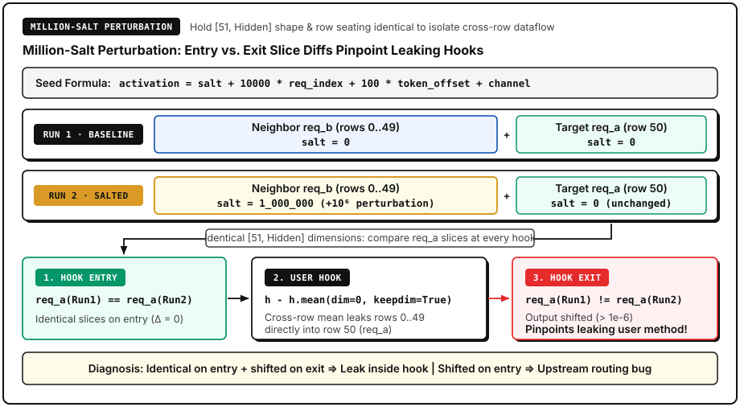

<div class="zine-dispatch" data-title-zh="`h - h.mean(dim=0)` 一行错都不报，却会让多租户推理串味：把连续批处理调度变成可测数据" data-title-en="`h - h.mean(dim=0)` Throws Zero Errors While Leaking Prompts Across Tenants: Turning Batch Schedules into Testable Data" data-desc-zh="用零字节 meta 追踪拦截隐式同步，将连续批处理压缩为静态整数三元组（Schedule-as-Data）；配合分块/抢占不变性、百万加盐蜕变测试与单行 return None 抢占注入，两秒内在笔记本 CPU 上抓出跨租户泄密（系统与架构专栏 · 支持 EN / 中文 一键切换）" data-desc-en="Ask a coding agent to center hidden states inside an inference hook, and h - h.mean(dim=0, keepdim=True) will sail past strict type checks, single-request unit tests, and CUDA Graph... (Systems &amp; Architecture · Bilingual EN / 中文)">
  <a class="zine-pill-link" data-i18n-zh="pLLM 项目主页与文档 →" data-i18n-en="pLLM Project &amp; Docs →" href="/pllm/">pLLM 项目主页与文档 →</a>
  <a class="zine-pill-link" data-i18n-zh="全部博客分类索引 →" data-i18n-en="Blog Categories →" href="/blog/">Blog Categories →</a>
</div>

<div class="zine-lang-panel" data-lang-panel="zh" lang="zh-CN" markdown="1">

<div class="zine-tldr" markdown="1">

**TL;DR：** 让编码智能体写一段挂载在推理引擎里的激活居中代码，它随手写出的 `h - h.mean(dim=0, keepdim=True)` 能顺利通过严格类型检查、单请求单测与静态图录制，却会在多租户混批上线时把用户 A 的保密提示词直接混进用户 B 的生成流。当写插件的成本降到几分钟时，“敢不敢上线”的核验成本成了真瓶颈。本文展示如何靠零字节 `meta` 符号追踪拦截隐式同步，再把连续批处理调度压缩成纯静态整数三元组（Schedule-as-Data），配合“百万加盐”蜕变差分测试与单行抢占注入，不用显卡、两秒内在笔记本 CPU 上揪出跨租户串味、分块漂移与抢占回滚漏洞。

</div>

> **系统与架构专栏（10/12 · 极客拆解 · 多租户核验）** · [pLLM 项目主页与文档](/pllm/) · [全站博客分类目录](/blog/) · [GitHub 原文 ↗](https://github.com/LinesHogan/pLLM/blob/main/blog/zh/10-schedule-as-data-verification.md)

假设你让助手或编码智能体写一个最简单的激活探针：在 Transformer 第 8 层对隐藏状态 `h` 做一次中心化处理，它十有八九会写出下面这一行代码：

```python
centered = h - h.mean(dim=0, keepdim=True)
```

拿这行代码去跑严格模式的类型检查，零报错；喂一条提示词跑单请求功能测试，输出正常；放进 GPU 引擎做 CUDA Graph 预热录制，同样顺畅通过。

直到把它推上多租户并发环境，事故才会悄无声息地发生：在连续批处理引擎里，传进模型层的 `h` 是把所有在场请求的词首尾相接拍平的 `[总词数, hidden]` 二维张量——第 `0..49` 行是甲公司刚发来的 50 个保密合同提示词，第 `50` 行是乙用户正在逐字生成的第 1 个闲聊词。那一行 `h.mean(dim=0)` 沿着第 0 维一求平均，甲公司的 50 个词就按权重灌进了乙用户的隐藏状态里。全程没有抛出一行异常，多租户隔离防线已经漏成了筛子。

---

在编码智能体几分钟就能生成一套自定义推理插件的今天，**写代码的成本降下来了，“敢不敢把这段代码装进多租户生产引擎”的核验成本却成了真瓶颈。** 如果每次改两行算法都得申请一台多卡 GPU 机器、拉起几十 GB 权重跑并发压测，试错迭代根本转不起来。

怎么把核验成本压到“在普通笔记本 CPU 上两秒内跑完”？

有人第一反应是模仿 Linux 内核的 eBPF 校验器：做纯静态语法树（AST）审查，禁止一切跨行算子。但在 PyTorch 上千个动态算子面前，纯静态审查寸步难行——合法的逐行矩阵乘与跨行归约在语法树上长得几乎一样，一刀切只会制造满屏误报。

更管用的第一道防线，是用 PyTorch 原生的零字节 **`device="meta"` 符号追踪**：不分配一字节真实显存，先拿带符号维度的空壳张量把用户函数完整跑一遍。除了即时抓出形状与数据类型错配，它还能零误报地揪出所有藏在角落里的 GPU-CPU 隐式同步——比如有人顺手写了一句 `if (h > 0).any():`、`x.item()` 或 `assert not torch.isnan(h).any()`，在 `meta` 张量上求数据相关的布尔真值会立刻触发底层的 `GuardOnDataDependentSymNode` 异常，不用真上显卡就能把破坏静态图录制的同步点全数拦截。

---

但光靠 `meta` 追踪抓不住 `h.mean(dim=0, keepdim=True)`，因为它的输出形状、精度与设备跟合法的逐行代码一字不差。想在没有 GPU、不下载大模型权重的前提下测试复杂混批行为，核心建模动作是：**把连续批处理调度本身剥离成纯静态数据（Schedule-as-Data）。**

在上一篇解剖批次布局时我们看到，决定连续批处理每一步怎么拼包的核心真相，其实就是一串 `(请求 ID, 本步词数 scheduled, 已算词数 computed)` 整数三元组。既然生产环境的真实 Rust 行标注器与状态执行器只认这几个整数，我们在离线测试里压根不需要去写一套复杂的“模拟 vLLM 调度器”——直接在 Python 里写几行静态元组列表，就能把最刁钻的线上交错调度重现出来，喂给几层微型合成 CPU Transformer 执行：

{: style="display: block; max-width: 100%; height: auto; margin: 1.5rem auto;" }

有了这套两秒跑完的微型真引擎，没有人工标注的“黄金标准答案”，怎么自动断言任意用户代码算得对不对、漏没漏数据？

借用编译器模糊测试与安全验证里的**蜕变测试（Metamorphic Testing，即检验系统在等价变换下的不变性）**，我们可以立下三条不依赖业务语义的硬标尺：

1. **分块不变性（Chunk Invariance）**：同一个请求 `req_a` 面对同一串词，不管是“一口气整段预填充完”，还是“被切成 2 词 + 3 词两块分步算完”，最终产出的输出和内部状态必须一致（直接抓出跨分块边界漏存尾巴或错算偏移的 bug）。
2. **抢占重放不变性（Preemption Invariance）**：请求跑到半路遭遇模拟抢占（第 3 步 `computed` 归零重跑历史）再接着生成，最终结果必须与从未遭遇抢占的基准运行一致（直接抓出 `keep` 模式下把旧词重训第二遍、或 `reset` 模式下漏回滚状态的 bug）。
3. **无干扰性与“百万加盐”跨租户隔离检验（Non-Interference & Salt Perturbation）**：只要目标请求 `req_a` 自己的词和历史没变，跟它拼在同一批次里的邻居 `req_b` 怎么变，`req_a` 在每一个挂载点的输出都必须分毫不差！

设计第 3 条检验时，还有一个专治狡猾 bug 的细节：如果只测“`req_a` 单独跑（总行数 1）”对比“`req_a` 跟 `req_b` 混跑（总行数 51）”，万一某段问题代码外面包了一层 `if h.shape[0] > 4:`，单跑与混跑走不同分支虽然也能报错，但遇到更复杂的形状分支或排查到底哪一层串味时不够直观。我们在固定批次总形状 `[51, Hidden]` 与座位顺序一字不差的前提下，加了一轮**百万加盐对照**：

{: style="display: block; max-width: 100%; height: auto; margin: 1.5rem auto;" }

因为两遍运行的张量形状连一个维度都没变，唯一改变的是邻居行的数值盐度，只要 `req_a` 的输出晃动了哪怕 `1e-6`，就从数学上坐实了跨租户信息泄漏；再对比每个挂载点**入口前**与**出口后**的切片差异，还能直接分清到底是框架路由错了行，还是用户写的某一个函数内部偷做了跨行归约。

---

过了笔记本 CPU 上的两秒蜕变核验，最后推上真卡做端到端烟雾核验（`check_on_gpu`）时，还有两条在实战中踩出来的排障经验值得收进工具箱：

- **别迷信 PyTorch 的 `torch.cuda.set_sync_debug_mode("error")` 能抓全所有主机阻塞**。打开这个官方调试开关抓 `.item()` 或 `.cpu()` 拷贝确实灵敏；但我们排查线上吞吐毛刺时发现，它对代码里显式调用的 **`event.synchronize()` 和 `stream.synchronize()` 完全失明**——哪怕把主线程卡死在原地干等 GPU，调试模式也一声不吭！要守住异步流水线零阻塞底线，除了开调试模式，还必须在核验器里对同步原语调用栈做显式审计。
- **测真卡在线 KV 抢占，别靠调小显存去赌随机 OOM，直接给块分配器注入一次 `return None`**。过去为了在真 GPU 上验证显存踢出后的状态回滚，得反复微调 `--gpu-memory-utilization` 跑并发去撞运气，既慢又偶发。看穿 vLLM 调度器契约后只需五六行代码：包一层 `kv_cache_manager.allocate_slots`，等目标请求刚生成满 4 个解码词那一拍故意返回一次 `None`，原厂调度器就会原原本本地走完驱逐请求、释放物理 KV 块、下一拍从头重算预填充的全套生产代码路径，每次必现、稳如钟表。

---

这套“零字节 `meta` 同步拦截 + 纯数据三元组调度 + 百万加盐蜕变测试 + 真卡单次抢占注入”的四合一工具链，已经浓缩为 **[pLLM](https://github.com/LinesHogan/pLLM)**（`pllm`）内置的 `pllm.explain()`、`pllm.testing.check()` 与 `check_on_gpu()` 三个入口。在我们的日常开发流里，编码智能体每写完一版新负载，必须先在 CPU 上花两秒过完这道门禁，才有资格去碰真 GPU。

最后也自嘲一句这套核验器的能力边界：它就像机加工车间门口那把冷冰冰的**通止规（Go/No-Go Gauge）**——能用两秒钟卡死“这颗零件装进多租户发动机里会不会炸缸、会不会串味、会不会卡死流水线”，但它没法替你判断你写的这套新数学到底是让模型更聪明了，还是在一本正经地胡说八道。算法有没有真本事，终归还得靠你自己的评测集说话。

</div>

<div class="zine-lang-panel is-hidden" data-lang-panel="en" lang="en" markdown="1">

<div class="zine-tldr" markdown="1">

**TL;DR:** Ask a coding agent to center hidden states inside an inference hook, and `h - h.mean(dim=0, keepdim=True)` will sail past strict type checks, single-request unit tests, and CUDA Graph capture—before silently mixing Tenant A's confidential prompt into Tenant B's decode token under continuous batching. When drafting custom inference logic takes minutes, multi-tenant verification becomes the real bottleneck. We show how zero-byte `meta` tracing catches hidden host syncs, and how turning batch schedules into static integer triples (`Schedule-as-Data`) paired with "million-salt" metamorphic testing and 1-line preemption injection catches cross-tenant leaks, chunking drift, and rollback bugs on a laptop CPU in under two seconds.

</div>

> **Systems & Architecture (10/12 · Deep Dive · Multi-Tenant Verification)** · [pLLM Project & Docs](/pllm/) · [All Blog Categories](/blog/) · [GitHub Source ↗](https://github.com/LinesHogan/pLLM/blob/main/blog/en/10-schedule-as-data-verification.md)

Ask a colleague or a coding agent to write a quick activation-centering hook at Layer 8 of a Transformer, and nine times out of ten you will get this one-liner:

```python
centered = h - h.mean(dim=0, keepdim=True)
```

Run strict Pyright over it: zero errors. Run a single-prompt functional test: clean output. Warm up and capture CUDA Graphs on a GPU serving engine: passes without a warning.

The failure waits quietly until multi-tenant traffic hits production. Inside a continuous-batching engine, `h` is a flattened 2D `[total_tokens, hidden]` array packing every active request's tokens end to end: rows `0..49` hold 50 tokens of Tenant A's confidential contract prompt, while row `50` holds 1 decode token for Tenant B's chat session. Evaluating `h.mean(dim=0)` averages straight across row boundaries, injecting Tenant A's private prompt directly into Tenant B's hidden state with zero exceptions raised.

---

In an era where coding agents can draft custom inference plugins in minutes, **authoring code is no longer the bottleneck—verifying that custom code is safe to load into a multi-tenant GPU server is.** Reserving a multi-GPU node and loading tens of gigabytes of weights for every two-line edit kills iteration speed.

How do you compress multi-tenant safety verification down to two seconds on a laptop CPU?

Mimicking the Linux kernel's eBPF verifier with pure static AST bans falls apart across PyTorch's thousand-operator surface—valid per-row GEMMs and illegal cross-row reductions look syntactically identical without shape semantics, drowning authors in false positives.

A far sharper first filter is zero-byte **`device="meta"` symbolic tracing**: execute the workload against shape-only meta tensors without allocating a byte of HBM. Alongside catching shape and dtype bugs immediately, `meta` tracing catches hidden GPU-to-CPU synchronizations with zero false positives—any stray `if (h > 0).any():`, `x.item()`, or `assert not torch.isnan(h).any()` evaluates a data-dependent boolean on a symbolic node and immediately trips PyTorch's `GuardOnDataDependentSymNode` error before touching a GPU.

---

`meta` tracing alone cannot catch `h.mean(dim=0, keepdim=True)`, because its output shape, dtype, and device match valid per-row code down to the last dimension. Testing intricate multi-tenant interleavings without a GPU or multi-gigabyte checkpoints hinges on one modeling move: **turn continuous-batching schedules themselves into plain static data (`Schedule-as-Data`).**

Because the production Rust `RowLabeler` and state executor consume plain `(request_id, scheduled, computed)` integer triples, offline verification needs zero mock schedulers—three lines of Python tuples script an interleaved chunked-prefill, decode, and mid-flight preemption scenario against a tiny synthetic CPU Transformer:

{: style="display: block; max-width: 100%; height: auto; margin: 1.5rem auto;" }

Without hand-written golden outputs for arbitrary user math, how does that miniature engine know whether outputs are right or leaking?

Borrow **Metamorphic Testing** (invariant checking under equivalence transformations from compiler fuzzing and security non-interference proofs) to enforce three domain-agnostic laws:

1. **Chunk Invariance**: Processing `req_a`'s prompt in one shot versus splitting it into `2 + 3` token chunks must produce identical outputs and final state (catching dropped chunk tails or miscounted offsets).
2. **Preemption Invariance**: Evicting `req_a` mid-generation (`computed` reset to `0` on Step 3) and replaying history must match an uninterrupted run (catching double-trained replay tokens under `keep` or missed state rollbacks under `reset`).
3. **Non-Interference & Million-Salt Perturbation**: As long as target `req_a`'s own tokens and history stay fixed, changing co-scheduled neighbor `req_b` must never alter `req_a`'s output by a single ulp!

Why add a **Million-Salt Perturbation** on top of solo-vs.-batched comparisons? Suppose buggy code hides behind `if h.shape[0] > 4:`, or you want to pinpoint _which exact method_ leaked. Holding the flattened batch shape `[51, Hidden]` and row seating identical across two runs isolates cross-row dataflow surgically:

{: style="display: block; max-width: 100%; height: auto; margin: 1.5rem auto;" }

With batch dimensions unchanged, even a `1e-6` shift in `req_a` proves cross-tenant coupling mathematically, while entry-vs.-exit slice diffs separate user `dim=0` bugs from framework routing bugs immediately. All suites finish in under two seconds on CPU.

---

When a workload clears CPU verification and runs end-to-end GPU smoke checks (`check_on_gpu`), two diagnostic lessons save hours of debugging:

- **Never assume PyTorch's `torch.cuda.set_sync_debug_mode("error")` catches every host stall.** That flag catches `.item()` and `.cpu()` transfers reliably—yet while hunting throughput jitter, we found it is **completely blind to explicit `event.synchronize()` and `stream.synchronize()` calls**, staying silent while the host thread blocks flat-footed on the GPU! Pair PyTorch's debug mode with explicit sync-primitive call audits.
- **Test live KV preemption deterministically by injecting one `return None` into `allocate_slots`, never by gambling on OOM stress tests.** Tuning memory utilization to provoke organic KV eviction is slow and flaky. Wrapping `kv_cache_manager.allocate_slots` in five lines to return `None` _once_ right after a request's fourth decode token exercises upstream vLLM's exact production eviction, block-free, and prefill-recompute path deterministically on every run.

---

Zero-byte `meta` tracing, schedule-as-data tuples, million-salt metamorphic checks, and deterministic GPU preemption injection ship together in **[pLLM](https://github.com/LinesHogan/pLLM)** (`pllm`) as `pllm.explain()`, `pllm.testing.check()`, and `check_on_gpu()`—a mandatory two-second CPU gate every coding-agent draft clears before touching a GPU.

One honest disclaimer on what this verifier _cannot_ do: think of it as a cold steel **go/no-go gauge** on a machine-shop floor. In two seconds, it guarantees your custom part won't seize the engine, stall the CUDA stream, or leak Neighbor A's prompt into Neighbor B's chat—while having zero opinion on whether your shiny new math makes the model smarter or just helps it hallucinate faster. For that half of the job, you still need an eval suite.

</div>

<script defer src="/assets/js/bilingual-post.js"></script>
