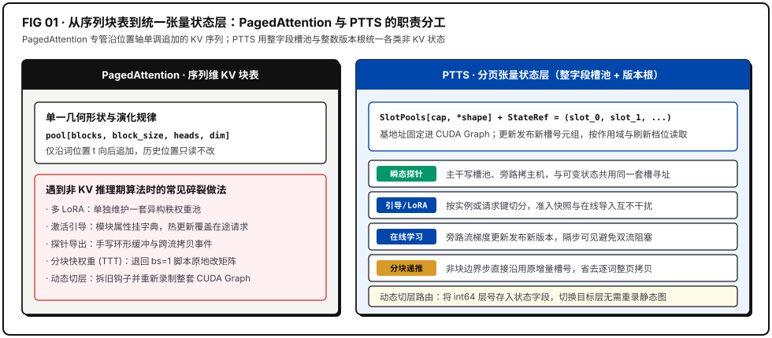
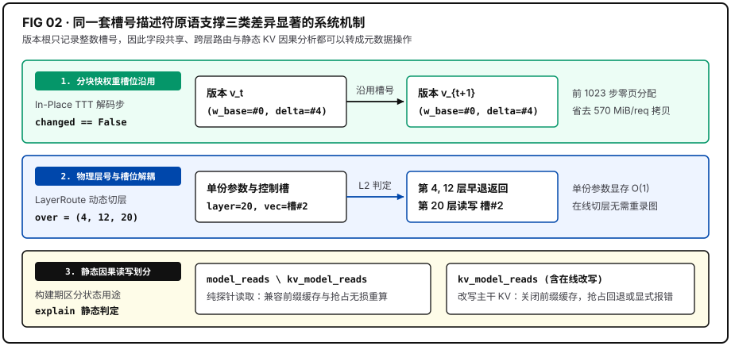
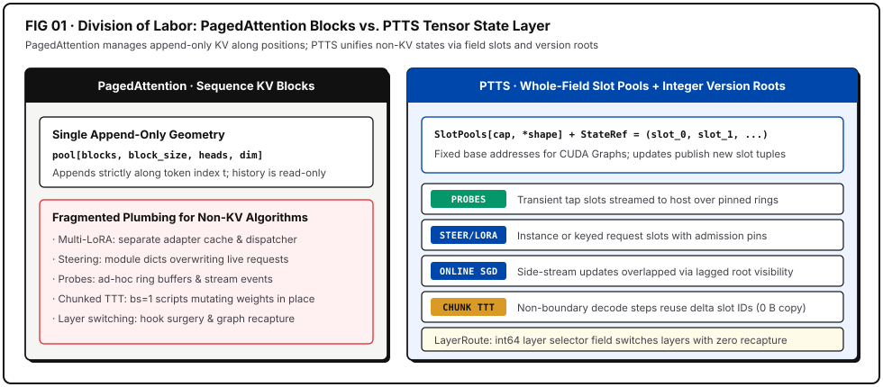
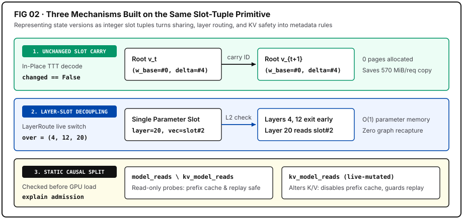

<div class="zine-dispatch" data-title-zh="PagedAttention 之后：用统一的张量状态层（PTTS）承接推理期算法" data-title-en="Beyond PagedAttention: Unifying Stateful Inference Algorithms on One Tensor State Layer (PTTS)" data-desc-zh="对比 PagedAttention 专管的一维序列块表与非 KV 推理期算法的多样状态需求；拆解 PTTS 如何用整字段固定基地址槽池、整数槽号版本根与因果读写划分统一瞬态探针、多租户引导/LoRA、在线学习、分块快权重零拷贝沿用与运行时免重录动态切层（系统与架构专栏 · 支持 EN / 中文 一键切换）" data-desc-en="PagedAttention turned append-only KV caches into clean block tables, but it models only one state geometry: fixed per-token slices growing along the sequence axis (Systems &amp; Architecture · Bilingual EN / 中文)">
  <a class="zine-pill-link" data-i18n-zh="pLLM 项目主页与文档 →" data-i18n-en="pLLM Project &amp; Docs →" href="/pllm/">pLLM 项目主页与文档 →</a>
  <a class="zine-pill-link" data-i18n-zh="全部博客分类索引 →" data-i18n-en="Blog Categories →" href="/blog/">Blog Categories →</a>
</div>

<div class="zine-lang-panel" data-lang-panel="zh" lang="zh-CN" markdown="1">

<div class="zine-tldr" markdown="1">

**TL;DR：** PagedAttention 把沿序列维度单调追加的 KV 缓存整理成了标准块表，但它只覆盖了一种特定几何形状的状态。当推理引擎需要同时支持激活探针导出、多租户 LoRA、在线激活引导、解码期旁路学习、分块快权重递推（In-Place TTT）以及运行时动态切层时，按特性逐个打补丁会让缓冲管理与调度规则彼此冲突。本文介绍分页张量状态系统（PTTS）的设计思路：通过“固定基地址整字段槽池 + 整数槽号版本根 + 显式刷新与因果分类”三个基础原语，把上述算法收敛到同一套与 CUDA Graph 和连续批处理兼容的状态底座上，并说明它与 PagedAttention 各自的职责边界。

</div>

> **系统与架构专栏（11/11 · 架构抽象 · 状态底座）** · [pLLM 项目主页与文档](/pllm/) · [全站博客分类目录](/blog/) · [GitHub 原文 ↗](https://github.com/LinesHogan/pLLM/blob/main/blog/zh/11-ptts-beyond-paged-attention.md)

回顾现代推理引擎的演进，PagedAttention 解决了一个核心系统问题：把原本每个请求各自连续申请、长短不一的 KV 缓存，统一拆成固定长度的物理块（Block），通过一张整数块表做间接寻址。只要算法的状态满足“每步沿序列位置向后追加 `[kv_heads, head_dim]`，且历史位置只读不改”，这一套抽象就足够干净。

但在实际的推理研究与线上部署中，需要跨步跨流流转的数据远不止 KV 缓存一种：

- 可解释性与安全监控需要从中间层提取激活探针（如 SAE 特征或全宽残差），跨 CUDA Stream 异步传回主机内存；
- 多租户定制与干预需要按请求挂载低秩 LoRA 因子，或者在服务运行期间在线替换全局激活引导（Steering）向量；
- 测试时自适应算法需要在解码期每步用梯度更新每个请求私有的小网络（如在线自蒸馏 ESamp），或者每满 512 至 1,024 个词在模型前向内部做一次大矩阵快权重递推（如 In-Place TTT）；
- 在线探索与分层路由还希望在不重新录制 CUDA Graph 的前提下，把探针、引导或适配器的目标位置从第 8 层切到第 20 层。

如果顺着“来一个需求加一套专属结构”的习惯演进，引擎里不久就会并存五六套互不相通的状态设施：多 LoRA 有一套适配器缓存，激活引导在模块属性上挂字典，探针导出手写一套锁页环形缓冲，快权重递推退回 `bs=1` 脚本原地改矩阵，动态切层则靠拆装钩子重录静态图。单独看每一套似乎都能工作，一旦把两三种能力组合进同一个连续批处理步，或者遇到 KV 显存不足触发抢占重算，不同设施对指针稳定性、流同步和历史可重放性的假设就会互相打架。

---

把这些算法放在一起对比，会发现它们虽然数学形式差异明显，向底层系统索取的能力却只有三件事：**一块在 CUDA Graph 生命周期内基地址不变的显存、一种把逻辑归属映射到物理槽位的轻量索引、以及一套区分“读准入快照还是读当步最新值”的版本规则。**

我们据此设计了**分页张量状态系统（PTTS，Paged Tensor Transition System）**。它不去替代 PagedAttention 管理的变长序列块，而是专门承接所有“形状在单字段内固定、按版本整体演进或瞬态传递”的张量状态：

{: style="display: block; max-width: 100%; height: auto; margin: 1.5rem auto;" }

PTTS 的核心结构收敛在三个正交维度上：

1. **按整字段建池（`SlotPools`）**：每个状态字段在引擎启动期分配一块连续张量 `pool[capacity, *field_shape]`。与逐词追加的 KV 缓存不同，权重矩阵、引导向量、探针行与控制标量在单步内都是按完整字段读写的；整字段成槽既省去了块内分片偏移，又保证了池底基地址在整场服务期间恒定不变，天然满足 CUDA Graph 的静态指针要求。
2. **整数槽号版本根（`StateRef`）与归属作用域**：一份状态快照本身不拷贝张量，只记录一组整数槽号 `(slot_0, slot_1, ...)`。配合作用域声明——引擎级单份的 `InstanceState`、按 `request_id` / `prompt_index` / `route` 切分的 `RequestState`、以及位置对齐的 `PositionState`——CPU 在每步前向开始前只需把本步各行对应的槽号填入几百字节的设备描述符表，全程无需主机同步。
3. **显式状态转移与两档读取刷新（`refresh`）**：所有修改都通过显式转移发布新版本根（宿主侧 `StateImport` / `Feed`、设备侧 `@pllm.write`、步后 `@pllm.train` 或前向内 `@pllm.train_in_forward`）。读取方则在声明期选定语义：默认 `refresh="admission"` 为请求钉住进场那一刻的快照，保证流式生成中途不受外部热更新干扰；`refresh="step"` 则每步读取最新发布版本，服务于在线实时切换。

---

这套看似简单的槽号元组表示，在面对复杂算法与硬件约束时会带来几项直接的系统收益。下面看三个具体的落地场景：

{: style="display: block; max-width: 100%; height: auto; margin: 1.5rem auto;" }

**第一，分块快权重递推（In-Place TTT）中的字段级零拷贝沿用。**

在 `Qwen3-4B` 的 In-Place TTT 架构中，6 个目标层的 `W_down` 快权重在 `float32` 下每个并发请求约占 `570 MiB`。如果每次状态步进都整块复制一份 `570 MiB`，解码带宽会被拷贝占满。实际上，In-Place TTT 只在攒够一整块（如 `chunk=1024` 个词）时才更新一次快权重增量，中间连续 1,023 个解码步的更新标志 `changed` 都是 `False`。

在 PTTS 下，我们将只读预训练基座 `w_base`（零拷贝借用模型检查点）与可变增量 `w_delta` 拆成独立字段。当某一步前向内返回 `changed == False` 时，新发布的版本根直接沿用上一步的 `w_delta` 槽号——既不分配新页，也不搬运任何字节；同时自定义的分页矩阵乘向量算子直接顺着 `SlotPools` 槽号流式读取，省去了先把多请求权重拼成 `1.1 GiB` 临时稠密张量的 gather 开销。在单张 RTX 4090 上，4 并发 `float32` 端到端吞吐达到 `171.6 tok/s`，是原版 `bs=1` 脚本上限（`54.8 tok/s`）的 3 倍以上。

**第二，瞬态激活探针与可变参数共用同一套槽池原语。**

往主机内存异步导出中间层隐藏状态（`HiddenTaps` + `@pllm.export`），在不少系统里是脱离状态管理之外的一套独立回调代码。而在 PTTS 里，瞬态激活行同样存放在 `SlotPools` 中：主计算流在层边界按槽表把命中的行拷入池内，不打断主干模型的 `torch.compile` 融合；旁路流随后把槽池数据经锁页内存环形缓冲传回 CPU，与下一步 GPU 前向重叠执行。在 `Qwen2.5-7B`、128 并发下每步把全宽 3,584 维残差实时传回 CPU，纯解码 TPOT 为 `22.06 ms`（无钩子基线为 `21.97 ms`），几乎不额外拉长解码步耗时。

**第三，运行时动态切层（`LayerRoute`）与静态因果读写分析。**

当客户希望在线把激活引导、探针或 LoRA 从第 8 层切到第 20 层，甚至让同一批次的不同请求命中不同层时，PTTS 不需要引入新的运行时补丁机制：目标层号本身就是状态里的一个 `0-d int64` 标量字段（如 `ctrl.layer`）。单份引导向量或 LoRA 因子依然只占 1 份参数槽；候选层集合 `over` 上的轻量 Triton 算子先从片上 L2 缓存读取该 `int64` 层号字段，未命中层直接返回，命中层再按描述符表读写对应的参数槽。更新一次 `import_state` 或执行一次 GPU `@pllm.write` 发布新版本根，下一步前向即切换至新层，全程无需重录任何一张 CUDA Graph：

```python
class DynamicSteering(pllm.Workload):
    ctrl = pllm.InstanceState(
        {"layer": pllm.Field((), torch.int64), "vector": pllm.Field(lambda width, _: (width,))},
        init=pllm.Imported(),
    )
    route = pllm.model.LayerRoute("ctrl", over=(4, 12, 20))
    steer = route.patch(operator="add", decode=True)

    @pllm.export(name="probe", max_rows=8, max_cols=16)
    def capture(self, r: torch.Tensor = route.residual()) -> torch.Tensor:
        return r[:, :16].float()
```

更重要的是，由于所有状态读写都在构建期经过统一的数据流图，规划器能够静态区分两个集合：**模型前向读取的状态（`model_reads`，决定槽位何时可回收）**与**会改变模型 K/V 数值的状态（`kv_model_reads`，决定前缀缓存与抢占策略）**。如果上面的负载只保留 `capture` 探针而去掉 `steer` 补丁，规划器识别出 `kv_model_reads` 为空，便允许安全开启前缀缓存（Prefix Caching）并在抢占时无损重算；而一旦包含在线可变的 `steer` 或 `adapter`，规划器会在构建期拒绝前缀缓存，并在发生无法重放历史的抢占时显式报错，避免拿切层后的新权重静默重算旧前缀。

---

这套统一的张量状态层目前作为 **[pLLM](https://github.com/LinesHogan/pLLM)**（`pllm`）的核心状态底座运行（关于其底层 Rust 无锁引用计数账本、代次校验与双流异步回收的具体实现细节，可参阅同系列的第 07 篇随笔）。

在工程边界上，PTTS 与 PagedAttention 是互补而非替代关系：凡是随生成长度逐词增长的序列历史，依然应当留在 PagedAttention 的定长块表里，若强行放进整字段槽池会因按最大长度对齐而浪费填充显存；涉及多分支草稿验证与位置计数器回退的投机解码属于外层词调度器的职责，也不在单步张量状态转移的覆盖范围内。此外，整字段槽池要求在启动期根据并发数与滞后窗口预算固定的槽位上限（可通过 `pllm.explain` 在 CPU 上预先核算字节账单）——用启动期明确的显存定额，换取运行期静态图零重录与多种有状态算法的统一组合能力。

</div>

<div class="zine-lang-panel is-hidden" data-lang-panel="en" lang="en" markdown="1">

<div class="zine-tldr" markdown="1">

**TL;DR:** PagedAttention turned append-only KV caches into clean block tables, but it models only one state geometry: fixed per-token slices growing along the sequence axis. Supporting activation probes, multi-tenant LoRA, live activation steering, side-stream online learning, chunk-recurrent fast weights (In-Place TTT), and runtime layer switching through separate feature-specific managers leads to conflicting pointer, synchronization, and preemption rules. We describe the Paged Tensor Transition System (PTTS)—built on fixed-base whole-field slot pools, integer slot-tuple version roots, and explicit refresh and causal KV classification—showing how one substrate serves all of these algorithms inside captured CUDA Graphs while complementing PagedAttention.

</div>

> **Systems & Architecture (11/11 · Architecture · State Layer)** · [pLLM Project & Docs](/pllm/) · [All Blog Categories](/blog/) · [GitHub Source ↗](https://github.com/LinesHogan/pLLM/blob/main/blog/en/11-ptts-beyond-paged-attention.md)

PagedAttention solved a foundational memory problem in LLM serving: replacing per-request contiguous KV allocations with fixed-size physical blocks indexed through a block table. Whenever an algorithm's state follows that single law—append `[kv_heads, head_dim]` at token index $$t$$ while keeping positions $$0..t-1$$ immutable—sequence block tables are hard to beat.

Modern inference workloads and research prototypes, however, routinely carry non-KV state across steps and streams:

- Interpretability and safety pipelines extract intermediate hidden states or sparse autoencoder (SAE) features and stream them asynchronously to host memory;
- Multi-tenant customization attaches per-request low-rank adapters or hot-swaps shared steering vectors on a live server;
- Test-time adaptation updates small per-request predictors after each sampled token on a side stream (such as online self-distillation ESamp), or updates large fast-weight matrices every 512–1,024 tokens inside the forward pass (In-Place TTT);
- Interactive probing and adaptive interventions switch observation or steering sites from layer 8 to layer 20 without pausing to recapture CUDA Graphs.

Implementing each capability as an isolated feature quickly fragments the engine: one subsystem manages LoRA slots, another stores steering vectors in module attributes, a third maintains custom pinned ring buffers for probes, fast-weight prototypes fall back to `bs=1` in-place mutation, and layer changes tear down hooks and re-record graphs. Each piece works in isolation, yet combining two of them in one continuous batch—or evicting a request under KV memory pressure—exposes contradictory assumptions about pointer stability, stream ordering, and replayability.

---

Look across those algorithms side by side, and their math differs far more than their systems requirements. What every one of them actually asks from the serving runtime comes down to three primitives: **device storage whose base address stays constant across CUDA Graph replays, a lightweight indirection mapping logical ownership to physical slots, and explicit rules governing which version a reader sees.**

That observation shaped our **Paged Tensor Transition System (PTTS)**. Rather than replacing PagedAttention's sequence blocks, PTTS manages tensor state whose per-field shape is fixed and whose values evolve across versions or flow transiently across streams:

{: style="display: block; max-width: 100%; height: auto; margin: 1.5rem auto;" }

PTTS factors non-KV state along three orthogonal axes:

1. **Whole-field fixed-base pools (`SlotPools`)**: Each declared field allocates one contiguous tensor `pool[capacity, *field_shape]` at engine startup. Unlike KV caches that grow one token at a time, adapter factors, steering vectors, tapped rows, and scalar selectors are read and written as whole fields; whole-field slots avoid sub-tensor block fragmentation while keeping base pointers fixed for the lifetime of captured CUDA Graphs.
2. **Integer slot-tuple roots (`StateRef`) and ownership scopes**: A state version copies zero tensor bytes on its own—it is simply a tuple of integer slot indices `(slot_0, slot_1, ...)`. Combined with explicit scopes—engine-wide `InstanceState`, `RequestState` keyed by `request_id` / `prompt_index` / `route`, and token-aligned `PositionState`—the host stages compact integer descriptor tables before each step with zero device-to-host synchronization.
3. **Explicit transitions and two refresh modes (`refresh`)**: State mutates only through declared transitions (`StateImport` / `Feed`, on-GPU `@pllm.write`, stepwise `@pllm.train`, or in-forward `@pllm.train_in_forward`), each publishing a new `StateRef`. Readers declare either `refresh="admission"` (pinning the version active when the request entered, isolating in-flight streams from concurrent updates) or `refresh="step"` (reading the latest published root each step for live control).

---

Representing state versions as integer slot tuples unlocks several practical payoffs when algorithms meet continuous batching and CUDA Graphs:

{: style="display: block; max-width: 100%; height: auto; margin: 1.5rem auto;" }

**First, zero-copy slot carry for chunk-recurrent fast weights (In-Place TTT).**

In `Qwen3-4B` In-Place TTT, six adapted `W_down` fast-weight matrices occupy roughly `570 MiB` per concurrent request in `float32`. Copying `570 MiB` on every decode step would saturate memory bandwidth, even though TTT updates weights only at chunk boundaries (e.g., every 1,024 tokens) and leaves `changed == False` on the 1,023 decode steps in between.

Under PTTS, immutable pretrained weights `w_base` (borrowed zero-copy from the checkpoint) and mutable increments `w_delta` live in separate fields. Whenever an in-forward step reports `changed == False`, the published next-step root carries forward the existing `w_delta` slot index—allocating zero pages and copying zero bytes—while a paged matrix-vector kernel streams directly from `SlotPools` instead of gathering a `1.1 GiB` dense temporary buffer. On a single RTX 4090, 4-way concurrent `float32` serving reaches `171.6 tok/s`, more than $$3\times$$ the throughput ceiling of a `bs=1` reference loop (`54.8 tok/s`).

**Second, transient activation probes share the same slot substrate.**

Streaming intermediate hidden states to the CPU (`HiddenTaps` + `@pllm.export`) does not require a separate callback buffer layer. During the main forward pass, tap kernels copy selected rows into transient `SlotPools` slots without breaking `torch.compile` fusion; a side-stream task then transfers those slots through a pinned host ring buffer concurrently with the next forward pass. On `Qwen2.5-7B` at 128 concurrent sequences, exporting full 3,584-dim residuals to CPU every step runs at `22.06 ms` decode TPOT versus `21.97 ms` on unmodified vLLM.

**Third, runtime dynamic layer switching (`LayerRoute`) and static causal KV analysis.**

Switching a probe, steering vector, or LoRA from layer 8 to layer 20 on a running server—or routing different requests in the same batch to different layers—requires no special graph-patching machinery once the target layer index is stored as a `0-d int64` field (`ctrl.layer`) in PTTS. A single steering vector or adapter occupies one parameter slot; lightweight Triton kernels at candidate layers `over` check the L2-cached `int64` selector, return early on inactive layers, and read or accumulate from the parameter slot only on the active layer. Publishing a new version via `import_state` or `@pllm.write` switches layers on the next forward step with zero CUDA Graph recapture:

```python
class DynamicSteering(pllm.Workload):
    ctrl = pllm.InstanceState(
        {"layer": pllm.Field((), torch.int64), "vector": pllm.Field(lambda width, _: (width,))},
        init=pllm.Imported(),
    )
    route = pllm.model.LayerRoute("ctrl", over=(4, 12, 20))
    steer = route.patch(operator="add", decode=True)

    @pllm.export(name="probe", max_rows=8, max_cols=16)
    def capture(self, r: torch.Tensor = route.residual()) -> torch.Tensor:
        return r[:, :16].float()
```

Because every read and transition flows through one static declaration graph, the planner also separates **`model_reads`** (states read during forward, governing slot retention) from **`kv_model_reads`** (states whose values alter trunk K/V entries). Removing `steer` from the workload above leaves `kv_model_reads` empty, so the engine automatically permits prefix caching and seamless preemption replay; keeping a live-mutated `steer` or `adapter` puts the state in `kv_model_reads`, disabling prefix caching at build time and failing closed if KV preemption would otherwise replay old tokens under newer weights.

---

PTTS serves as the unified state substrate in **[pLLM](https://github.com/LinesHogan/pLLM)** (`pllm`); readers interested in the underlying lock-free Rust refcount ledger, generation tags, and non-blocking event reclamation can find those mechanics in Essay 07 of this collection.

Its boundaries are straightforward: variable-length token histories still belong in PagedAttention blocks (whole-field slots would pad shorter sequences to a fixed ceiling), outer-loop speculative tree verification and KV rollback belong in the token scheduler rather than per-step state transitions, and whole-field pools reserve a deterministic slot budget up front (inspected on CPU via `pllm.explain`). Trading an explicit startup memory reservation buys constant graph pointers and one composable state model across diverse inference-time algorithms.

</div>

<script defer src="/assets/js/bilingual-post.js"></script>
