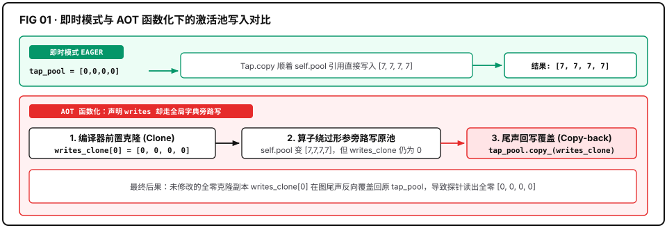
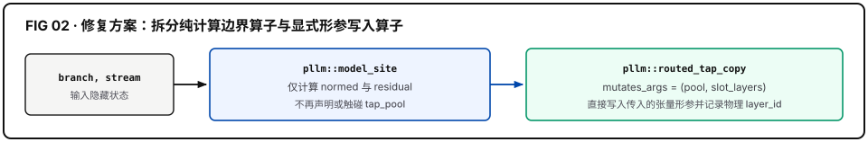
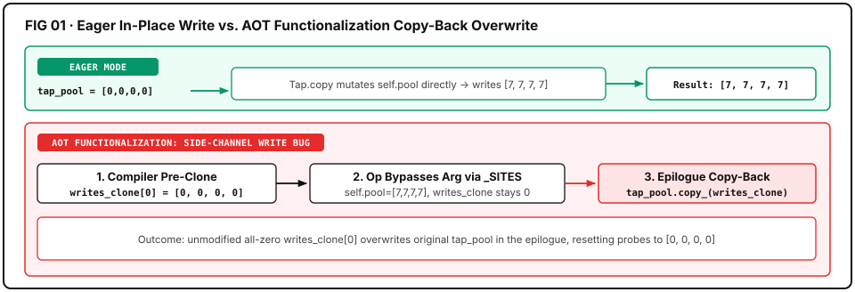
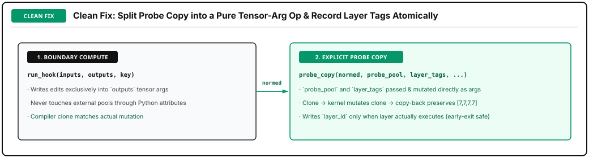

<div class="zine-dispatch" data-title-zh="自定义算子接入 `torch.compile` 后写入失效：从一次排障看 PyTorch AOT 函数化" data-title-en="Why Custom Op Writes Disappear Under `torch.compile`: Debugging PyTorch AOT Functionalization" data-desc-zh="即时执行时写入激活池的 [7, 7, 7, 7]，在开启 aot_eager 编译后读出来仍是全零。从图编译器的单静态赋值（SSA）要求出发，梳理 auto_functionalized 的“克隆—执行—回写”过程，定位全局字典旁路写入与 mutates_args 声明不一致导致的覆盖问题，并顺带修正自适应跳层下的层号记录时机（工程与排障笔记 · 支持 EN / 中文 一键切换）" data-desc-en="When wrapping inter-layer normalization boundaries in a PyTorch custom op, writes to an activation tap pool worked fine in Eager mode yet read back as all zeros under torch.compile's AOT... (Engineering &amp; Debugging Notes · Bilingual EN / 中文)">
  <a class="zine-pill-link" data-i18n-zh="pLLM 项目主页与文档 →" data-i18n-en="pLLM Project &amp; Docs →" href="/pllm/">pLLM 项目主页与文档 →</a>
  <a class="zine-pill-link" data-i18n-zh="全部博客分类索引 →" data-i18n-en="Blog Categories →" href="/blog/">Blog Categories →</a>
</div>

<div class="zine-lang-panel" data-lang-panel="zh" lang="zh-CN" markdown="1">

<div class="zine-tldr" markdown="1">

**TL;DR：** 在 Transformer 层间归一化边界封装自定义算子时，即时（Eager）模式下正常写入激活池的数据，经过 `torch.compile` 的 AOT 函数化（Functionalization）变换后读出来却是全零。原因在于算子签名将激活池声明在 `mutates_args` 中，算子内部却绕过形参、顺着全局字典里的对象引用直接写了原张量，导致编译器在收尾阶段用未被修改过的克隆副本覆盖了原池。把激活池拷贝拆为直接读写张量形参的独立算子后，数据流与编译器契约恢复一致，同时也一并解决了自定义前向跳层时层号记录失真的问题。

</div>

> **工程与排障笔记（#1 · 编译与自定义算子）** · [pLLM 项目主页与文档](/pllm/) · [全站博客分类目录](/blog/) · [GitHub 原文 ↗](https://github.com/LinesHogan/pLLM/blob/main/blog/personal/01-aot-functionalization-and-custom-ops.md)

问题出在给层间 `RMSNorm` 边界挂载探针拷贝的时候。

在连续批处理推理引擎中，为了在不打断 `torch.compile` 整图编译的前提下，在层间归一化边界插入自定义的残差改写与隐藏态探针（Tap），我们把边界逻辑包成了一个 PyTorch 自定义算子 `pllm::model_site`。因为 `torch.compile` 会把整数参数当作编译期常量固定到图里，算子不能直接接收 Python 对象 ID，所以借用了第 0 个只读张量的首地址 `reads[0].data_ptr()` 作为运行期查找键，从全局字典 `_SITES` 取回会话对象执行。

注册算子时，我们把所有会被原地写入的张量——包括激活探针用于存放隐藏状态的显存池 `tap_pool`——放进了 `writes` 列表，并在装饰器上注明了 `mutates_args={"outputs", "writes"}`：

```python
@torch.library.custom_op("pllm::model_site", mutates_args={"outputs", "writes"})
def model_site(
    inputs: list[Tensor], outputs: list[Tensor], reads: list[Tensor], writes: list[Tensor], hook: int
) -> None:
    # 通过第 0 个只读张量的地址取回会话对象，执行对应的边界钩子
    _SITES[reads[0].data_ptr()].hooks[hook].emit(inputs, outputs)
```

在即时执行（Eager）和原生 CUDA Graph 录制下，这段代码工作正常：残差输出是 `[7, 7, 7, 7]`，`tap_pool` 对应槽位里也是 `[7, 7, 7, 7]`。

但用 `torch.compile(..., backend="aot_eager", fullgraph=True)` 包装同一个边界并运行后，出现了不一致的结果：前向返回的 `residual` 仍然是 `[7, 7, 7, 7]`，全程没有报错，可再去读 `tap_pool` 的同一个槽位，里面的值却是初始的 `[0, 0, 0, 0]`。

---

要弄清楚写进去的数据为什么在算子返回后变回全零，需要先看 PyTorch 2 编译器栈里的 **Functionalization（函数化）** 阶段做了什么。

日常写 PyTorch 代码时，原地修改（如 `pool.index_copy_()`、`x.add_()`）十分常见，这样能省显存分配。但后端图编译器（如 Inductor）在做算子融合、死代码消除和指令重排时，要求计算图满足**单静态赋值（SSA，Single Static Assignment）**：图里的每条边代表一个不可变的值，算子之间只通过显式的输入输出建立依赖，不能存在隐式的原地内存副作用。

AOTAutograd 中的 Functionalization 负责把包含原地修改的图转换成纯函数式的 SSA 图。当它遇到一个声明了 `mutates_args={"outputs", "writes"}` 的黑盒自定义算子时，无法直接改写算子内部源码，于是通过 `auto_functionalized` 自动包一层三步转换：

1. **克隆副本（Clone）**：调用自定义算子前，将 `outputs` 和 `writes` 中的每个张量分别克隆一份临时副本（`writes_clone = [w.clone() for w in writes]`），把克隆副本作为形参传进算子；
2. **执行算子（Execute）**：运行算子函数体，默认算子会把所有原地修改落在这批克隆形参上，再将修改后的克隆副本作为纯函数节点的输出返回；
3. **尾声回写（Epilogue Copy-back）**：当图执行结束需要把新状态同步回外部持久缓冲区时，生成一条 `writes_orig.copy_(writes_clone)`，用克隆副本的内容更新原始张量。

把这三步放到时间线上对照，原因就清楚了：

{: style="display: block; max-width: 100%; height: auto; margin: 1.5rem auto;" }

`outputs` 之所以结果正常，是因为 `emit(inputs, outputs)` 确实往形参 `outputs` 上写了数据，克隆副本被更新成了 `[7, 7, 7, 7]`，回写时自然保留了下来。而 `tap_pool` 虽然被外层放进了 `writes` 列表告知编译器“该参数会被修改”，`emit` 内部却没有使用 `writes` 形参，而是直接修改了 Python 对象属性里持有的 `self.pool.tensors[0]`。

在编译器看来，传入的克隆形参 `writes_clone[0]` 进去是零、出来还是零，代表算子执行后的新值就是零，最后一步 `copy_` 便把刚写进原池的数覆盖回了零。反过来，如果不在 `writes` 里声明 `tap_pool`，编译器又会认为该张量未被修改，后续若在同一张图里读取它，重排或死代码消除都可能改变执行顺序。

---

定位原因后，修改方式并不需要去改造 `_SITES` 字典，而是把探针拷贝从 `model_site` 黑盒里拿出来。

`model_site` 之所以需要通过指针查表回调 Python，是因为自定义残差改写方法可能携带任意复杂的闭包状态；而激活探针只做一件事：拿到边界归一化产出的 `(normed, residual)` 两个张量，按索引表把选中的行拷进显存池。

将 `self._copy_taps(normed, residual)` 从 `emit` 内部移到外层 `graph_forward` 中，放在 `run_hook` 之后直接调用：

{: style="display: block; max-width: 100%; height: auto; margin: 1.5rem auto;" }

拆分之后，`routed_tap_copy` 直接把 `pool` 和伴随的层号数组 `slot_layers` 作为张量形参接收并在内核里原地写入。AOT 函数化克隆形参、内核修改克隆副本、尾声拷回原池，数据流与编译器的假设保持一致。

---

这次拆分还顺带解决了动态切层里的另一个问题：**导出的层号元数据应该在准备阶段写入，还是在实际跑过该层时写入。**

在动态切层导出（`@pllm.export`）中，导出的每一行激活都带有 `event.layers[r]`，用来记录这一行采自模型的哪一层（若传入 `-1` 关闭则记为 `-1`）。

最初的实现在前向开始前的 `bind_routes()` 阶段，读出控制状态里的目标层号（例如 `2`）后，直接填进了 `_slot_layers[dst]`。在顺序跑完全部层的常规前向下，这样写没有问题；但如果用户同时编写了自定义前向 `@pllm.custom_forward`，比如在某一步提前退出，只执行了第 0 层：

```python
@pllm.custom_forward(tokens="decode")
def early_exit(self, layers: pllm.model.Layers) -> torch.Tensor:
    return layers(0, 1)[0]  # 本步只执行第 0 层，未经过第 2 层
```

此时控制状态虽然指向第 2 层，但第 2 层的模块钩子在这一步并未执行。如果提前在准备阶段把 `2` 写进 `_slot_layers`，下游拿到的就是一行数值全零（缓冲区初值）、标签却标着 `2` 的记录；若使用的是 `route.layer_logits()` 且候选集合包含末层，还可能误触发末层 logits 替换。

把层号写入移进 `routed_tap_copy` 内核内部后，行为就自然对齐了：

```python
@triton.jit
def _routed_tap_copy_kernel(
    output_ptr, src_rows_ptr, dst_slots_ptr, row_layers_ptr,
    pool_ptr, slot_layers_ptr, out_stride0, out_stride1, pool_stride,
    width, layer_id, BLOCK: tl.constexpr,
):
    row = tl.program_id(0)
    dst = tl.load(dst_slots_ptr + row)
    target_layer = tl.load(row_layers_ptr + row)
    if (dst < 0) | (target_layer != layer_id):
        return
    src = tl.load(src_rows_ptr + row)
    if src < 0:
        return
    if tl.program_id(1) == 0:
        # 仅当该层钩子实际运行并拷贝激活时，由第 0 号列块写入真实层号
        tl.store(slot_layers_ptr + dst.to(tl.int64), tl.full((), layer_id, dtype=tl.int64))
    cols = tl.program_id(1) * BLOCK + tl.arange(0, BLOCK)
    mask = cols < width
    values = tl.load(output_ptr + src.to(tl.int64) * out_stride0 + cols * out_stride1, mask=mask, other=0.0)
    tl.store(pool_ptr + dst.to(tl.int64) * pool_stride + cols, values, mask=mask)
```

准备阶段统一把 `_slot_layers` 清为 `-1`，只有当对应层的钩子真正执行且 `target_layer == layer_id` 时，才在拷贝激活的同时写入 `layer_id`。未被访问到的层保持全零和 `-1` 标签，数值与来源标签在同一时刻产生。

---

回顾这个问题，之所以第一轮端到端 GPU 测试没有触发 `model_site` 的回写覆盖，是因为之前的测试负载同时开启了自定义残差或适配器，引擎在这些组合下会切到 `backend="eager"` 配合原生 CUDA Graph 录制，跳过了 Inductor 的 AOT 函数化；而当负载只包含激活补丁与探针时，引擎走默认的 `backend="inductor"` 路径，问题才会显现。

这也提供了一个低成本的自检方式：每当编写带有 `mutates_args` 的 `torch.library.custom_op` 时，可以在纯 CPU 单测里先套一层 `torch.compile(fn, backend="aot_eager", fullgraph=True)` 传入非零输入验证输出缓冲。`aot_eager` 不依赖 GPU，百毫秒内就能完整跑通 AOTAutograd 的克隆与回写逻辑，及早发现绕过形参写内存的问题。

相关实现位于开源项目 **[pLLM](https://github.com/LinesHogan/pLLM)** 的 `pllm.model.LayerRoute` 中。代价方面，将 `routed_tap_copy` 放在边界外作为独立算子后，候选集合 `over` 中的每一层都会在 CUDA Graph 里保留一个轻量内核节点；未命中层虽只需在 L2 缓存读取两个 `int64` 即可返回，不会访问隐藏态显存池，但图内内核发射开销仍随 `|over|` 线性增加，因此更适合按需声明实际要切换的少数候选层。

</div>

<div class="zine-lang-panel is-hidden" data-lang-panel="en" lang="en" markdown="1">

<div class="zine-tldr" markdown="1">

**TL;DR:** When wrapping inter-layer normalization boundaries in a PyTorch custom op, writes to an activation tap pool worked fine in Eager mode yet read back as all zeros under `torch.compile`'s AOT Functionalization pass. The op declared the pool in `mutates_args`, yet its body bypassed the tensor argument and mutated the original buffer through a global dictionary reference—so the compiler's epilogue faithfully copied the untouched zero-filled clone right back over the pool. Splitting tap copying into a standalone op that mutates its tensor arguments directly realigns the data flow with the compiler contract, and fixes stale layer-ID metadata under early-exit custom forwards in the same stroke.

</div>

> **Engineering & Debugging Notes (#1 · Compiler & Custom Ops)** · [pLLM Project & Docs](/pllm/) · [All Blog Categories](/blog/) · [GitHub Source ↗](https://github.com/LinesHogan/pLLM/blob/main/blog/personal/en/01-aot-functionalization-and-custom-ops.md)

The bug showed up while attaching an activation tap copy to an inter-layer `RMSNorm` boundary.

In a continuous-batching inference engine, to insert custom residual edits and hidden-state taps at inter-layer normalization boundaries without breaking `torch.compile` full-graph capture, we wrapped the boundary logic in a PyTorch custom op, `pllm::model_site`. Because `torch.compile` specializes plain integer arguments as compile-time constants inside the graph, the op cannot accept a raw Python object ID; instead, it uses the data pointer of the 0th read-only tensor, `reads[0].data_ptr()`, as a runtime lookup key into a global `_SITES` dictionary to retrieve the session object and run the hook.

When registering the op, we placed every tensor mutated in place—including `tap_pool`, the GPU memory pool holding tapped hidden states—into the `writes` list, and declared `mutates_args={"outputs", "writes"}` on the decorator:

```python
@torch.library.custom_op("pllm::model_site", mutates_args={"outputs", "writes"})
def model_site(
    inputs: list[Tensor], outputs: list[Tensor], reads: list[Tensor], writes: list[Tensor], hook: int
) -> None:
    # Look up the session by the 0th read-only tensor's address and run the boundary hook
    _SITES[reads[0].data_ptr()].hooks[hook].emit(inputs, outputs)
```

Under Eager execution and raw CUDA Graph capture, everything worked as expected: the residual output held `[7, 7, 7, 7]`, and the corresponding slot in `tap_pool` held `[7, 7, 7, 7]`.

Wrap the same boundary in `torch.compile(..., backend="aot_eager", fullgraph=True)`, however, and the two diverged. The forward pass still returned `[7, 7, 7, 7]` for `residual` without raising an error, yet reading the same slot in `tap_pool` gave back the initial `[0, 0, 0, 0]`.

---

To understand why values written inside the op vanished back to zero on return, look at what the **Functionalization** pass in the PyTorch 2 compiler stack does.

Everyday PyTorch code relies heavily on in-place mutations (`pool.index_copy_()`, `x.add_()`) to avoid extra allocations. Backend graph compilers such as Inductor, however, require **Single Static Assignment (SSA)** form before fusing operators, eliminating dead code, or reordering instructions: every edge in the graph represents an immutable value, and dependencies flow strictly through explicit inputs and outputs, with no hidden in-place memory side effects.

Functionalization inside AOTAutograd translates graphs containing in-place mutations into pure SSA form. When it hits a black-box custom op declaring `mutates_args={"outputs", "writes"}`, it cannot rewrite the op's Python body, so it wraps the call via `auto_functionalized` in three steps:

1. **Clone**: Before invoking the op, clone every tensor in `outputs` and `writes` into temporary buffers (`writes_clone = [w.clone() for w in writes]`), and pass those clones in as arguments.
2. **Execute**: Run the op body assuming all in-place writes land on the cloned arguments, then return the mutated clones as pure functional outputs of the graph node.
3. **Epilogue Copy-back**: At the end of the graph, when updated state must be synchronized back to persistent external buffers, emit `writes_orig.copy_(writes_clone)` to write the clones back into the original tensors.

Put those three steps on a timeline, and the failure mode is immediate:

{: style="display: block; max-width: 100%; height: auto; margin: 1.5rem auto;" }

`outputs` came through intact because `emit(inputs, outputs)` actually wrote to its `outputs` parameter, updating the clone to `[7, 7, 7, 7]` so the epilogue copy-back preserved it. `tap_pool` behaved differently: the caller placed it in `writes` to tell the compiler that the buffer would be mutated, yet `emit` ignored the `writes` argument and wrote directly to `self.pool.tensors[0]` via a Python object attribute.

As far as the compiler could see, `writes_clone[0]` entered as all zeros and exited as all zeros, meaning the op's new value for `tap_pool` was zero. The epilogue `copy_` dutifully overwrote the freshly written pool with zeros. Conversely, leaving `tap_pool` out of `writes` is no fix either: the compiler would assume the tensor was untouched, leaving any later read in the same graph open to reordering or dead-code elimination.

---

Once the mechanism is clear, the fix leaves `_SITES` untouched and simply pulls tap copying out of the `model_site` black box.

`model_site` needs the pointer-table Python callback only because custom residual-editing methods can carry arbitrary closure state. An activation tap does one narrow job: take the `(normed, residual)` tensors produced at the normalization boundary and copy selected rows into the memory pool according to an index table.

Moving `self._copy_taps(normed, residual)` out of `emit` and calling it directly after `run_hook` inside the outer `graph_forward` separates the two cleanly:

{: style="display: block; max-width: 100%; height: auto; margin: 1.5rem auto;" }

After the split, `routed_tap_copy` receives `pool` and its companion layer-ID array `slot_layers` directly as tensor arguments and mutates them in place inside the kernel. AOT Functionalization clones the arguments, the kernel mutates the clones, and the epilogue copies them back—bringing the actual data flow back in line with the compiler's contract.

---

The same split also settled a second bug in dynamic layer routing: **whether exported layer-ID metadata should be written during setup, or only when the layer actually runs.**

Under dynamic-layer export (`@pllm.export`), every exported activation row carries `event.layers[r]` to record which model layer it came from (or `-1` when disabled).

The initial implementation read the target layer ID (say, `2`) from the control state during `bind_routes()` before the forward pass started, and wrote it directly into `_slot_layers[dst]`. Under a standard sequential forward pass across all layers, that holds up. The mismatch appears when paired with a `@pllm.custom_forward` that exits early—for example, running only layer 0 on a given step:

```python
@pllm.custom_forward(tokens="decode")
def early_exit(self, layers: pllm.model.Layers) -> torch.Tensor:
    return layers(0, 1)[0]  # Only runs layer 0 this step; never reaches layer 2
```

Here the control state still points to layer `2`, yet layer `2`'s module hook never executes on this step. Writing `2` into `_slot_layers` up front hands downstream code a row of zeros (the initial buffer contents) tagged as layer `2`. If the user is also using `route.layer_logits()` and the candidate set includes the final layer, that stale tag can even trigger spurious final-layer logits replacement.

Moving the layer-ID write inside the `routed_tap_copy` kernel keeps data and metadata aligned automatically:

```python
@triton.jit
def _routed_tap_copy_kernel(
    output_ptr, src_rows_ptr, dst_slots_ptr, row_layers_ptr,
    pool_ptr, slot_layers_ptr, out_stride0, out_stride1, pool_stride,
    width, layer_id, BLOCK: tl.constexpr,
):
    row = tl.program_id(0)
    dst = tl.load(dst_slots_ptr + row)
    target_layer = tl.load(row_layers_ptr + row)
    if (dst < 0) | (target_layer != layer_id):
        return
    src = tl.load(src_rows_ptr + row)
    if src < 0:
        return
    if tl.program_id(1) == 0:
        # Write the actual layer ID from column block 0 only when this layer's hook runs and copies activations
        tl.store(slot_layers_ptr + dst.to(tl.int64), tl.full((), layer_id, dtype=tl.int64))
    cols = tl.program_id(1) * BLOCK + tl.arange(0, BLOCK)
    mask = cols < width
    values = tl.load(output_ptr + src.to(tl.int64) * out_stride0 + cols * out_stride1, mask=mask, other=0.0)
    tl.store(pool_ptr + dst.to(tl.int64) * pool_stride + cols, values, mask=mask)
```

Setup resets `_slot_layers` to `-1` across the board; `layer_id` is written alongside the activation row only when that layer's hook actually runs and `target_layer == layer_id`. Unvisited layers remain all zeros with a `-1` label—values and provenance are produced at the exact same moment.

---

Looking back, our first round of end-to-end GPU tests missed the overwrite in `model_site` for a simple reason: those workloads also enabled custom residuals or adapters, combinations under which the engine switched to `backend="eager"` with raw CUDA Graph capture, bypassing Inductor's AOT Functionalization altogether. Only when a workload enabled activation patches and taps on their own did it hit the default `backend="inductor"` path and surface the bug.

That gives a cheap way to catch this class of bug early: whenever you write a `torch.library.custom_op` with `mutates_args`, wrap it in `torch.compile(fn, backend="aot_eager", fullgraph=True)` in a pure CPU unit test and pass non-zero inputs to verify the mutated buffers. `aot_eager` needs no GPU and executes the full AOTAutograd clone-and-copy-back path in around a hundred milliseconds, flagging any mutation that bypasses the declared parameters.

The implementation lives in `pllm.model.LayerRoute` inside the open-source project **[pLLM](https://github.com/LinesHogan/pLLM)**. On the trade-off side, placing `routed_tap_copy` outside the boundary as a standalone op keeps one lightweight kernel node inside the CUDA Graph for each layer in the candidate set `over`. A missed layer only reads two `int64` values from L2 cache before returning and never touches the hidden-state pool, yet in-graph kernel launch overhead still scales linearly with `|over|`—making it best suited to declaring only the specific candidate layers you intend to switch between.

</div>

<script defer src="/assets/js/bilingual-post.js"></script>
