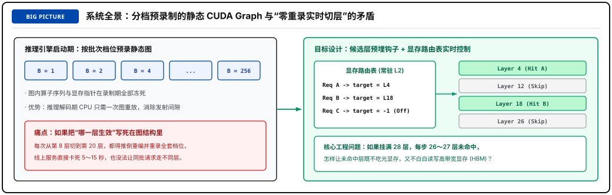
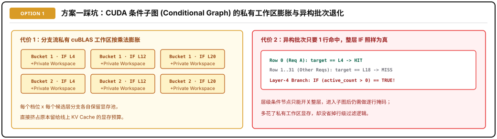
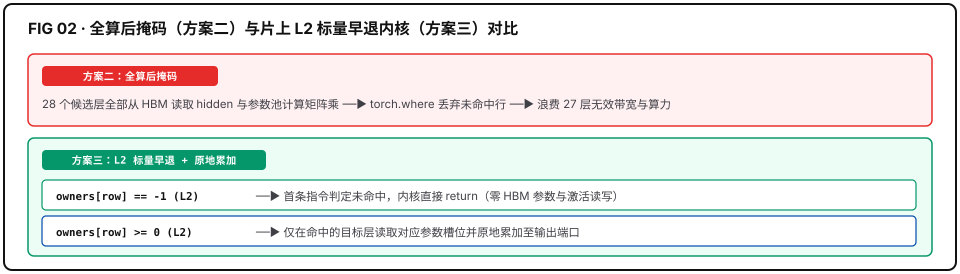
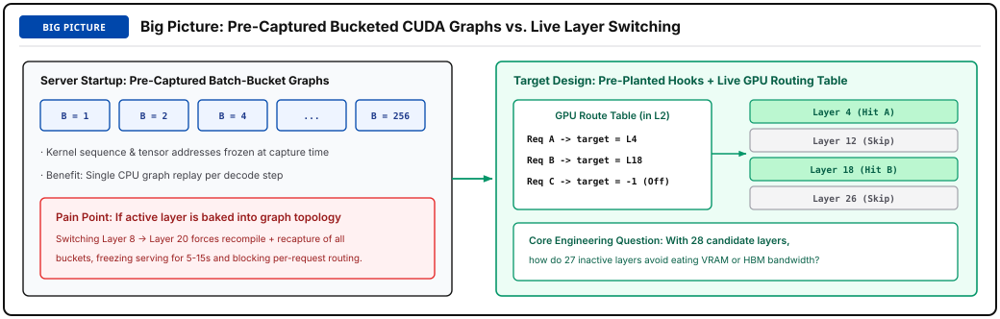
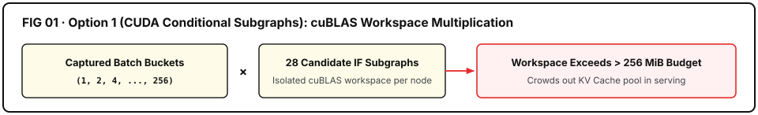
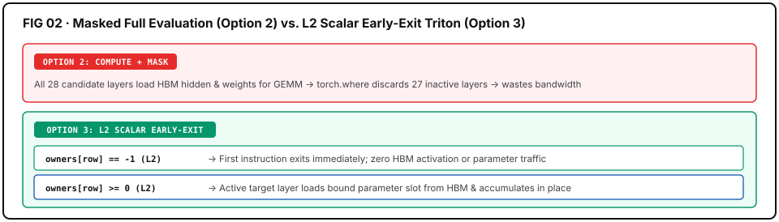

<div class="zine-dispatch" data-title-zh="不重录 CUDA Graph 实现动态切层：条件子图、掩码求值与早退 Triton 内核的比较" data-title-en="Dynamic Layer Switching Without Recapturing CUDA Graphs: Conditional Subgraphs, Masked Evaluation, and Early-Exit Triton Kernels" data-desc-zh="推理服务完成分档 CUDA Graph 预热捕获后，如何在不卡顿十余秒重录整套静态图的前提下实时切换激活干预或 LoRA 目标层？对比条件子图的工作区显存膨胀、torch.where 的无效 HBM 带宽消耗与片上 L2 标量早退 + 原地累加方案，并复盘 rank &gt; 256 兜底分支里一行 bool(mask.any()) 打碎图捕获的原因（工程与排障笔记 · 支持 EN / 中文 一键切换）" data-desc-en="How to switch active steering or LoRA layers live without freezing traffic for 10 seconds to recapture bucketed CUDA Graphs—comparing conditional graph workspace bloat, torch.where HBM traffic, and L2 early-exit Triton kernels, plus a bool(mask.any()) stream-capture crash in a rank &gt; 256 fallback. (Engineering &amp; Debugging Notes · Bilingual EN / 中文)">
  <a class="zine-pill-link" data-i18n-zh="pLLM 项目主页与文档 →" data-i18n-en="pLLM Project &amp; Docs →" href="/pllm/">pLLM 项目主页与文档 →</a>
  <a class="zine-pill-link" data-i18n-zh="全部博客分类索引 →" data-i18n-en="Blog Categories →" href="/blog/">Blog Categories →</a>
</div>

<div class="zine-lang-panel" data-lang-panel="zh" lang="zh-CN" markdown="1">

<div class="zine-tldr" markdown="1">

**TL;DR：** 现代大模型推理引擎在启动时会按不同批次档位预先录制静态 CUDA Graph，以消除逐算子发射间隙。一旦图结构录死，若想在线把激活干预、探针或 LoRA 从第 8 层切到第 20 层，推倒重录整套静态图会让线上服务卡顿十余秒。本文从静态图捕获机制出发，对比在候选层预埋钩子后的三种免重录方案：CUDA 条件子图会因分支流私有 cuBLAS 工作区成倍挤占 KV 显存；全量计算加 `torch.where` 会让未命中层白白消耗高带宽显存（HBM）流量；而“片上 L2 标量早退 Triton 内核 + 原地累加端口”则能将 27 个未命中层的 HBM 读写降为零。最后还原一处藏在 `rank > 256` 慢速兜底分支里、因一行 `bool(mask.any())` 触发流同步而炸掉图捕获的排障插曲。

</div>

> **工程与排障笔记（#2 · 静态图与早退内核）** · [pLLM 项目主页与文档](/pllm/) · [全站博客分类目录](/blog/) · [GitHub 原文 ↗](https://github.com/LinesHogan/pLLM/blob/main/blog/personal/02-early-exit-triton-vs-conditional-cudagraph.md)

在跑大模型在线推理或者做模型内部机理分析（Mechanistic Interpretability）时，经常会碰到这样一个需求：服务已经加载完 7B/70B 权重并上线接客了，这时研究员想把注入引导向量（Steering Vector）或提取残差的位置从第 8 层切到第 20 层看看效果；又或者在同一个并发批次里，请求 A 需要挂载第 4 层的领域 LoRA，请求 B 需要挂载第 18 层的风格 LoRA，而请求 C 传 `-1` 保持原模型裸跑。

放在单请求离线脚本里，这不过是改个 `if layer_idx == target_layer:` 的事。可一旦放进开启了 **CUDA Graph** 的生产级推理引擎，这件小事就会直接撞上静态图的铁板。

先花一分钟看清推理引擎背后是怎么靠 CUDA Graph 跑出高吞吐的：

{: style="display: block; max-width: 100%; height: auto; margin: 1.5rem auto;" }

自回归解码（Decode）每一步生成的计算量很小，GPU 算完一层线性投影往往只要十几微秒；如果让 Python 解释器在 CPU 上一层层、一个个算子往下发指令，CPU 发射算子的耗时比 GPU 真正干活的时间还长，显卡大部分时间都在空转等指令。

为了消掉这层发射开销，vLLM、SGLang 等现代引擎都会在服务启动预热时，针对 `B = 1, 2, 4, 8, ..., 256` 等一串固定的批次档位（Buckets），把整轮模型前向的所有 GPU 内核连同它们的输入输出显存地址，一次性录制成一张张静态 **CUDA Graph**。到了线上解码时，CPU 只需要发一条 `graph.replay()`，GPU 硬件就会按录好的剧本一口气跑完全部层。

代价也很直接：**录进 CUDA Graph 里的算子序列和内存指针是彻底冻死的，图里面不能有依赖运行期数值的 Python `if` 分支。** 如果把“当前挂在第 8 层”写死在图结构里，每次想切到第 20 层，引擎就得卸载旧图、重新触发 `torch.compile` 编译、再把十几个批次档位的 CUDA Graph 挨个重录一遍——在单卡上这就要卡顿 5 到 15 秒，线上并发请求直接全部超时，更不可能在同一个批次里让请求 A 走第 4 层、请求 B 走第 18 层。

---

既然不能重录图，唯一的出路就是**在建图期把所有可能用到的候选层（比如 `over = (4, 12, 18, 26)`，甚至整张模型的全部 28 层）预先埋好钩子算子**，运行时只改写显存里的一张小型 `int64` 路由表（比如把请求 A 的目标层号从 `8` 改成 `20`），靠数据驱动控制哪一层真正干活。

思路听着很顺，但账一算就冒出了新的麻烦：假如研究员为了做全模型逐层扫描，把钩子挂满了全部 28 层，而每一步其实只有 1 层真正被选中——**剩下那 27 个“陪跑”的未命中层，怎么才能既不多占显存，又不拖慢解码速度？**

围绕这个问题，我们先后试过并对比了三种底层方案。

---

### 方案一：用 CUDA 12.4+ 的硬件条件子图（Conditional CUDA Graph）

最符合直觉的想法，是用较新的 CUDA 条件图节点（PyTorch 里封装为 `torch.cond` 或底层 `cudaGraphConditionalHandle`）：在每个候选层门口放一个设备端硬件 `IF (active_count > 0)` 开关，只有当本步真的有请求命中这一层时，GPU 才去执行子图里的矩阵乘。

听起来像是硬件白送的免费午餐。然而很遗憾，真正在多档位推理引擎里跑起来后，它在显存和并发两个维度都露出了短板：

{: style="display: block; max-width: 100%; height: auto; margin: 1.5rem auto;" }

第一笔账出在 **cuBLAS 私有工作区（Workspace）显存**上。录制 CUDA Graph 时，每个条件分支子图运行在独立的分支捕获流上；一旦子图内部调用了 cuBLAS 矩阵乘，cuBLAS 会为这条分支流单独申请一块几兆到几十兆不等的私有工作区内存池，不能与主干流共享。“十几个批次档位 × 二十几个候选层”一乘，光空着不干活的条件分支工作区就能吃掉上百 MB 乃至上 GB 显存——而在线上服务里，每一兆显存原本都是留给 KV Cache 撑并发量的。

第二笔账出在**连续批处理的异构性**上。线上同一个批次里往往混着几十条请求：只要请求 0 命中了第 4 层，第 4 层门口的 `IF (active_count > 0)` 就只能判为 `True` 放行整个子图；进了子图之后，面对其余 31 条不该在第 4 层被修改的请求，你依然逃不掉逐行掩码过滤。多付出了私有工作区显存，却连行级掩码都没省掉。

---

### 方案二：全算一遍，最后用 `torch.where` 掩码丢弃

既然条件子图不划算，最偷懒的兼容写法就是“先全算出来，再按掩码挑结果”。代码写出来只有三四行，天然兼容任何版本的 CUDA Graph：

```python
def naive_routed_patch(h: Tensor, weight_pool: Tensor, slots: Tensor, active_mask: Tensor) -> Tensor:
    # 所有候选层照常收集参数并算出增量 delta
    delta = compute_intervention(h, weight_pool[slots])
    # 未命中的行保留原隐藏态 h，命中的行返回 h + delta
    return torch.where(active_mask[:, None], h + delta, h)
```

这段代码没有任何显存膨胀，但它犯了自回归解码最忌讳的毛病：**白烧高带宽显存（HBM）带宽。**

前面说过，Decode 阶段批次行数少，算力远没跑满，速度几乎完全卡在“把权重和激活从 HBM 搬进芯片”的访存带宽上。上面那三行代码在全部 28 层里，不管本步有没有请求命中，都会老老实实把那一层钩子的权重和整批隐藏态 `h` 从 HBM 读进来算一遍矩阵乘，最后再靠 `torch.where` 把其中 27 层千辛万苦算出来的 `delta` 扔进垃圾桶。

顺着这条带宽线索往下查时，我们还顺手揪出了旧版静态适配器里的一条无谓拷贝：原先代码为了兼容“在线训练反传”，在每层前向入口无条件写了一句 `captured[:len(h)].copy_(h)` 把输入存起来；在纯推理场景下根本没人求导，删掉这句无条件保存后，每层又白捡回一笔写带宽。

---

### 方案三：片上 L2 标量早退 Triton 内核 + 原地累加端口

那能不能既不建条件子图，又让未命中的 27 层连 1 字节的权重和隐藏态 HBM 都不碰？

这里需要引入一个关键的 GPU 存储层次心智模型：**高带宽显存（HBM）和片上二级缓存（L2 Cache）的代价差着数量级。** 一张 RTX 4090 上有 72 MB 的片上 L2 缓存；如果我们在每步前向开始前，把当前批次每一行（比如最多几十到几百行）归属哪个候选层整理成一张几百字节的 `int64` 小表 `table`，这张小表在整个前向过程中都会常驻在片上 L2 缓存里，读取延迟低且完全不占 HBM 带宽。

利用这个特性，我们可以手写一个按 `(row, col_block)` 切分网格的 Triton 内核：每个线程块（CTA）一启动，第一条指令不是去 HBM 搬隐藏态，而是先去片上 L2 瞄一眼自己负责的这一行命没命中当前层；**一旦发现 `active == 0`，整个线程块当场 `return` 退出**！

但只加一句早退还差最后半步。请仔细看下面这两种函数签名的区别：

- 如果把算子写成返回新张量的 `out = routed_patch(h, table, pool)`：就算未命中行的线程块提早 `return` 跳过了参数池读取，可下游层等着拿返回的 `out` 继续往前跑——如果内核不把原来的 `h` 拷进 `out` 里，`out` 里就是未初始化的脏数据！而一旦去拷 `h -> out`，未命中层照样得做一次全宽 HBM 读写；
- 反过来，如果利用层间 `RMSNorm` 边界已经备好的输出缓冲区 `normed`，把算子设计成**原地累加（In-place Accumulate）**的 `routed_patch_into(normed, table, pool)`：命中的行把增量加进 `normed`，**未命中的行什么都不用干直接 `return`**，因为原本正确的激活值本来就安安静静躺在 `normed` 里！

{: style="display: block; max-width: 100%; height: auto; margin: 1.5rem auto;" }

最终落地的 Triton 内核干净得只有十几行：

```python
@triton.jit
def _masked_patch_add_into_kernel(
    target_ptr, table_ptr, pool_ptr,
    table_stride, target_stride, pool_stride, width, BLOCK: tl.constexpr,
):
    row = tl.program_id(0)
    # 第一条指令只读片上 L2 里的 8 字节标志；未命中直接退出，0 字节 HBM 读写！
    if tl.load(table_ptr + row) == 0:
        return
    cols = tl.program_id(1) * BLOCK + tl.arange(0, BLOCK)
    col_mask = cols < width
    slot = tl.load(table_ptr + table_stride + row)
    dst_ptrs = target_ptr + row.to(tl.int64) * target_stride + cols
    h = tl.load(dst_ptrs, mask=col_mask, other=0.0)
    delta = tl.load(pool_ptr + slot.to(tl.int64) * pool_stride + cols, mask=col_mask, other=0.0)
    tl.store(dst_ptrs, h + delta.to(target_ptr.dtype.element_ty), mask=col_mask)
```

同样的两阶段早退设计也用在了动态切层的低秩 LoRA 上：预先留好一块固定的小中间缓冲 `[max_rows, rank]`，两轮 Triton 内核都在开头先读 L2 路由表早退，第二轮直接把投影结果原地加进线性层的输出端口。哪怕同一个批次里请求 A 命中第 4 层、请求 B 命中第 18 层、请求 C 关闭，每个线程块也都能按行各自早退，互不拖累。

---

### 排障插曲：藏在 `rank > 256` 慢速兜底分支里的图捕获炸弹

主干快路径调通后，我们在交叉审查外围分派代码时，在一段平时几乎没人走到的“慢速兜底分支”里抓到了一个典型的静态图地雷。

事情是这样的：上面的两阶段低秩 Triton 内核为了把中间向量塞进单块寄存器，设了一个 `rank <= 256` 的快路径上限；如果遇到极端情况（比如跑 CPU 单测、输入是 `float64`、或者用户传了一个罕见的超大秩 `rank = 260`），代码会自动退回到普通 PyTorch 算子拼出来的兜底实现。

写初版兜底代码时，为了在“全批次都没人命中这一层”时省掉后面的矩阵乘，作者很自然地顺手加了一句短路判断：

```python
# 初版出问题的慢速兜底分支：
if (not target.is_cuda) or target.dtype == torch.float64 or rank > 256 or target.stride(-1) != 1:
    mask = table[0, :rows].bool()
    if bool(mask.any()):  # <--- 平时 rank=8 根本走不到这行！
        delta = slow_pytorch_lora(hidden, mask, weights)
        target.add_(delta)
    return
```

这段代码为什么能潜伏下来？因为常规 GPU 测试清一色用的都是 `rank = 8` 或 `16`，100% 走上面的 Triton 快路径；而唯一会走进这个 `if` 分支的是纯 CPU 单元测试——在 CPU 上调 `bool(mask.any())` 没有任何毛病，测试当然全绿。

然而一旦线上真有用户在 GPU 上声明了一个 `rank = 260` 的大秩适配器并开启 CUDA Graph，引擎在启动预热录制静态图时，刚走到这行 `if bool(mask.any()):`，就会当场抛出致命异常：

```text
RuntimeError: CUDA error: operation not permitted when stream is capturing
(cudaErrorStreamCaptureUnsupported)
```

背后的原因用一句话就能直观理解：**录制 CUDA Graph 就像在给 GPU 提前写一份“脱机批处理剧本”，录制期间 GPU 并没有在跑真实请求的数据；可 `bool(mask.any())` 却强迫 GPU 立刻停下手里的录制工作，把显存里的布尔值通过 PCIe 同步拷回 CPU，让 Python 解释器现在就决定到底要不要把括号里的算子写进剧本里。** CUDA 驱动遇到这种在录制期索要设备端运行结果的流同步操作，唯一能做的就是直接掀桌报错。

修起来很干脆：把 CPU 短路和 GPU 兜底拆开——只要张量在 GPU 上，哪怕退回慢速 PyTorch 路径，也老老实实用纯设备端的 `torch.where` 更新，绝不把设备端张量转成 Python `bool`；同时在 GPU 测试集里专门补上一条 `rank = 260` 的 CUDA Graph 捕获单测把这条冷门分支锁死：

```python
if (not target.is_cuda) or target.dtype == torch.float64 or rank > 256 or target.stride(-1) != 1:
    mask = table[0, :rows].bool()
    if not target.is_cuda and not bool(mask.any()):
        # 只有纯 CPU 路径才允许用 Python bool 短路
        return
    # CUDA 兜底路径全程留在设备端，不触发任何主机同步
    delta = slow_pytorch_lora(hidden, weights)
    target.copy_(torch.where(mask[:, None], target + delta, target))
    return
```

---

最后看一眼这套“L2 标量早退 + 原地累加”在真实硬件上的表现。我们在单张 RTX 4090 上用 `Qwen2.5-7B-Instruct`（`bfloat16`，开启完整分档 CUDA Graph，128 并发解码）实测：

- **挂载 4 个候选层**（`over=(4, 12, 20, 26)`）做在线激活引导并轮次间实时切层：解码单步耗时（TPOT）为 `24.6 ms`，而把层号写死、不支持切层的静态单层版本是 `24.4 ms`（无任何钩子的原生基线为 `23.2 ms`）——零重录实时切层只比静态写死多了约 **`0.2 ms`**；
- **极端压力：把 LoRA 挂满全模型全部 28 层**（共 56 个 `q_proj` / `v_proj` 投影点，每步只激活其中 1 层）：全套分档 CUDA Graph 总显存占用仅 `0.30 GiB`，54 个陪跑早退内核合计只让 TPOT 从静态单层的 `24.0 ms` 增加到 `24.8 ms`（27 个未命中层总共多花约 **`0.8 ms`**）。

这套动态切层机制现已合入开源项目 **[pLLM](https://github.com/LinesHogan/pLLM)** 的 `LayerRoute` 原语中。需要坦诚交代它的工程边界：早退内核虽然把未命中层的 HBM 流量降到了零，但每个候选层在 CUDA Graph 里依然要保留一次空跑内核发射（单层十余微秒量级）；因此如果明确知道实验只在三四个层之间切换，显式传入那几个候选层，永远比无脑挂满全模型更省调度开销。

</div>

<div class="zine-lang-panel is-hidden" data-lang-panel="en" lang="en" markdown="1">

<div class="zine-tldr" markdown="1">

**TL;DR:** Production LLM serving engines pre-capture static CUDA Graphs across batch-size buckets at startup to eliminate CPU kernel-launch overhead. Once those graphs are frozen, switching an activation steering vector, probe, or LoRA adapter from layer 8 to layer 20 by recompiling and recapturing every bucket stalls live traffic for 5–15 seconds. Starting from how static graph capture works, this note compares three ways to switch candidate layers live without recapturing: CUDA conditional subgraphs multiply stream-private cuBLAS workspaces across buckets and layers; evaluating every layer then masking with `torch.where` wastes HBM memory bandwidth on inactive layers; and an on-chip L2 scalar early-exit Triton kernel paired with in-place port accumulation drops inactive-layer HBM traffic to zero. Finally, we trace a fallback bug where `bool(mask.any())` on `rank > 256` crashed CUDA Graph capture via an unintended host synchronization.

</div>

> **Engineering & Debugging Notes (#2 · CUDA Graphs & Triton)** · [pLLM Project & Docs](/pllm/) · [All Blog Categories](/blog/) · [GitHub Source ↗](https://github.com/LinesHogan/pLLM/blob/main/blog/personal/en/02-early-exit-triton-vs-conditional-cudagraph.md)

When serving LLMs interactively or running mechanistic interpretability sweeps, a natural request comes up all the time: the 7B or 70B model is already warmed up and serving traffic, and now you want to move a steering vector or residual probe from layer 8 to layer 20—or, inside a single continuous-batching step, route Request A through a layer-4 LoRA, Request B through a layer-18 LoRA, and Request C through `-1` (the unmodified base model).

In an eager single-request script, that is a one-line `if layer_idx == target_layer:`. Inside a production inference engine running **CUDA Graphs**, that one-line `if` collides head-on with how static graphs achieve low latency.

Let's start with a quick mental model of why serving engines rely on bucketed CUDA Graphs in the first place:

{: style="display: block; max-width: 100%; height: auto; margin: 1.5rem auto;" }

During autoregressive decode, each step processes only one new token per request. A GPU finishes an individual matrix projection in tens of microseconds—often faster than the Python interpreter on the CPU can dispatch the next kernel. Left in eager mode, the GPU spends much of decode sitting idle between kernel launches.

To remove CPU launch gaps, engines like vLLM and SGLang pre-capture static **CUDA Graphs** at startup for a fixed ladder of batch sizes (`B = 1, 2, 4, 8, ..., 256`). At runtime, the CPU issues a single `graph.replay()` and the GPU hardware replays the entire sequence of kernels back-to-back.

The catch is rigidity: **every kernel node and memory pointer inside a captured CUDA Graph is frozen at capture time—there is no Python interpreter in the loop to evaluate `if` branches on live values.** If "layer 8 is active" is baked into the graph topology, switching to layer 20 means tearing down the old hooks, re-running `torch.compile`, and recapturing every batch bucket from scratch, freezing the server for 5 to 15 seconds and ruling out per-request layer routing within a shared batch.

---

To switch layers with zero graph recapture, we have to **pre-plant lightweight hook ops at a set of candidate layers during graph construction** (say `over = (4, 12, 18, 26)`, or even all 28 layers of a 7B model) and drive which layer actually fires at runtime via a small `int64` routing table in GPU memory.

That shifts the engineering problem onto hardware efficiency: suppose a researcher attaches hooks across all 28 layers for a layer-by-layer sweep, activating just 1 layer at a time. **How do we keep the other 27 inactive layers from bloating VRAM or burning memory bandwidth on every token?**

We evaluated three designs against that constraint.

---

### Option 1: Hardware Conditional CUDA Graph Nodes (`CUDA 12.4+`)

The textbook answer on recent GPUs is a device-side conditional graph node (`torch.cond` / `cudaGraphConditionalHandle`): place a hardware `IF (active_count > 0)` gate in front of each candidate layer so the GPU only enters the subgraph when at least one request targets that layer.

On paper, that sounds ideal. In a multi-bucket serving engine, however, two practical costs show up immediately:

{: style="display: block; max-width: 100%; height: auto; margin: 1.5rem auto;" }

First is **stream-private cuBLAS workspace bloat**. When capturing a conditional body subgraph, CUDA records its internal ops on a dedicated branch capture stream. Whenever that body invokes cuBLAS GEMMs, cuBLAS allocates a stream-private workspace buffer that is not shared with the main stream's memory pool. Multiply that private workspace by a dozen batch-size buckets and twenty-plus candidate layers, and idle conditional branches quietly eat hundreds of megabytes—or gigabytes—of VRAM that would otherwise hold online KV Cache.

Second is **mixed-request continuous batching**. A layer-wide `IF (active_count > 0)` gate is all-or-nothing: as soon as Request 0 targets layer 4 while Requests 1..31 target layer 18, layer 4's condition evaluates to `True` and the entire subgraph runs anyway. Inside that subgraph, you still need row-level masking to keep Requests 1..31 untouched—paying extra workspace VRAM without even eliminating per-row filtering.

---

### Option 2: Compute Everything, Then Mask with `torch.where`

If conditional subgraphs cost too much VRAM, the simplest graph-safe alternative is to compute the intervention unconditionally at every candidate layer and mask out inactive rows at the end:

```python
def naive_routed_patch(h: Tensor, weight_pool: Tensor, slots: Tensor, active_mask: Tensor) -> Tensor:
    # Every candidate layer gathers weights and computes `delta` unconditionally
    delta = compute_intervention(h, weight_pool[slots])
    # Keep `h + delta` for matching rows and original `h` for inactive rows
    return torch.where(active_mask[:, None], h + delta, h)
```

This adds zero workspace memory and captures cleanly into any CUDA Graph, but it violates the cardinal rule of LLM decode: **never waste High-Bandwidth Memory (HBM) traffic.**

Because decode batches have small row counts, arithmetic units sit mostly underutilized while latency is bottlenecked on streaming bytes to and from off-chip HBM. In the snippet above, all 27 inactive layers still stream their adapter/patch weights and the full hidden state `h` out of HBM, compute `delta`, and throw 27 out of 28 results away inside `torch.where`. (While auditing this HBM traffic, we also spotted an unconditional `captured[:len(h)].copy_(h)` left over in the static adapter path for online backprop; skipping that copy on inference-only workloads saved another full-width HBM write per layer.)

---

### Option 3: On-Chip L2 Scalar Early-Exit Triton Kernels + In-Place Port Accumulation

Can we keep a flat, workspace-free CUDA Graph while driving inactive-layer HBM reads and writes all the way down to **zero bytes**?

Here a quick GPU memory-hierarchy mental model helps: **off-chip HBM bandwidth is scarce, whereas reading a few hundred bytes from on-chip L2 Cache is practically free.** An RTX 4090 carries 72 MB of on-chip L2 Cache. Before each forward step, we materialize a tiny `int64` routing table `table` (a few hundred bytes mapping each batch row to its active slot, or `0` if inactive). Because that table is tiny and touched by every candidate layer, it stays hot in on-chip L2 throughout the forward pass.

We then launch a custom Triton kernel tiled across `(row, col_block)` whose very first instruction loads that single cached flag for its row—and **immediately executes `return` if the row is inactive**, before issuing a single HBM load of weights or activations!

One subtle API detail still stands between early-exit and true zero-HBM skipping:

- If the op returns a **fresh output tensor** `out = routed_patch(h, table, pool)`, even an early-exiting thread block has a problem: downstream layers will read `out`, so somebody still has to copy `h -> out` for inactive rows—burning a full-width HBM read and write on every skipped layer!
- If instead we mutate the `RMSNorm` boundary's existing `normed` output buffer **in place** via `routed_patch_into(normed, table, pool)`, active rows add their delta into `normed` while **inactive rows do nothing and `return` immediately**, leaving the valid activations already sitting in `normed` untouched:

{: style="display: block; max-width: 100%; height: auto; margin: 1.5rem auto;" }

The resulting Triton kernel is barely fifteen lines long:

```python
@triton.jit
def _masked_patch_add_into_kernel(
    target_ptr, table_ptr, pool_ptr,
    table_stride, target_stride, pool_stride, width, BLOCK: tl.constexpr,
):
    row = tl.program_id(0)
    # First instruction checks the 8-byte flag in on-chip L2; exits with 0 HBM traffic on miss!
    if tl.load(table_ptr + row) == 0:
        return
    cols = tl.program_id(1) * BLOCK + tl.arange(0, BLOCK)
    col_mask = cols < width
    slot = tl.load(table_ptr + table_stride + row)
    dst_ptrs = target_ptr + row.to(tl.int64) * target_stride + cols
    h = tl.load(dst_ptrs, mask=col_mask, other=0.0)
    delta = tl.load(pool_ptr + slot.to(tl.int64) * pool_stride + cols, mask=col_mask, other=0.0)
    tl.store(dst_ptrs, h + delta.to(target_ptr.dtype.element_ty), mask=col_mask)
```

We applied the same two-stage L2 early-exit pattern to dynamically routed LoRA adapters: a shared `[max_rows, rank]` buffer holds intermediate projections, both stages exit on L2 miss at line 1, and stage 2 accumulates directly into `output[:, offset:offset+width]`. Even when Request A hits layer 4, Request B hits layer 18, and Request C is off in the same batch, each thread block exits independently for its row.

---

### Debugging Detour: The `bool(mask.any())` Time Bomb Hiding in the `rank > 256` Fallback

While reviewing the dispatch wrapper around our two-stage LoRA kernel, we caught a classic CUDA Graph capture bug hiding inside a cold fallback branch.

To keep intermediate vectors inside registers, our Triton fast path handles `rank <= 256`. Whenever inputs arrive on CPU, use `float64`, have non-contiguous last-dim strides, or specify an unusually large `rank > 256`, the wrapper falls back to plain PyTorch ops.

To save work when no rows matched in that fallback branch, the initial implementation reused a Python short-circuit check:

```python
# Initial broken fallback branch:
if (not target.is_cuda) or target.dtype == torch.float64 or rank > 256 or target.stride(-1) != 1:
    mask = table[0, :rows].bool()
    if bool(mask.any()):  # <--- Never reached on GPU when rank=8; crashes capture when rank=260!
        delta = slow_pytorch_lora(hidden, mask, weights)
        target.add_(delta)
    return
```

Why did every standard test suite stay green? Because GPU tests all used `rank = 8` or `16`—taking the Triton fast path above—while the fallback branch was only ever exercised by CPU unit tests, where `bool(mask.any())` is completely legal!

The moment a user declares `rank = 260` on GPU with CUDA Graphs enabled, server warmup enters stream capture, hits `if bool(mask.any()):`, and crashes immediately with:

```text
RuntimeError: CUDA error: operation not permitted when stream is capturing
(cudaErrorStreamCaptureUnsupported)
```

Intuitively, **CUDA Graph capture is like recording a macro offline before any real batch runs—yet `bool(mask.any())` demands that the GPU halt recording, synchronize with the host over PCIe, and hand Python a runtime `True/False` scalar right now so Python can decide whether to record the body of the `if` block.** CUDA stream capture forbids any device-to-host synchronization by design.

Separating the CPU short-circuit from the GPU fallback—and adding an explicit `rank = 260` CUDA Graph capture test—closed the hole cleanly:

```python
if (not target.is_cuda) or target.dtype == torch.float64 or rank > 256 or target.stride(-1) != 1:
    mask = table[0, :rows].bool()
    if not target.is_cuda and not bool(mask.any()):
        # Python bool short-circuit is safe on CPU only
        return
    # On CUDA, stay 100% device-side with torch.where so stream capture never syncs
    delta = slow_pytorch_lora(hidden, weights)
    target.copy_(torch.where(mask[:, None], target + delta, target))
    return
```

---

How much does L2 early-exit cost end-to-end on real hardware? Benchmarking `Qwen2.5-7B-Instruct` (`bfloat16`, full bucketed CUDA Graphs, 128 concurrent decode sequences) on a single RTX 4090:

- **4 candidate layers** (`over=(4, 12, 20, 26)`) with live steering + async residual export switched between turns: decode TPOT is `24.6 ms` vs. `24.4 ms` for a static single-layer hook (`23.2 ms` unhooked baseline)—live zero-recapture layer switching adds roughly **`0.2 ms`**;
- **All 28 layers hooked** (`over=tuple(range(28))`, 56 `q_proj`/`v_proj` LoRA sites, 1 active layer per step): the entire bucketed CUDA Graph pool takes `0.30 GiB` of VRAM, and 27 inactive layers add **`~0.8 ms`** total (`24.8 ms` vs. `24.0 ms` static single-layer LoRA).

This mechanism ships as `LayerRoute` in **[pLLM](https://github.com/LinesHogan/pLLM)**. Its remaining boundary cost is kernel launch overhead inside the graph: early-exit eliminates HBM traffic on inactive layers, but each candidate site still records a ~10-microsecond kernel node in the static graph, so declaring only the candidate layers you actually intend to switch across remains good practice.

</div>

<script defer src="/assets/js/bilingual-post.js"></script>
