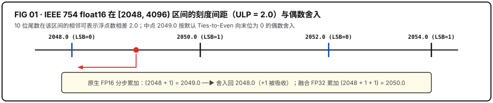
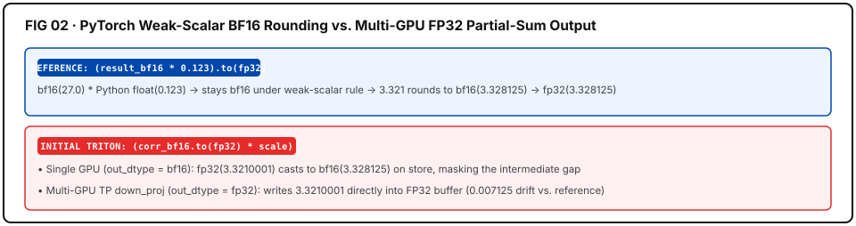

<div class="zine-dispatch" data-title-zh="融合 Triton 内核与 PyTorch 原生算子的两次舍入差异：FP16 吸收效应与弱类型标量" data-title-en="Two Rounding Traps in Fused Triton Kernels: FP16 Absorption and Weakly Typed Scalars" data-desc-zh="正态随机测试通过的融合内核，在 FP16 [2048, 0] 输入下算出 1 而原生 PyTorch 算出 0，在多卡张量并行 down_proj 的 FP32 部分和路径上又因缩放因子 0.123 出现尾数偏差。结合 IEEE 754 尾数间距与 PyTorch 弱类型标量规则还原两处差异，并讨论如何构造最小数值与步长测试用例（pLLM 底层排障手记 · 支持 EN / 中文 一键切换）" data-desc-en="Fusing a chain of eager PyTorch ops into one Triton kernel can change outputs on boundary inputs even when the algebra is identical—the culprit is whether intermediate values stay in... (pLLM Debugging Postmortem · Bilingual EN / 中文)">
  <a class="zine-pill-link" data-i18n-zh="pLLM 项目主页与文档 →" data-i18n-en="pLLM Project &amp; Docs →" href="/pllm/">pLLM 项目主页与文档 →</a>
  <a class="zine-pill-link" data-i18n-zh="全部博客分类索引 →" data-i18n-en="Blog Categories →" href="/blog/">Blog Categories →</a>
</div>

<div class="zine-lang-panel" data-lang-panel="zh" lang="zh-CN" markdown="1">

<div class="zine-tldr" markdown="1">

**TL;DR：** 把多步 PyTorch 算子融合成单个 Triton 内核时，即使代数公式一致，寄存器内保留 `float32` 还是中途截断回半精度，也会在边界输入上产生不同的输出。本文记录动态切层算子校验中遇到的两处数值差异：一处是 `FP16` 输入 `[2048, 0]` 下的大数吸收效应，导致融合仿射内核输出 `1` 而原生算子输出 `0`；另一处是多卡张量并行 `down_proj` 输出 `FP32` 部分和时，Python `float` 标量乘法的弱类型规则引起缩放尾数偏差。最后讨论如何用小尺寸数值探针与步长哨兵列补充常规随机测试。

</div>

> **pLLM 编译与底层排障手记（3/4 · 浮点算术与张量并行）** · [pLLM 项目主页与文档](/pllm/) · [专栏与排障索引](/pllm/#blog) · [GitHub 原文 ↗](https://github.com/LinesHogan/pLLM/blob/main/blog/personal/03-fp16-bf16-rounding-traps-in-fused-kernels.md)

编写融合 GPU 内核时，常见的做法是把参考实现里的矩阵乘加搬进 Triton，中间累加统一用 `tl.float32`，最后写回显存时再转成目标半精度类型，随后用 `torch.randn` 生成几组正态分布张量跑 `assert_close` 验证。

在为低秩仿射激活干预（LoReFT，$$\Delta h = R(Wh + b - R^\top h)$$）和张量并行 LoRA 编写早退内核时，常规随机测试都顺利通过了；但在做针对静态参考路径的边界对账时，两组二维极简输入暴露出了两边的舍入差异。

第一组输入在 `float16` 下运行：隐藏状态 $$h = [2048, 0]$$，投影矩阵 $$W = [1, 1]$$，正交基 $$R^\top = [1, 1]$$，偏置 $$b = 1$$。  
按实数运算，$$Wh = 2048$$，$$R^\top h = 2048$$，中间项 $$2048 + 1 - 2048 = 1$$，加回 $$h$$ 后第 1 维为 `1`。初版 Triton 内核算出的结果是 `[2049, 1]`，而原有的 PyTorch 实现 `(h @ W.T + b - h @ R) @ R.T` 算出的第 1 维则是 `0`。

第二组输入出现在多卡张量并行（`TP > 1`）的 `down_proj` 路径上：`bfloat16` 投影修正量为 `27.0`，缩放系数 `scale = 0.123`，目标输出缓冲区 `output` 为 `float32`（跨卡待规约的部分和）。原生 PyTorch 路径累加进去的值是 `3.328125`，而初版 Triton 内核写进去的值是 `3.3210001`。

---

先看第一处差异：为什么 `2048 + 1 - 2048` 在 `float16` 的分步 PyTorch 计算里等于 `0`？

IEEE 754 `float16` 包含 1 位符号、5 位指数和 10 位显式尾数（外加 1 位隐含前导 `1`）。在 $$[2048, 4096)$$（即 $$[2^{11}, 2^{12})$$）区间内，指数固定为 $$2^{11}$$，10 位尾数将长度为 $$2048$$ 的区间均分为 $$2^{10} = 1024$$ 份，相邻两个可表示浮点数之间的间距（ULP，Unit in the Last Place）正好是 `2.0`：

{: style="display: block; max-width: 100%; height: auto; margin: 1.5rem auto;" }

在未融合的 PyTorch 参考实现里，`h @ W.T + b - h @ R` 分成四次独立的 ATen 算子调用，每次调用结束后结果都存回 `float16` 张量：

1. `wh = h @ W.T` 得到 `float16(2048.0)`；
2. `wh_b = wh + b` 计算 `float16(2048.0 + 1.0)`，受限于 `ULP = 2.0` 与偶舍入规则，`1.0` 被吸收，结果仍为 `float16(2048.0)`；
3. `hr = h @ R` 得到 `float16(2048.0)`；
4. `wh_b - hr` 得到 `2048.0 - 2048.0 = 0.0`。

而初版 Triton 融合内核把 `acc_w`、`acc_r` 和 `b` 都保留在 23 位尾数的 `tl.float32` 寄存器里（在 `2048` 处 `float32` 的 ULP 约为 `0.000244`），`2048.0 + 1.0` 精确得到 `2049.0`，再减去 `2048.0` 后保留了 `1.0`。

从纯实数逼近看，`float32` 中间结果的误差更小；但在推理框架里，静态 `ActivationPatch(layers=(10,))` 与动态 `LayerRoute.patch(over=(2, 10, 18))` 属于同一算子的静态与动态两个入口。如果两边在相同层号和相同权重下采用不同的舍入点，在 `temperature=0` 贪婪解码或 `top-p` 边界附近，单步 1 个 ULP 的差异经过多步自回归累积就可能生成不同的词序列，不利于用户对齐实验结果。

要在融合内核里与静态参考实现对齐，并不需要拆回多个算子读写显存，只需在寄存器内补上对应的类型转换：

```python
# 在寄存器内按参考算子的分步类型做中间截断，不增加 HBM 读写：
wh = acc_w.to(elem_ty).to(tl.float32)
wh_b = (wh + b).to(elem_ty).to(tl.float32)
hr = acc_r.to(elem_ty).to(tl.float32)
coeff = (wh_b - hr).to(elem_ty).to(tl.float32)
```

---

再看第二处差异：`27.0 * 0.123` 为什么在多卡 `down_proj` 上会出现 `3.328125` 与 `3.3210001` 的区别？

在单卡（`TP = 1`）运行时，隐藏态 `hidden` 和线性层输出缓冲 `output` 都是 `bfloat16`。而在多卡张量并行（`TP > 1`）下，`down_proj` 是按输入维切分的 `RowParallelLinear`，各卡算完局部部分和后要做一次跨卡 `All-Reduce`。为了减少规约前的重复半精度舍入，钩子在多卡路径上让 `output` 保持为 `float32`，等加上本卡的 LoRA 增量并完成 `All-Reduce` 后再转回 `bfloat16`。

因此进入 LoRA 累加时，未缩放的投影结果 `result`（值为 `27.0`）是 `bfloat16`，`self.scale`（值为 `0.123`）是 Python 原生 `float`，目标 `output` 是 `float32`。静态参考路径的写法如下：

```python
output[:, offset : offset + width].add_((result * self.scale).to(output.dtype))
```

容易产生误解的地方在于 `result * self.scale` 的返回类型。按照 PyTorch 的类型提升规则（Type Promotion），Python 的原生 `float` / `int` 标量属于弱类型；当它与浮点 `Tensor`（包括 `float16` 和 `bfloat16`）相乘时，运算结果会保持该 `Tensor` 原有的低精度类型，而不会提升为 `float32`：

{: style="display: block; max-width: 100%; height: auto; margin: 1.5rem auto;" }

在单卡测试里，因为最终输出也是 `bfloat16`，写回前的类型转换顺带完成了截断，掩盖了中间少做的一次舍入；切到 `output` 为 `float32` 的多卡部分和路径后，差异才显现出来。在内核里补上向 `hidden_ptr.dtype` 的中间截断后，单卡与多卡行为便一致了：

```python
corr = acc.to(hidden_ptr.dtype.element_ty)
# 对齐 PyTorch (bf16_tensor * python_float) 的同类型截断，再转为输出缓冲区类型：
scaled = (corr.to(tl.float32) * scale).to(hidden_ptr.dtype.element_ty)
delta = scaled.to(out_ptr.dtype.element_ty)
```

同一轮检查中，我们还顺手补上了输出列步长 `out_stride1`：原先写回地址按 `row * out_stride0 + out_offset + cols` 计算，隐含假定了最后一维连续（`out_stride1 == 1`）；显式传入 `out_stride1` 改为 `row * out_stride0 + (out_offset + cols) * out_stride1` 后，遇到隔列切片视图（如 `output[:, ::2]`）也能写到正确位置。

---

从这两次排障中可以总结两条写算子单测的具体做法：

一是除了常规的 `torch.randn` 随机张量测试外，单独构造两三组极简的边界输入——比如横跨半精度 ULP 吸收阈值的 `[2048.0, 0.0] + 1.0`，以及非二进分数缩放因子（如 `0.123`）配合 `float32` 输出缓冲区，并用 `rtol=0, atol=0` 对照参考算子。这类用例只有几个元素，但能比大尺寸零均值随机张量更早测出中间舍入不一致。

二是验证切片视图写回时，在目标视图之外的相邻列预先填上固定哨兵值（如 `out[:, 1::2] = -99.0`，将 `out[:, ::2]` 传入内核），运行结束后同时检查目标列的计算结果与未选中列是否仍为 `-99.0`，可以直观排查步长计算错误。此外，若在真实模型上对比两条路径的贪婪解码输出，需要让两边处于相同的批次大小（匹配同一个 CUDA Graph 分档与 cuBLAS 矩阵分块策略），以免基座线性层的分块归约差异干扰对比。

相关内核实现在 **[pLLM](https://github.com/LinesHogan/pLLM)** 中已通过实卡校验。补充说明一点：在寄存器内插入半精度截断，是为了与框架内既有的非融合参考算子保持严格的数值一致；如果没有历史算子对齐约束、单纯追求更低的舍入噪声，保留全程 `float32` 中间累加也是合理的设计选择，关键是明确知晓每一处类型转换的语义。

</div>

<div class="zine-lang-panel is-hidden" data-lang-panel="en" lang="en" markdown="1">

<div class="zine-tldr" markdown="1">

**TL;DR:** Fusing a chain of eager PyTorch ops into one Triton kernel can change outputs on boundary inputs even when the algebra is identical—the culprit is whether intermediate values stay in `float32` registers or round back to half precision along the way. This note documents two numerical divergences caught while validating dynamic layer-routing kernels: an `FP16` absorption case at `[2048, 0]` where a fused affine kernel produced `1` while eager PyTorch produced `0`, and a multi-GPU tensor-parallel `down_proj` case where PyTorch's weak-scalar type promotion rounded a `bfloat16` product before casting to an `FP32` partial-sum buffer. We close with two lightweight test probes—tiny exact-boundary tensors and stride-sentinel columns—that catch rounding and indexing drift far earlier than `torch.randn`.

</div>

> **pLLM Debugging Postmortems (3/4 · IEEE 754 & Tensor Parallelism)** · [pLLM Project & Docs](/pllm/) · [Series & Postmortems Index](/pllm/#blog) · [GitHub Source ↗](https://github.com/LinesHogan/pLLM/blob/main/blog/personal/en/03-fp16-bf16-rounding-traps-in-fused-kernels.md)

The standard playbook for writing a fused GPU kernel is straightforward: move the reference multiply-add sequence into Triton, accumulate intermediates in `tl.float32`, cast back to the target half-precision dtype on the final store, and validate with `assert_close` over a handful of `torch.randn` tensors.

While building early-exit kernels for low-rank affine activation intervention (LoReFT, $$\Delta h = R(Wh + b - R^\top h)$$) and tensor-parallel LoRA, our standard Gaussian random tests all passed cleanly. Only when we began edge-case parity checks against the static reference path did two tiny two-element inputs expose rounding divergences between the two implementations.

The first input ran in `float16`: hidden state $$h = [2048, 0]$$, projection $$W = [1, 1]$$, orthonormal basis $$R^\top = [1, 1]$$, and bias $$b = 1$$. Over the reals, $$Wh = 2048$$ and $$R^\top h = 2048$$, so the inner term $$2048 + 1 - 2048 = 1$$; adding that update back to $$h$$ leaves index 1 equal to `1`. Our first Triton kernel returned `[2049, 1]`, whereas the eager PyTorch implementation `(h @ W.T + b - h @ R) @ R.T` returned `0` at index 1.

The second input showed up on the multi-GPU tensor-parallel (`TP > 1`) `down_proj` path: a `bfloat16` projection delta of `27.0`, a scaling factor `scale = 0.123`, and a `float32` output buffer holding partial sums awaiting cross-rank reduction. The eager PyTorch path accumulated `3.328125`; our initial Triton kernel wrote `3.3210001`.

---

Start with the first divergence: why does `2048 + 1 - 2048` evaluate to `0` in step-by-step `float16` PyTorch?

IEEE 754 `float16` allocates 1 sign bit, 5 exponent bits, and 10 explicit mantissa bits (plus 1 implicit leading `1`). On the interval $$[2048, 4096)$$—that is, $$[2^{11}, 2^{12})$$—the exponent is fixed at $$2^{11}$$, and those 10 mantissa bits divide a span of length $$2048$$ into $$2^{10} = 1024$$ equal steps. The spacing between adjacent representable floats (one ULP, or Unit in the Last Place) is exactly `2.0`:

{: style="display: block; max-width: 100%; height: auto; margin: 1.5rem auto;" }

In the unfused PyTorch reference, `h @ W.T + b - h @ R` runs as four separate ATen kernels, materializing a `float16` tensor after every op:

1. `wh = h @ W.T` yields `float16(2048.0)`;
2. `wh_b = wh + b` computes `float16(2048.0 + 1.0)`. With `ULP = 2.0`, `2049.0` sits halfway between `2048.0` and `2050.0`; under round-to-nearest-even (ties-to-even), `1.0` is absorbed and the result stays `float16(2048.0)`;
3. `hr = h @ R` yields `float16(2048.0)`;
4. `wh_b - hr` evaluates `2048.0 - 2048.0 = 0.0`.

Our first fused Triton kernel kept `acc_w`, `acc_r`, and `b` inside 23-bit-mantissa `tl.float32` registers (where the ULP at `2048` is roughly `0.000244`). In `float32`, `2048.0 + 1.0` equals `2049.0` exactly, and subtracting `2048.0` preserves the `1.0`.

Strictly as a real-number approximation, keeping `float32` intermediates carries smaller rounding error. Inside an inference engine, however, static `ActivationPatch(layers=(10,))` and dynamic `LayerRoute.patch(over=(2, 10, 18))` are the static and dynamic entry points to the same operator. If the two paths round at different points under identical layers and weights, a 1-ULP shift near a greedy (`temperature=0`) tie or a `top-p` boundary can compound across autoregressive steps into a different token sequence, making experimental parity harder to verify.

Matching the static reference inside the fused kernel requires zero extra HBM traffic; you just insert the corresponding dtype casts in registers:

```python
# Match the reference op's per-step half-precision rounding in registers (zero extra HBM traffic):
wh = acc_w.to(elem_ty).to(tl.float32)
wh_b = (wh + b).to(elem_ty).to(tl.float32)
hr = acc_r.to(elem_ty).to(tl.float32)
coeff = (wh_b - hr).to(elem_ty).to(tl.float32)
```

---

Now for the second divergence: why did `27.0 * 0.123` produce `3.328125` on one path and `3.3210001` on the other for multi-GPU `down_proj`?

On a single GPU (`TP = 1`), both the hidden state `hidden` and the linear output buffer `output` live in `bfloat16`. Under multi-GPU tensor parallelism (`TP > 1`), `down_proj` is a `RowParallelLinear` sharded along its input dimension: each rank computes a local partial sum before a cross-rank `All-Reduce`. To avoid repeated half-precision rounding prior to reduction, the hook keeps `output` in `float32`, adds each rank's LoRA delta into that buffer, runs `All-Reduce`, and casts back to `bfloat16` afterward.

When execution reaches LoRA accumulation, the unscaled projection `result` (`27.0`) is `bfloat16`, `self.scale` (`0.123`) is a native Python `float`, and the destination `output` is `float32`. The static reference computes:

```python
output[:, offset : offset + width].add_((result * self.scale).to(output.dtype))
```

The trap sits in the return dtype of `result * self.scale`. Under PyTorch's type promotion rules, native Python `float` and `int` scalars are weakly typed: multiplying a Python `float` by a floating-point `Tensor` (including `float16` and `bfloat16`) preserves the tensor's lower-precision dtype instead of promoting the product to `float32`:

{: style="display: block; max-width: 100%; height: auto; margin: 1.5rem auto;" }

The real product `3.321` falls in $$[2.0, 4.0)$$, where `bfloat16` has 7 mantissa bits (`ULP = 0.015625`) and adjacent representable values `3.3125` and `3.328125`, so `result * self.scale` rounds to `3.328125` before `.to(output.dtype)` ever runs. In single-GPU tests, the final store targeted `bfloat16` anyway, so the epilogue cast quietly performed the same truncation and hid the missing intermediate rounding. Only when we switched to the multi-GPU `float32` partial-sum buffer did `3.3210001` land straight in `output`. Adding an explicit cast back to `hidden_ptr.dtype` before converting to the output buffer dtype aligned single-GPU and multi-GPU behavior:

```python
corr = acc.to(hidden_ptr.dtype.element_ty)
# Match PyTorch's (bf16_tensor * python_float) same-dtype rounding before casting to the output buffer dtype:
scaled = (corr.to(tl.float32) * scale).to(hidden_ptr.dtype.element_ty)
delta = scaled.to(out_ptr.dtype.element_ty)
```

During the same pass, we also wired up the output column stride `out_stride1`. The original store offset `row * out_stride0 + out_offset + cols` silently assumed a contiguous last dimension (`out_stride1 == 1`). Passing `out_stride1` explicitly and computing `row * out_stride0 + (out_offset + cols) * out_stride1` lets the kernel write cleanly into strided column slices such as `output[:, ::2]`.

---

Two concrete unit-testing habits come straight out of these two sessions.

First, alongside standard `torch.randn` fuzzing, add two or three tiny hand-crafted boundary cases—a vector straddling a half-precision ULP absorption threshold like `[2048.0, 0.0] + 1.0`, and a non-dyadic scale factor like `0.123` writing into a `float32` accumulator—and check them against the reference with `rtol=0, atol=0`. Each case holds only a few elements, yet surfaces intermediate rounding drift far earlier than large zero-mean Gaussian tensors.

Second, when verifying writes into sliced views, pre-fill the untouched neighboring columns with a recognizable sentinel (for example, set `out[:, 1::2] = -99.0` and pass `out[:, ::2]` into the kernel), then assert both the computed target columns and that every untouched column still holds `-99.0`. Stride bugs show up immediately. One extra note when comparing greedy-decode outputs on a real model: run both paths at the exact same batch size so they hit the same CUDA Graph bucket and cuBLAS GEMM tiling; otherwise tiling-reduction differences in the base linear layers will muddy the comparison.

Both kernels are verified on real GPUs in **[pLLM](https://github.com/LinesHogan/pLLM)**. One caveat worth stating plainly: inserting half-precision truncation inside registers is done here to maintain strict parity with an existing unfused reference operator in the same framework. If you have no legacy reference to match and simply want lower rounding noise, keeping `float32` intermediates from start to finish is an entirely sound design choice—what matters is knowing the exact semantics of every cast.

</div>

<script defer src="/assets/js/bilingual-post.js"></script>
