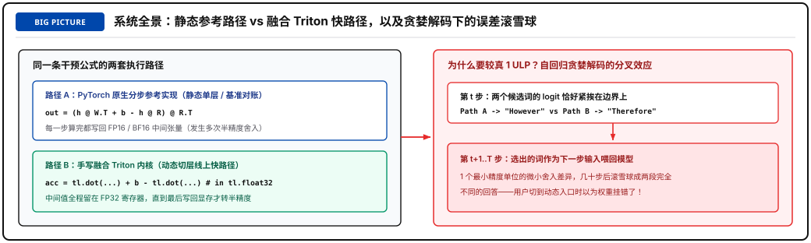
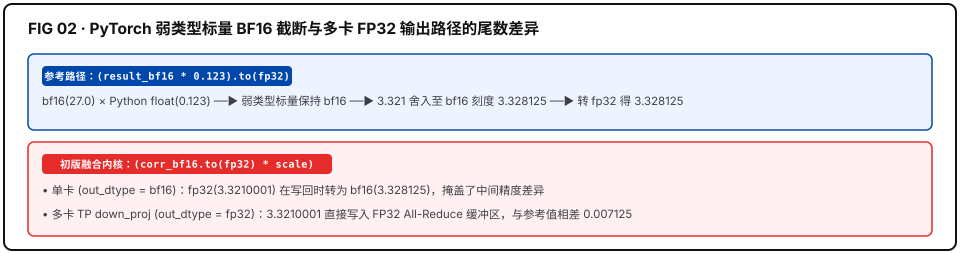
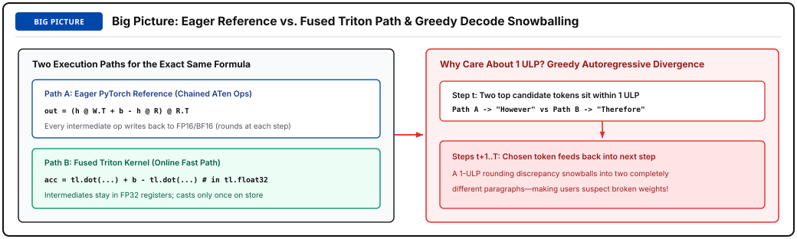
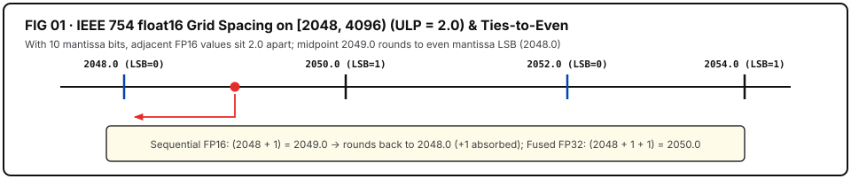

<div class="zine-dispatch" data-title-zh="融合 Triton 内核与 PyTorch 原生算子的两次舍入差异：FP16 吸收效应与弱类型标量" data-title-en="Two Rounding Divergences Between Fused Triton Kernels and Eager PyTorch: FP16 Absorption and Weak-Scalar Promotion" data-desc-zh="从自回归贪婪解码下 1 ULP 误差滚雪球讲起，还原两次 torch.randn 随机单测未能发现的数值分叉：float16 在 2048 处因 ULP = 2.0 把 + 1 吞成 0，以及多卡张量并行 float32 部分和遇上 Python 原生 float 弱类型标量导致的缩放尾数偏差（工程与排障笔记 · 支持 EN / 中文 一键切换）" data-desc-en="Why 1-ULP rounding differences snowball under greedy decoding, and how two minimal inputs ([2048, 0] in float16 and 27.0 * 0.123 on TP &gt; 1 float32 partial sums) exposed IEEE 754 ULP absorption and PyTorch's weakly-typed Python float promotion. (Engineering &amp; Debugging Notes · Bilingual EN / 中文)">
  <a class="zine-pill-link" data-i18n-zh="pLLM 项目主页与文档 →" data-i18n-en="pLLM Project &amp; Docs →" href="/pllm/">pLLM 项目主页与文档 →</a>
  <a class="zine-pill-link" data-i18n-zh="全部博客分类索引 →" data-i18n-en="Blog Categories →" href="/blog/">Blog Categories →</a>
</div>

<div class="zine-lang-panel" data-lang-panel="zh" lang="zh-CN" markdown="1">

<div class="zine-tldr" markdown="1">

**TL;DR：** 在推理引擎里把多步 PyTorch 原生算子改写成单个融合 Triton 内核时，哪怕两边的数学公式一字不差，“中间值留在 `float32` 寄存器里”与“每一步落回半精度张量”也会在特定输入上算出不同结果。本文从自回归贪婪解码的误差放大效应讲起，复盘两次真实对账排障：一次是 `float16` 输入 `[2048, 0]` 撞上 IEEE 754 的刻度间距（`ULP = 2.0`），导致 `+ 1` 在分步 PyTorch 中被吞成 `0`；另一次是多卡张量并行（`TP > 1`）的 `float32` 部分和缓冲遇上 Python 原生 `float` 标量的“弱类型”规则，使缩放系数 `0.123` 产生尾数分叉。最后总结如何用两三行极简边界探针与切片哨兵补齐 `torch.randn` 随机测试的盲区。

</div>

> **工程与排障笔记（#3 · 浮点算术与张量并行）** · [pLLM 项目主页与文档](/pllm/) · [全站博客分类目录](/blog/) · [GitHub 原文 ↗](https://github.com/LinesHogan/pLLM/blob/main/blog/personal/03-fp16-bf16-rounding-traps-in-fused-kernels.md)

在给大模型推理框架写高性能扩展算子时，工程上通常会同时维护两套代码路径：

- **一套是 PyTorch 原生算子拼出来的参考路径**（比如给单个固定层挂静态干预或离线验证时用），代码只有三五行，逻辑一目了然；
- **另一套是手写的融合 Triton 内核**（线上动态切层、高并发解码时用），把好几次矩阵乘加融进同一个 GPU 内核里，省掉中间结果反复读写显存（HBM）的带宽开销。

按理说，两边实现的是完全同一条线性代数公式，平时跑 `torch.randn` 生成的正态随机张量单测，`torch.testing.assert_close` 也次次全绿通过——那还有必要深究最后一位小数（1 ULP，最小精度单位）的细微舍入差别吗？

在图像分类模型里或许不用，但在**大语言模型的自回归贪婪解码（`temperature = 0`）**里，1 个 ULP 的差别足以让整段回答面目全非：

{: style="display: block; max-width: 100%; height: auto; margin: 1.5rem auto;" }

只要在第 $$t$$ 步恰逢两个候选词的得分咬得很紧，两边差出 `0.0005` 就会选出两个不同的词（比如一边吐出 `"However"`，另一边吐出 `"Therefore"`）；而自回归生成会把第 $$t$$ 步选出的词作为第 $$t+1$$ 步的输入再喂回模型，滚雪球二三十步之后，同一个模型、同一份权重在静态入口和动态入口下会吐出两段毫不相干的话——用户第一反应一定是：“你们的动态内核是不是把权重挂错了？”

为了守住“同一套权重走哪条入口结果都一致”的底线，我们专门拿极端边界数据给两套路径做了一次逐位对账，结果当场撞出了两处颇具反直觉的浮点差异。

---

### 第一处差异：为什么在 `float16` 下，`2048 + 1 - 2048` 算出来等于 `0`？

第一个出问题的算子是低秩仿射激活干预（LoReFT），它的数学公式很简单：给定隐藏状态 $$h$$、投影矩阵 $$W$$、正交基 $$R$$ 和偏置 $$b$$，在隐藏态上叠加一项低秩修正：

$$\Delta h = (h W^\top + b - h R) R^\top$$

先看当时我们写的两套代码。PyTorch 参考路径直接照着公式一行写完，而初版融合 Triton 内核则遵循了写 GPU 内核的标准教科书习惯——**把半精度数据读进 `tl.float32` 寄存器做乘加，直到最后写回显存时再转回 `float16`**：

```python
# 路径 A：PyTorch 原生分步参考实现（h, W, R, b 均为 float16）
def eager_loreft(h: Tensor, W: Tensor, R: Tensor, b: Tensor) -> Tensor:
    coeff = h @ W.T + b - h @ R   # 分成四次独立 ATen 算子调用，每步结果都是 float16
    return h + coeff @ R.T

# 路径 B：初版融合 Triton 内核（核心计算节选）
@triton.jit
def fused_loreft_v0(...):
    # 在 float32 寄存器里累加 Wh 和 R^T h，最后再转回 float16 写回
    acc_w = tl.dot(h_tile, w_tile)          # tl.float32
    acc_r = tl.dot(h_tile, r_tile)          # tl.float32
    coeff = acc_w + b_fp32 - acc_r          # 全程留在 tl.float32！
    ...
```

拿 `torch.randn(32, 4096, dtype=torch.float16)` 测一百遍，两边结果都高度吻合。直到我们喂进去下面这组只有 2 个元素的极简测试输入：

```python
h = torch.tensor([[2048.0, 0.0]], dtype=torch.float16, device="cuda")
W = torch.tensor([[1.0, 1.0]], dtype=torch.float16, device="cuda")
R = torch.tensor([[1.0], [1.0]], dtype=torch.float16, device="cuda")
b = torch.tensor([1.0], dtype=torch.float16, device="cuda")
```

口算一下实数正确答案：$$h W^\top = 2048$$，$$h R = 2048$$，括号里的系数是 $$2048 + 1 - 2048 = 1$$，乘上 $$R^\top = [1, 1]$$ 再加回 $$h = [2048, 0]$$，输出理应是 **`[2049, 1]`**。

跑出来一看：

- 初版融合 Triton 内核输出：**`[2048., 1.]`**（第 0 维落回 `float16` 时舍入为 `2048`，第 1 维是 `1`）；
- 原生 PyTorch 参考路径输出：**`[2048., 0.]`**——第 1 维的 `1` 凭空消失了！

明明加了一个 `1.0`，怎么算完减法就变成 `0.0` 了？这里要补一个算法同学平时容易忽略的硬件常识：**浮点数的刻度尺不是均匀的，数值越大，相邻两个刻度之间的缝隙就越宽。**

IEEE 754 标准下的 `float16` 只有 16 个比特：1 位符号、5 位指数、10 位尾数。每当数值跨过一个 $$2$$ 的整数次幂，10 位尾数就要负责把这一整段区间均分成 $$2^{10} = 1024$$ 格：

- 在 $$[1, 2)$$ 区间，跨度是 $$1$$，最小刻度间距（1 ULP）是 $$1 / 1024 \approx 0.000977$$，精度足够细；
- 可一旦数值来到 **$$[2048, 4096)$$（即 $$[2^{11}, 2^{12})$$）区间**，跨度变成了 $$2048$$，均分 $$1024$$ 格之后，**相邻两个 `float16` 可表示数字之间的最小刻度间距正好变成了 `2.0`！**

{: style="display: block; max-width: 100%; height: auto; margin: 1.5rem auto;" }

这就好比你拿一台“超过 2048 克之后最小刻度就变成 2 克”的厨房秤去称东西：`float16` 的世界里只有 `2048.0`、`2050.0`、`2052.0`，**压根不存在 `2049.0` 这个数**。

回看 PyTorch 原生分步路径的那四步执行过程，谜底一目了然：

1. `wh = h @ W.T` 算完写回显存，得到 `float16(2048.0)`；
2. `wh_b = wh + b` 计算 `2048.0 + 1.0 = 2049.0`。因为结果必须存回 `float16` 张量，而 `2049.0` 卡在 `2048.0` 和 `2050.0` 正中间，触发 IEEE 754 默认的“向偶数舍入（Round to Nearest Even）”规则，尾数最低位为 0 的 `2048.0` 胜出——**加上的 `1.0` 当场被大数吞没，结果还是 `2048.0`**；
3. `hr = h @ R` 得到 `float16(2048.0)`；
4. `wh_b - hr` 变成 `2048.0 - 2048.0 = 0.0`。

而初版 Triton 内核之所以算出了 `1.0`，是因为 `tl.float32` 拥有 23 位尾数（在 `2048` 附近最小刻度只有 `0.000244`），`2048.0 + 1.0` 在寄存器里精确算出了 `2049.0`，减去 `2048.0` 自然留下了 `1.0`。

想要让融合内核与既有 PyTorch 参考路径逐位对齐，**完全不需要把融合内核拆碎写回显存**——只需要在片上寄存器里，照着参考算子落地半精度的位置做几次轻量的寄存器类型转换即可：

```python
# 修复后：在寄存器内复现分步半精度舍入点，0 字节额外 HBM 读写开销
wh = acc_w.to(elem_ty).to(tl.float32)
wh_b = (wh + b).to(elem_ty).to(tl.float32)
hr = acc_r.to(elem_ty).to(tl.float32)
coeff = (wh_b - hr).to(elem_ty).to(tl.float32)
```

---

### 第二处差异：为什么 `27.0 * 0.123` 在单卡上一致，一上多卡张量并行就分叉？

刚修完 `float16` 吸收问题，我们在测试多卡张量并行（Tensor Parallelism，`TP > 1`）下的低秩 LoRA 内核时，又抓到了另一处只在多卡模式下才会现身的尾数偏差。

先交代一下多卡 `TP > 1` 背后是怎么跑的。在 Transformer 的 MLP 层里，第二个线性层 `down_proj` 通常采用按输入维度切分的**行并行线性层（`RowParallelLinear`）**：每张 GPU 各拿一半隐藏维度算出一个局部的“部分和（Partial Sum）”，最后通过一次跨卡 `All-Reduce` 把所有卡的部分和加起来。

- **在单卡（`TP = 1`）模式下**：不需要跨卡求和，线性层的输出缓冲区 `output` 直接就是 `bfloat16`；
- **在多卡（`TP > 1`）模式下**：为了避免每张卡在跨卡相加之前先各自做一次粗糙的 `bfloat16` 舍入，框架特意让 `output` 缓冲区保持为 **`float32`**，等本卡的主干部分和与 LoRA 增量都在 `float32` 下加完、做完跨卡 `All-Reduce` 之后，再统一转回 `bfloat16`。

当时静态参考路径往 `output` 上叠加 LoRA 增量的代码只有一行（其中未缩放的 LoRA 投影结果 `result` 是 `bfloat16`，缩放系数 `self.scale = lora_alpha / rank` 是一个普通的 Python `float` 浮点数，比如 `0.123`）：

```python
# 静态 PyTorch 参考实现：
# result: bfloat16 Tensor (例如 27.0)
# self.scale: Python float (例如 0.123)
# output: 单卡时为 bfloat16，多卡 TP > 1 时为 float32！
output[:, offset : offset + width].add_((result * self.scale).to(output.dtype))
```

而在初版 Triton 内核里，我们是这么写的：

```python
# 初版 Triton 内核实现：
corr = acc.to(tl.bfloat16)                  # 对齐未缩放的 bfloat16 投影结果 27.0
scaled = corr.to(tl.float32) * scale        # 转成 float32 乘上 0.123 -> 得到 3.3210001
delta = scaled.to(out_ptr.dtype.element_ty) # 转为 output 的类型（TP>1 时保持 float32）
```

单卡测试时，两边算出来分毫不差，全是 `3.328125`。可一开多卡 `TP = 2`（`output` 变成 `float32`），传入 `result = 27.0, scale = 0.123`：

- 初版 Triton 内核写进 `output` 的值是 **`3.3210001`**；
- 原生 PyTorch 参考代码写进 `output` 的值却是 **`3.3281250`**！

乍看之下很容易懵：Python 里的原生 `float` 明明是 64 位双精度浮点数，为什么在 PyTorch 里拿 `bfloat16(27.0)` 乘上一个 64 位的 `0.123`，算出来的精度反倒这么粗糙？

这就要提到 PyTorch 类型系统里一条很容易踩坑的规则——**Python 标量的“弱类型（Weakly Typed）”提升机制**。

在早期版本的科学计算库里，只要你写一句 `half_tensor * 0.5`，库看到 `0.5` 是 Python `float`，就会把整张半精度大张量默默升格成 `float32` 甚至 `float64`，导致显存瞬间翻倍。为了防止这种意外升格，PyTorch 规定：**普通的 Python `float` / `int` 字面量没有资格抬高 `Tensor` 的浮点精度**——当你执行 `bfloat16_tensor * 0.123` 时，结果不会变成 `float32`，而是当场截断回 **`bfloat16`**！

{: style="display: block; max-width: 100%; height: auto; margin: 1.5rem auto;" }

把这个规则代回那行参考代码 `(result * self.scale).to(output.dtype)`：

1. `result * 0.123` 因为 `0.123` 是弱类型 Python `float`，乘法刚算完就已经被截断成了 `bfloat16`（`3.321` 落在 `bfloat16` 网格上最近的数是 `3.328125`）；
2. 后面的 `.to(torch.float32)` 只是在一个已经丢失了尾数的 `3.328125` 后面补了一串二进制零；
3. 单卡测试之所以没暴露，是因为单卡的 `output` 也是 `bfloat16`，Triton 算出的精确值 `3.3210001` 在最后写回 `output` 时刚好也被截断成了 `3.328125`，歪打正着掩盖了中间少做的一次舍入！

定位清楚后，在 Triton 寄存器里补上与 `result * self.scale` 同类型的截断，单卡与多卡便彻底统一了：

```python
corr = acc.to(hidden_ptr.dtype.element_ty)
# 先对齐 PyTorch (bf16_tensor * python_float) 的同类型截断，再转为输出缓冲区类型：
scaled = (corr.to(tl.float32) * scale).to(hidden_ptr.dtype.element_ty)
delta = scaled.to(out_ptr.dtype.element_ty)
```

顺着这轮逐行检查，我们还顺手揪出了内核写回地址里的一个隐含假设：初版写回指针算的是 `row * out_stride0 + out_offset + cols`，默认了输出张量最后一维在内存里一定紧挨着连续（`stride(-1) == 1`）。如果外层传进来的是一个隔列切片视图（比如 `output[:, ::2]`），数据就会全部写串列。把列步长 `out_stride1` 显式传进内核，改成 `row * out_stride0 + (out_offset + cols) * out_stride1` 后，非连续切片视图也一并安全了。

---

### 给手写 GPU 内核留下的三条低成本防坑手段

为什么这两处 bug 能轻松绕过上百组 `torch.randn` 随机单测？因为标准正态分布采样出来的数大多集中在 `[-3, 3]` 之间，均值又接近零，既碰不到 `2048` 附近 `ULP = 2.0` 的大数吸收区，也很容易被宽松的默认容差（如 `atol=1e-2`）放过去。

从这两次排障里，我们提炼出三条写自定义内核单测时直接好用的固定动作：

1. **在 `torch.randn` 之外，固定配两组只有 2～4 个元素的“显微镜探针”**：一组专门测跨数量级加减（如 `float16` 下的 `[2048.0, 0.0] + 1.0 - 2048.0`），另一组专门测非二进分数缩放（如 `0.123` 配合 `float32` 输出缓冲），并用 `rtol=0, atol=0` 对照参考实现；
2. **测非连续视图写回时，在隔壁列埋“哨兵值”**：分配一张两倍宽的缓冲区，先把奇数列填成刺眼的 `-99.0`（`buf[:, 1::2] = -99.0`），再把偶数列视图 `buf[:, ::2]` 传进内核；跑完同时断言偶数列算对了、且奇数列依然雷打不动全是 `-99.0`，任何漏乘 `stride` 的指针越界都会立刻现形；
3. **端到端对比贪婪解码时锁死批次档位**：如果在整张 7B 模型上对比两条路径的生成文本，务必让两边处在完全相同的批次大小下（命中同一个 CUDA Graph 档位与相同的 cuBLAS 矩阵分块策略），否则基座线性层自身的并行归约顺序变化就会喧宾夺主。

上述内核均已在开源框架 **[pLLM](https://github.com/LinesHogan/pLLM)** 中上线并实卡验证。最后多补一句客观取舍：我们在寄存器里主动加上 `.to(fp16)` 截断，是因为框架内需要保证“静态参考入口”和“动态融合入口”严格产出同一串词；如果你的系统没有对齐旧版非融合算子的历史包袱，单纯追求更低的数值舍入噪声，那么全程保留 `tl.float32` 反而是数学上更准的做法——真正重要的不是教条地选哪一种，而是清楚每一行类型转换到底发生在哪个精度网格上。

</div>

<div class="zine-lang-panel is-hidden" data-lang-panel="en" lang="en" markdown="1">

<div class="zine-tldr" markdown="1">

**TL;DR:** When fusing a chain of PyTorch operators into a single Triton kernel, keeping intermediates in `float32` registers versus rounding back to half precision after each sub-expression can produce different outputs even when the algebraic formula is identical. Starting from why a 1-ULP difference snowballs under `temperature=0` greedy decoding, this note walks through two real numerical mismatches: an IEEE 754 `float16` tick-spacing trap on `[2048, 0]` (`ULP = 2.0`) where `+ 1` is absorbed into `0` in stepwise PyTorch, and a multi-GPU tensor-parallel (`TP > 1`) `float32` partial-sum divergence caused by PyTorch's weakly-typed Python `float` promotion on `27.0 * 0.123`. We close with three tiny deterministic test probes that catch rounding and stride bugs missed by `torch.randn`.

</div>

> **Engineering & Debugging Notes (#3 · IEEE 754 & Tensor Parallelism)** · [pLLM Project & Docs](/pllm/) · [All Blog Categories](/blog/) · [GitHub Source ↗](https://github.com/LinesHogan/pLLM/blob/main/blog/personal/en/03-fp16-bf16-rounding-traps-in-fused-kernels.md)

When building custom operators inside an LLM inference engine, you frequently end up maintaining two implementations of the same math:

- **An eager PyTorch reference path** (used for static single-layer hooks, prototyping, and ground-truth checks), written in three or four readable lines of ATen matrix ops;
- **A handwritten fused Triton kernel** (used on the online serving fast path), which fuses multiple projections and elementwise ops inside registers to avoid streaming intermediate tensors to and from HBM.

Both paths implement the exact same linear algebra, and standard `torch.randn` unit tests pass `torch.testing.assert_close` without complaint. Why bother chasing a 1-ULP (Unit in the Last Place) rounding discrepancy in the least significant bit?

In an image classifier, you rarely care. Under **autoregressive greedy decoding (`temperature = 0`) in an LLM**, however, a single ULP can change the entire generated response:

{: style="display: block; max-width: 100%; height: auto; margin: 1.5rem auto;" }

Whenever two top candidate tokens sit within `0.0005` of each other at step $$t$$, a 1-ULP difference flips `argmax`—say from `"However"` on the reference path to `"Therefore"` on the fused path. Because autoregressive decoding feeds the chosen token right back in as step $$t+1$$'s input, twenty steps later the exact same weights produce two completely different paragraphs, leaving users convinced that your online kernel loaded the wrong checkpoint.

While auditing bit-level parity between our static PyTorch ops and our fused Triton kernels, two minimal boundary inputs exposed surprising rounding divergences.

---

### Trap 1: Why Does `2048 + 1 - 2048` Equal `0` in Stepwise `float16`?

The first mismatch appeared in a low-rank affine intervention (LoReFT), which adds a rank-$$r$$ update to hidden state $$h$$ given projection $$W$$, orthonormal basis $$R$$, and bias $$b$$:

$$\Delta h = (h W^\top + b - h R) R^\top$$

Here are the two implementations side by side. The PyTorch reference chains standard operators directly, while our initial fused Triton kernel followed standard GPU practice—**accumulating dot products in `tl.float32` registers and casting back to `float16` once at the end**:

```python
# Path A: Stepwise PyTorch reference (`h, W, R, b` are all float16)
def eager_loreft(h: Tensor, W: Tensor, R: Tensor, b: Tensor) -> Tensor:
    coeff = h @ W.T + b - h @ R   # Four separate ATen ops, each writing a float16 tensor
    return h + coeff @ R.T

# Path B: Initial fused Triton kernel (core math excerpt)
@triton.jit
def fused_loreft_v0(...):
    # Accumulate Wh and R^T h in float32 registers, casting only on final store
    acc_w = tl.dot(h_tile, w_tile)          # tl.float32
    acc_r = tl.dot(h_tile, r_tile)          # tl.float32
    coeff = acc_w + b_fp32 - acc_r          # Stays in tl.float32 throughout!
    ...
```

Across hundreds of `torch.randn(32, 4096, dtype=torch.float16)` tests, both paths agreed closely. Then we fed in a two-element toy input:

```python
h = torch.tensor([[2048.0, 0.0]], dtype=torch.float16, device="cuda")
W = torch.tensor([[1.0, 1.0]], dtype=torch.float16, device="cuda")
R = torch.tensor([[1.0], [1.0]], dtype=torch.float16, device="cuda")
b = torch.tensor([1.0], dtype=torch.float16, device="cuda")
```

In exact arithmetic, $$h W^\top = 2048$$, $$h R = 2048$$, the inner coefficient is $$2048 + 1 - 2048 = 1$$, and adding $$[1, 1]$$ back onto $$h = [2048, 0]$$ gives **`[2049, 1]`**.

Running both paths on GPU produced:

- Initial fused Triton kernel: **`[2048., 1.]`** (coordinate 0 rounds to `2048` on final `float16` store; coordinate 1 is `1`);
- Eager PyTorch reference: **`[2048., 0.]`**—the `1` in coordinate 1 vanished completely!

Where did `+ 1.0` go? Here it helps to recall a hardware detail easy to forget in daily ML work: **floating-point ticks are not evenly spaced—the larger the number, the wider the gap between representable values.**

An IEEE 754 `float16` value has 1 sign bit, 5 exponent bits, and 10 explicit mantissa bits. Between any two consecutive powers of two, those 10 mantissa bits divide the interval into $$2^{10} = 1024$$ equal steps:

- On $$[1, 2)$$, the interval width is $$1$$, so adjacent `float16` values sit $$1 / 1024 \approx 0.000977$$ apart;
- On **$$[2048, 4096)$$ ($$[2^{11}, 2^{12})$$)**, the interval width is $$2048$$, so dividing into $$1024$$ steps makes **the spacing between adjacent `float16` numbers (`1 ULP`) exactly `2.0`!**

{: style="display: block; max-width: 100%; height: auto; margin: 1.5rem auto;" }

Think of a kitchen scale whose smallest tick mark above 2,048 grams jumps to 2 grams: in `float16`, `2048.0`, `2050.0`, and `2052.0` exist, **but `2049.0` does not exist at all**.

Tracing PyTorch's four eager steps makes the disappearance obvious:

1. `wh = h @ W.T` writes `float16(2048.0)`;
2. `wh_b = wh + b` computes `2048.0 + 1.0 = 2049.0`. Forced back into `float16`, `2049.0` lands halfway between `2048.0` and `2050.0`; IEEE 754 round-to-nearest-even picks `2048.0` (whose least significant mantissa bit is `0`), **swallowing `+ 1.0` whole**;
3. `hr = h @ R` produces `float16(2048.0)`;
4. `wh_b - hr` evaluates `2048.0 - 2048.0 = 0.0`.

Our fused Triton kernel kept `acc_w + b - acc_r` in 23-bit-mantissa `tl.float32` registers (where `1 ULP` at `2048` is `0.000244`), preserving `2049.0` and returning `1.0`.

To make the fused kernel match the eager PyTorch reference bit-for-bit, **we do not need to split the kernel or touch HBM**—four in-register casts reproduce the exact intermediate rounding points at register speed:

```python
# Fixed: match stepwise half-precision rounding inside registers with 0 extra HBM traffic
wh = acc_w.to(elem_ty).to(tl.float32)
wh_b = (wh + b).to(elem_ty).to(tl.float32)
hr = acc_r.to(elem_ty).to(tl.float32)
coeff = (wh_b - hr).to(elem_ty).to(tl.float32)
```

---

### Trap 2: Why Did `27.0 * 0.123` Match on 1 GPU, Then Diverge Under Multi-GPU Tensor Parallelism?

Right after fixing `float16` absorption, multi-GPU Tensor Parallelism (`TP > 1`) tests on our low-rank LoRA kernel uncovered a second discrepancy—one that never appeared on a single GPU.

First, a quick look at what changes under the hood when `TP > 1`. In a Transformer MLP block, `down_proj` is typically a `RowParallelLinear` layer sharded along its input dimension: each GPU computes a local **partial sum**, and a cross-GPU `All-Reduce` sums those partial results together.

- **On a single GPU (`TP = 1`)**: No cross-GPU reduction is needed, so the linear layer's `output` buffer is directly `bfloat16`;
- **Across multiple GPUs (`TP > 1`)**: To avoid rounding each GPU's partial sum to `bfloat16` _before_ summing across ranks, the engine keeps `output` in **`float32`** until both the base projection and any LoRA delta have been accumulated and `All-Reduce`d, casting back to `bfloat16` only at the end.

In the eager PyTorch reference path, accumulating the scaled LoRA update into `output` was a one-liner (where `result` is an unscaled `bfloat16` projection tensor, e.g. `27.0`, and `self.scale = lora_alpha / rank` is a plain Python `float`, e.g. `0.123`):

```python
# Eager PyTorch reference:
# result: bfloat16 Tensor (e.g., 27.0)
# self.scale: Python float (e.g., 0.123)
# output: bfloat16 when TP == 1, but float32 when TP > 1!
output[:, offset : offset + width].add_((result * self.scale).to(output.dtype))
```

In our initial Triton kernel, we wrote:

```python
# Initial Triton kernel:
corr = acc.to(tl.bfloat16)                  # Match unscaled bfloat16 projection (27.0)
scaled = corr.to(tl.float32) * scale        # Multiply in float32 -> 3.3210001
delta = scaled.to(out_ptr.dtype.element_ty) # Cast to output dtype (stays float32 when TP > 1)
```

On a single GPU (`TP = 1`), both paths wrote `3.328125`. Under `TP = 2` (`output` in `float32`) with `result = 27.0` and `scale = 0.123`:

- Initial Triton kernel wrote **`3.3210001`**;
- Eager PyTorch wrote **`3.3281250`**!

At first glance that looks backwards: a Python `float` is a 64-bit IEEE double, so why did `bfloat16(27.0) * 0.123` in PyTorch lose _more_ precision than `float32`?

The answer lies in PyTorch's **weakly-typed Python scalar promotion rule**.

If multiplying `half_tensor * 0.5` promoted the entire tensor to `float32` or `float64` just because `0.5` is a Python `float`, half-precision models would silently double their memory footprint everywhere. To prevent accidental upcasting, PyTorch treats bare Python `float` and `int` scalars as **weakly typed**: when multiplied with any floating-point `Tensor` (`float16` or `bfloat16`), **the Python scalar adopts the tensor's lower precision instead of promoting it!**

{: style="display: block; max-width: 100%; height: auto; margin: 1.5rem auto;" }

Tracing `(result * self.scale).to(output.dtype)` with that rule in mind:

1. `result * 0.123` multiplies a `bfloat16` tensor by a weak Python `float`, so the product immediately rounds to `bfloat16` (`3.321` snaps to the nearest `bfloat16` grid point, `3.328125`);
2. `.to(torch.float32)` simply pads zeros onto an already-rounded `3.328125`;
3. Single-GPU tests hid the discrepancy because `output` was `bfloat16` too, so Triton's `3.3210001` got rounded to `3.328125` on final store anyway!

Adding one explicit cast to `hidden_ptr.dtype.element_ty` after scaling inside the Triton kernel aligned single-GPU and multi-GPU paths completely:

```python
corr = acc.to(hidden_ptr.dtype.element_ty)
# Match PyTorch's (bf16_tensor * python_float) same-dtype rounding before casting to output:
scaled = (corr.to(tl.float32) * scale).to(hidden_ptr.dtype.element_ty)
delta = scaled.to(out_ptr.dtype.element_ty)
```

During the same audit, we also fixed an implicit contiguous-column assumption in the store address (`row * out_stride0 + out_offset + cols`), passing `out_stride1` explicitly as `row * out_stride0 + (out_offset + cols) * out_stride1` so strided column slices like `output[:, ::2]` land in the right memory locations.

---

### Three Practical Habits for Testing Handwritten GPU Kernels

Standard `torch.randn` tests missed both bugs because unit-normal values cluster tightly in `[-3, 3]`—nowhere near `float16`'s `ULP = 2.0` absorption zone at `2048`—and loose default tolerances (`atol=1e-2`) wave away `0.007` scaling differences.

Three tiny additions to any kernel test suite catch these issues early:

1. **Pair `torch.randn` with 2-to-4-element deterministic "microscope probes"**: Test one cross-magnitude cancellation (`[2048.0, 0.0] + 1.0 - 2048.0` in `float16`) and one non-dyadic scale factor (`0.123` into a `float32` output buffer) with `rtol=0, atol=0` against the reference op;
2. **Guard non-contiguous slice stores with sentinel columns**: Allocate a 2x-wide output buffer, fill odd columns with `-99.0` (`buf[:, 1::2] = -99.0`), pass the even-column view `buf[:, ::2]` into the kernel, and assert afterward that odd columns still read `-99.0`;
3. **Lock batch bucket sizes when comparing end-to-end greedy decode**: When checking greedy token-for-token parity on a full 7B model, keep both paths at the exact same batch size so they hit the same CUDA Graph bucket and cuBLAS split-K reduction order.

These kernels run in production inside **[pLLM](https://github.com/LinesHogan/pLLM)**. One closing note on design trade-offs: we inserted in-register half-precision casts specifically because our static and dynamic entry points must produce identical greedy token streams for the same weights; if you are building a greenfield kernel with no legacy eager reference to match, keeping `tl.float32` throughout is numerically cleaner—what matters is knowing exactly where every rounding boundary sits.

</div>

<script defer src="/assets/js/bilingual-post.js"></script>
