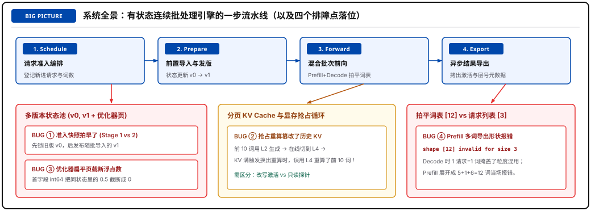
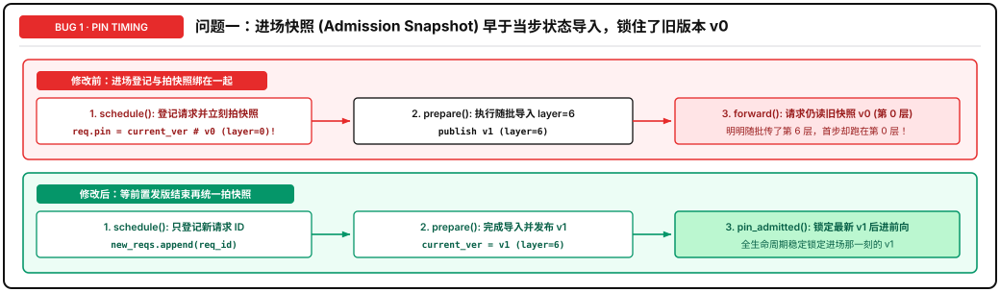
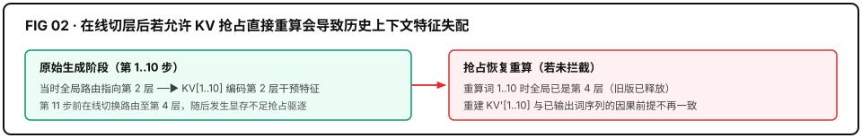
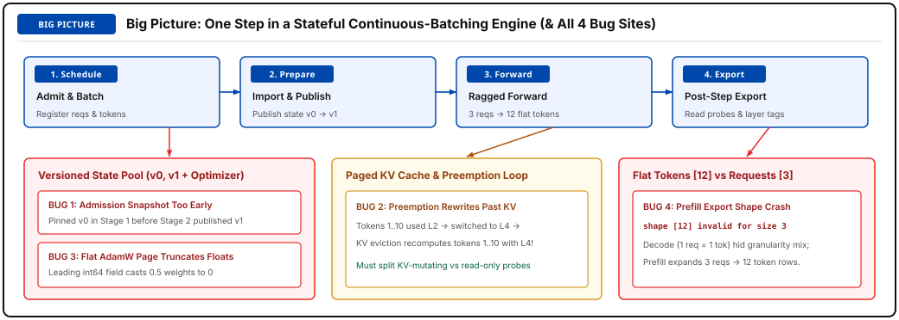
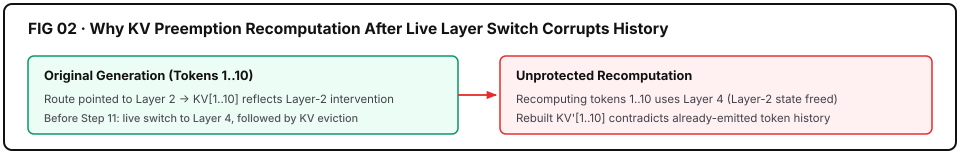
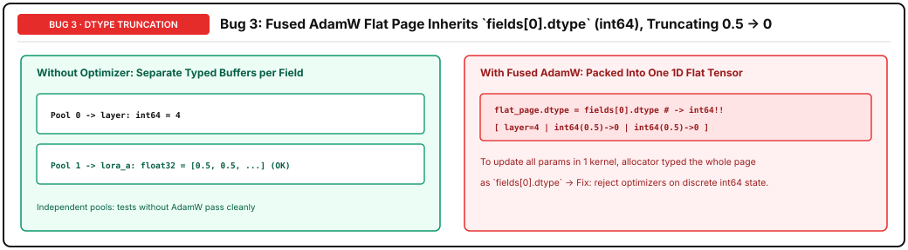

<div class="zine-dispatch" data-title-zh="连续批处理下的状态生命周期排障：准入快照时机、抢占重算边界与导出维度对齐" data-title-en="Debugging State Lifecycles Under Continuous Batching: Admission Pins, Preemption Boundaries, and Export Dimensions" data-desc-zh="先画出有状态连续批处理引擎一步的四阶段流水线全景，再逐一还原单步测试全绿、并发调度下才暴露的四个边界故障：进场快照早于随批导入锁住旧版本、在线换层后发生 KV 抢占重算篡改历史上下文、融合 AdamW 扁平页继承首字段 int64 把 0.5 截断为零、以及预填充多词展开与按请求去重混用引发形状崩溃（工程与排障笔记 · 支持 EN / 中文 一键切换）" data-desc-en="Maps one step inside a stateful continuous-batching engine across four stages, then walks through four cross-step bugs: early admission snapshots, KV preemption recomputing old tokens with new weights, int64-led AdamW pages truncating floats to 0, and ragged prefill export crashes. (Engineering &amp; Debugging Notes · Bilingual EN / 中文)">
  <a class="zine-pill-link" data-i18n-zh="pLLM 项目主页与文档 →" data-i18n-en="pLLM Project &amp; Docs →" href="/pllm/">pLLM 项目主页与文档 →</a>
  <a class="zine-pill-link" data-i18n-zh="全部博客分类索引 →" data-i18n-en="Blog Categories →" href="/blog/">Blog Categories →</a>
</div>

<div class="zine-lang-panel" data-lang-panel="zh" lang="zh-CN" markdown="1">

<div class="zine-tldr" markdown="1">

**TL;DR：** 无状态大模型推理引擎里，模型权重固定不变，KV Cache 只是历史词序列的确定性函数，因此怎么拼批、怎么换出重算都不会改变计算语义。一旦往引擎里引入运行时可变状态（如在线切换干预层号、随批导入适配器或在线更新快权重），真正容易翻车的往往不是单步 GPU 算子，而是跨步、跨请求的生命周期交界处。本文先画出有状态连续批处理引擎一步的四阶段流水线全景，再结合具体代码逐一拆解开发动态切层时撞上的四个真实故障：进场快照早于当步导入导致锁住旧版本、在线换层后发生 KV 抢占重算篡改历史上下文、融合 `AdamW` 扁平页继承首字段 `int64` 把浮点权重截断为零、以及预填充多词展开与按请求去重混用引发形状崩溃。

</div>

> **工程与排障笔记（#4 · 多版本状态与连续批处理）** · [pLLM 项目主页与文档](/pllm/) · [全站博客分类目录](/blog/) · [GitHub 原文 ↗](https://github.com/LinesHogan/pLLM/blob/main/blog/personal/04-mvcc-pins-preemption-and-batch-dedup.md)

如果你写过或者用过常规的大模型推理引擎（如原版 vLLM），会发现它有一个省心的性质：**整个系统在模型参数层面是“无状态”的。**

不管线上同时涌进来多少条并发请求，模型权重自始至终纹丝不动；某条请求第 5 个词算出来的隐藏状态和 KV Cache，只取决于它自己的前 5 个词。因此，调度器把这条请求单独跑也好，和别的请求拼成“预填充 + 解码”混合批次（Chunked Prefill + Decode）也好，甚至中途显存满了把它的 KV Cache 扔掉、过会儿再拿历史词重新算一遍也好，最终生成的每一个词都不会有任何区别。

可一旦你想让推理引擎变得**“有状态（Stateful）”**——比如允许研究员在服务运行中途发一条指令把全局激活引导层从第 2 层切到第 4 层，允许新请求进场时随批附带自己的配置参数，或者让每条请求边解码边用优化器在线更新自己的专属快权重——原本井水不犯河水的调度器、状态池与 KV 缓存之间，突然就长出了一堆微妙的时序和维度耦合。

在把这套有状态机制接进连续批处理循环的过程中，单步孤立单测全都顺风顺水，可一放进多请求并发压测，我们接连撞上了四个让人初看一头雾水的怪现象。

在看具体 bug 之前，我们先花两分钟把**“一个有状态连续批处理引擎的一步到底是怎么跑的”**铺在桌面上：

{: style="display: block; max-width: 100%; height: auto; margin: 1.5rem auto;" }

在引擎内部，所有可变状态（比如当前生效的层号 `layer`、低秩权重 `lora_a`）都存放在一块**多版本显存状态池**里：为了不阻塞 GPU 流水线，每次更新状态时不会原地覆盖旧内存，而是分配一个新槽位发布新版本（例如从 `v0` 升到 `v1`），正在用旧版本的请求靠一张引用凭证（`Pin`）安全读取，用完再归还。

在此基础上，引擎每往前迈一步（`engine.step()`），都会严格按上面图里的四个阶段顺序执行：

1. **阶段 1 · 请求准入与编排（`schedule`）**：调度器挑出本步要跑的新请求与在途请求，计算每个请求本步要喂进模型的词（Token）数量；
2. **阶段 2 · 前置导入与状态发版（`prepare`）**：如果外部调用随这一批请求附带了状态修改（比如“把全局目标层改成第 6 层”），在这一步写入新槽位并正式发布新版本号 `v1`；
3. **阶段 3 · 混合批次拍平前向（`forward`）**：为了喂给同一套 Attention 和线性层，引擎会把本步所有请求的词**拍平成一张一维词表**（例如请求 A 预填充 5 个词 + 请求 B 解码 1 个词 + 请求 C 预填充 6 个词 = 一张 12 行的词表 `[12, hidden_dim]`）送入 GPU 前向；如果此时显存不够放新生成的 KV Cache，调度器还会触发**抢占（Preemption）**，把某条请求的旧 KV 块释放掉，等显存宽裕时再把旧词重算一遍；
4. **阶段 4 · 步后结果导出（`export`）**：前向跑完后，把探针采集到的隐藏态连同元数据（比如“这一行采自第几层”）打包返回给调用方。

有了这张全景地图，下面这四个排障故事你一眼就能看懂是怎么回事。

---

### 故障一：随批传了 `layer = 6`，首步前向怎么还是跑在第 0 层？（阶段 1 与阶段 2 顺序倒挂）

**场景与初衷**：假设服务上有一个全局共享的控制状态 `route_layer`（初始版本 `v0` 为第 `0` 层）。有些请求希望“进场那一刻全局是第几层，我整轮回答就一直锁死用那一层，别受后续其他请求切层的影响”——我们把这种策略叫作**准入锁定（`refresh="admission"`）**。

写第一版调度循环时，逻辑看起来顺理成章：“既然是新请求进场锁定，那就在阶段 1 新请求刚被 `schedule()` 准入的时候，顺手把当前的全局版本号拍个快照锁在请求身上呗！”写出来的核心调度代码大概长这样：

```python
# 初版出问题的单步调度伪代码：
def step(self, incoming_requests, batch_state_updates):
    # 阶段 1：挑出本步要跑的批次，新请求进场时当场拍下全局状态快照！
    batch = self.scheduler.schedule(incoming_requests)
    for req in batch.newly_admitted:
        req.pinned_version = self.state_pool.current_version  # <--- 此时还是 v0 (layer=0)！

    # 阶段 2：执行随本批请求一起传进来的状态导入，发布新版本 v1
    if batch_state_updates:
        self.state_pool.apply_and_publish(batch_state_updates)  # <--- 这里才变成 v1 (layer=6)！

    # 阶段 3：执行 GPU 前向
    self.run_forward(batch)
```

**发现过程与症状**：平时我们先调一次状态更新、再发请求，两边跑得完全正常。直到写了一条“随批导入”测试——用户在提交新请求的同时，在同一批请求里附带了 `StateUpdate(layer=6)`，期望这批新请求从第 1 个词起就锁在第 6 层上运行。结果跑出来一看：逐步刷新的监控探针明明已经读到了第 `6` 层（`v1`），可这批准入锁定的请求在首步前向里却齐刷刷跑在了初始的第 `0` 层（`v0`）上！

**直观理解与修复**：对照上面的三段代码和下图，原因直白得让人拍脑门——**照相机按早了半拍**。

{: style="display: block; max-width: 100%; height: auto; margin: 1.5rem auto;" }

阶段 1 `schedule()` 刚挑出新请求时，随批附带的 `layer=6` 还没来得及在阶段 2 执行发布，池子里的当前版本还是旧的 `v0`；等阶段 2 把 `v1(layer=6)` 发布出来，新请求手里的快照早就锁死在 `v0` 上了。

修复方法就是把“登记新请求名单”和“按快门拍快照”拆成两步：阶段 1 只记录哪些请求是本步新进场的，等阶段 2 把所有前置状态导入和更新全部发布完毕后，在进阶段 3 前向之前再统一调用 `pin_admitted()` 拍快照：

```python
def step(self, incoming_requests, batch_state_updates):
    # 阶段 1：只登记新准入请求 ID，先不拍状态快照
    batch = self.scheduler.schedule(incoming_requests)

    # 阶段 2：先完成所有随批状态导入与前置写入，正式发布 v1 (layer=6)
    if batch_state_updates:
        self.state_pool.apply_and_publish(batch_state_updates)

    # 修复：等当步新版本发布完毕，再为本步新进场的请求统一锁定最新快照 v1
    for req in batch.newly_admitted:
        req.pinned_version = self.state_pool.current_version

    self.run_forward(batch)
```

顺着这个边界我们还多堵上了一个静态检查漏洞：如果有人给每步都会被自己改写的“请求私有状态”也标上 `refresh="admission"`，由于系统只给全局共享状态维护多版本历史快照，运行中就会读到新改的值，违背“锁死初值”的语义；现在这类自相矛盾的声明会在加载期直接报错拦截。

---

### 故障二：在线切完层恰逢显存满了，恢复出来的上下文怎么“精神分裂”了？（阶段 3 · KV 抢占重算边界）

**场景与底层运行机制**：前面提到，如果不锁死初值、采用默认的逐步刷新（`refresh="step"`），在线切层的期望语义是**“既往不咎，只改未来”**：请求 A 的前 10 个词是在第 2 层引导下生成的，这 10 个词的 Key/Value 向量已经算好存进了分页 KV Cache 物理块里；第 11 步研究员在线把引导层切到第 4 层后，前 10 个词的 KV 保持原样不动，从第 11 个词开始用第 4 层继续往下接。这样既符合实时调节的直觉，又不用为每条在途请求备份历史权重。

**发现过程与症状**：低并发下这套机制跑得很稳。可一旦把并发压力拉高、把 GPU 的 KV Cache 显存池塞满，调度器触发了**抢占（Preemption）**，怪事就来了：请求 A 生成到第 10 个词时切到了第 4 层，紧接着因为显存吃紧，调度器把请求 A 占用的 KV 块临时回收让给了别的请求；两秒钟后显存腾出来了，引擎把请求 A 的“原始 Prompt + 刚才已经生成的 10 个词”重新拼起来送进前向，想把丢掉的 KV 算回来——

```python
# 引擎默认的无状态抢占恢复逻辑（对有状态干预会闯祸！）：
def resume_preempted_request(self, req):
    # 把 Prompt 和已生成的 10 个词拼成一段重算序列
    recompute_tokens = req.prompt_tokens + req.generated_tokens  # 共 len + 10 个词
    # 糟糕：此时全局状态池已经是新切的 layer=4，不再是当年生成这 10 个词时的 layer=2！
    self.run_forward(recompute_tokens, active_state=self.state_pool.current_version)
```

看清发生什么了吗？**那 10 个词明明是当年在第 2 层干预下选出来的文本，可恢复重算 KV 时，引擎却拿当前的第 4 层参数把这 10 个旧词从头刷了一遍！**

{: style="display: block; max-width: 100%; height: auto; margin: 1.5rem auto;" }

这会导致模型下半截看到的上下文 KV 特征与上半截实际生成的词序列彻底脱节，吐出前言不搭后语的乱码，而且全程静默无报错。

**直观理解与精细修复**：只要系统不花巨额显存去给每个请求每一词存档全套历史参数轨迹，中途被改写过模型激活的请求就**在数学上不具备无损重算的条件**。因此对这类会修改模型激活的动态状态，一旦检测到状态已偏离初值且触发了抢占重算，引擎不能装作无事发生地用新参数硬算旧词，而必须显式中止报错，提示用户调高 KV 显存水位或降低最大并发上限（同时自动关闭跨请求的前缀缓存 Prefix Caching，防止把第 2 层算出来的 KV 缓存借给第 4 层的请求用）。

但这里千万不能“一刀切”误伤好人！试想另一种常见的场景：**用户挂动态切层只是为了做“只读探针（Read-Only Probe）”**——比如第 1 步看一眼第 4 层的残差，第 2 步切去看第 18 层的残差，全程只往外拷数据，一丁点都没改模型主干的计算。

既然主干计算没变，无论探针在各层之间怎么跳，模型算出来的 KV Cache 都跟裸跑原模型 100% 相等！我们把后端的状态集合一分为二：

- 凡是挂载了激活补丁或 LoRA 的状态，归入 `kv_mutating_states`，严格禁用前缀缓存并拦截跨版本重算；
- 纯只读观测的状态，只做内存页生命周期保活，不进 `kv_mutating_states`——前缀缓存和抢占无损重算照常全速开启。

---

### 故障三：明明给权重初始化了 `0.5`，一挂 `AdamW` 怎么全变成 `0` 了？（多版本状态池 · 扁平页类型继承）

**场景与出事代码**：第三个坑是在把“控制路由的层号 `layer`（整数）”和“在线训练的低秩矩阵 `lora_a, lora_b`（浮点数）”写进同一个状态类、并挂上 `AdamW` 优化器时撞上的。当时的状态声明大致长这样：

```python
class RoutedAdapterState:
    layer: Field(shape=(), dtype=torch.int64)          # 第 0 个字段：当前生效层号 (整数 4)
    lora_a: Field(shape=(8, 4096), dtype=torch.float32) # 第 1 个字段：可训练低秩矩阵 (初值 0.5)
    lora_b: Field(shape=(4096, 8), dtype=torch.float32) # 第 2 个字段：可训练低秩矩阵 (初值 0.5)
```

**发现过程与症状**：如果不配优化器，初始化填进去的 `0.5` 读出来原封不动就是 `0.5`。可只要在声明上加一句 `optimizer=AdamW(lr=1e-3)`，初始化刚跑完、连一步训练都还没开始，去读显存里的 `lora_a` 和 `lora_b`，满屏的 `0.5` 全变成了整整齐齐的 **`0`**！

**背后是怎么跑的**：翻开底层状态池分配器的建池代码，真凶当场落网：

```python
# 初版状态池建池逻辑（节选）：
def allocate_state_pool(fields, optimizer):
    if optimizer is None:
        # 无优化器：每个字段各建各的独立 Tensor 池，int64 和 float32 井水不犯河水
        return [torch.zeros((num_slots, *f.shape), dtype=f.dtype, device="cuda") for f in fields]
    else:
        # 有 AdamW：为了用一个融合内核一次性更新所有参数和一二阶动量，
        # 把所有字段拍平成一块一维连续大张量——却直接拿第 0 个字段的 dtype 当整页类型！
        page_dtype = fields[0].dtype  # <--- fields[0] 是 layer: int64！！
        total_elems = sum(f.numel for f in fields)
        flat_param_page = torch.zeros((num_slots, total_elems), dtype=page_dtype, device="cuda")
        ...
```

{: style="display: block; max-width: 100%; height: auto; margin: 1.5rem auto;" }

原来底层为了避免给十几个小张量分别发射十几次 `AdamW` 内核，在开启优化器时会把状态里的全部字段拼成一块一维扁平参数页（动量 `exp_avg` 和 `exp_avg_sq` 也按同样长度分配），并图省事直接取了 `fields[0].dtype` 作为整块大张量的数据类型。平时大家习惯把浮点权重写在最前面，所以一直没事；这次偏偏把 `int64` 的 `layer` 排在了第 0 位，整张参数页连同后面的浮点权重就全建成了 `int64` 整数张量——往 `int64` 里拷 `0.5`，自然被静默截断成了整数 `0`！

再退一步想：离散的整数层号 `int64` 本来就不可求导，放进 `AdamW` 里算一阶二阶动量毫无物理意义。于是我们在编译期校验阶段直接加上明确规则：离散控制状态禁止挂载梯度优化器，引导用户把“控制哪一层生效的整数开关”和“参与梯度更新的浮点权重”拆成两个职责单一的状态声明。

---

### 故障四：单步解码好好的，一跑多词预填充导出就炸 `shape '[12]' is invalid for input of size 3`（阶段 4 · 词粒度 vs 请求粒度）

**场景与出事代码**：最后一个 bug 出在阶段 4 步后导出（`export`）。当用户开启 `tokens="all"`（要求把预填充阶段每一个输入词的隐藏状态和采样层号全都导出来做分析）时，前向探针内核把激活向量拷进了探针池，接着后处理代码负责把每一行对应的“采样层号”打包成数组返回：

```python
# 初版出问题的步后导出后处理代码：
def package_export_event(batch, probe_pool):
    num_tokens = batch.total_tokens  # 本步拍平后的总词数
    activations = probe_pool[:num_tokens]

    # 错误：去查了“去重后的请求级状态槽”，拿到的是每个请求 1 个值！
    req_slots = select_unique_request_slots(batch)     # 长度等于请求数 (3)，而非词数 (12)！
    layers = route_layer_pool[req_slots].reshape(num_tokens)  # <--- Prefill 时当场爆炸！
    return ExportEvent(activations=activations, layers=layers)
```

**发现过程与症状**：跑单步解码（Decode）测试时，哪怕同时跑 3 个、8 个、32 个并发请求，这段代码都稳如泰山。可一旦喂进一个包含 3 个请求、长度分别为 `5`、`1`、`6` 个词的**预填充（Prefill）批次**，框架立刻抛出异常：

```text
RuntimeError: shape '[12]' is invalid for input of size 3
```

**直观理解与修复**：看一眼下图就能明白为什么 Decode 测试会漏掉这个 bug——

{: style="display: block; max-width: 100%; height: auto; margin: 1.5rem auto;" }

在纯解码步里，每个请求每步恰好只生成 `1` 个词，3 个请求拍平之后也是 3 行词（`num_tokens == num_requests == 3`），所以拿请求级查出来的 3 个层号去 `.reshape(3)` 歪打正着蒙混过关了；而一进预填充步，3 个请求在一维词表里展开成了 `5 + 1 + 6 = 12` 行词，请求级查询依然只返回去重后的 3 个数，硬往 `[12]` 上重塑当然当场炸裂。

况且，我们在第一篇排障笔记里其实已经在前向探针拷贝内核里备好了按物理探针槽位同步记录的 `_slot_layers` 数组（每一行词拷入探针池的同时，就把当时的真实层号写进了对应的槽位里）！后处理阶段根本不需要再绕回去按请求查状态池，直接切片取走 `_slot_layers[:num_tokens]` 即可：

```python
def package_export_event(batch, probe_pool, slot_layers):
    num_tokens = batch.total_tokens
    # 直接读取前向探针按每个词槽位同步写下的层号，Decode、Prefill 与自动分片天然一致
    return ExportEvent(
        activations=probe_pool[:num_tokens],
        layers=slot_layers[:num_tokens],
    )
```

---

### 排障复盘：为什么写代码的人自己很难写出这四条单测？

回头看这四个问题，没有一个是高深的数学难题，全都是不同子系统拼接时的契约错位。可为什么在最初几百条常规单元测试里它们一个都没报警？

因为**写功能代码的作者在写测试时，大脑里自带一套“顺着正常用法走”的隐性假设**：作者测导入时习惯先调导入再发请求，测状态时习惯把浮点权重写在第一个字段，测导出时随手起了几个单步解码请求，测在线切层时也不会故意把 KV 显存池塞爆触发抢占。

在这轮开发收尾时，我们试了一个很管用的办法：找一个完全没参与编写这段代码的独立审查模型（在只读权限下），只给它看对外声明的 API 契约，让它专门挑“两个特性的交叉点”写几十行纯 CPU 最小破坏性探针——比如“同一批请求既开准入锁定又做随批导入”“把 `int64` 字段故意放在 `AdamW` 状态的第一行”“构造长度不等的 3 条多词输入测 `tokens='all'`”。上面这四处隐患，全都是在合入主干前被这组不到百行的微型探针提前揪出来的。

这套有状态调度与多版本状态池（PTTS）机制现已合入开源推理框架 **[pLLM](https://github.com/LinesHogan/pLLM)**。站在系统设计的角度看，用固定基地址的多版本槽池配合显式的 `admission` / `step` 两档刷新策略，换来了 CUDA Graph 内部无锁读取与严格可控的显存上界；相应的客观边界则是：只要你的在线干预在单条请求生成中途动态改写了会影响主干 KV 的共享参数，就必须放弃跨请求前缀缓存，并留足 KV 缓存余量以避免触发抢占重算。

</div>

<div class="zine-lang-panel is-hidden" data-lang-panel="en" lang="en" markdown="1">

<div class="zine-tldr" markdown="1">

**TL;DR:** In a stateless LLM serving engine, model weights never change and a request's KV Cache is a pure function of its past tokens, making batching, prefix caching, and preemption recomputation invisible to model semantics. Once you introduce mutable runtime state—such as live layer switching, same-batch parameter imports, or online fast-weight updates—bugs rarely hide inside a single GPU kernel; they cluster at cross-step and cross-request boundaries. Starting from a four-stage walkthrough of how a stateful continuous-batching step executes, this note reconstructs four bugs we hit in multi-request testing: an admission snapshot taken half a stage too early, KV preemption recomputing old tokens with newly switched layer weights, a flat `AdamW` parameter page inheriting `int64` from field 0 and truncating float weights to `0`, and a ragged prefill export crash (`shape '[12]' is invalid for input of size 3`) hidden during decode.

</div>

> **Engineering & Debugging Notes (#4 · MVCC & Continuous Batching)** · [pLLM Project & Docs](/pllm/) · [All Blog Categories](/blog/) · [GitHub Source ↗](https://github.com/LinesHogan/pLLM/blob/main/blog/personal/en/04-mvcc-pins-preemption-and-batch-dedup.md)

If you have worked inside a standard LLM serving engine like vanilla vLLM, one quiet property makes almost every systems optimization easier: **at the parameter level, the engine is completely stateless.**

No matter how many concurrent requests arrive, the model weights stay frozen. Token 5's hidden states and KV Cache depend solely on tokens 1 through 5 of that request. As a result, whether the scheduler runs a request alone, packs it into a mixed chunked-prefill-plus-decode batch, reuses a prefix cache block, or evicts its KV Cache under memory pressure and recomputes those tokens two seconds later, the resulting numbers are identical.

The moment you make an inference engine **stateful**—letting callers switch an active steering layer from layer 2 to layer 4 mid-flight, pass state updates alongside a new batch of requests, or update per-request fast weights with an optimizer—the scheduler, state pool, and KV Cache cease to be orthogonal.

When we wired dynamic layer routing and mutable states into continuous batching, isolated single-step tests passed right away. Under multi-request concurrent load, four puzzling failures surfaced one after another.

Before looking at any individual bug, let's put **the big picture of a single step inside a stateful continuous-batching engine** on the table:

{: style="display: block; max-width: 100%; height: auto; margin: 1.5rem auto;" }

Under the hood, mutable states (such as an active `layer` index or low-rank weights `lora_a`) live in a **versioned GPU state pool**: instead of overwriting memory in place and stalling running kernels, updates allocate a fresh slot and publish a new immutable version (`v0 -> v1`), while active readers hold lightweight reference pins (`Pin`) until their step finishes.

Every call to `engine.step()` marches through four stages in order:

1. **Stage 1 · Schedule & Admit (`schedule`)**: Pick which new and running requests participate in this step, and decide how many tokens each request feeds into the model;
2. **Stage 2 · Prepare & Publish State (`prepare`)**: Apply any pre-forward state imports or updates attached to this step (for instance, switching the target layer to `6`), publishing version `v1`;
3. **Stage 3 · Ragged Mixed-Batch Forward (`forward`)**: Flatten all tokens across prefill and decode requests into a single 1D ragged token table (e.g., Request A prefilling 5 tokens + Request B decoding 1 token + Request C prefilling 6 tokens = `[12, hidden_dim]`) and run the GPU forward pass. If GPU KV memory fills up, the scheduler triggers **preemption**, freeing a request's KV blocks and recomputing its prompt + generated tokens once memory clears;
4. **Stage 4 · Post-Step Export (`export`)**: Package captured probe activations alongside per-row metadata (such as which layer each row came from) and return them to the caller.

With that four-stage map in mind, each of the four bugs becomes easy to spot.

---

### Bug 1: The Caller Passed `layer = 6` With the Batch—Why Did Step 1 Still Run on Layer 0? (Stage 1 vs. Stage 2 Ordering)

**Motivation & Initial Code**: Suppose the server holds a shared `route_layer` state (initialized at version `v0` with `layer = 0`). Many workloads want **admission pinning (`refresh="admission"`)**: _"whatever layer is active the moment my request enters the engine, lock that version for my entire generation so later switches by other users don't affect me."_

When writing the first version of `step()`, the most natural place to take an admission snapshot seemed to be right inside Stage 1 when `schedule()` admits the request:

```python
# Initial broken step() ordering:
def step(self, incoming_requests, batch_state_updates):
    # Stage 1: Select requests for this step and immediately pin the current global state!
    batch = self.scheduler.schedule(incoming_requests)
    for req in batch.newly_admitted:
        req.pinned_version = self.state_pool.current_version  # <--- Still v0 (layer=0)!

    # Stage 2: Apply state updates submitted alongside this batch, publishing v1
    if batch_state_updates:
        self.state_pool.apply_and_publish(batch_state_updates)  # <--- Publishes v1 (layer=6) here!

    # Stage 3: Run GPU forward
    self.run_forward(batch)
```

**Discovery & Symptom**: Whenever we updated the state in a separate call _before_ submitting requests, everything worked. Then we tested **same-batch state import**—submitting new requests alongside `StateUpdate(layer=6)` in a single call. Step-refreshed probes immediately saw `layer = 6` (`v1`), yet every admission-pinned request in that exact batch ran its entire life on stale `layer = 0` (`v0`)!

**Intuition & Fix**: As the timeline below shows, **we pressed the camera shutter half a stage too early**:

{: style="display: block; max-width: 100%; height: auto; margin: 1.5rem auto;" }

At Stage 1, Stage 2's same-batch import had not published `v1` yet, so `newly_admitted` locked `v0`. Splitting "record who was admitted" from "pin the state snapshot"—waiting until Stage 2 finishes publishing all pre-forward updates before pinning—fixed the race cleanly:

```python
def step(self, incoming_requests, batch_state_updates):
    # Stage 1: Record newly admitted request IDs only—do not pin yet
    batch = self.scheduler.schedule(incoming_requests)

    # Stage 2: Publish all same-batch state imports and pre-forward writes -> v1 (layer=6)
    if batch_state_updates:
        self.state_pool.apply_and_publish(batch_state_updates)

    # Fix: Pin admitted requests right after Stage 2 publishes the fresh version v1
    for req in batch.newly_admitted:
        req.pinned_version = self.state_pool.current_version

    self.run_forward(batch)
```

While auditing this boundary, we also added a load-time check rejecting contradictory declarations where a request-private state is marked `refresh="admission"` while also being mutated every step by a write task.

---

### Bug 2: Why Did Context Turn Incoherent Right After a Live Layer Switch Under High Load? (Stage 3 · KV Preemption Recompute)

**How Live Switching Interacts with KV Cache**: Under default per-step refresh (`refresh="step"`), switching a steering hook live follows **forward-only KV semantics**: if Request A generates tokens 1..10 while routed to layer 2, those 10 K/V vectors stay untouched in their physical KV blocks; when you switch to layer 4 at step 11, tokens 11 onward use layer 4 conditioned on the existing KV history. That keeps memory overhead constant without archiving historical weights per request.

**Discovery & Symptom**: At low concurrency, live switching behaved smoothly. Once we cranked concurrency high enough to exhaust the KV Cache pool and trigger **preemption**, coherence broke down silently: Request A generated 10 tokens on layer 2, the user switched the global layer to layer 4, memory pressure evicted Request A's KV blocks, and two seconds later the engine resumed Request A by feeding `prompt + 10 generated tokens` back through the forward pass to rebuild its missing KV Cache:

```python
# Standard stateless preemption recovery (silently corrupts stateful KV!):
def resume_preempted_request(self, req):
    # Concatenate prompt and the 10 already-generated tokens to rebuild evicted KV blocks
    recompute_tokens = req.prompt_tokens + req.generated_tokens
    # Bug: `current_version` is now layer=4, NOT layer=2 that originally produced those 10 tokens!
    self.run_forward(recompute_tokens, active_state=self.state_pool.current_version)
```

**Those first 10 tokens were chosen under layer-2 steering, yet preemption recovery recomputed all 10 of their K/V vectors using layer-4 weights!**

{: style="display: block; max-width: 100%; height: auto; margin: 1.5rem auto;" }

**Intuition & Two-Way Fix**: Without recording a full per-token parameter log, a request whose backbone activations were altered mid-generation **cannot be losslessly recomputed from a single current state**. For KV-mutating hooks (activation patches or LoRA adapters), the engine must disable cross-request Prefix Caching and fail fast if KV eviction forces a cross-version recompute, instructing the operator to raise KV memory headroom or cap max concurrency.

Equally important, **we should not penalize read-only probes!** Often a researcher switches `LayerRoute` live purely to _inspect_ residuals or per-layer logits without modifying the model's forward activations at all. When no patch or adapter writes back into the backbone, the model's K/V tensors are 100% identical to the base model regardless of which layer the probe reads. Splitting state tracking into `all_bound_states` (for page pin lifetimes) and `kv_mutating_states` (for hooks that actually alter K/V) lets read-only probes keep full Prefix Caching and lossless preemption recompute.

---

### Bug 3: We Initialized Weights to `0.5`—Why Did Attaching `AdamW` Turn Them All Into `0`? (State Pool · Flat Page Dtype)

**Initial Code & Symptom**: Next, someone defined a single state class holding both the discrete routing index `layer` (`int64`) and trainable low-rank weights `lora_a, lora_b` (`float32`), initialized the weights to `0.5`, and attached `AdamW(lr=1e-3)`:

```python
class RoutedAdapterState:
    layer: Field(shape=(), dtype=torch.int64)           # Field 0: active layer index (int64 = 4)
    lora_a: Field(shape=(8, 4096), dtype=torch.float32) # Field 1: trainable factor (init = 0.5)
    lora_b: Field(shape=(4096, 8), dtype=torch.float32) # Field 2: trainable factor (init = 0.5)
```

Without an optimizer, reading `lora_a` right after initialization returned `0.5`. The instant `optimizer=AdamW(lr=1e-3)` was added—before a single training step even ran—every `0.5` in `lora_a` and `lora_b` came back as **`0`**!

**How the Allocator Ran Underneath**: Inspecting the state pool allocator revealed why field ordering suddenly mattered:

```python
# Initial state-pool allocator (excerpt):
def allocate_state_pool(fields, optimizer):
    if optimizer is None:
        # No optimizer: each field gets its own typed tensor pool—int64 and float32 never mix
        return [torch.zeros((num_slots, *f.shape), dtype=f.dtype, device="cuda") for f in fields]
    else:
        # With AdamW: pack all fields into one flat 1D tensor so a single fused paged_adamw
        # kernel updates everything—typing the entire page using `fields[0].dtype`!
        page_dtype = fields[0].dtype  # <--- fields[0] is `layer: int64`!!
        total_elems = sum(f.numel for f in fields)
        flat_param_page = torch.zeros((num_slots, total_elems), dtype=page_dtype, device="cuda")
        ...
```

{: style="display: block; max-width: 100%; height: auto; margin: 1.5rem auto;" }

To update all trainable parameters and moments (`exp_avg`, `exp_avg_sq`) in one fused kernel launch, the optimizer allocator packed every field into one flat 1D buffer typed as `fields[0].dtype`. Previous tests always listed float weights first; putting `layer: int64` at index 0 turned the entire parameter page into an `int64` tensor, silently truncating `0.5` to `0` on copy!

Since discrete `int64` routing indices are non-differentiable anyway, rejecting gradient optimizers on discrete routing states at declaration time—and keeping discrete control switches separate from trainable float states—eliminated the trap cleanly.

---

### Bug 4: Decode Worked Fine—Why Did Multi-Token Prefill Export Crash With `shape '[12]' is invalid for input of size 3`? (Stage 4 · Token Rows vs. Unique Requests)

**Initial Code & Symptom**: Our fourth bug surfaced in Stage 4 (`export`) when `tokens="all"` was enabled to export hidden states across every prompt token during prefill:

```python
# Initial broken post-step export packaging:
def package_export_event(batch, probe_pool):
    num_tokens = batch.total_tokens  # Total flattened token rows in this step
    activations = probe_pool[:num_tokens]

    # Bug: queried deduplicated per-request state slots (1 entry per request, not per token!)
    req_slots = select_unique_request_slots(batch)     # Length = 3 requests, NOT 12 tokens!
    layers = route_layer_pool[req_slots].reshape(num_tokens)  # <--- Crashes on prefill!
    return ExportEvent(activations=activations, layers=layers)
```

Across dozens of concurrent **decode** tests (3, 8, or 32 requests), this ran without a hitch. The moment we fed a 3-request **prefill** batch whose prompts had `5`, `1`, and `6` tokens (`12` flattened token rows total), PyTorch threw:

```text
RuntimeError: shape '[12]' is invalid for input of size 3
```

**Intuition & Fix**: Look at why decode tests masked the bug completely:

{: style="display: block; max-width: 100%; height: auto; margin: 1.5rem auto;" }

During pure decode, every request contributes exactly `1` token, so `num_tokens == num_unique_requests == 3` and `.reshape(3)` succeeded by sheer coincidence! During prefill (or chunked prefill mixed with decode), 3 requests expand to `5 + 1 + 6 = 12` rows in the flattened token table while `select_unique_request_slots` still returns 3 entries.

Better yet, as we saw in Note 01, our forward probe kernel already writes the executed layer index into `slot_layers[dst_slot]` alongside every token row it copies. Reading `slot_layers[:num_tokens]` directly drops the redundant state-pool lookup and works identically across decode, ragged prefill, and chunked exports:

```python
def package_export_event(batch, probe_pool, slot_layers):
    num_tokens = batch.total_tokens
    # Read per-token-slot layer tags recorded during forward—aligned for both decode and prefill
    return ExportEvent(
        activations=probe_pool[:num_tokens],
        layers=slot_layers[:num_tokens],
    )
```

---

### Takeaway: Why Authors Miss Cross-Boundary Bugs (& How Tiny Adversarial CPU Probes Catch Them)

None of these four bugs involved subtle math; every single one lived at the seam between two subsystems that worked fine in isolation. Why did hundreds of initial unit tests miss them?

Because **the engineer who just built a feature unconsciously writes "happy-path" tests matching their own mental order of operations**: importing before admitting, listing float weights before integer flags, testing export on single-token decode steps, and keeping KV memory comfortably below eviction.

Before merging this subsystem, we ran an experiment that paid off handsomely: we handed a separate reviewer model read-only access to the codebase and asked it to write tiny, 20-line CPU-only adversarial probes specifically targeting _feature intersections_—combining `refresh="admission"` with same-batch imports, placing an `int64` field first under `AdamW`, and running `tokens="all"` on ragged multi-token prefill batches. All four bugs above were reproduced and fixed in seconds on CPU before touching a GPU cluster.

This versioned state lifecycle (PTTS) and dynamic routing layer now ship in **[pLLM](https://github.com/LinesHogan/pLLM)**. Fixed-base versioned pools paired with explicit `admission` / `step` refresh policies keep in-graph reads lock-free inside CUDA Graphs; the fundamental constraint to remember is that whenever an online intervention mutates backbone KV mid-request, cross-request prefix caching must stay off and KV memory should be sized with enough headroom to avoid preemption recompute.

</div>

<script defer src="/assets/js/bilingual-post.js"></script>
