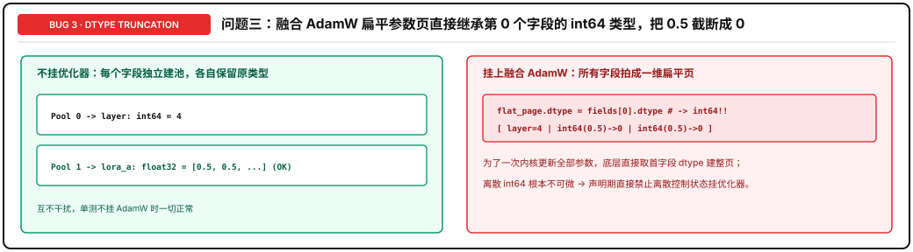
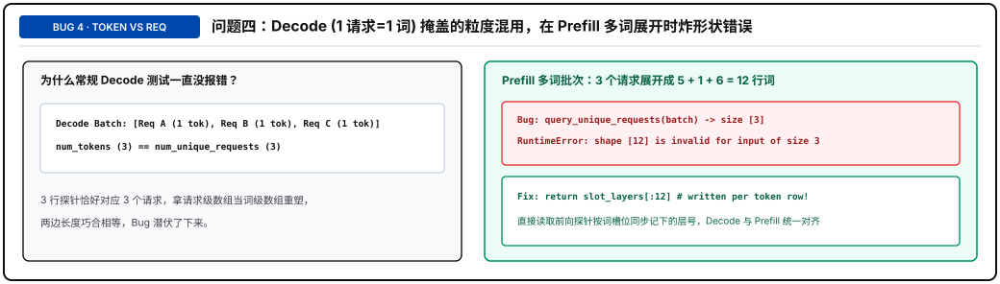
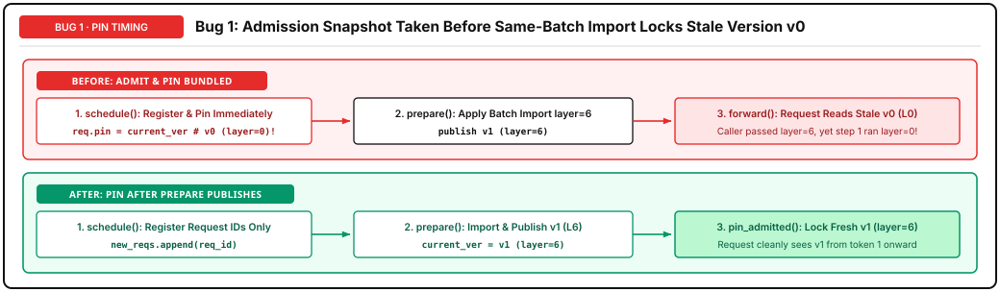
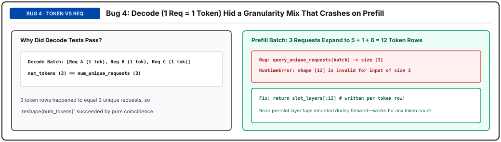

  <a class="zine-pill-link" data-i18n-zh="pLLM 项目主页与文档 →" data-i18n-en="pLLM Project &amp; Docs →" href="/pllm/">pLLM 项目主页与文档 →</a>
  <a class="zine-pill-link" data-i18n-zh="全部博客分类索引 →" data-i18n-en="Blog Categories →" href="/blog/">Blog Categories →</a>

**TL;DR：** 在连续批处理推理引擎中引入运行时可变状态（如动态切层路由、逐请求快权重或在线参数导入），容易出错的地方往往不在单步算子内部，而在跨步、跨请求的生命周期交界处。本文结合动态切层开发中的四次排障，梳理分页张量状态系统（PTTS）与引擎调度器配合时的四项规则：准入快照需在当步前置发布完成后记录；只读观测状态与改写 KV 的状态需分开判定前缀缓存与抢占策略；离散 `int64` 控制字段不宜与扁平化浮点优化器混装在同一状态中；多词导出的层号标签应随物理探针槽位同步记录，而非事后按去重请求重查。

> **pLLM 编译与底层排障手记（4/4 · 多版本状态与连续批处理）** · [pLLM 项目主页与文档](/pllm/) · [专栏与排障索引](/pllm/#blog) · [GitHub 原文 ↗](https://github.com/LinesHogan/pLLM/blob/main/blog/personal/04-mvcc-pins-preemption-and-batch-dedup.md)

在无状态推理引擎中，只要 KV Cache 块表映射正确，一个请求无论是单跑、与别的请求拼成分块预填充加解码的混合批次（Chunked Prefill + Decode），还是因显存不足被换出后重算，得到的激活值都是一致的。

引入可变运行时状态之后——例如通过 `import_state` 在线修改观察或干预的目标层，或者让每个请求持有独立状态并在运行中更新——单步孤立测试里不易触发的时序与维度边界就会在多请求调度循环里显现出来。

开发动态切层时，我们陆续遇到了四个具体问题：

1. **准入快照读到了导入前的旧版本**：负载声明了 `refresh="admission"`（希望请求进场时固定当时的全局层号），调用 `generate(..., batch=StateImport(layer=6))` 随批导入第 6 层。首步前向执行时，逐步刷新的探针读到了新发布的版本 `v1`（第 6 层），而声明为准入锁定的补丁却读到了初始版本 `v0`（第 0 层）；
2. **抢占恢复后用新层重算了旧前缀**：服务初始将全局引导层设为第 2 层，请求 A 生成了 10 个词；随后在线将引导层切到第 4 层，此时 KV 显存不足触发抢占（Preemption），请求 A 的 KV 块被释放；稍后恢复请求 A 时，引擎用第 4 层的参数重新计算了前 10 个词的 KV 历史；
3. **挂载优化器后浮点初值被截断为零**：将控制层号 `layer: int64` 与低秩因子 `a, b: float32` 放在同一个状态中，用初始化函数填入 `0.5` 并配置 `optimizer=AdamW(lr=1e-3)`；初始化完成后读回 `a` 和 `b`，数值全变成了 `0`；
4. **开启 `tokens="all"` 导出多词预填充时形状报错**：单步解码导出正常，但对包含 3 个请求、共 12 个词的预填充批次执行 `tokens="all"` 导出时，框架报出 `RuntimeError: shape '[12]' is invalid for input of size 3`。

这四个问题最终都指向状态版本管理与连续批处理调度时间线的衔接细节。

---

在 pLLM 内部，可变状态由分页张量状态系统（PTTS）统一管理：每个字段对应一块固定基地址的显存槽池，每次更新分配新槽位并发布递增的不可变版本引用（`StateRef`），读取方通过持有凭证（`PagePin`）无锁读取，使用完毕后通过 CUDA Event 异步归还。下面按一次推理步的时间线逐一还原上述四个问题的成因与处理方式。

**第一处：准入快照（Admission Pin）记录的时机。**

为什么随批传入了 `StateImport(layer=6)`，准入锁定的读者在首步却读到了旧版本 `v0`？对照单步启动时的调用顺序就能看到原因：

{: style="display: block; max-width: 100%; height: auto; margin: 1.5rem auto;" }

最初实现时，“登记新请求谱系”和“为全局实例状态记录准入快照”合并在同一个 `admit()` 调用里，发生在第 1 步 `schedule()`。当没有随批导入时，版本号不会在 `request.prepare` 变化；但当调用附带了 `StateImport` 或存在前置写入任务时，新版本 `v1` 要到第 2 步推进完 `request.prepare` 锚点后才正式发布。

将这两步拆开即可修正：`schedule()` 阶段仅建立请求谱系（`pin_instances=False`），等到 `begin()` 完成 `request.prepare` 阶段的所有前置导入与状态发布后，再调用 `pin_admitted()` 为本步新准入的请求记录 `InstanceState` 快照。

顺着这个边界再往下看一层：如果用户对请求级状态 `RequestState` 声明了 `refresh="admission"`，同时又定义了每步修改该状态的 `@pllm.write` 任务，或者使用了不含 `request_id` 的共享键（如 `key_fields=("sample_index",)`，后到达的在线请求可能覆盖同键槽位），由于系统只为全局共享的 `InstanceState` 维护逐请求准入快照，不为 `RequestState` 额外保留多版本历史，运行中该请求就会读到更新后的值，偏离 `refresh="admission"` 的预期语义。因此我们在编译检查期直接识别这类组合并给出明确的报错提示，引导改用 `refresh="step"` 或包含 `request_id` 的独立键。

---

**第二处：只读观测与改写 KV 在前缀缓存和抢占重算上的区分。**

第二个问题涉及自回归模型的 KV Cache 因果一致性。

当动态切层使用默认的 `refresh="step"` 时，采用的是只作用于后续前向（Forward-only KV）的语义：前 10 步路由指在第 2 层，生成的 K/V 已经写入物理块；第 11 步通过 `import_state` 切到第 4 层后，历史前 10 个词的 KV 保持不变，从第 11 个词起按第 4 层继续生成。这样无需为每个在途请求锁定历史参数副本，状态页开销保持常数级。

但如果中途发生显存不足引发的抢占（Preemption），调度器会回收请求 A 前 10 个词的 KV 块，稍后将“Prompt + 已生成的 10 个词”重新送入前向以恢复 KV：

{: style="display: block; max-width: 100%; height: auto; margin: 1.5rem auto;" }

因为系统并未记录每个请求在历史每一步分别用过哪一层参数，重算无法还原混合层号的历史轨迹。对此，需要将包含可变共享状态且作用在模型层上的负载归入 `preemption="reset"`，并在检测到状态无法从初值重放时主动抛出运行时错误中止，提示调高 KV 显存水位或减小最大并发数，避免静默产出不一致的上下文（使用共享键 `key_fields=("sample_index",)` 做在线导入时同理）。

反过来，如果某个 `LayerRoute` 仅用于读取隐藏态或层间 logits（如只挂载了 `route.residual()` 配合 `@pllm.export`），完全没有挂载 `patch` 或 `adapter` 修改模型计算，那么无论路由切到哪一层，主干模型的 KV Cache 都与原模型一致。初版实现将所有路由状态统一归入了 `model_reads` 集合，导致纯观测负载也被禁止开启前缀缓存（Prefix Caching）。后续我们在后端附件契约中将其拆分为两个集合：`model_reads` 用于管理状态页的持有周期，`kv_model_reads` 专门标记会影响模型 K/V 数值的状态。纯观测路由只进前者不进后者，从而正常兼容前缀缓存与抢占无损重算。

---

**第三处与第四处：优化器的扁平页假设，以及按请求去重与按词展开的维度差异。**

后两个问题分别来自参数池的内存布局约定与导出索引的粒度差异。

在第三个问题中，把 `layer: Field((), int64)` 排在 `a, b: Field(..., float32)` 前面并配置 `AdamW` 后，浮点初值之所以变成 `0`，是因为底层 `declare_parameters` 对两类状态采用了不同的建池方式：无优化器的普通状态按字段各自独立建池，不同字段的数据类型互不影响；而带 `AdamW` 的状态为了用单次融合 `paged_adamw` 内核更新全部可训练参数，会将所有字段拼成一块一维扁平张量 `parameters`（动量 `exp_avg` 与 `exp_avg_sq` 按同样总长度分配），并直接取第 0 个字段的类型 `fields[0].dtype` 作为整块合并页的数据类型：

{: style="display: block; max-width: 100%; height: auto; margin: 1.5rem auto;" }

离散的 `int64` 层号本身不可微，也不适合参与 `AdamW` 动量更新。在声明校验阶段直接拒绝为 `LayerRoute` 控制状态配置优化器（提示将离散控制状态与可训练权重状态分开声明），即可避免这类混装截断。

第四个问题——`tokens="all"` 导出预填充多词批次时报 `shape '[12]' is invalid for input of size 3`——源于混用了“按请求去重”与“按词展开”两种索引粒度。解码步里每个请求只占 1 个词，请求数与词行数相等；而在预填充步里，3 个请求可能合计展开为 `5 + 1 + 6 = 12` 行词。初版导出逻辑在后处理阶段调用 `_core.select_states` 去查状态槽，而该函数返回的是去重后的 3 个请求状态下标，不能直接重塑为 12 行：

{: style="display: block; max-width: 100%; height: auto; margin: 1.5rem auto;" }

去掉事后重查状态池的逻辑，直接读取前向拷贝探针时同步写入的 `_slot_layers` 数组后，无论是单步解码、多词分块预填充，还是超过 32 KiB 时的自动分片导出，行数与采样时刻的层号都能保持一致。

---

回顾这四处问题，一个挺实用的开发体会是引入独立的交叉代码审查。编写者自己的测试用例容易顺着预期的正常用法设计（例如单步验证、习惯性把权重字段写在前面、每次导入只测紧接着的一步）；而在这次开发中，我们让未参与编码的审查模型（`gpt-6.2-astra`）在只读环境下对照契约边界编写最小 CPU 探针——比如同时声明 `InstanceState` 与 `RequestState` 检查首步准入版本号、把 `int64` 字段放在 `AdamW` 首位检查内存快照、以及在导入后连续推进多步解码验证状态保持。上述四处问题均在合入前由几十行 CPU 探针提前复现定位。

这套状态生命周期与动态切层机制目前已合入 **[pLLM](https://github.com/LinesHogan/pLLM)**。在整体取舍上，PTTS 通过固定基地址版本页与显式的 `admission` / `step` 两档刷新策略实现了图内无锁读取和可计算的显存上界；相应的约束是，只要负载在请求生成中途修改了会影响主干 KV 的共享状态，就需要关闭前缀缓存，并预留充足的 KV 缓存空间以避免触发抢占重算。

**TL;DR:** Once a continuous-batching inference engine adds mutable runtime state—dynamic layer routing, per-request fast weights, or online parameter imports—bugs tend to surface along cross-step and cross-request lifecycle seams instead of inside individual kernels. Drawing on four debugging sessions from building dynamic layer routing, this note lays out four rules for pairing a Paged Tensor State System (PTTS) with a continuous-batching scheduler: record admission pins only after the step's pre-forward publications settle; separate read-only observation state from KV-mutating state when gating prefix caching and preemption; keep discrete `int64` control fields out of flat floating-point optimizer pages; and record exported layer tags alongside physical tap slots instead of re-querying deduplicated request indices after the fact.

> **pLLM Debugging Postmortems (4/4 · MVCC & Continuous Batching)** · [pLLM Project & Docs](/pllm/) · [Series & Postmortems Index](/pllm/#blog) · [GitHub Source ↗](https://github.com/LinesHogan/pLLM/blob/main/blog/personal/en/04-mvcc-pins-preemption-and-batch-dedup.md)

In a stateless inference engine, as long as the KV-cache block table maps correctly, a request produces the same activations whether it runs solo, rides inside a mixed chunked-prefill-plus-decode batch, or gets evicted under memory pressure and recomputed later.

Introduce mutable runtime state—updating an observed or intervened layer online via `import_state`, or letting each request carry private state that mutates mid-flight—and timing and shape bugs that never appear in isolated single-step tests emerge quickly inside a multi-request scheduling loop.

While implementing dynamic layer routing, we ran into four concrete failures:

1. **Admission pins captured the pre-import version**: A workload declared `refresh="admission"` (pinning the global layer active when the request enters) and called `generate(..., batch=StateImport(layer=6))` to import layer 6 with the batch. On step 1, a step-refreshed probe saw the newly published version `v1` (layer 6), whereas the admission-pinned patch still read the initial version `v0` (layer 0).
2. **Preemption recomputed old prefixes with the new layer**: The server started with global steering on layer 2, and request A generated 10 tokens. An online update switched steering to layer 4 right before KV-cache memory pressure preempted request A and freed its blocks. When request A resumed, the engine recomputed KV history for the first 10 tokens using layer 4.
3. **Attaching an optimizer truncated float initializers to zero**: Placing a routing field `layer: int64` alongside low-rank factors `a, b: float32` in the same state, filling them with `0.5`, and attaching `optimizer=AdamW(lr=1e-3)` caused `a` and `b` to read back as all `0`s immediately after initialization.
4. **Multi-token prefill export failed with a shape mismatch under `tokens="all"`**: Single-token decode exports worked cleanly, yet running `tokens="all"` on a prefill batch of 3 requests totaling 12 tokens threw `RuntimeError: shape '[12]' is invalid for input of size 3`.

All four traced back to how state versioning meets the continuous-batching scheduler timeline.

---

Inside pLLM, mutable state lives in the Paged Tensor State System (PTTS): each field maps to a fixed-base-address GPU slot pool; every update allocates a fresh slot and publishes an immutable, monotonically increasing version reference (`StateRef`); readers hold a lock-free lease (`PagePin`) and return it asynchronously via a CUDA Event once kernels finish. Walking through one step's timeline exposes all four bugs and their fixes.

**First: when admission pins get recorded.**

Why did an admission-pinned reader see `v0` on the very step that carried `StateImport(layer=6)`? The original step-entry call order gives the answer immediately:

{: style="display: block; max-width: 100%; height: auto; margin: 1.5rem auto;" }

In our initial implementation, registering a new request's lineage and pinning its snapshot of global `InstanceState` were bundled inside a single `admit()` call during step 1 (`driver.schedule()`). Whenever no batch-attached import existed, the version number never changed during `request.prepare`, so the ordering stayed invisible. Once a call passed `StateImport` or ran a pre-forward write task, however, the new version `v1` was only published later inside `driver.begin()` once the `request.prepare` anchor completed—leaving `refresh="step"` readers on `v1` (layer 6) during `model.execute` while `refresh="admission"` readers still held the stale `inference_pin[req]` captured at `v0` (layer 0).

Splitting those two actions fixes the race: `schedule()` creates the request lineage alone (`pin_instances=False`), and `begin()` calls `pin_admitted()` for newly admitted requests only after all `request.prepare` imports and state publications have settled.

Follow that boundary one layer further. Suppose a user declares `refresh="admission"` on a per-request `RequestState`, yet also attaches a per-step `@pllm.write` task mutating that state—or keys it without `request_id` (such as `key_fields=("sample_index",)`, where a later online request can overwrite the same keyed slot). Because PTTS maintains per-request admission pins only for globally shared `InstanceState` and does not keep multi-version history for `RequestState`, the running request would read the updated value mid-generation and silently drift from `refresh="admission"` semantics. We now catch those combinations at compile-time validation with a clear error steering callers toward `refresh="step"` or a key schema containing `request_id`.

---

**Second: separating read-only observation from KV-mutating state for prefix caching and preemption.**

The second bug is about causal consistency in an autoregressive KV cache.

Under its default `refresh="step"` mode, dynamic layer routing follows forward-only KV semantics: tokens 1 through 10 are generated under layer 2 and their keys/values sit in physical blocks; once `import_state` switches routing to layer 4 before token 11, historical KV blocks for tokens 1–10 remain untouched while token 11 onward runs under layer 4. That avoids pinning historical parameter snapshots per in-flight request and keeps state-page overhead constant.

Trouble starts if memory pressure triggers preemption mid-generation. The scheduler evicts request A's KV blocks for tokens 1–10 and later feeds `"prompt + 10 generated tokens"` back through forward to rebuild the cache:

{: style="display: block; max-width: 100%; height: auto; margin: 1.5rem auto;" }

Because the engine never recorded which layer each historical token used, recomputation replays all 10 historical tokens through the current layer 4—building a `KV'[1..10]` that contradicts the premises under which those tokens were sampled. Any workload combining mutable shared state with model-layer intervention therefore belongs under `preemption="reset"`: if preemption occurs and the state cannot be replayed from its initial value, the engine raises a runtime error instead of silently serving inconsistent context, advising the caller to raise KV memory headroom or lower max concurrency. (The same applies to online imports targeting shared keys such as `key_fields=("sample_index",)`.)

The converse matters just as much. If a `LayerRoute` only reads hidden states or intermediate logits—for instance, attaching `route.residual()` with `@pllm.export`, with no `patch` or `adapter` modifying model computation—then the trunk's KV cache matches the unmodified base model regardless of which layer is tapped. Our initial implementation put every routed state into one `model_reads` set, needlessly blocking prefix caching on pure observation workloads. Splitting the backend attachment contract into two sets fixed that over-restriction: `model_reads` governs state-page pin lifetimes, while `kv_model_reads` specifically marks states that affect trunk K/V values. Pure observation routes enter only `model_reads`, staying fully compatible with prefix caching and lossless preemption recomputation.

---

**Third and fourth: the optimizer's flat-page assumption, and request-deduplicated vs. token-expanded indexing.**

The final two bugs came from memory-layout conventions in parameter pools and a granularity mismatch in export indices.

In the third bug, placing `layer: Field((), int64)` ahead of `a, b: Field(..., float32)` with `AdamW` turned float initializers into zeros because `declare_parameters` builds pools differently for optimized and unoptimized states. Plain unoptimized states allocate an independent pool per field, so mixed dtypes never interfere. States with `AdamW`, by contrast, pack every field into one flat 1D `parameters` tensor (allocating matching `exp_avg` and `exp_avg_sq` buffers) so a single fused `paged_adamw` kernel can update all trainable weights in one pass—and they take `fields[0].dtype` as the dtype of that entire merged page:

{: style="display: block; max-width: 100%; height: auto; margin: 1.5rem auto;" }

Because `layer` sat at index 0, the whole merged page was allocated as `int64`; calling `f["a_0"].fill_(0.5)` during initialization wrote into an `int64` view and truncated `0.5` toward zero. A discrete `int64` layer index is neither differentiable nor suited to `AdamW` momentum updates anyway. Rejecting optimizers on `LayerRoute` control states at declaration validation—and prompting users to declare discrete control state separately from trainable weight state—eliminates that truncation trap before any pool is allocated.

The fourth bug—`shape '[12]' is invalid for input of size 3` during `tokens="all"` prefill export—came from mixing request-level deduplication with token-level expansion. On a decode step, each request occupies 1 token, so request count equals token row count. On a prefill step, 3 requests can expand into `5 + 1 + 6 = 12` token rows. Our first export post-processor called `_core.select_states` to look up state slots, which returns 3 deduplicated request-state indices that cannot be reshaped to 12 rows:

{: style="display: block; max-width: 100%; height: auto; margin: 1.5rem auto;" }

Since the forward tap pool already allocates per-token physical slots `dst_slots[0..11]`, recording each row's active layer ID into a companion `_slot_layers[dst_slots]` array during the forward copy removes post-hoc pool lookups entirely. Export simply reads `tap.layers[tap.slots[row]]` per packed row index, keeping row counts and sampled layer IDs aligned across single-token decode, multi-token chunked prefill, and automatic chunked exports above 32 KiB.

---

Looking back across all four bugs, one engineering habit paid off well beyond its cost: bringing in an independent cross-review model. An author's own tests naturally follow the intended happy path—validating a single step, habitually listing weight fields before metadata, or checking an import only on the immediately following step. Here, we had a separate review model (`gpt-6.2-astra`) work read-only against the contract boundaries and write minimal CPU probes: declaring `InstanceState` and `RequestState` side by side to check first-step admission versions, placing an `int64` field first inside an `AdamW` state to inspect the memory snapshot, and advancing multiple decode steps after an import to verify state retention. A few dozen lines of CPU probes reproduced and pinned down all four issues before merge.

This state-lifecycle and dynamic layer-routing mechanism is now merged into **[pLLM](https://github.com/LinesHogan/pLLM)**. On the system trade-off: fixed-base-address version pages paired with explicit `admission` and `step` refresh modes give PTTS lock-free in-graph reads and a predictable GPU memory ceiling. The corresponding constraint is straightforward: whenever a workload mutates shared state that alters trunk KV values mid-generation, prefix caching has to stay off and the KV cache needs enough headroom to avoid preemption recomputation.

